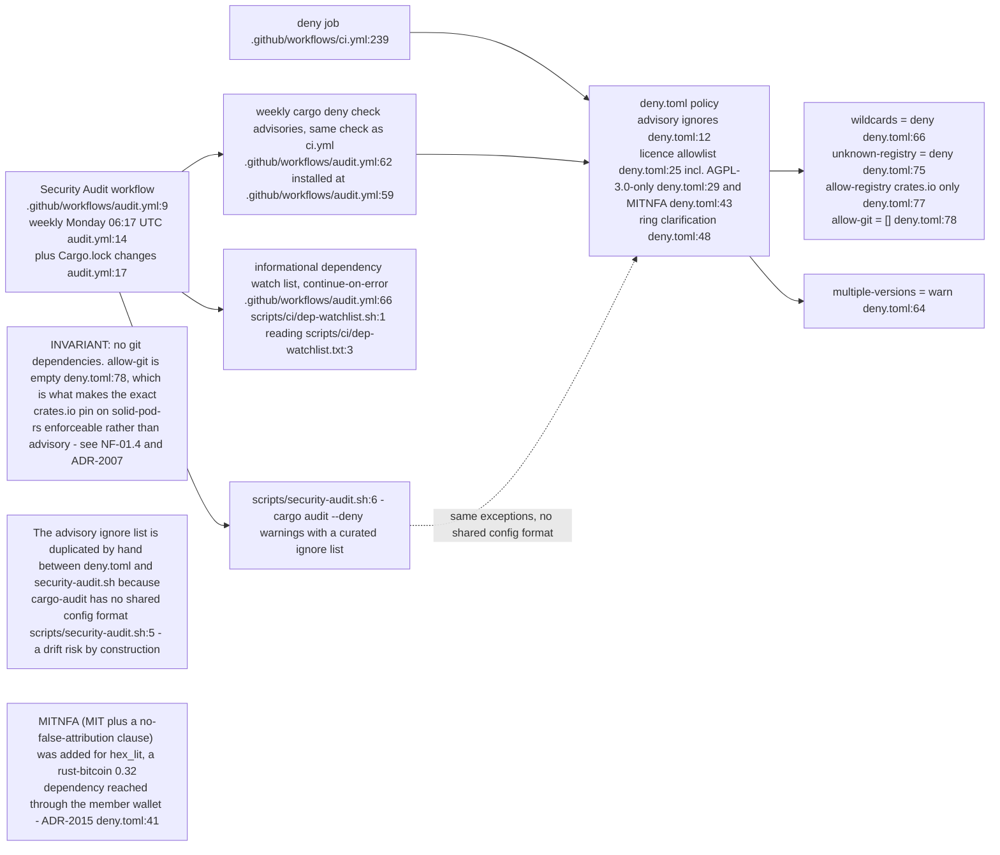
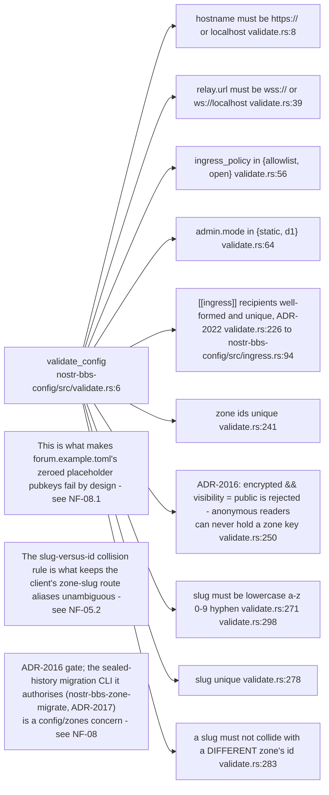
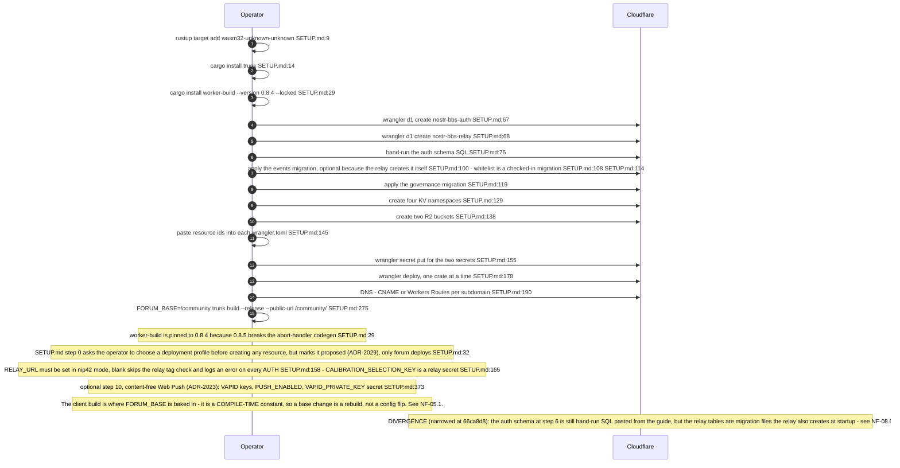
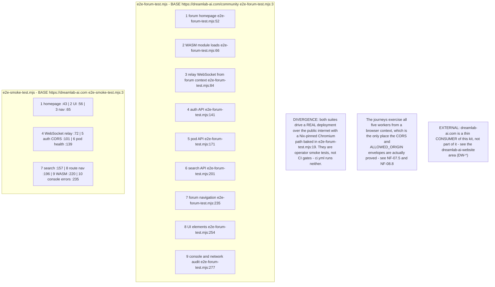
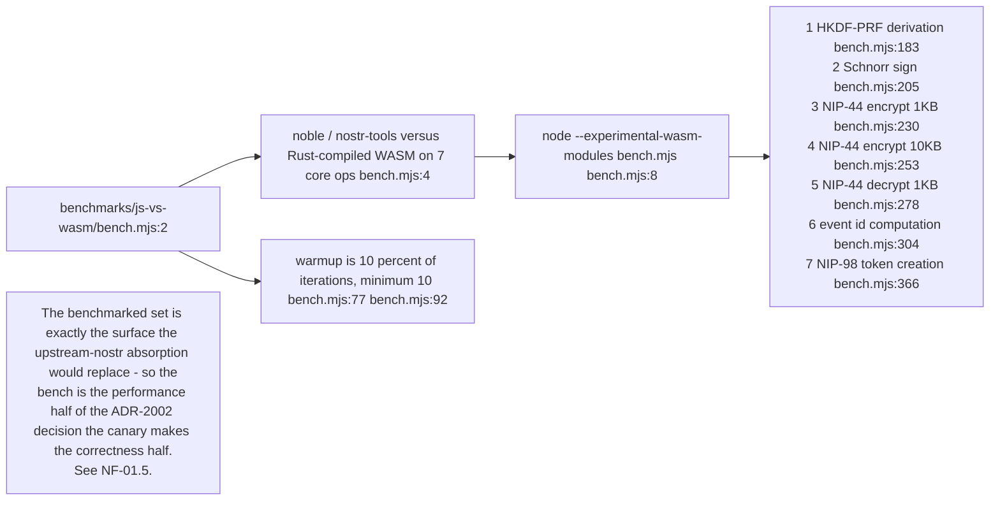
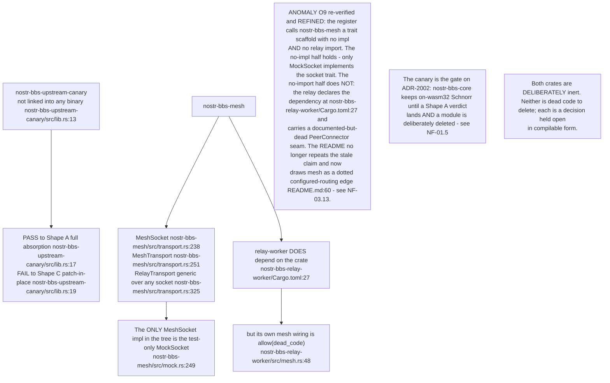

## NF-09.1 The CI gate graph

```mermaid
flowchart TB
    subgraph gates["Eight required jobs"]
        FMT["fmt - cargo fmt --all --check<br/>.github/workflows/ci.yml:70 .github/workflows/ci.yml:80"]
        CLIP["clippy - workspace, all targets, all features, -D warnings<br/>.github/workflows/ci.yml:86 .github/workflows/ci.yml:98"]
        TEST["test - cargo test --workspace --all-targets --all-features<br/>.github/workflows/ci.yml:104 .github/workflows/ci.yml:114"]
        SEC["test-security - six security-critical crates re-run alone<br/>.github/workflows/ci.yml:136 .github/workflows/ci.yml:148"]
        WASM["wasm32 check - cargo check --workspace --target wasm32-unknown-unknown<br/>.github/workflows/ci.yml:171 .github/workflows/ci.yml:188"]
        DOC["doc - cargo doc --workspace --no-deps<br/>.github/workflows/ci.yml:194 .github/workflows/ci.yml:206"]
        COV["coverage - cargo llvm-cov lcov artefact<br/>.github/workflows/ci.yml:211 .github/workflows/ci.yml:227"]
        DENY["deny - cargo deny check<br/>.github/workflows/ci.yml:239 .github/workflows/ci.yml:258"]
    end
    DG["drift-gates - ninth job, deliberately NOT a required gate<br/>.github/workflows/ci.yml:276, runs identity-vector parity .github/workflows/ci.yml:293<br/>and the anti-drift lint .github/workflows/ci.yml:296"]
    PASS["ci-pass - the single branch-protection target named CI required<br/>.github/workflows/ci.yml:303 .github/workflows/ci.yml:306"]

    FMT & CLIP & TEST & SEC & WASM & DOC & COV & DENY --> PASS
    DG -.->|"absent from the ci-pass needs list .github/workflows/ci.yml:306-314"| PASS

    N1["The test job also validates the shipped configuration contract by running the kit's own validator<br/>over forum.example.toml .github/workflows/ci.yml:121"]
    N2["The security crates re-run is nostr-bbs-core, relay-worker, pod-worker, auth-worker, preview-worker<br/>and config .github/workflows/ci.yml:150 through .github/workflows/ci.yml:155"]
    N3["The wasm32 job installs libc6-dev-i386 so the secp256k1-sys cross-compile succeeds<br/>.github/workflows/ci.yml:185 - which is why it can check the WHOLE workspace, not the three crates<br/>workspace.metadata.ci.wasm-check-packages names nostr-rust-forum/Cargo.toml:72. See NF-01.2."]
    N4["ci-pass iterates every job result and fails the aggregate unless all succeeded<br/>.github/workflows/ci.yml:329"]
    N6["The drift job needs no Rust toolchain, checks out agentbox read-only into _agentbox so the JS derivation is pinned to the real call sites<br/>.github/workflows/ci.yml:281-284, and runs only when its scripts or fixtures change - the push and PR path filters name them<br/>.github/workflows/ci.yml:33-35 .github/workflows/ci.yml:272-273"]
    N5["INVARIANT: no toolchain pin, by owner decision 2026-10-02 R8 - the forum floats on stable rust-toolchain.toml:2<br/>under -D warnings so every release is taken the day it ships BASELINE-architecture.md:244-246. Recovery when a new<br/>lint fires on code we do not own: a scoped per-item allow(clippy::lint) naming the cause, as rustc 1.99 needed on<br/>every async_trait trait - nostr-bbs-mesh/src/transport.rs:236 transport.rs:249 nostr-bbs-setup-skill/src/lib.rs:71<br/>nostr-bbs-relay-worker/src/mesh.rs:141 - never a crate-wide allow, never a pin"]
    CLIP -.- N5
    DG -.- N6
```

## NF-09.2 Supply-chain policy

## NF-09.3 Repository scripts

```mermaid
flowchart TB
    ADR["adr-index-gen.js:5 - walk the ADR tree, validate frontmatter, regenerate README index"]
    DRIFT["anti-drift-lint.sh:2 - ADR-077 P3: reject SUPERSEDED Schnorr verification-key identifiers<br/>after the ADR-125 did:nostr Multikey convergence anti-drift-lint.sh:5"]
    PARITY["identity-vector-parity.mjs:3 - the JavaScript half of the ADR-2003 parity proof,<br/>loading the SAME versioned fixture as the Rust suite identity-vector-parity.mjs:6"]
    PKG["package-repo.sh:2 - package code + metadata into one review blob, ~800K tokens package-repo.sh:4"]
    SEC["security-audit.sh:6 - cargo audit with the curated ignore list"]
    SYNC["sync-fixtures.sh:4 - ADR-082 D5: clone VisionClaw, copy tests/fixtures, write a CHECKSUM"]
    VAL["validate-forum-config.sh:7 - run the kit's own nostr-bbs-config validator binary"]

    N1["INVARIANT ADR-2003: derive_subkey is a BYTE-FOR-BYTE cross-stack contract with agentbox's JS<br/>mirror derivation. The Rust half is the known-answer vector nostr-bbs-core/src/keys.rs:478 with the<br/>expected digest at nostr-bbs-core/src/keys.rs:483; the JS half is identity-vector-parity.mjs. Both read<br/>ONE fixture, so they cannot drift. EXTERNAL: see AB-11 and ES-04."]
    N2["Both anti-drift-lint.sh and identity-vector-parity.mjs are now wired into CI by the drift-gates job<br/>.github/workflows/ci.yml:293 .github/workflows/ci.yml:296, but outside the required ci-pass set .github/workflows/ci.yml:306-314.<br/>validate-forum-config.sh runs inside the required test job .github/workflows/ci.yml:121"]
    N3["Fixtures come FROM VisionClaw, so a fixture-suite change there is an unversioned input here -<br/>EXTERNAL: see the VisionClaw area (VC-*)"]
```

## NF-09.4 Config validation rules the kit enforces

**Open:** `forum.example.toml` already sets `[deployment] profile = "forum"` and documents `room` as proposed under ADR-2029 (`../nostr-rust-forum/forum.example.toml:31`), but the config validator checks no profile value and no crate source mentions a channel dialect (`../nostr-rust-forum/crates/nostr-bbs-config/src/validate.rs:6`), so the key is read by nothing here.

## NF-09.5 Deploy — the wrangler sequence

## NF-09.6 End-to-end journeys — against production, not a fixture

## NF-09.7 Benchmarks — JS versus WASM on the seven core operations

## NF-09.8 Canary and mesh — the two crates that prove rather than serve

## NF-09.9 The setup-skill provider scaffold

```mermaid
classDiagram
    class Provider {
        tier : nostr-bbs-setup-skill/src/lib.rs:75
        provision : nostr-bbs-setup-skill/src/lib.rs:78
        render_wrangler : nostr-bbs-setup-skill/src/lib.rs:82
    }
    class SelfHostProvider {
        nostr-bbs-setup-skill/src/lib.rs:90 - only provision with real logic
    }
    class CloudflareWorkersProvider {
        nostr-bbs-setup-skill/src/lib.rs:119
    }
    class FlyDotIoProvider {
        nostr-bbs-setup-skill/src/lib.rs:149
    }
    class TurnkeyProvider {
        nostr-bbs-setup-skill/src/lib.rs:177
    }
    class KubernetesProvider {
        nostr-bbs-setup-skill/src/lib.rs:204
    }
    Provider <|.. SelfHostProvider
    Provider <|.. CloudflareWorkersProvider
    Provider <|.. FlyDotIoProvider
    Provider <|.. TurnkeyProvider
    Provider <|.. KubernetesProvider

    note for Provider "DIVERGENCE, self-declared: scaffold only - each impl returns SetupError::NotYetImplemented for unfinished methods nostr-bbs-setup-skill/src/lib.rs:11, e.g. nostr-bbs-setup-skill/src/lib.rs:111 and nostr-bbs-setup-skill/src/lib.rs:130"
    note for TurnkeyProvider "TurnkeyProvider::render_wrangler returns Unsupported by DESIGN, not by omission - a custody-tier provider never writes a wrangler.toml (variant at nostr-bbs-setup-skill/src/lib.rs:48)"
    note for SelfHostProvider "The provider abstraction is a CUSTODY ladder, not a hosting menu - each tier is a different answer to who holds the keys. Tiers are named at nostr-bbs-setup-skill/src/lib.rs:94"
```

