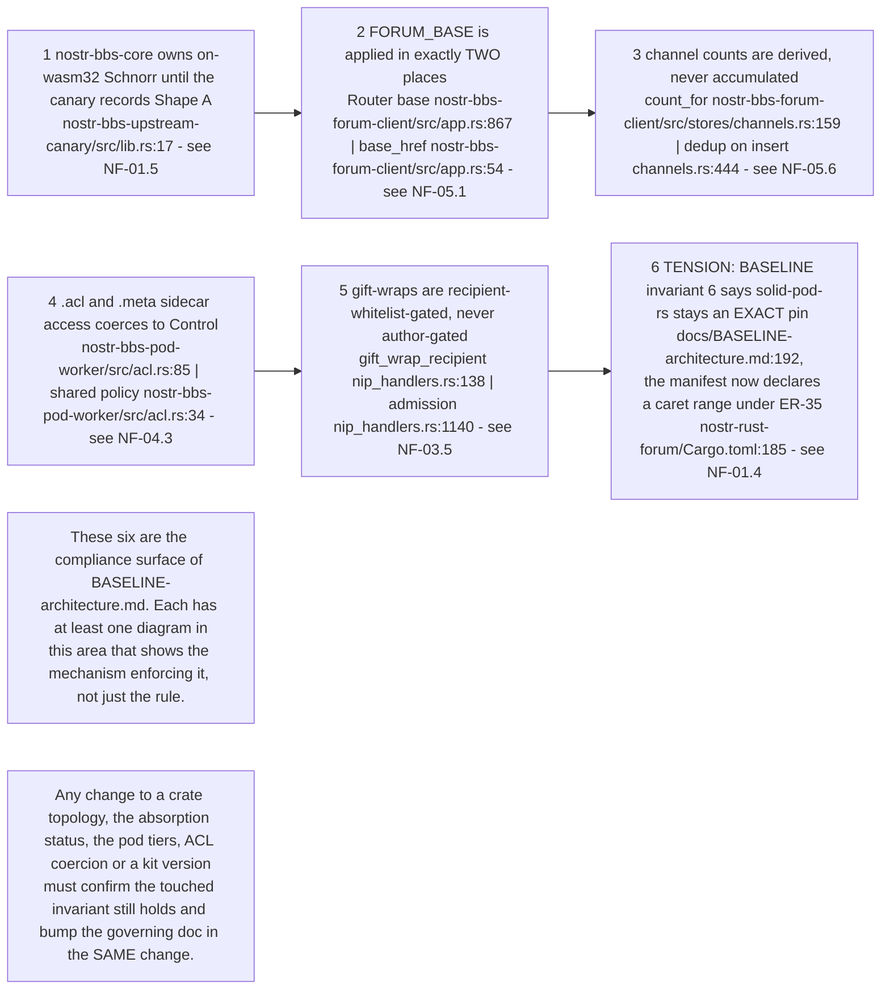
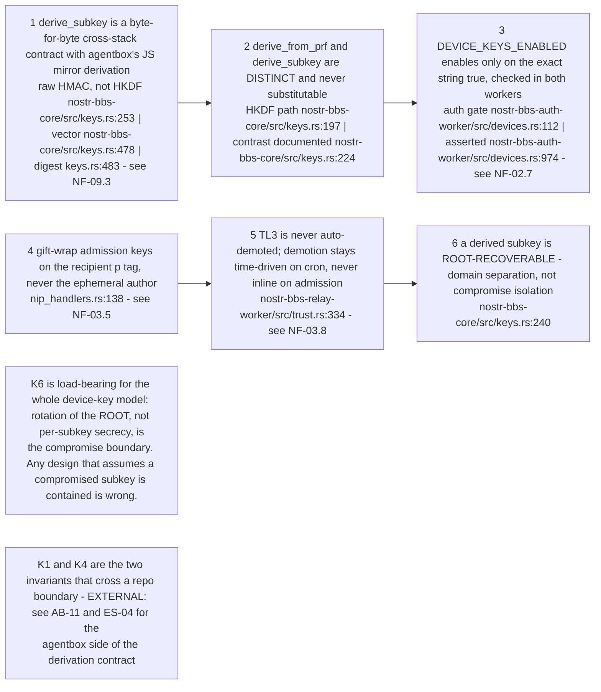
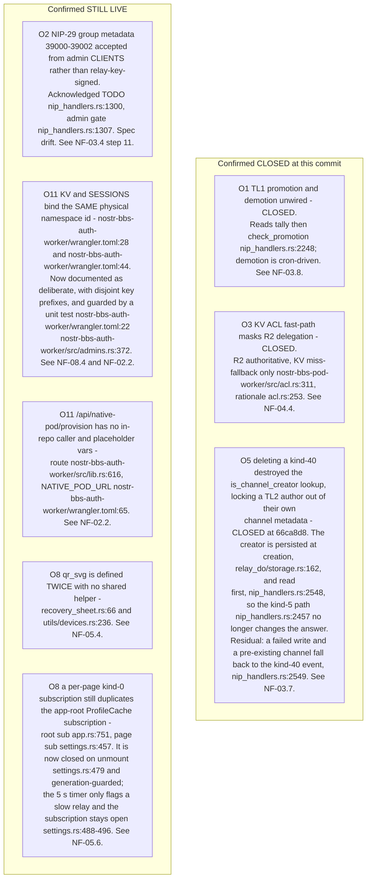
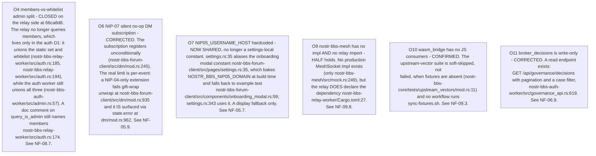
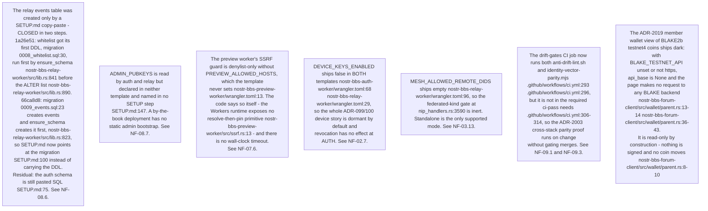
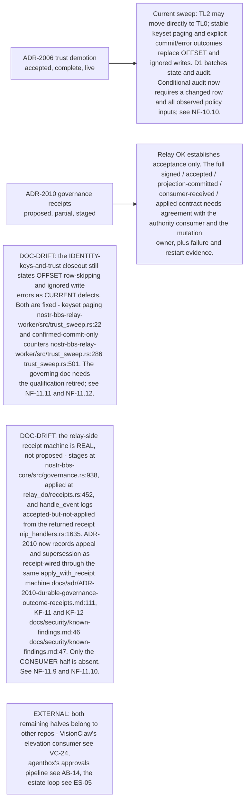
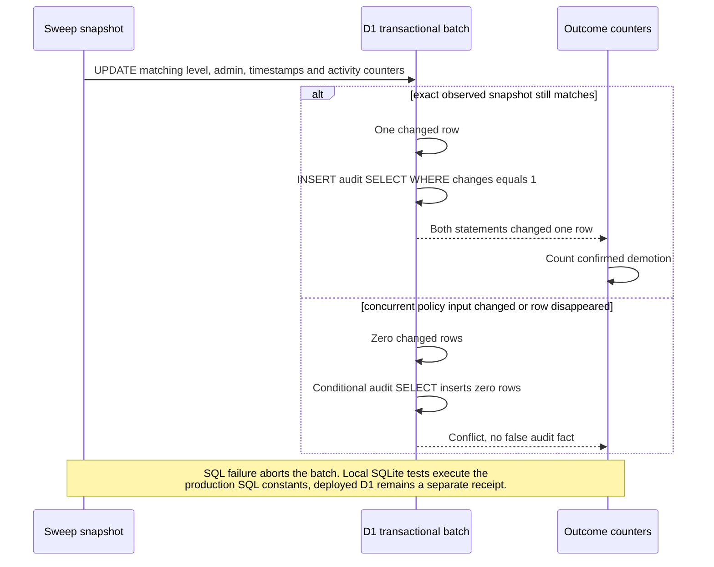
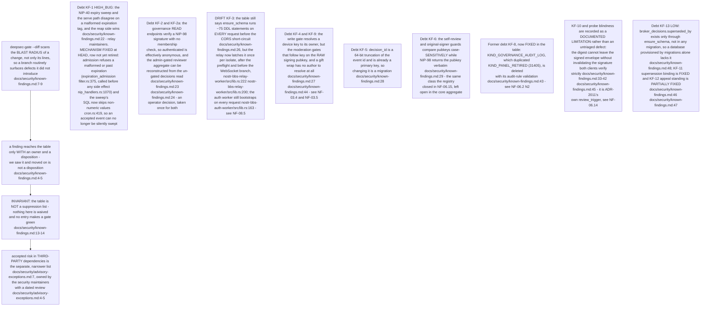
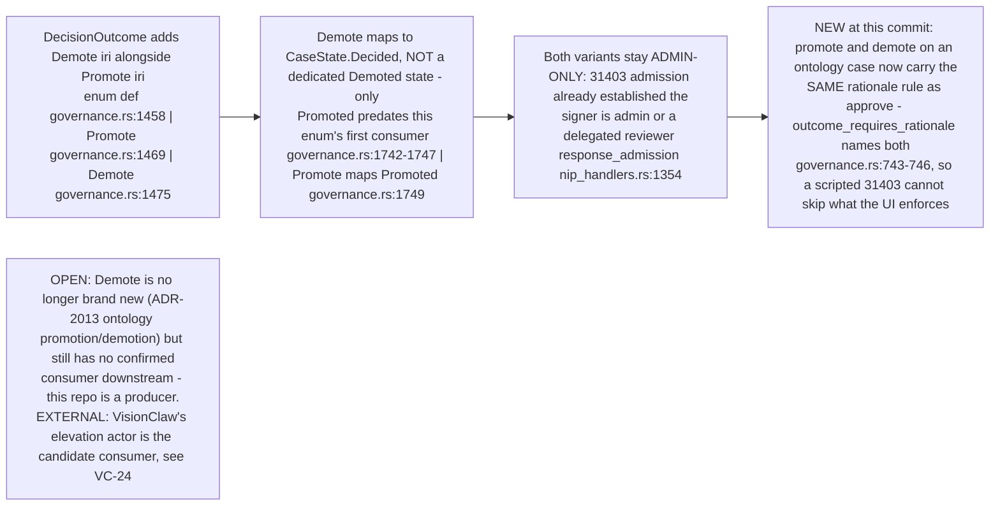

## NF-10.1 The compliance surface — BASELINE-architecture invariants

## NF-10.2 The compliance surface — IDENTITY invariants

## NF-10.3 Anomaly register — closed and still live

## NF-10.4 Anomaly register — refined or corrected by this pass

## NF-10.6 New doc-drift found in this pass

```mermaid
flowchart TB
    DD1["CLOSED by the README rewrite: the Known-gaps row calling NIP-42 AUTH scaffolded with auth_required false is gone<br/>(the README at this stamp carries no scaffolded or planned rows README.md:60). The code is unchanged: nip42 is the DEFAULT nip42.rs:115,<br/>the template ships AUTH_MODE nip42 nostr-bbs-relay-worker/wrangler.toml:39, and every EVENT passes the gate first nip_handlers.rs:1102.<br/>See NF-03.3."]
    DD2["CLOSED by the README rewrite: the row saying nostr-bbs-mesh is NOT a dependency of the relay-worker is gone and the README<br/>now draws mesh as a dotted configured-routing edge README.md:60. nostr-bbs-relay-worker/Cargo.toml:27 declares the dependency. See NF-09.8."]
    DD3["nostr-bbs-relay-worker/wrangler.toml:18 asserts there is no ADMIN_PUBKEYS reader in src/.<br/>nostr-bbs-relay-worker/src/auth.rs:185 reads it, and so does nostr-bbs-auth-worker/src/admin.rs:71.<br/>Only nostr-bbs-search-worker/wrangler.toml:41 declares the var. See NF-08.7."]
    DD4["nostr-rust-forum/Cargo.toml:72 workspace.metadata.ci.wasm-check-packages names three crates (config, preview-worker, jev) and is read by NOTHING -<br/>the wasm job checks the whole workspace .github/workflows/ci.yml:188. Inert metadata. See NF-01.2."]
    DD5["nostr-bbs-upstream-canary/src/lib.rs:10 names a five-NIP build matrix but only three smokes exist<br/>nostr-bbs-upstream-canary/src/lib.rs:35 nostr-bbs-upstream-canary/src/lib.rs:56 nostr-bbs-upstream-canary/src/lib.rs:89 - nip04, nip59 and nip98 are unexercised. The same doc calls the crate<br/>nostr-upstream-canary nostr-bbs-upstream-canary/src/lib.rs:14 while the package is nostr-bbs-upstream-canary. See NF-01.5."]
    DD6["The search-worker cron runs every five minutes and reindexes NOTHING - the handler body is a<br/>load_store warm touch nostr-bbs-search-worker/src/lib.rs:1004. See NF-07.1."]
    DD7["CLOSED in part: KIND_GOVERNANCE_AUDIT_LOG, which was numerically the SAME kind as KIND_PANEL_RETIRED, is deleted and a regression test<br/>keeps the six kinds pairwise distinct nostr-bbs-core/src/governance.rs:2079, KIND_PANEL_RETIRED stays nostr-bbs-core/src/governance.rs:32.<br/>Still open: only three of the six documented ACS types have Rust structs nostr-bbs-core/src/governance.rs:102 nostr-bbs-core/src/governance.rs:1109 nostr-bbs-core/src/governance.rs:1135.<br/>See NF-06.1 and NF-06.2."]
    DD8["docs/consumer-surface-map.md:21 lists the git panel as calling /.well-known/apps; the client fetches<br/>/apps/manifest.json and no .well-known path exists in that crate. See NF-05.10."]
```

## NF-10.7 Deployment-shaped divergences

## NF-10.8 ADR-2006 and ADR-2010 — what the closeout holds open

## NF-10.10 Trust conflicts cannot create an audit fact for an unchanged row

Execution update, 2026-09-07: `trust_sweep.rs` compares every observed policy input using null-safe timestamp/admin predicates. The audit INSERT is conditional inside the transaction; both result counts must equal one. Five exact-SQL trust tests cover concurrent level/activity/admin edits, missing rows, nullable snapshots, rollback and idempotency. The earlier false-audit probe remains in the [audit](../../estate-review/2026-09-07-federation-audit.md); it is not a current-code claim.

## NF-10.11 The security-gate ledger — findings owned rather than silenced

## NF-10.12 New invariant — DecisionOutcome gains Demote, still uncovered downstream

