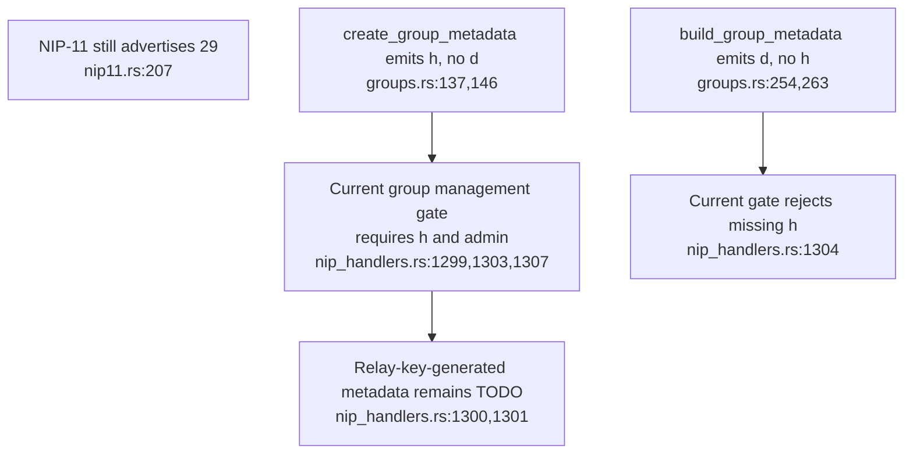
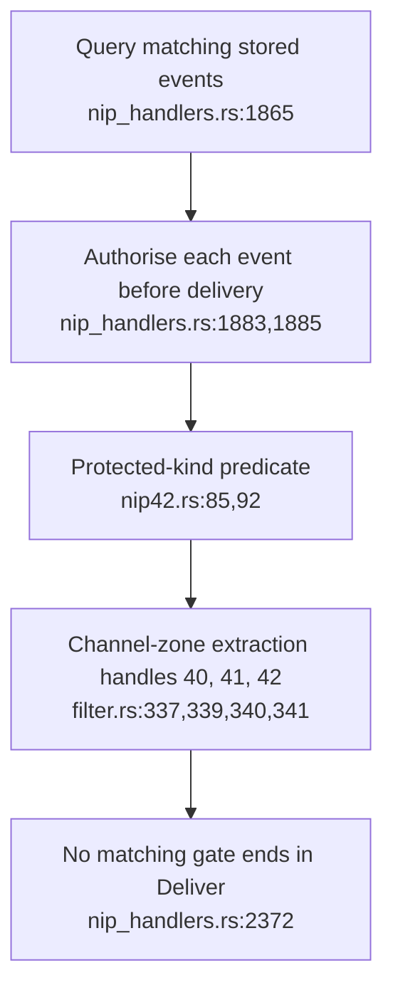
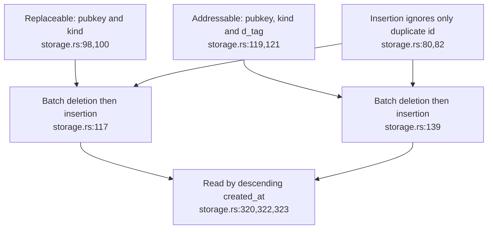

## For developers

The [forum audit](../../estate-review/2026-11-01-forum-spaces-and-replication.md) tests unchanged pure read/filter modules, real signed builders and extracted production SQL in SQLite. Full Worker admission and live sockets were not executed.

## For the business

An advertised protocol and signed events do not establish private group membership. The proposed engine must add authority checks and reliable replacement before spaces depend on it.

## NF-13.1 The advertised protocol has incompatible metadata builders and a legacy gate

**What it shows.** Both builders sign valid events, but only the legacy tag shape satisfies the current group-tag check. **Why it is this way.** The existing admin gate predates the proposed relay-signed group engine; NIP-11 advertisement does not close that gap.

## NF-13.2 Current read protection does not include NIP-29 group membership

**What it shows.** Anonymous group kinds pass the tested pure predicates; correspondence remains protected. **Why it is this way.** Current gates cover other protocols. The proposed on-to-off rollback must preserve protection for any private group data stored after activation.

## NF-13.3 Current replacement deletes older timestamps then inserts by event id

**What it shows.** Real SQLite retains and returns late older rows; same-second rows coexist, and later timestamps erase higher proposed revisions. **Why it is this way.** Revision tags are not part of the current replacement key or comparison. The ADR-2031 migration is still a prerequisite.
