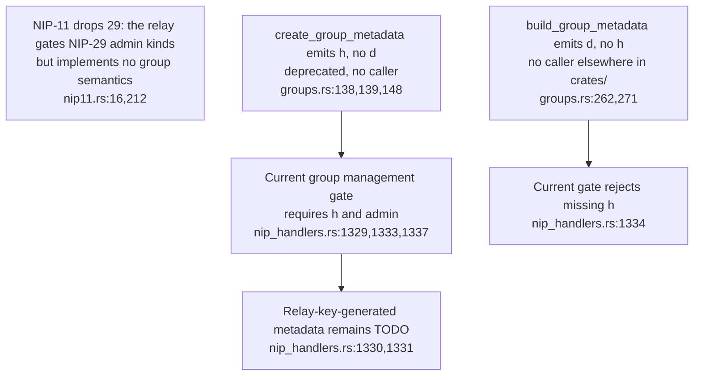
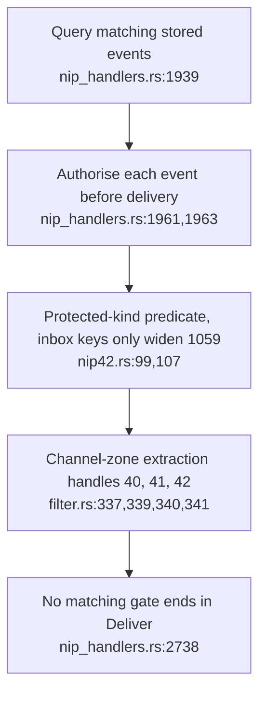
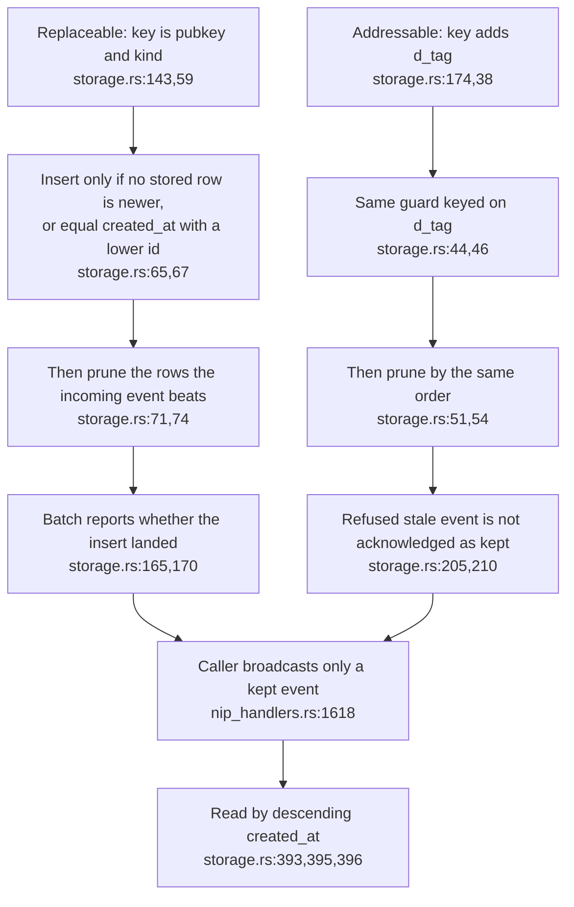

## For developers

The [forum audit](../../estate-review/2026-11-01-forum-spaces-and-replication.md) tests unchanged pure read/filter modules, real signed builders and extracted production SQL in SQLite. Full Worker admission and live sockets were not executed.

## For the business

An advertised protocol and signed events do not establish private group membership. The proposed engine must add authority checks and reliable replacement before spaces depend on it.

## NF-13.1 Neither metadata builder is used, and NIP-11 no longer advertises 29

**What it shows.** Both builders sign valid events, but only the legacy tag shape satisfies the current group-tag check, and the legacy builders are now deprecated as callerless. **Why it is this way.** The admin gate predates the proposed relay-signed engine; the relay stopped advertising NIP-29 because the ADR-2029 room dialect is a-scoped (commit 75e48b4, merged by a80c572).

## NF-13.2 Current read protection does not include NIP-29 group membership

**What it shows.** Anonymous group kinds pass the tested pure predicates; correspondence remains protected. **Why it is this way.** Current gates cover other protocols. The proposed on-to-off rollback must preserve protection for any private group data stored after activation.

## NF-13.3 Replacement now follows the NIP-01 order, still with no revision key

**What it shows.** A late older event is now refused and a same-second tie keeps the lowest id (commit 75e48b4 for addressable kinds, 22ad7e2 for plain replaceable ones). The audit's SQLite result of retained late rows and coexisting same-second rows was measured at the earlier stamp and no longer describes this code; it was not re-run. **Why it is this way.** Revision tags are still not part of the replacement key, so a later timestamp still erases a higher proposed revision; the ADR-2031 migration remains a prerequisite.
