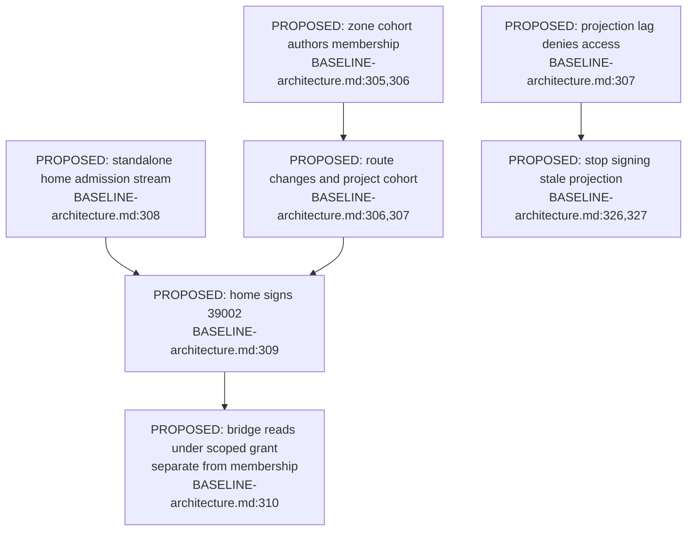
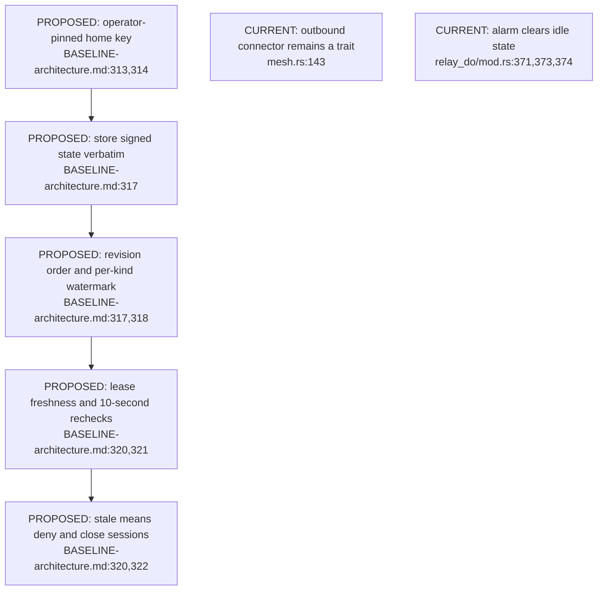
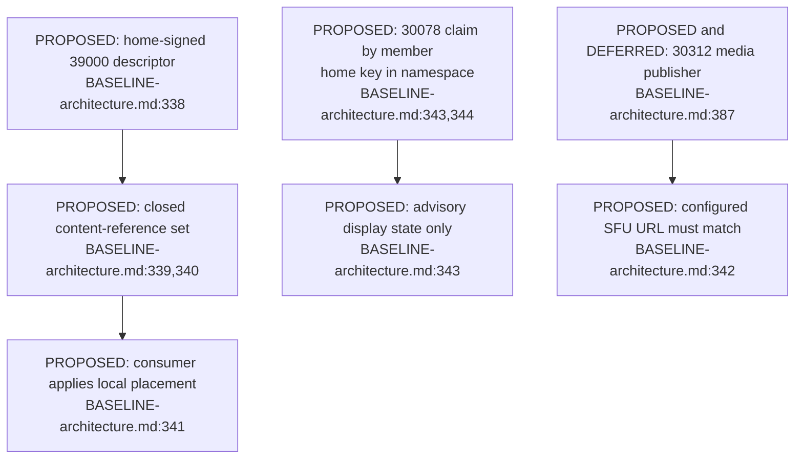

## For developers

All feature nodes below are proposed. The [section audit](../../estate-review/2026-11-01-forum-spaces-and-replication.md) records missing implementation, rollback and parser requirements; voice and its publisher remain explicitly deferred.

## For the business

The intended benefit is one membership decision governing a shared space across clients. Signed freshness, replay protection and confidentiality during outages and rollback must hold together for that benefit to be dependable.

## NF-14.1 Proposed group membership has one source per group

**What it shows.** Zone-backed and standalone groups have different membership sources; both produce a home-signed projection. **Why it is this way.** A second independently editable group roster would diverge from cohort authority. A read grant does not make its holder a member or writer.

## NF-14.2 Proposed mirrors need more than a valid signature

**What it shows.** Authority, order, freshness and ongoing enforcement are separate requirements. **Why it is this way.** The current connector and alarm do not implement this chain. The voice bound is separately disputed by the preceding issuer audit and is not a guarantee of this diagram.

## NF-14.3 Proposed spatial descriptors do not themselves grant access

**What it shows.** Layout, advisory claims and the deferred call publisher serve different purposes. **Why it is this way.** None supplies membership authority. The audit's encoded-dot example requires canonical path validation before the eventual descriptor fetcher is accepted.
