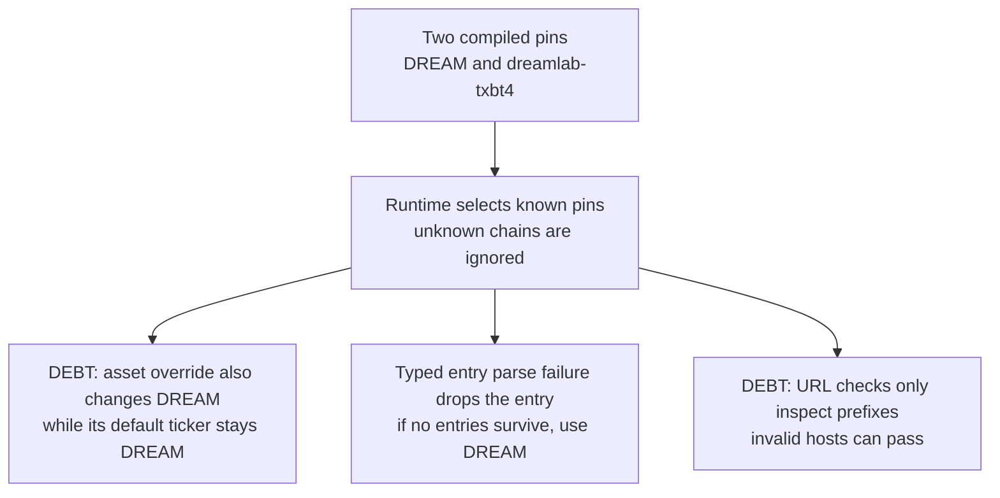
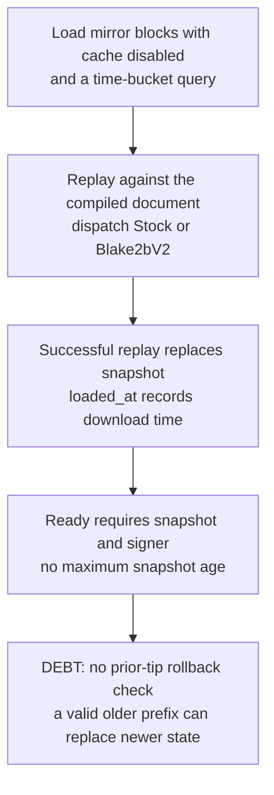
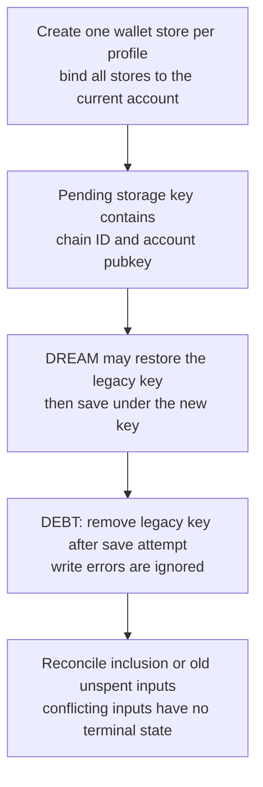
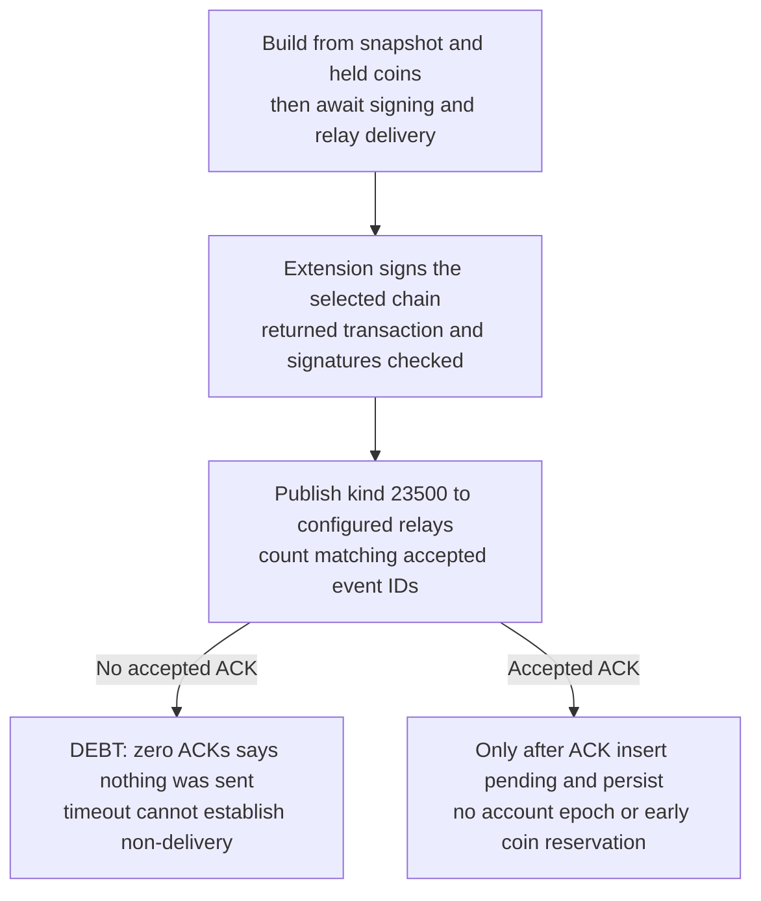
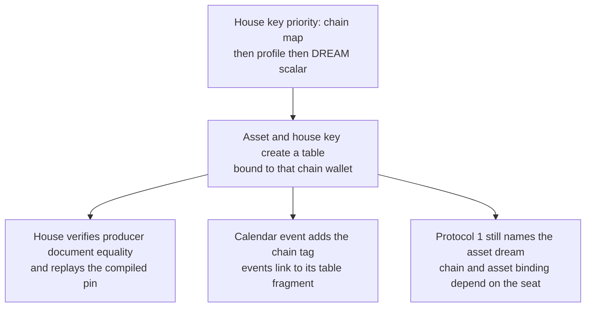
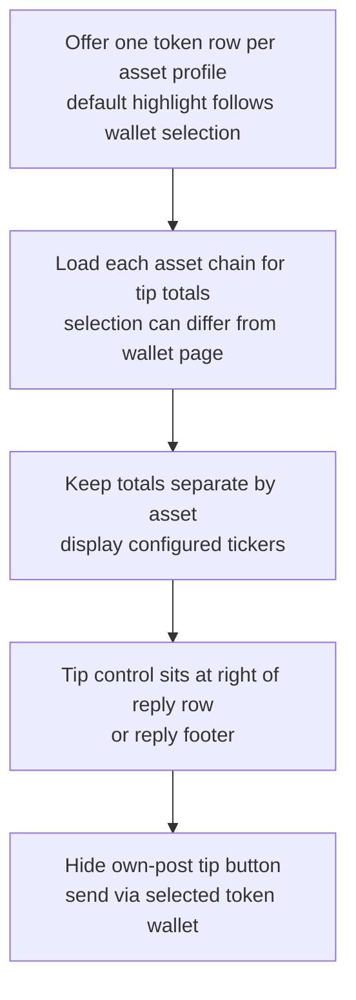

## For developers

These panels follow the website-consumed kit revision. The [section audit](../../estate-review/2026-11-01-forum-multichain-wallet.md) also compares the newer ADR close-out, which changes the activation trigger without changing these decisions.

## For the business

Members can use the same identity on two configured testnet chains. Reliable receipts need a known asset, fresh state and recovery across account changes and interrupted delivery. The compiled chain pins provide only part of that assurance.

## NF-15.1 Profiles choose among compiled chains

**What it shows:** The native cases preserve the no-third-chain boundary but contradict the fixed DREAM asset assertion. A malformed field type can change which chain is offered.
**Why it is this way:** ADR-2021 separates chain trust from deployment settings, but asset identity and malformed configuration need stronger validation.

## NF-15.2 Replay validates history but does not establish freshness

**What it shows:** A native test accepts height 26 and then a valid height-zero prefix. The replacement path is source evidence; this audit did not execute a browser rollback.
**Why it is this way:** A chain pin establishes identity. It does not establish that a mirror supplies the latest state or that its signer is honest.

## NF-15.3 Pending state is partitioned but migration is fallible

**What it shows:** Per-chain keys are implemented. Source inspection finds no successful-write requirement before migration deletion and no conflict-expiry branch.
**Why it is this way:** ADR-2021 preserves old DREAM pending lists. Migration and receipt recovery need explicit success and failure states.

## NF-15.4 Signing and delivery have separate guarantees

**What it shows:** Existing signer tests reject changed transactions and invalid signatures. The late reservation and account association are source-based concurrency concerns, not reproduced browser exploits.
**Why it is this way:** Relay acknowledgement is an intermediate receipt. Persisted intent and coin reservation should precede an operation that may already have reached a peer.

## NF-15.5 Poker binds a table through configuration

**What it shows:** Two correctly configured identities distinguish the current tables. The wire tag alone does not identify a chain or asset; the preceding poker audit covers payment and recovery gaps.
**Why it is this way:** ADR-2021 deliberately retains protocol 1. Configuration validation and a verifiable service capability receipt should guard that compatibility choice.

## NF-15.6 Tips select and display each asset separately

**What it shows:** The consumed client implements the picker, separate totals and own-post hiding. Each asset chain adds a download and replay, and optimistic pending totals remain distinct from confirmed inclusion.
**Why it is this way:** The useful outcome is a recognisable contribution receipt in the conversation. Clear asset identity and payment status matter more than adding another chain.
