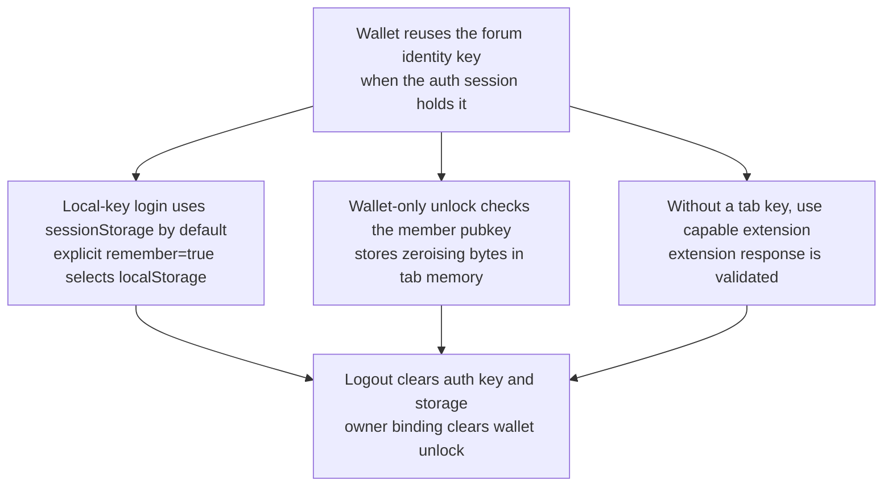
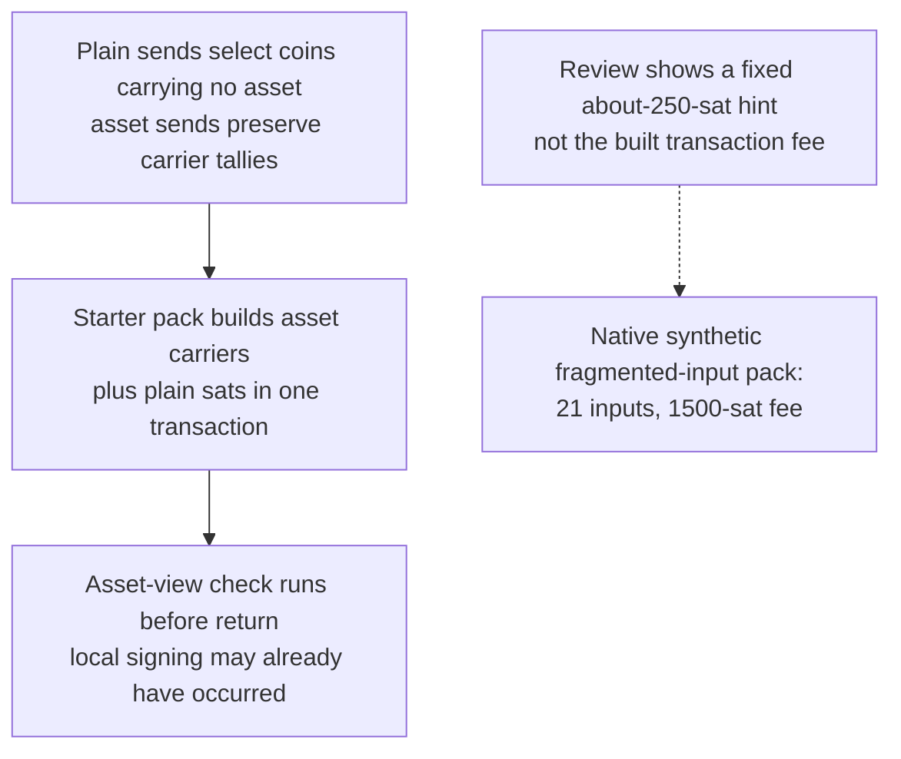
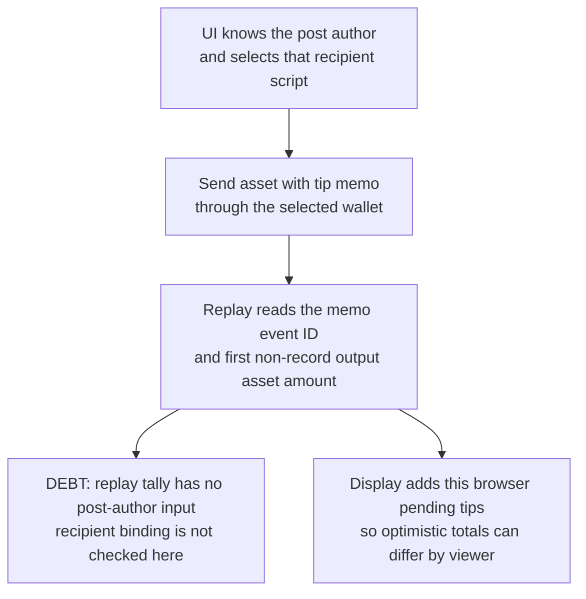
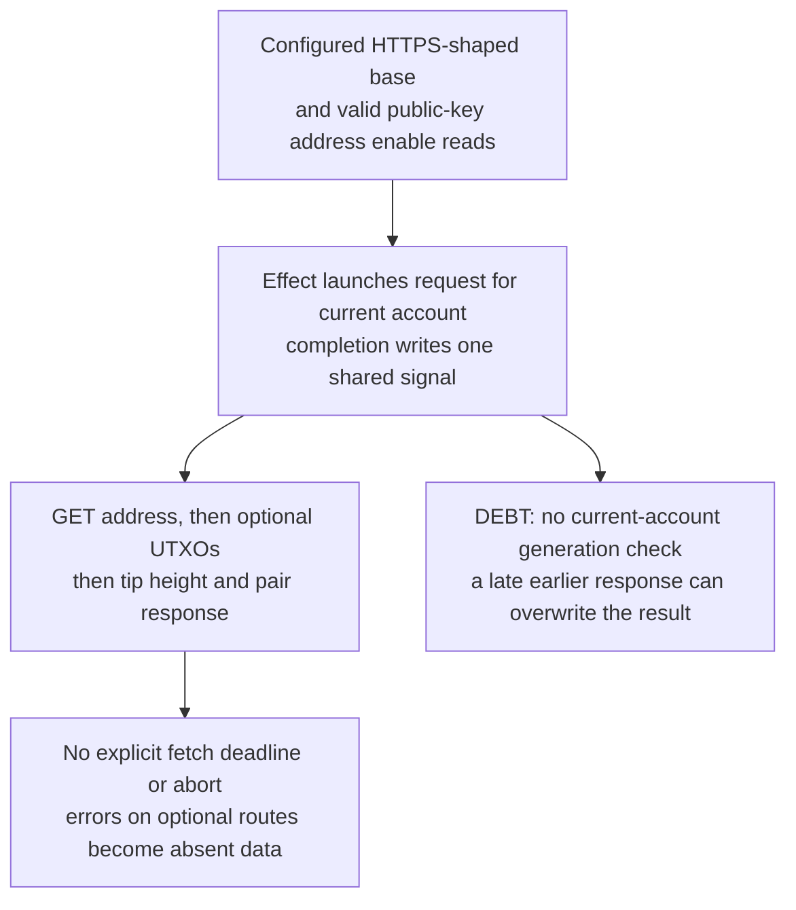
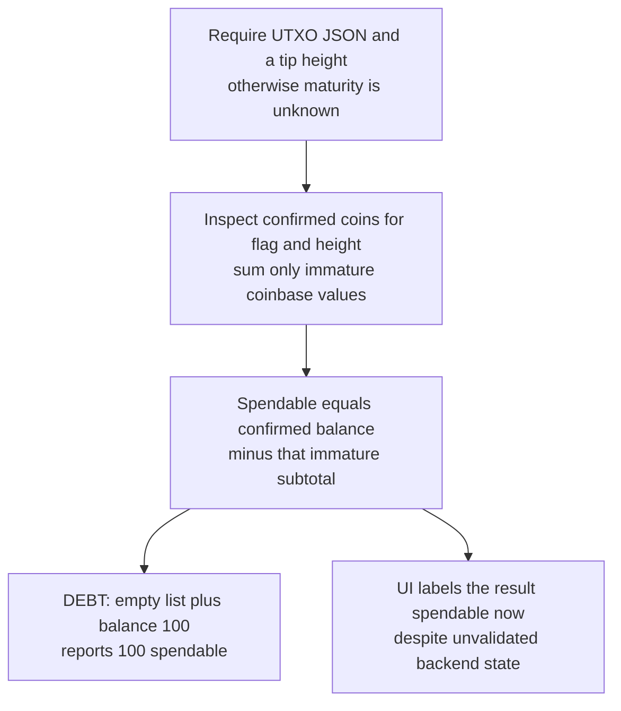
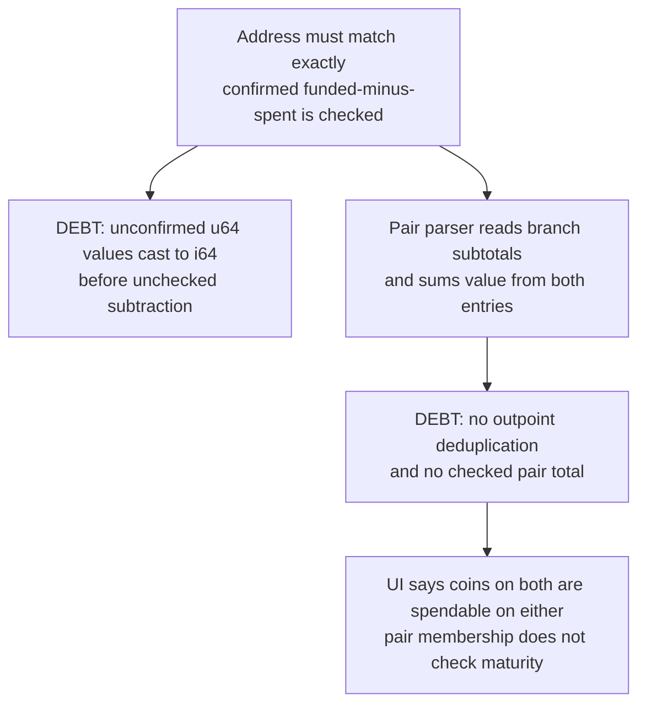

## For developers

The [section audit](../../estate-review/2026-11-01-forum-wallet-foundations.md) distinguishes native parser and fee tests from unexecuted browser interleavings. NF-15 covers multichain pending state and delivery.

## For the business

A recognised forum identity makes receiving testnet tokens convenient. Clear receipts still require the correct recipient, an accurate fee and a balance labelled according to the evidence behind it. The parent card remains an optional read-only backend view.

## NF-16.1 The identity key serves different custody paths

**What it shows:** Auth-key persistence and a wallet-only unlock are different paths. The parent card uses only a public key.
**Why it is this way:** ADR-2015 deliberately reuses identity keys on testnet; it does not introduce an independent spend-key boundary.

## NF-16.2 Asset carriers and the fee preview have different checks

**What it shows:** The actual builder protects carriers, but the confirmation screen uses a constant fee hint. The test is unsigned construction with synthetic coins, not a chain transfer.
**Why it is this way:** A useful confirmation should bind the recipient, amount, selected inputs and actual fee to the transaction later signed.

## NF-16.3 A tip memo identifies a post but does not prove its author was paid

**What it shows:** This is source evidence. A memo-bearing transfer is a candidate receipt; attributing it to an author requires the recipient comparison. No forged tip was broadcast.
**Why it is this way:** ADR-2015 relies on chain records, while D5 overstates uniform displayed totals and does not specify how to bind a transfer to the post author.

## NF-16.4 Parent reads are gated but optional work can delay all results

**What it shows:** The source exposes neither a timeout for optional requests nor an account check at completion. Browser interleavings and stalled HTTP responses were not executed.
**Why it is this way:** ADR-2019 keeps the card read-only and backend-reported. Partial results and response identity still need explicit handling.

## NF-16.5 Maturity classification does not reconcile the complete coin set

**What it shows:** Native tests accept empty and inconsistent UTXO sets and an ordinary coin above the tip. The parser does reject missing flags on present confirmed coins.
**Why it is this way:** Maturity is only one restriction on spending. Reconcile snapshots and preserve unknown when the inputs disagree.

## NF-16.6 Backend shape checking leaves arithmetic and duplicate gaps

**What it shows:** Native fixtures reproduce a negative wrapped cast, two caught debug overflow panics and a duplicated pair coin. Extreme arithmetic inputs test parser hardening, not realistic supply.
**Why it is this way:** A read-only backend contract should reject inconsistent or out-of-range figures before giving them spending language.
