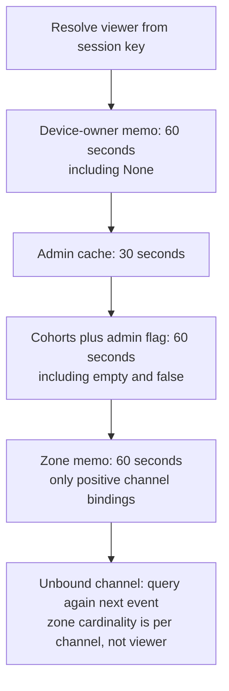
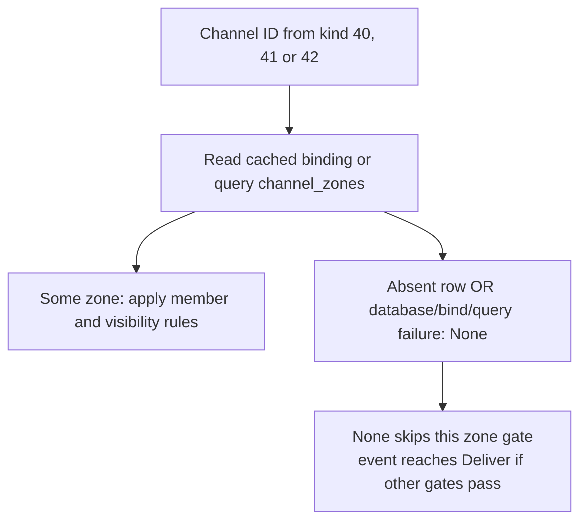
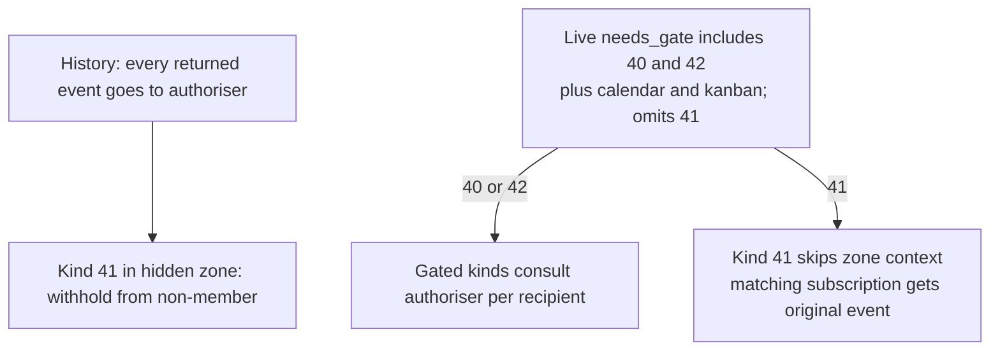
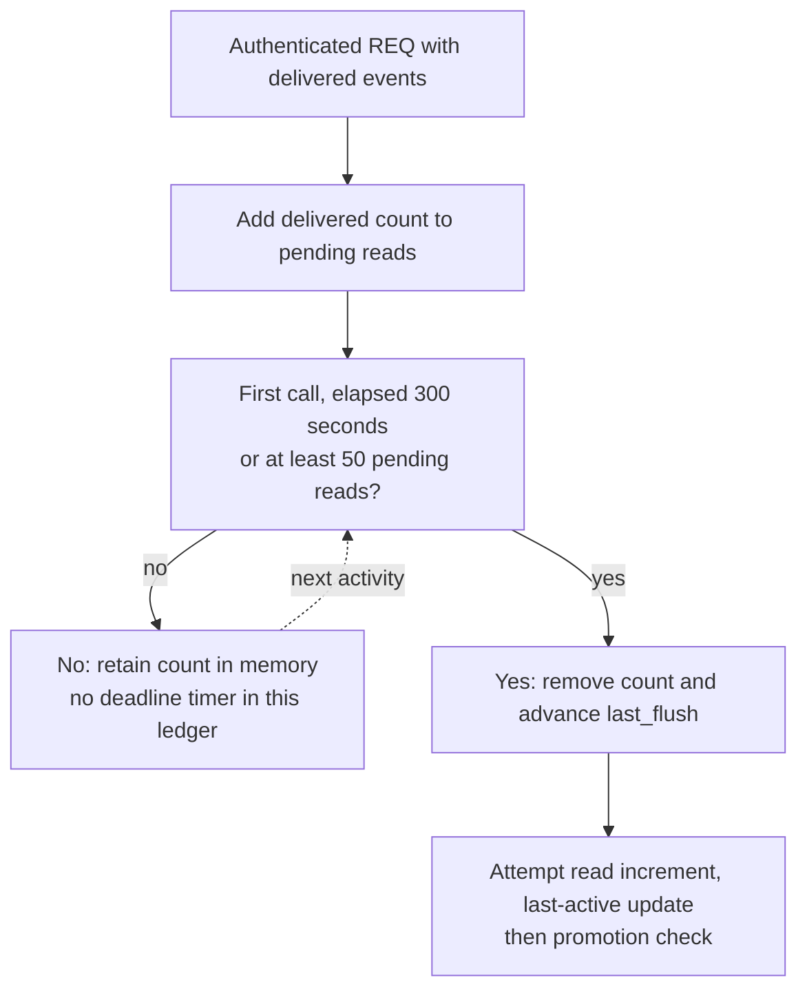
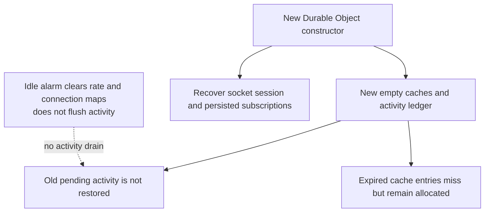
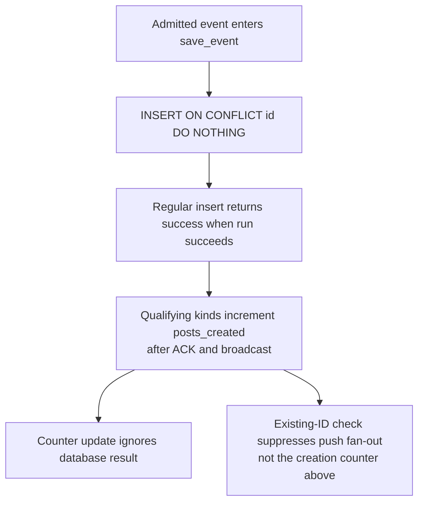

## For developers

The [ADR-2018 section audit](../../estate-review/2026-11-01-forum-read-cache-and-activity.md) separates native counterexamples from source-only failure paths. All cited implementation files match the website-consumed kit pin.

## For the business

The optimisation saves repeated successful lookups. Privacy, activity credit and operating cost still need explicit failure and restart rules; the present code does not establish the ADR's universal cost or five-minute persistence guarantees.

## NF-17.1 Successful cache hits and deliberate misses

Native wrapper tests: one bound channel costs one lookup across 50 calls; an unbound channel or 50 distinct bound channels costs 50. The separate admin flag can remain true through the cohort cache.

## NF-17.2 Missing binding and failed lookup share a public fallback

Source-only failure finding: distinguish unavailable from unbound. A whole-database failure may prevent history retrieval first; this panel concerns an event already available to authorisation.

## NF-17.3 History and live metadata do not share the same dispatch

The unchanged native dispatcher sends kind 41 despite a fixture authoriser that would withhold; kind-40 and kind-42 controls consult the gate and send nothing. This is metadata routing evidence, not a live relay probe.

## NF-17.4 Activity flush is triggered by another call

Native tests retain 49 pending reads through a day of other-user activity. A consumed but unpersisted Flush is not retried; repeated 50-read calls can flush every time at one timestamp.

## NF-17.5 Reconstruction restores different kinds of state

Native reconstruction loses the old pending count; 10,000 expired cache entries remain allocated after misses. These are state-model tests, not actual Cloudflare eviction or resource-exhaustion tests.

## NF-17.6 Post creation counts follow save success, including no-op inserts

Source-only exactness gap: an admitted duplicate can increment the counter again, and a failed update can lose activity. Full admission/rate limits still apply; no duplicate event was published in this audit.
