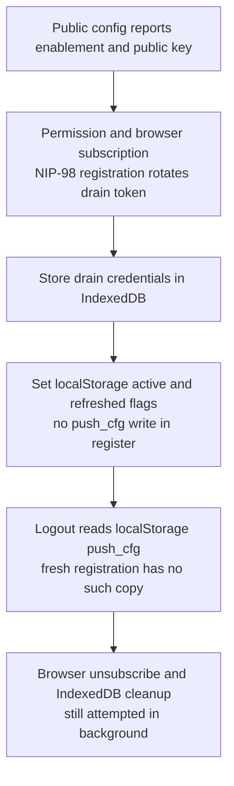
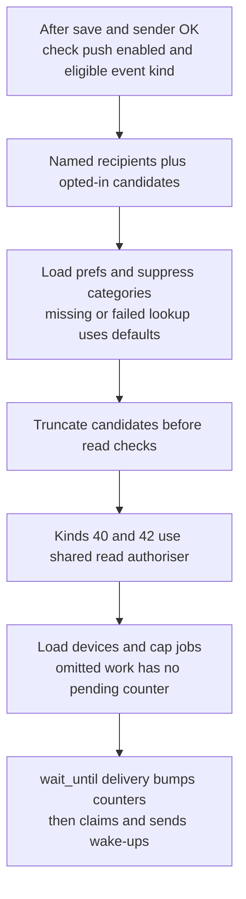
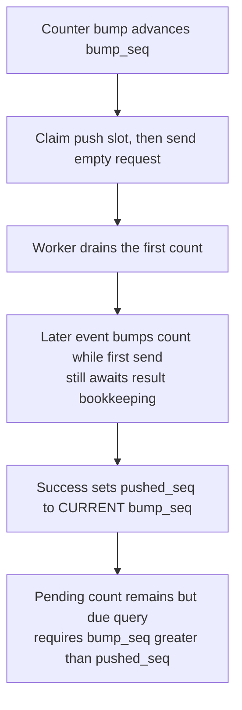
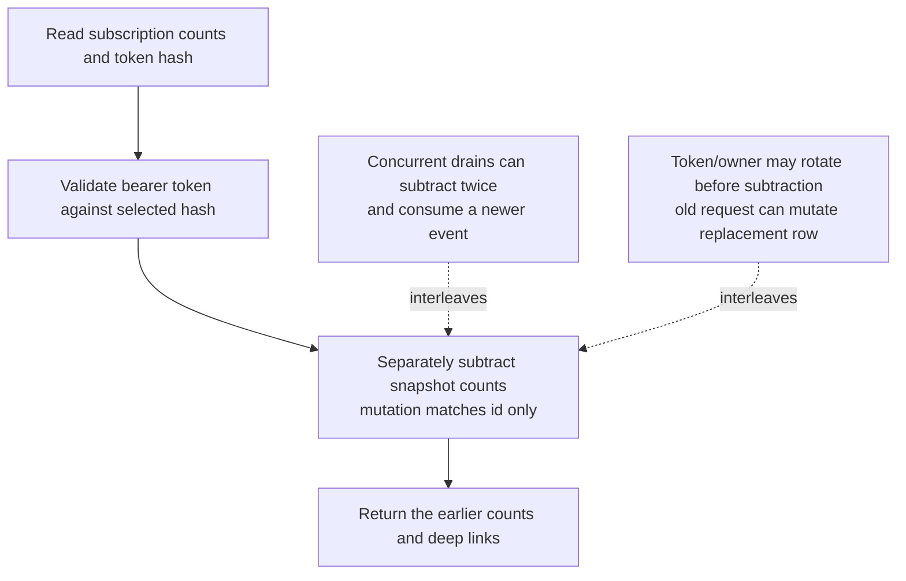
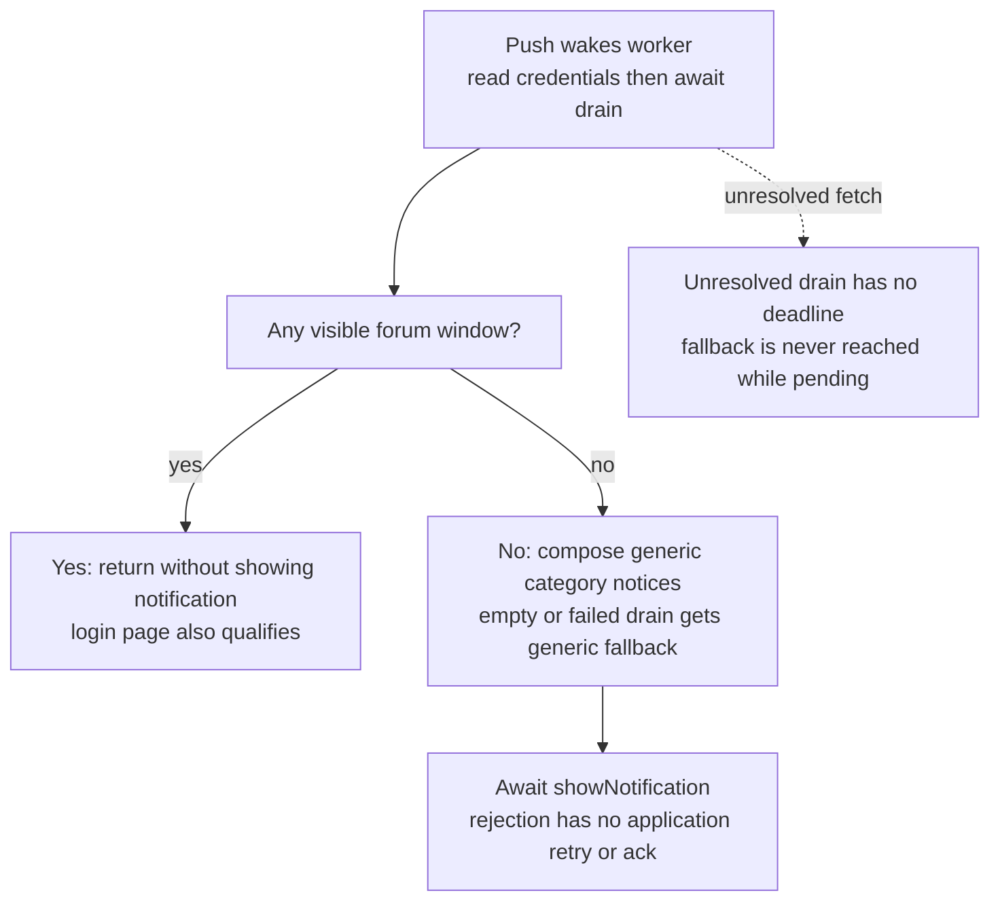
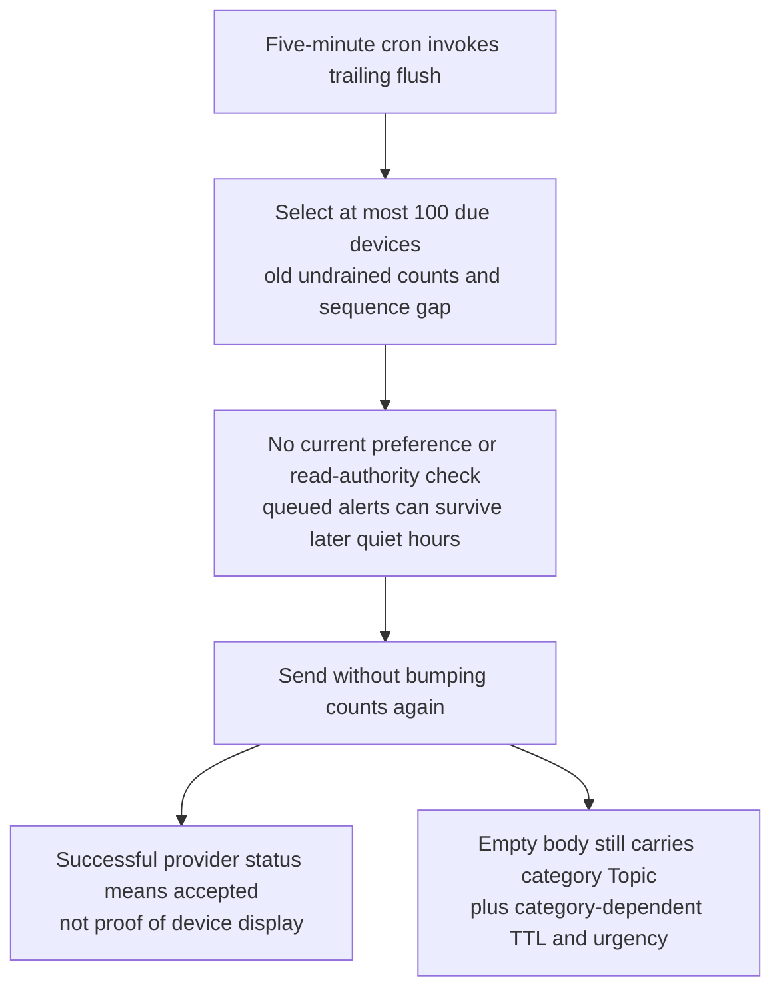
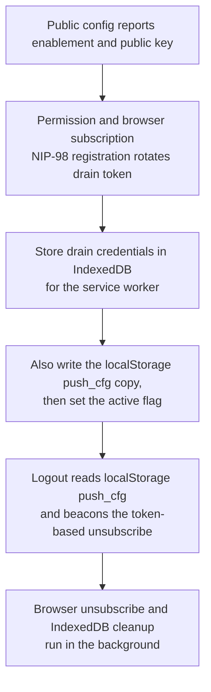
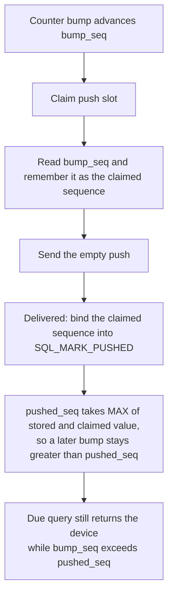
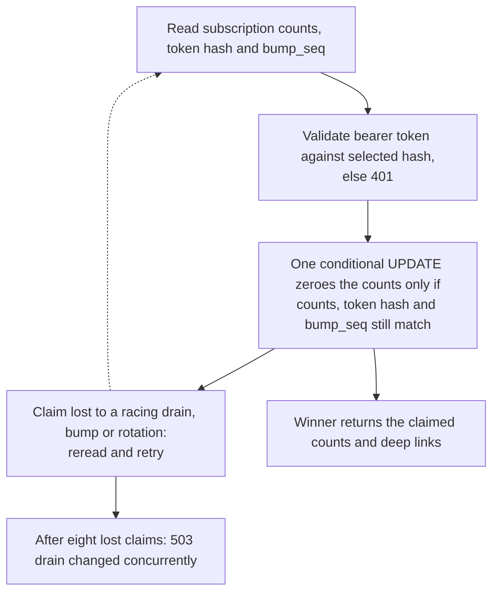

## For developers

NF-18.1, NF-18.3 and NF-18.4 are frozen as the c39f41f audit record and superseded by NF-18.7, NF-18.8 and NF-18.9, which describe the current registration, bookkeeping and drain behaviour at 4a06539. The scoped source-repair record is [NF-29](29-external-review-repairs.md#nf-293-notification-claims-and-bounded-sweeps-retain-concurrent-work). Remaining device and runtime boundaries are unchanged.

The [ADR-2023 section audit](../../estate-review/2026-11-01-forum-web-push.md) records 85 selected native/worker checks, revision differences and untested device boundaries. The unfrozen panels describe current code and demonstrated interleavings, and the frozen ones record what the audit found, not a deployed push receipt.

## For the business

Empty push requests keep message text away from providers. Reliable alerts still require consistent account teardown, quiet-hour enforcement and a distinction between provider acceptance, device fetch and visible notification. Activation remains staged.

## NF-18.1 Registration stores one credential copy but teardown expects two
> **Superseded** by NF-18.7 at 4a06539 (frozen at c39f41f).

A bridge fixture confirms the IndexedDB-only write. Source tracing establishes that the Rust caller never creates the localStorage copy used by token-based server teardown. Browser unsubscribe can still succeed.

## NF-18.2 Fan-out is bounded before pending counts exist

Caps limit work but are not a durable queue. The shared read gate retains the failure boundary documented in NF-17. Candidate resolution occurs before wait_until; only delivery is detached.

## NF-18.3 A fast drain can precede successful-send bookkeeping
> **Superseded** by NF-18.8 at 4a06539 (frozen at c39f41f).

Actual SQLite statements reproduce this ordering: one undrained count, no due wake-up. This is an allowed interleaving test, not a measured production frequency. Completion should bind to the sequence actually claimed.

## NF-18.4 Draining selects and subtracts without an atomic claim
> **Superseded** by NF-18.9 at 4a06539 (frozen at c39f41f).

Two native interleavings demonstrate count loss and mutation after registration rotation. Subtracting a snapshot preserves one intervening bump only when competing drains/registrations do not invalidate that snapshot.

## NF-18.5 A drained count is not an acknowledged display

Worker fixtures reproduce visible-login suppression, rejected display after drain, and no fallback during a stalled fetch. WebKit requires user-visible notification for each push; actual device enforcement remains untested.

## NF-18.6 Trailing flush and provider acceptance have limited guarantees

The actual due-query test still selects a queued DM after preferences disable it. RFC 8030 distinguishes provider acceptance from delivery; the clear Topic header carries the category, even with no message payload.

## NF-18.7 Registration writes both credential copies, so logout can tear down by token

**What it shows.** At 4a06539 register persists the drain credentials twice: IndexedDB through `js_store_cfg` (`../nostr-rust-forum/crates/nostr-bbs-forum-client/js/push.js:144`) and `LocalStorage` under `nostrbbs:push_cfg` (`../nostr-rust-forum/crates/nostr-bbs-forum-client/src/utils/push.rs:63`). Logout reads the second copy to build the unsubscribe request, so server teardown no longer depends on browser unsubscribe succeeding. This is source tracing, not a device run.

**Why it is this way.** The relay authenticates teardown by drain credentials (`../nostr-rust-forum/crates/nostr-bbs-relay-worker/src/push.rs:1186`), so the page must hold them where a synchronous logout can read them. NF-18.1 recorded the missing localStorage write at c39f41f.

## NF-18.8 Success bookkeeping binds to the sequence read before the send

**What it shows.** A bump that lands during the send raises `bump_seq` past the sequence claimed before it, so completion cannot mark it as pushed and the cron flush still wakes the device. The native tests at `../nostr-rust-forum/crates/nostr-bbs-relay-worker/src/push.rs:2283` and `../nostr-rust-forum/crates/nostr-bbs-relay-worker/src/push.rs:2297` exercise the larger and smaller claimed values.

**Why it is this way.** One burst earns one flush, but a counter the app never drained must stay due. NF-18.3 recorded success setting `pushed_seq` to the current `bump_seq` at c39f41f.

## NF-18.9 Drain claims its exact snapshot in one conditional update

**What it shows.** `SQL_DRAIN_CLAIM` (`../nostr-rust-forum/crates/nostr-bbs-relay-worker/src/push.rs:200`) compares every pending counter, the token hash and `bump_seq` in its `WHERE` clause, so a competing drain, an intervening bump or a token rotation changes the row and the loser retries (loop bound at `../nostr-rust-forum/crates/nostr-bbs-relay-worker/src/push.rs:1326`). An old request therefore cannot mutate the replacement row after rotation.

**Why it is this way.** The drain is the only place counters are cleared, so it has to be a compare-and-set. NF-18.4 recorded the separate select and subtract at c39f41f.
