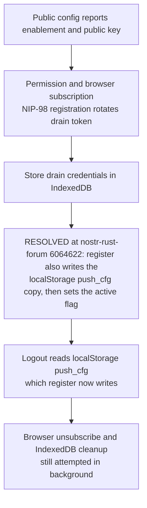
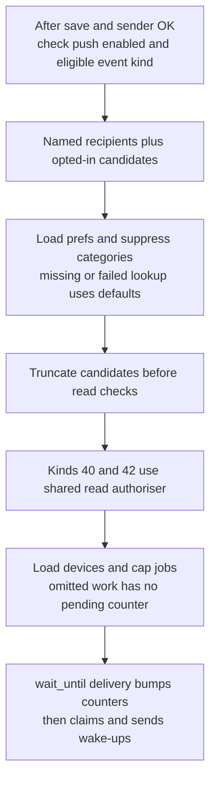
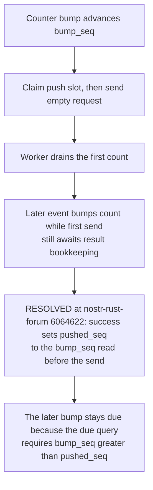
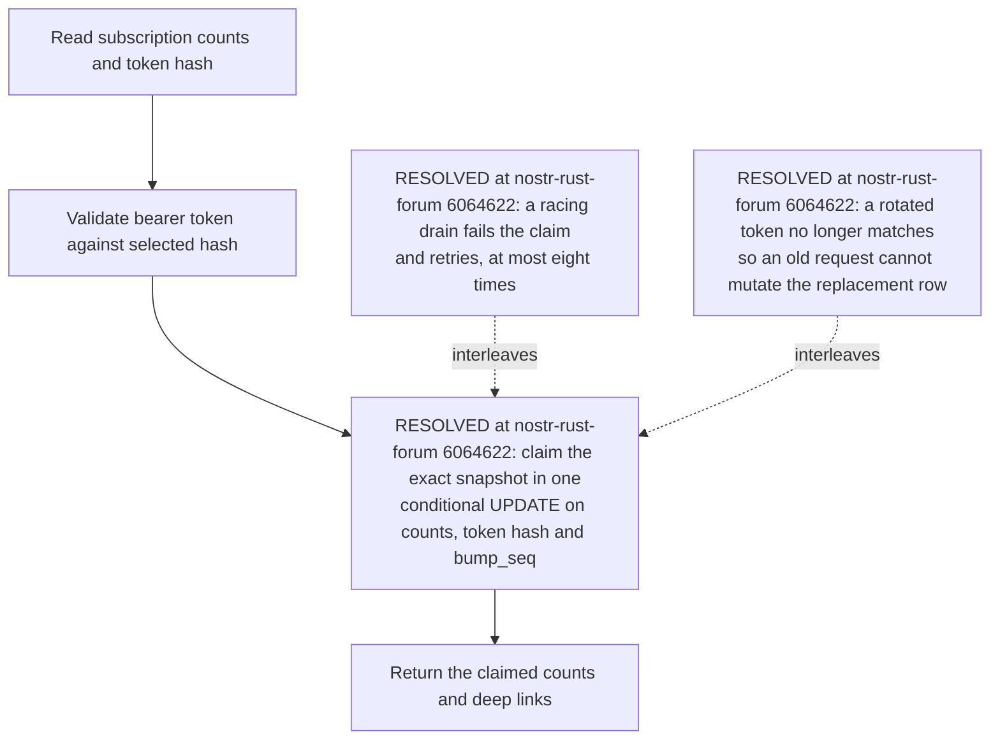
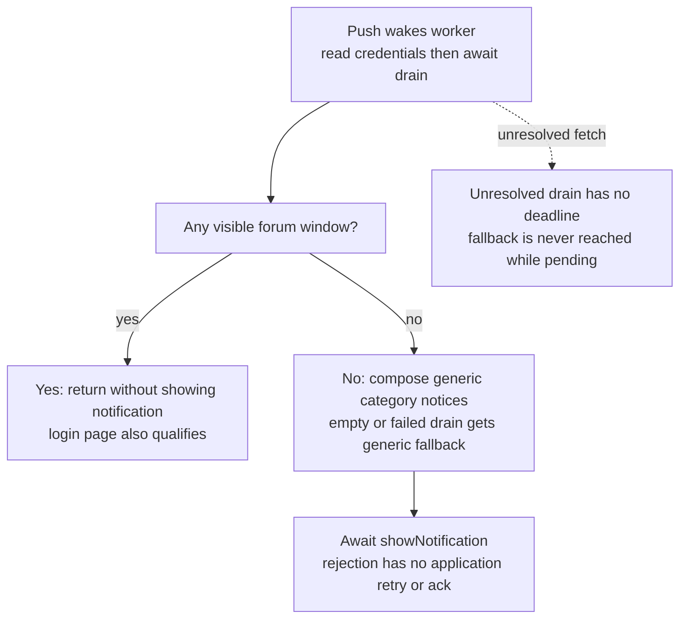
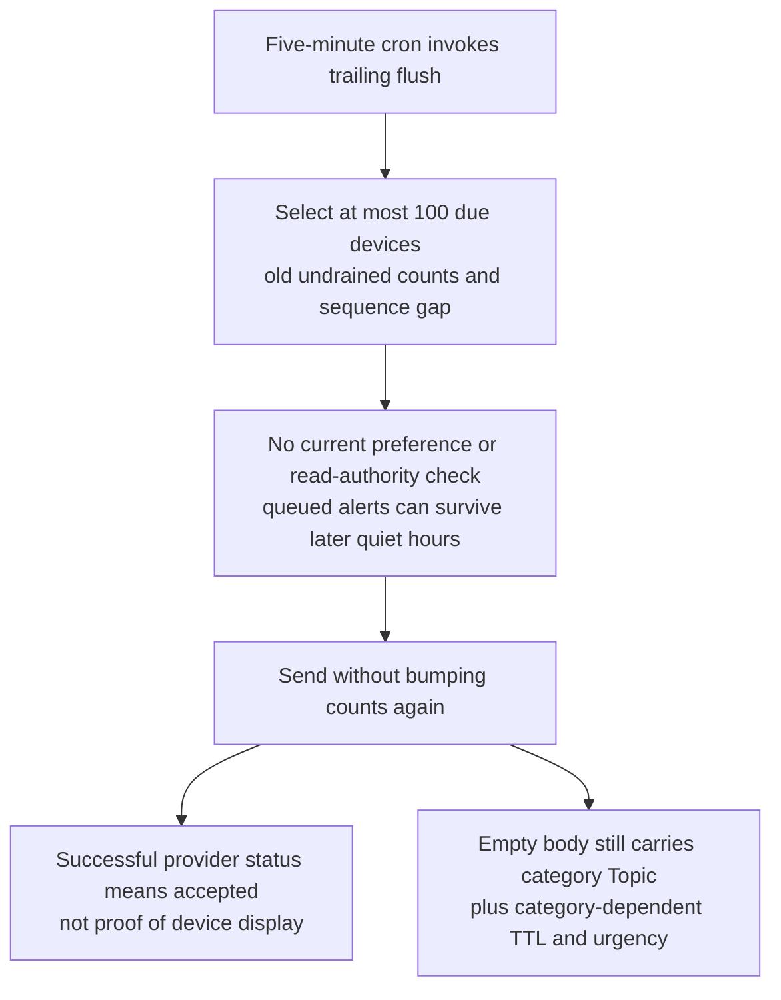

## For developers

The historical drain/bump/logout findings below have a [scoped source-repair successor, NF-29](29-external-review-repairs.md#nf-293-notification-claims-and-bounded-sweeps-retain-concurrent-work). The drain, bump and logout findings below are marked resolved at the re-verified stamp 6064622; remaining device/runtime boundaries are unchanged.

The [ADR-2023 section audit](../../estate-review/2026-11-01-forum-web-push.md) records 85 selected native/worker checks, revision differences and untested device boundaries. These panels describe current code and demonstrated interleavings, not a deployed push receipt.

## For the business

Empty push requests keep message text away from providers. Reliable alerts still require consistent account teardown, quiet-hour enforcement and a distinction between provider acceptance, device fetch and visible notification. Activation remains staged.

## NF-18.1 Registration stores one credential copy but teardown expects two

At the earlier stamp a bridge fixture confirmed an IndexedDB-only write and the Rust caller never created the localStorage copy used by token-based server teardown. At 6064622 register stores that copy (`../nostr-rust-forum/crates/nostr-bbs-forum-client/src/utils/push.rs:314-318`) and logout reads it for the beacon (`../nostr-rust-forum/crates/nostr-bbs-forum-client/src/utils/push.rs:373-377`). Browser unsubscribe still runs in the background.

## NF-18.2 Fan-out is bounded before pending counts exist

Caps limit work but are not a durable queue. The shared read gate retains the failure boundary documented in NF-17. Candidate resolution occurs before wait_until; only delivery is detached.

## NF-18.3 A fast drain can precede successful-send bookkeeping

At the earlier stamp actual SQLite statements reproduced this ordering: one undrained count, no due wake-up. At 6064622 completion binds to the sequence read before the send (`../nostr-rust-forum/crates/nostr-bbs-relay-worker/src/push.rs:700`, `../nostr-rust-forum/crates/nostr-bbs-relay-worker/src/push.rs:722`) and `SQL_MARK_PUSHED` takes the larger of the stored and claimed sequence, so the later bump remains due.

## NF-18.4 Draining selects and subtracts without an atomic claim

At the earlier stamp two native interleavings demonstrated count loss and mutation after registration rotation. At 6064622 the drain claims the snapshot atomically, so a competing drain, bump or registration invalidates the comparison and the loser retries (`../nostr-rust-forum/crates/nostr-bbs-relay-worker/src/push.rs:1338-1356`).

## NF-18.5 A drained count is not an acknowledged display

Worker fixtures reproduce visible-login suppression, rejected display after drain, and no fallback during a stalled fetch. WebKit requires user-visible notification for each push; actual device enforcement remains untested.

## NF-18.6 Trailing flush and provider acceptance have limited guarantees

The actual due-query test still selects a queued DM after preferences disable it. RFC 8030 distinguishes provider acceptance from delivery; the clear Topic header carries the category, even with no message payload.
