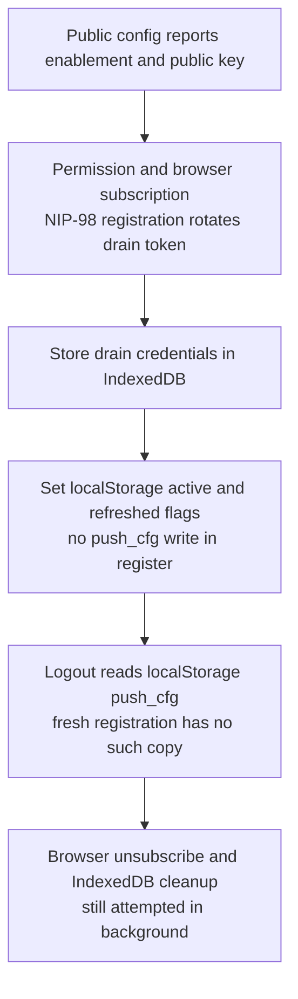
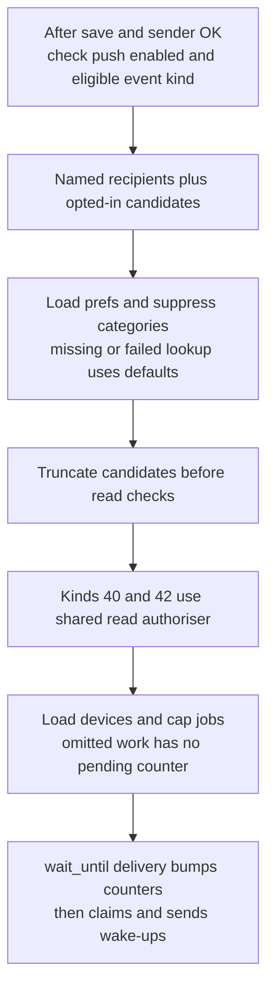
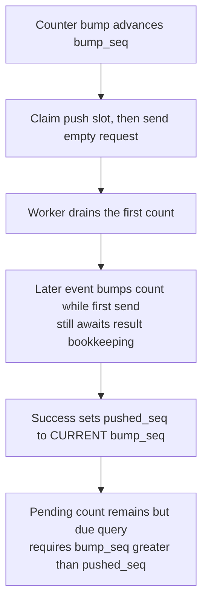
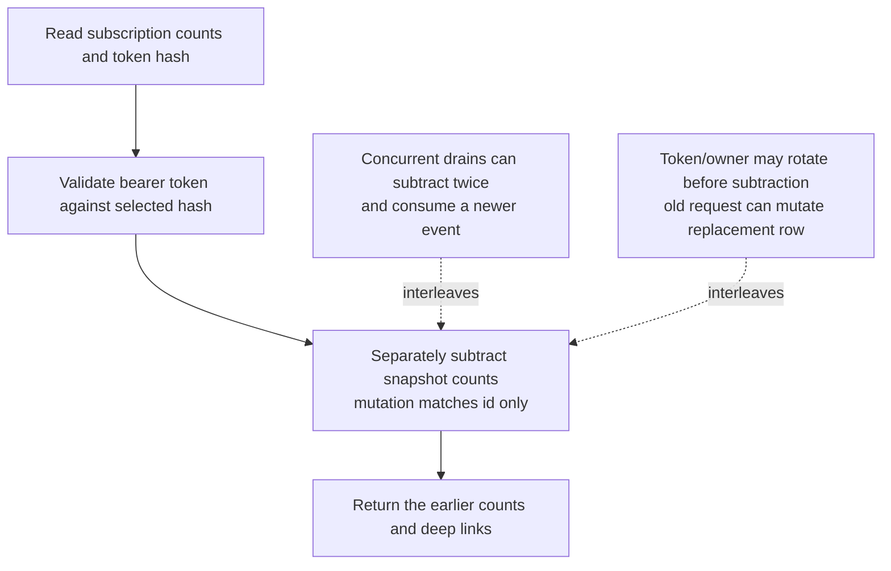
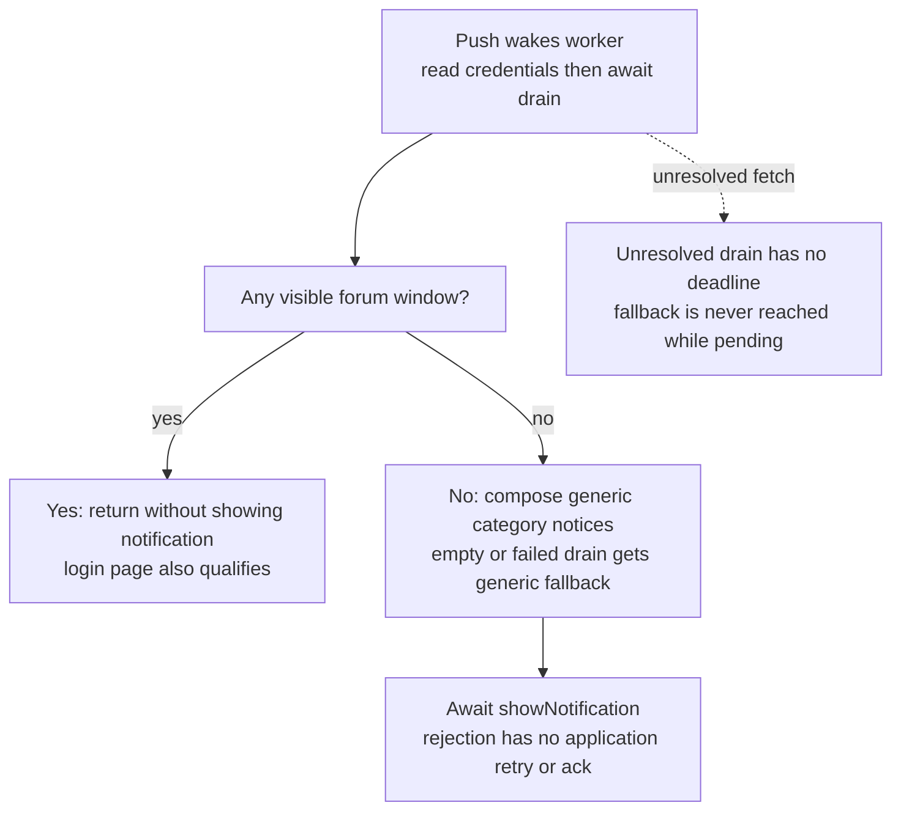
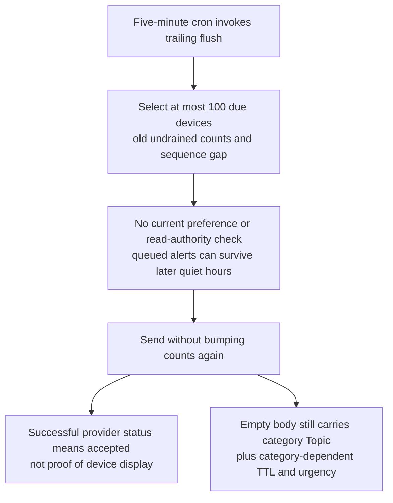

## For developers

The historical drain/bump/logout findings below have a [scoped source-repair successor, NF-29](29-external-review-repairs.md#nf-293-notification-claims-and-bounded-sweeps-retain-concurrent-work). This topic retains its declared audit revision; remaining device/runtime boundaries are unchanged.

The [ADR-2023 section audit](../../estate-review/2026-11-01-forum-web-push.md) records 85 selected native/worker checks, revision differences and untested device boundaries. These panels describe current code and demonstrated interleavings, not a deployed push receipt.

## For the business

Empty push requests keep message text away from providers. Reliable alerts still require consistent account teardown, quiet-hour enforcement and a distinction between provider acceptance, device fetch and visible notification. Activation remains staged.

## NF-18.1 Registration stores one credential copy but teardown expects two

A bridge fixture confirms the IndexedDB-only write. Source tracing establishes that the Rust caller never creates the localStorage copy used by token-based server teardown. Browser unsubscribe can still succeed.

## NF-18.2 Fan-out is bounded before pending counts exist

Caps limit work but are not a durable queue. The shared read gate retains the failure boundary documented in NF-17. Candidate resolution occurs before wait_until; only delivery is detached.

## NF-18.3 A fast drain can precede successful-send bookkeeping

Actual SQLite statements reproduce this ordering: one undrained count, no due wake-up. This is an allowed interleaving test, not a measured production frequency. Completion should bind to the sequence actually claimed.

## NF-18.4 Draining selects and subtracts without an atomic claim

Two native interleavings demonstrate count loss and mutation after registration rotation. Subtracting a snapshot preserves one intervening bump only when competing drains/registrations do not invalidate that snapshot.

## NF-18.5 A drained count is not an acknowledged display

Worker fixtures reproduce visible-login suppression, rejected display after drain, and no fallback during a stalled fetch. WebKit requires user-visible notification for each push; actual device enforcement remains untested.

## NF-18.6 Trailing flush and provider acceptance have limited guarantees

The actual due-query test still selects a queued DM after preferences disable it. RFC 8030 distinguishes provider acceptance from delivery; the clear Topic header carries the category, even with no message payload.
