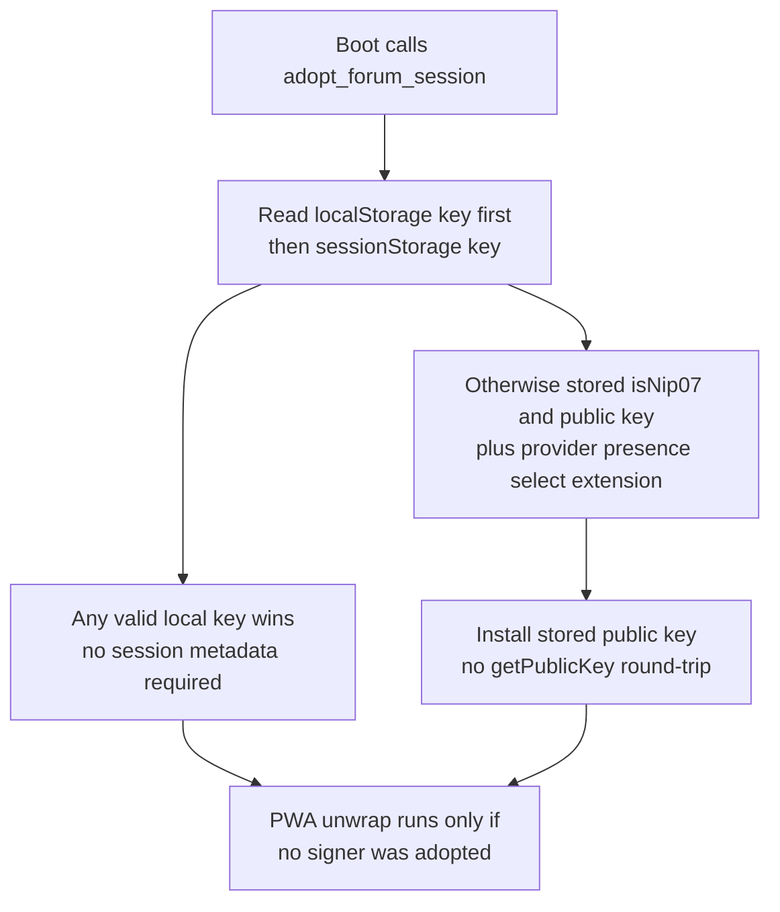
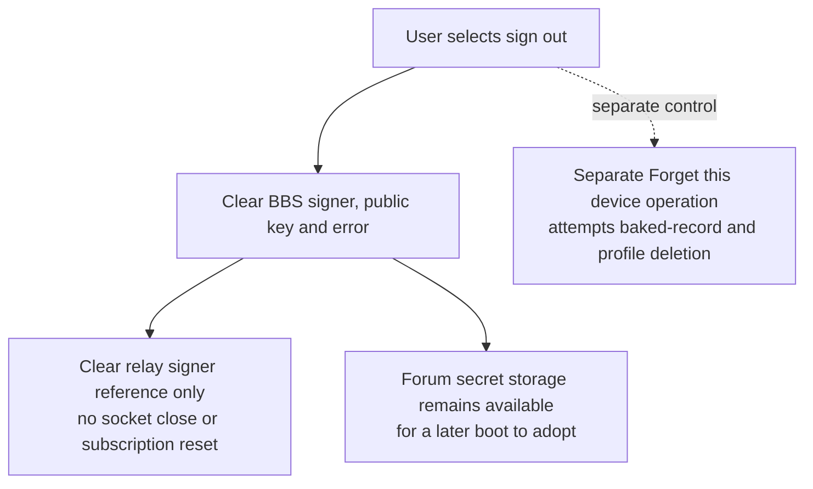
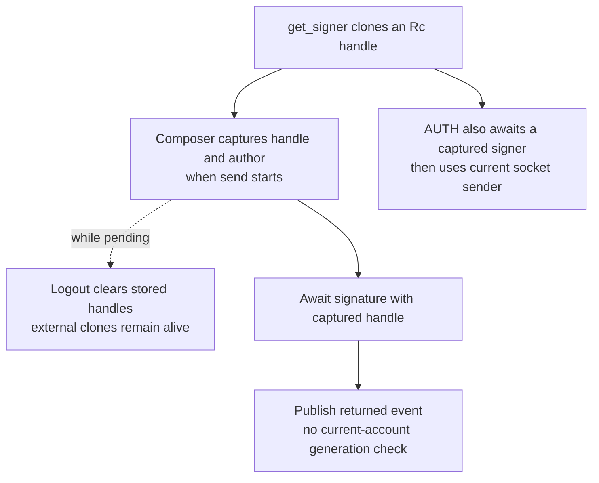
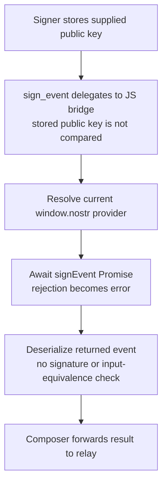
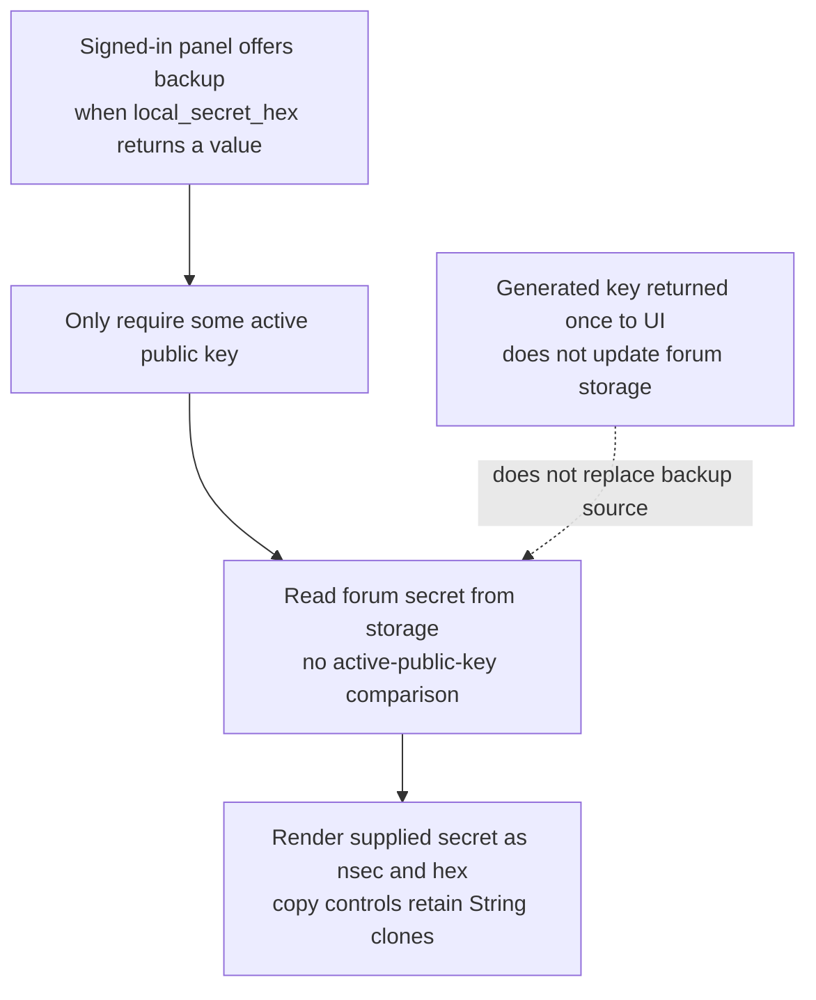
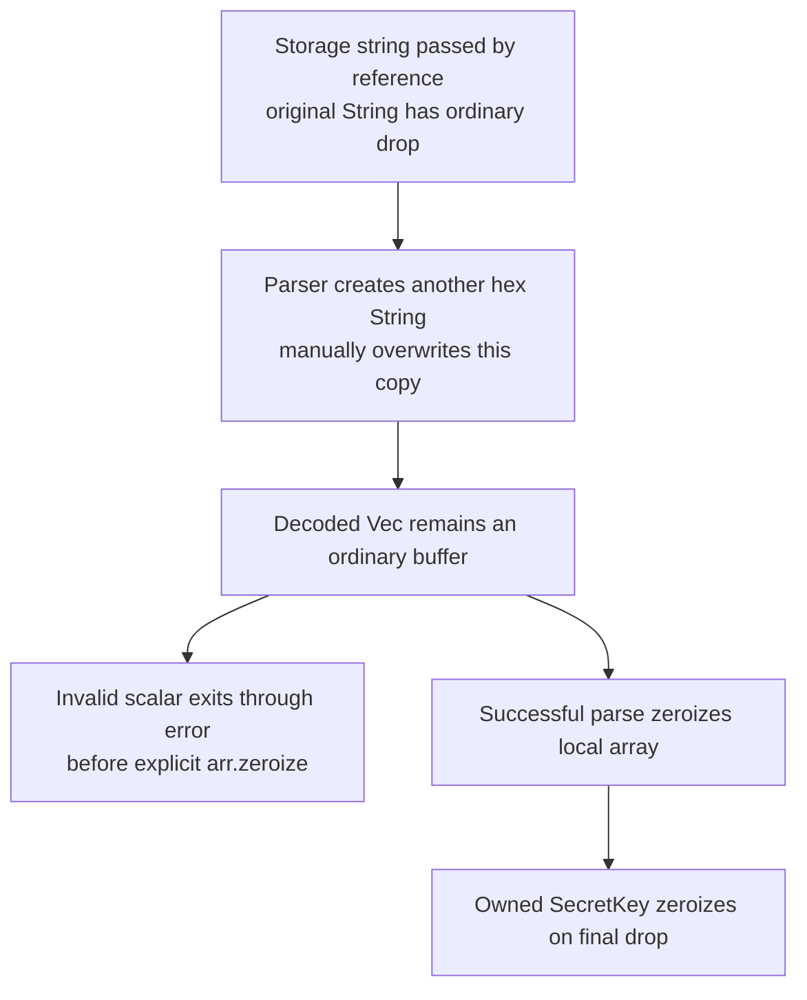

## For developers

[ADR-2008 section review](../../estate-review/2026-11-01-forum-bbs-signer.md) distinguishes tested local signer lifetime from browser-only storage, extension and socket findings. No live session was changed.

## For the business

Users need sign-out and backup to refer to the same account shown on screen. Shared branding and same-origin storage do not make the forum and BBS one session. Existing extension support reduces raw-key handling, but account binding and cancellation still need work.

## NF-19.1 Adoption chooses storage before checking the extension

A non-empty but invalid localStorage key prevents reading a valid sessionStorage key; parsing then falls through to extension selection. The extension-selection helper accepts any non-empty stored public-key string, including malformed values.

## NF-19.2 Sign-out leaves recoverable credentials and the socket

Ordinary sign-out does not remove the baked key either. Forget this device ignores IndexedDB deletion failures and does not clear forum raw-key storage. Neither operation establishes global account revocation.

## NF-19.3 A retained signer can act after the visible account changes

Two native counterexamples produce strictly verified signatures with retained local signers after logout and account replacement. Publication and extension-prompt races remain source findings, not executed browser journeys.

## NF-19.4 Extension signing does not validate the returned intent

An extension account change may produce a different author from the visible account. Relay verification can reject invalid signatures; it cannot reconstruct the user’s intended author or content. No malicious extension or deployed account switch was exercised.

## NF-19.5 Backup reads storage rather than the active signer

With forum key A still stored and local signer B installed, the backup path can show A while the account label names B. An in-memory pasted key has no later backup route when forum storage is empty. These are source-traced conditions; browser reproduction remains open.

## NF-19.6 Zeroisation covers selected objects and paths

Final-key zeroisation does not prove erasure of browser storage, UI strings, decoded vectors, rejected-input copies or JavaScript allocations. This audit makes no heap-recovery or compiler-level erasure claim.
