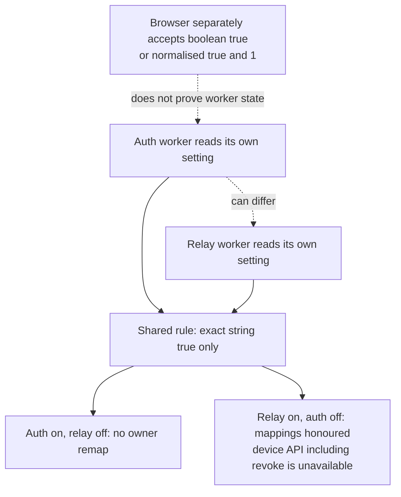
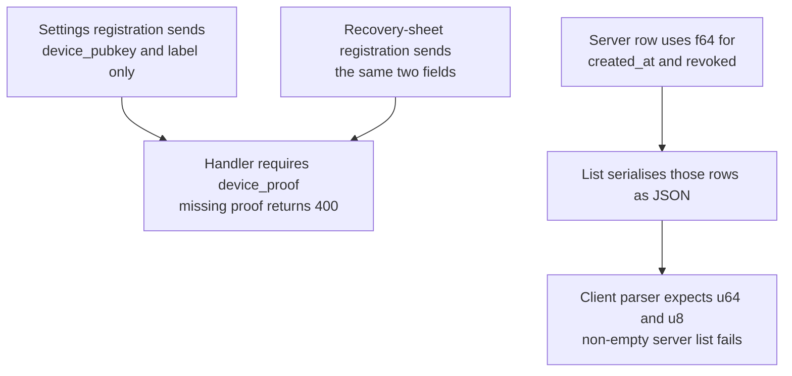
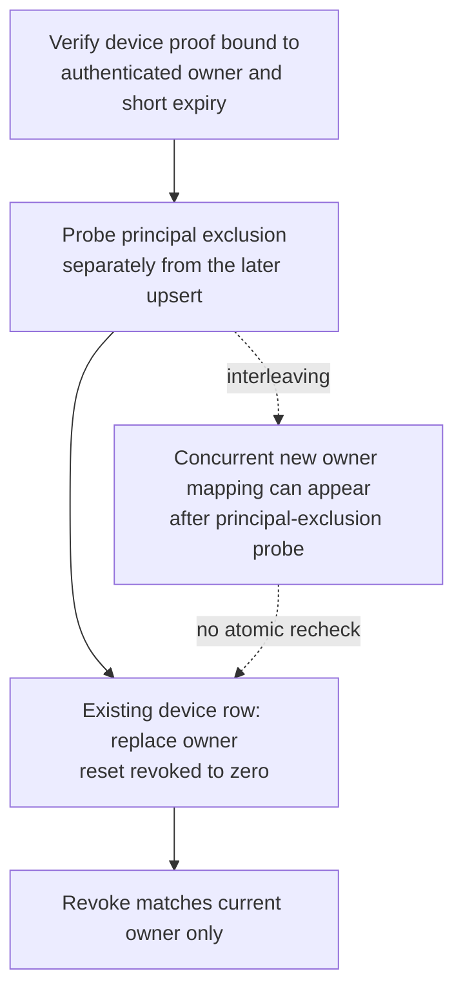
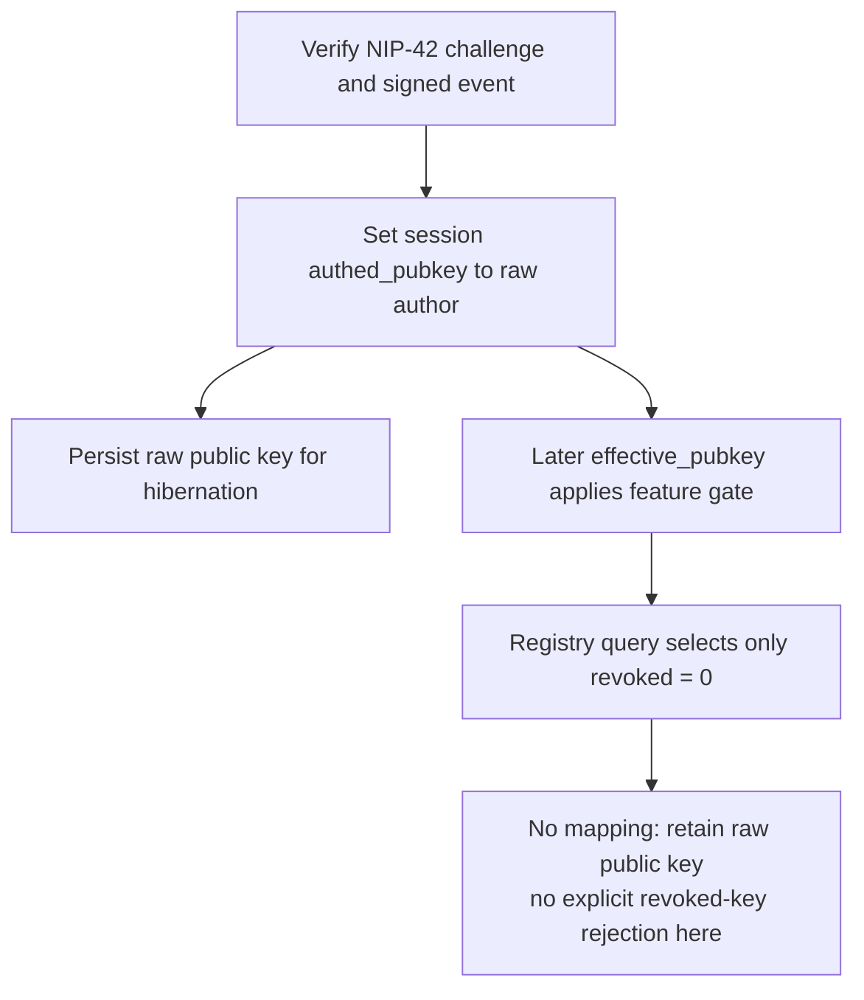
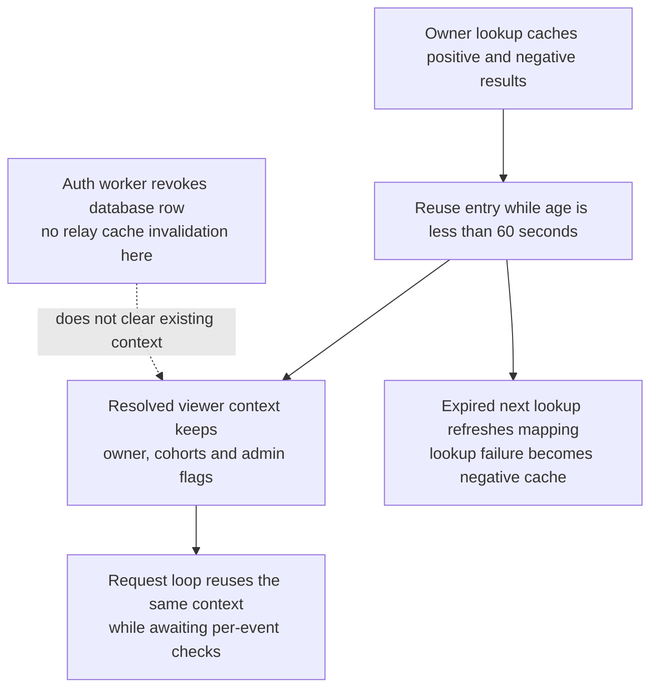
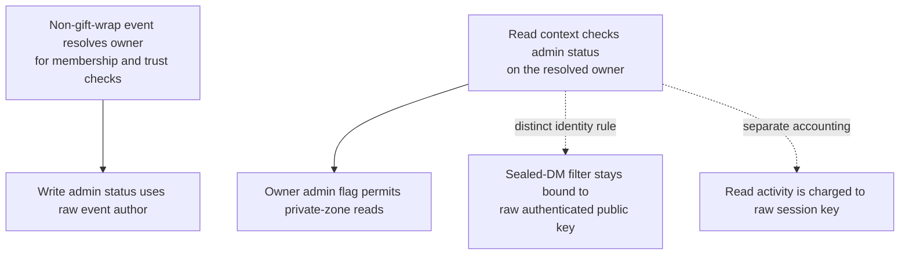

## For developers

The registration proof/list-number and re-enrolment findings below have a [scoped source-repair successor, NF-29](29-external-review-repairs.md#nf-292-device-lifecycle-and-dynamic-administration-settle-at-their-owners). This topic retains its declared audit revision; cache/transport findings remain separate.

[ADR-2004 section review](../../estate-review/2026-11-01-forum-device-keys.md) records 76 selected checks, including producer-consumer mismatches, actual SQLite statements and extracted cache methods. Mocked lookup fixtures do not certify deployed Workers or browser behaviour.

## For the business

A lost-phone control needs a working device list and a measurable point at which delegated access stops. Correct boolean parsing alone establishes neither. Device membership also differs from master-key messaging and administrative authority.

## NF-20.1 Independent settings do not guarantee rollout agreement

An independently whitelisted raw device key may still pass ordinary write policy when owner remapping is off. The helper name AuthOnlyFailsClosed does not establish universal device denial.

## NF-20.2 Both registration and non-empty listing have contract gaps

Five native contract tests use the two extracted producer expressions and actual server/client types and parser. Empty lists pass, concealing the numeric mismatch. HTTP dispatch and browser rendering were not executed.

## NF-20.3 Registration can reactivate or transfer a device

SQL tests reproduce reactivation, transfer and a principal-probe race. Real registration still requires caller authentication and a valid device proof; these tests do not bypass either. Original-owner revocation matches no row after a transfer.

## NF-20.4 AUTH authenticates the raw key, not the owner mapping

Owner mapping is cached between the later lookup and D1. Revoking a mapping does not invalidate the device’s cryptographic signature or make AUTH itself fail. Subsequent policy decides what the remaining raw identity can do.

## NF-20.5 Cached decisions and snapshots extend beyond the database write

Native fixtures retain owner mapping at t=159 after a t=100 fill and drop it at t=160; an old admin context still permits a zone read at t=500. Those synthetic times prove code behaviour, not a measured production propagation limit.

## NF-20.6 Delegated authority is different across read and write paths

An admin owner’s device inherits zone-read admin scope in the fixture, while write administration remains raw-key scoped. Master-addressed encrypted messages and owner read-activity credit do not follow automatically from forum membership delegation.
