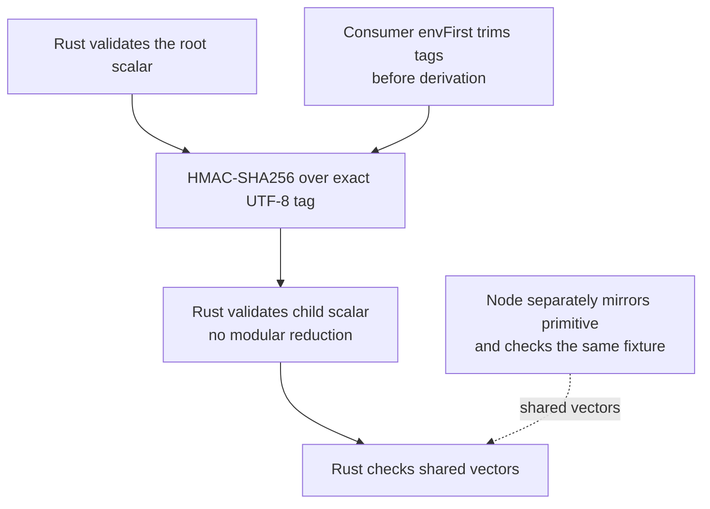
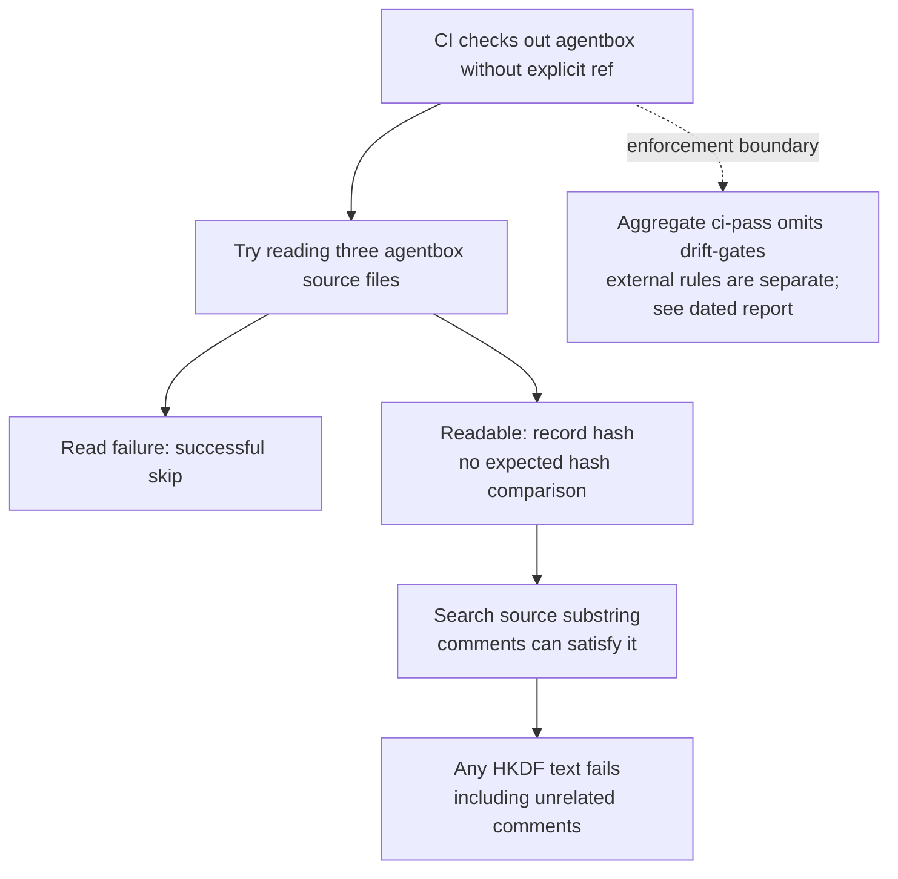
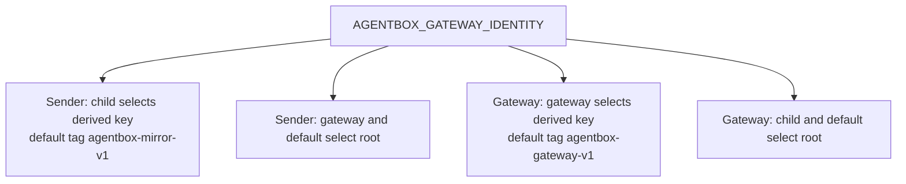
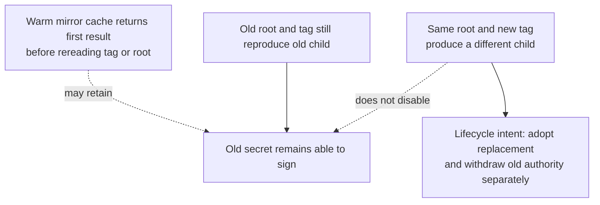

## For developers

[Section review and adversarial evidence](../../estate-review/2026-11-01-forum-subkey-derivation.md) cover ADR-2003 and archived ADR-094/100. Thirty native tests, twelve extracted JavaScript probes and eight runner scenarios distinguish primitive parity from consumer selection and release enforcement. No production entrypoint or live key is used.

## For the business

A replacement key helps only when every component adopts it and the old key loses the relevant rights. Show the expected public identity and the rotation state; a passing derivation fixture alone cannot establish either.

## NF-21.1 Primitive equality has exact input and validation boundaries

## NF-21.2 The parity runner does not execute production consumers

## NF-21.3 Sender and gateway disagree on identity modes

## NF-21.4 Tag rotation is not consumer adoption or revocation

