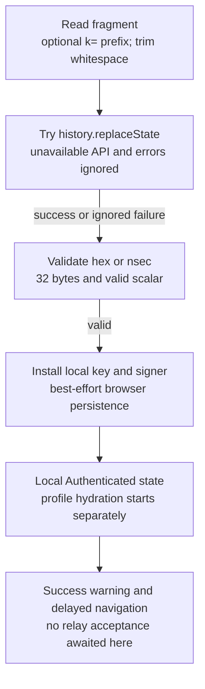
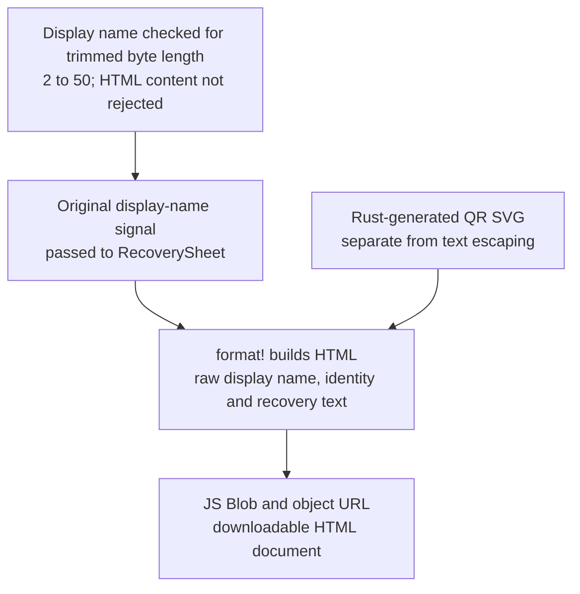
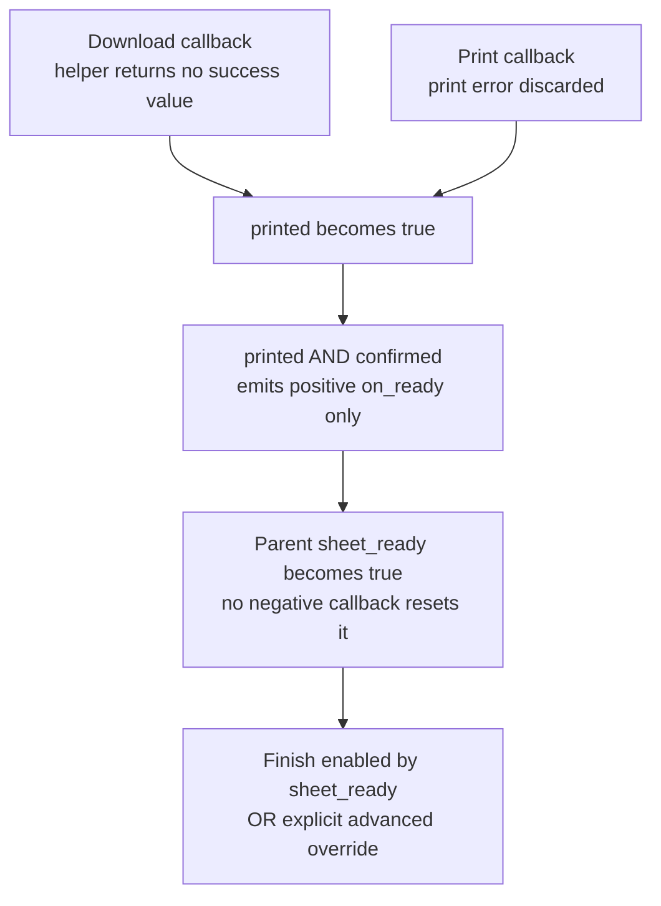
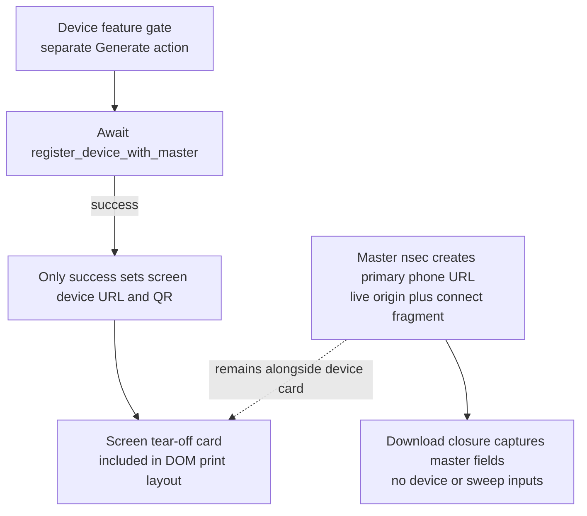
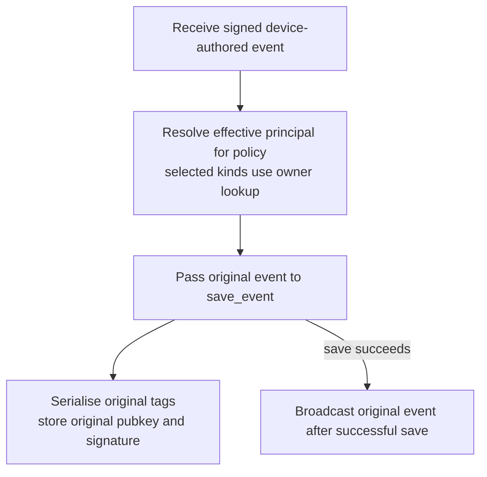

## For developers

[The section review](../../estate-review/2026-11-01-forum-recovery-and-connect.md) covers archived ADR-095/098/099 with nineteen native cases and five isolated Chrome cases. Extracted callbacks use mocked browser/reactive state; Chrome runs synthetic formatter output and History API controls. Neither suite executes the full signup, relay or phone journey.

## For the business

A saved recovery key, a locally imported account and a revocable phone are three different outcomes. Show which one the user has obtained. A download click does not prove a usable backup, and a successful local import does not prove access to the forum.

## NF-22.1 Connect calls strip before import but ignores strip failure

Native probes reproduce failed clearing followed by import. A deliberately cross-origin Chrome replacement demonstrates `SecurityError` retaining the fragment, not a production routing defect. Clearing runs at mount time, not before every possible page observer.

## NF-22.2 Recovery HTML contains raw interpolated text beside the key

Chrome executes the synthetic display-name marker in this formatter output. An escaped test-only control does not. This is active-content injection in an exported secret-bearing document; remote delivery and real-secret exfiltration were not demonstrated. Pure-Rust QR generation does not make the exported DOM or Blob inaccessible to scripts.

## NF-22.3 The backup gate latches an attempted output and acknowledgement

A failed print and a missing window still set `printed`. Unchecking confirmation does not clear the parent latch. These are extracted-callback probes, not a complete reactive-runtime test. The advanced override is intentional; this gate is a user acknowledgement, not proof of file creation or account authorisation.

## NF-22.4 Master recovery and device enrolment have different exports

NF-20 documents the missing registration proof and incompatible list parser. This diagram shows the success branch in source, not a working deployed enrolment. Downloaded HTML retains the master link and lacks device/sweep sections. A master-key import cannot be contained by revoking an unrelated device row.

## NF-22.5 Owner policy does not rewrite the signed author or tags

This ordinary stored-event path has no appended owner-attribution tag. Ephemeral events broadcast directly without storage. Separate UI projections were not exhaustively reviewed here. Preserve signed event bytes and specify any owner presentation as an independent authenticated assertion; see NF-20 for policy/cache limits.
