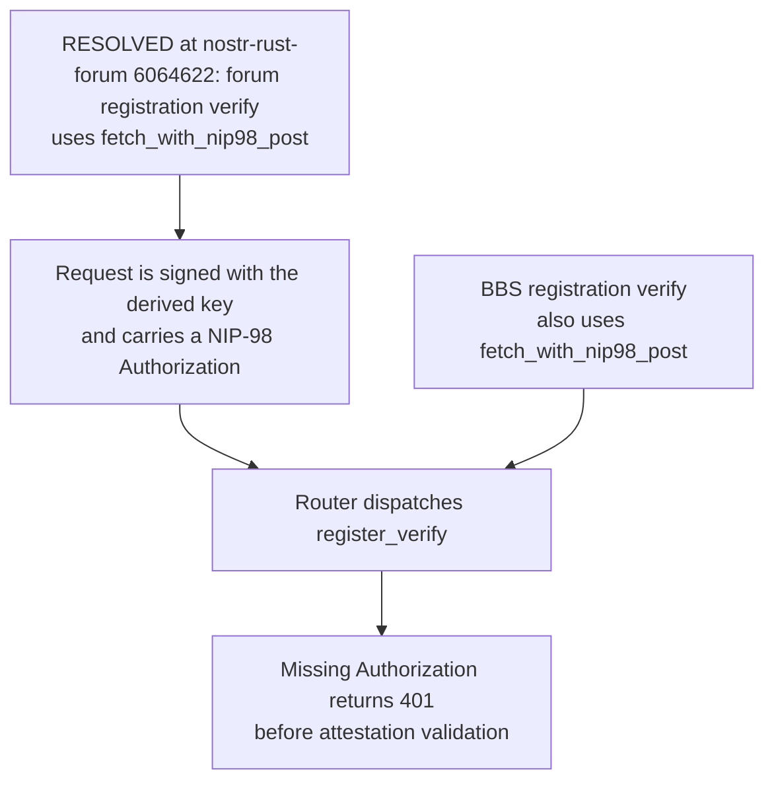
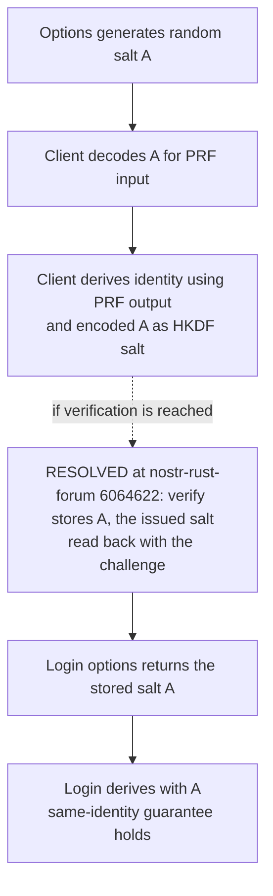
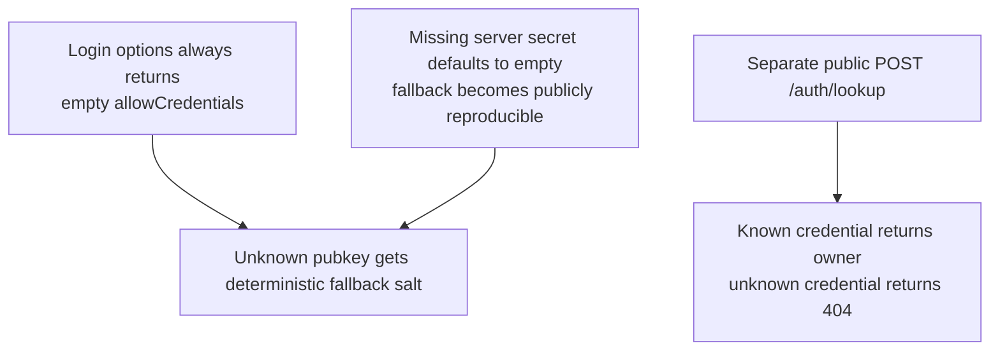
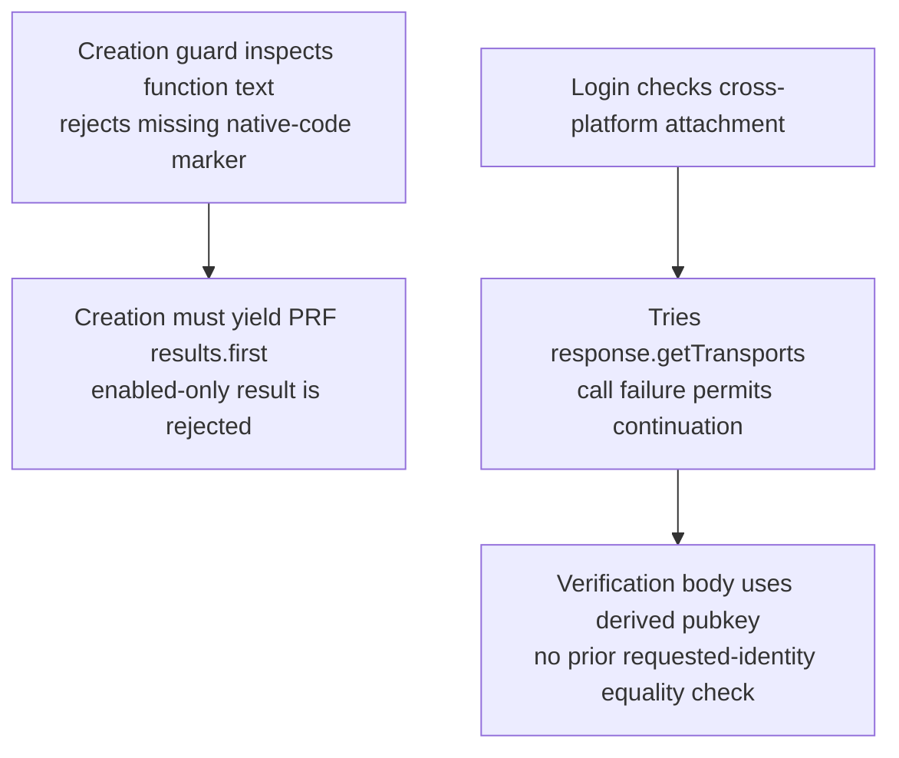
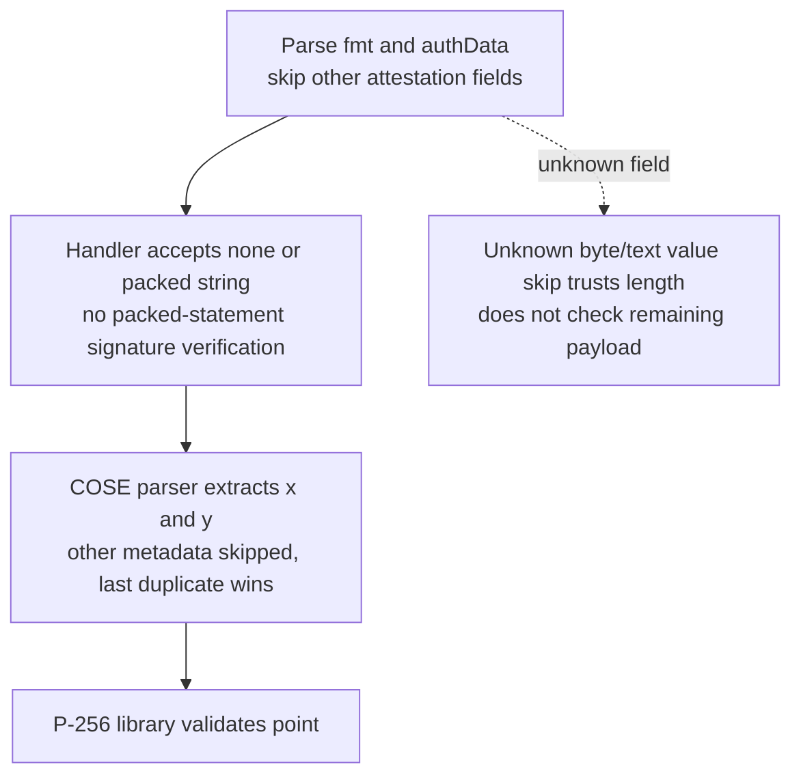
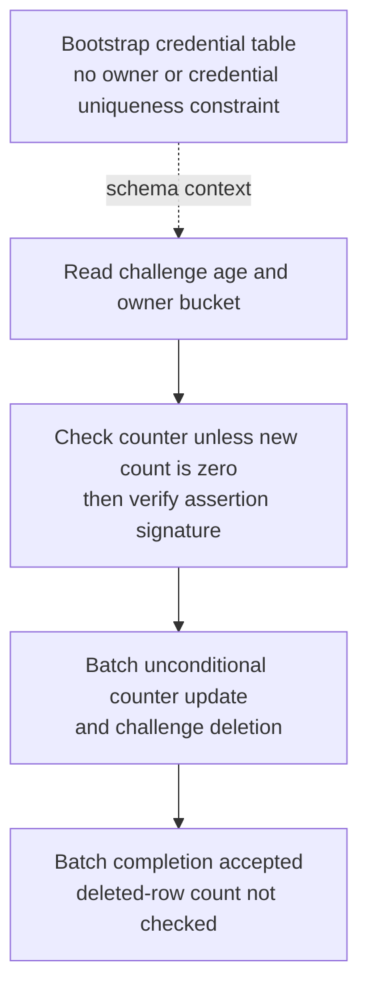

## For developers

NF-23.1/23.2 have a [scoped source-repair successor, NF-29](29-external-review-repairs.md#nf-291-registration-keeps-the-issued-salt-and-proves-the-derived-identity). NF-23.1 and NF-23.2 are marked resolved at the re-verified stamp 6064622. Other discovery, recovery and authenticator boundaries below are not restamped or closed.

[The passkey review](../../estate-review/2026-11-01-forum-passkey-contracts.md) adds 10 audit cases to the actual worker's 65 passing native WebAuthn tests, plus four isolated SQLite scenarios. No live Worker, browser ceremony or authenticator ran. Request/header findings are source composition; the salt probe holds PRF output constant to isolate downstream derivation drift.

## For the business

The acceptance journey is creation, logout, return to the same public identity and one authorised forum action. A functioning cryptographic primitive does not prove that the browser and server agree on the inputs needed to recover that identity.

## NF-23.1 Both registration clients omit the required authorisation header

The earlier caller/handler mismatch is resolved at 6064622: both clients sign register/verify, and the worker's matching-author proof is retained (`../nostr-rust-forum/crates/nostr-bbs-auth-worker/src/webauthn.rs:905-906`). This is not a live request trace.

## NF-23.2 Issued and stored salts do not describe the same identity

At the earlier stamp native controls proved different roots for A and B even with identical PRF output; at 6064622 the stored salt is the issued one, which the native test `registration_and_login_use_the_same_server_issued_prf_input` asserts (`../nostr-rust-forum/crates/nostr-bbs-auth-worker/src/webauthn.rs:723`). No authenticator PRF was emulated and no salt was changed in production.

## NF-23.3 Empty credential lists do not close every discovery path

The common IP rate limiter still applies. The lookup finding concerns supplied credential IDs, not guessing arbitrary high-entropy IDs. The missing-secret condition was tested with synthetic values; deployed configuration is unknown.

## NF-23.4 Capability and transport heuristics are not identity checks

Creation-time PRF evaluation is optional in the specification. `getTransports` belongs to attestation responses, not standard assertion responses. These source/spec discrepancies require tested compatibility and identity checks; no hardware support claim follows from this diagram.

## NF-23.5 Point validation and attestation parsing have narrower guarantees

Native probes accept contradictory COSE metadata and a truncated final unknown field; an invalid point and truncated known authData are rejected. This is not a demonstrated bypass of NIP-98 ownership or login signature verification. Packed attestation needs an explicit verification policy or rejection.

## NF-23.6 Challenge reads and consumption are separate operations

SQLite permits duplicate owner rows under this bootstrap and two batches after a chosen two-reader schedule. Serial reuse correctly finds no challenge. D1 scheduling, deployed constraints and NIP-98 replay behaviour were not executed; both modelled requests assume independently valid tokens.
