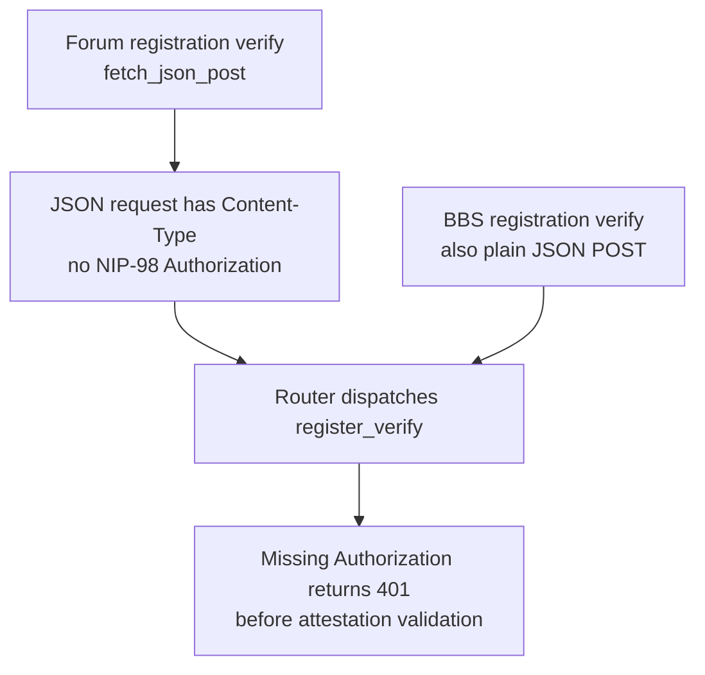
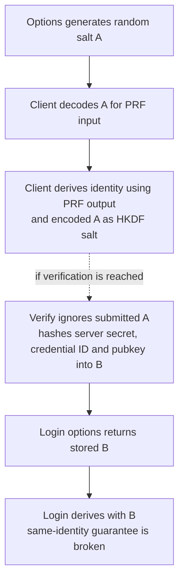
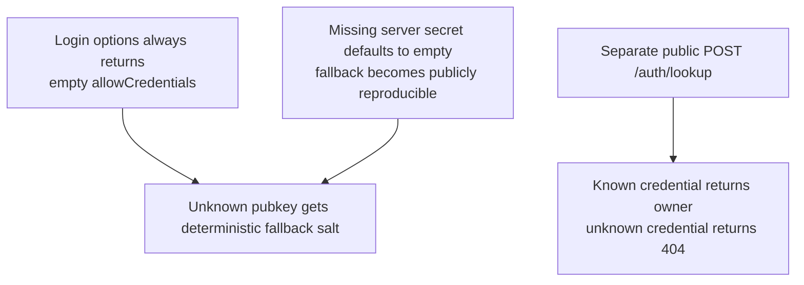
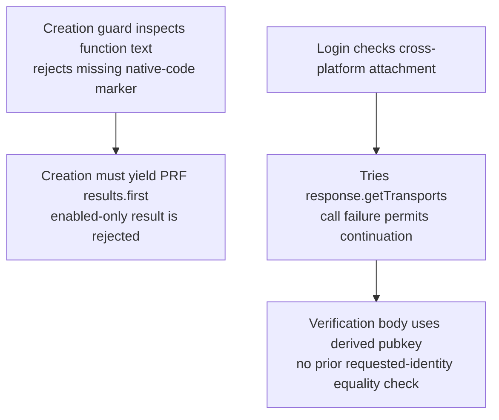
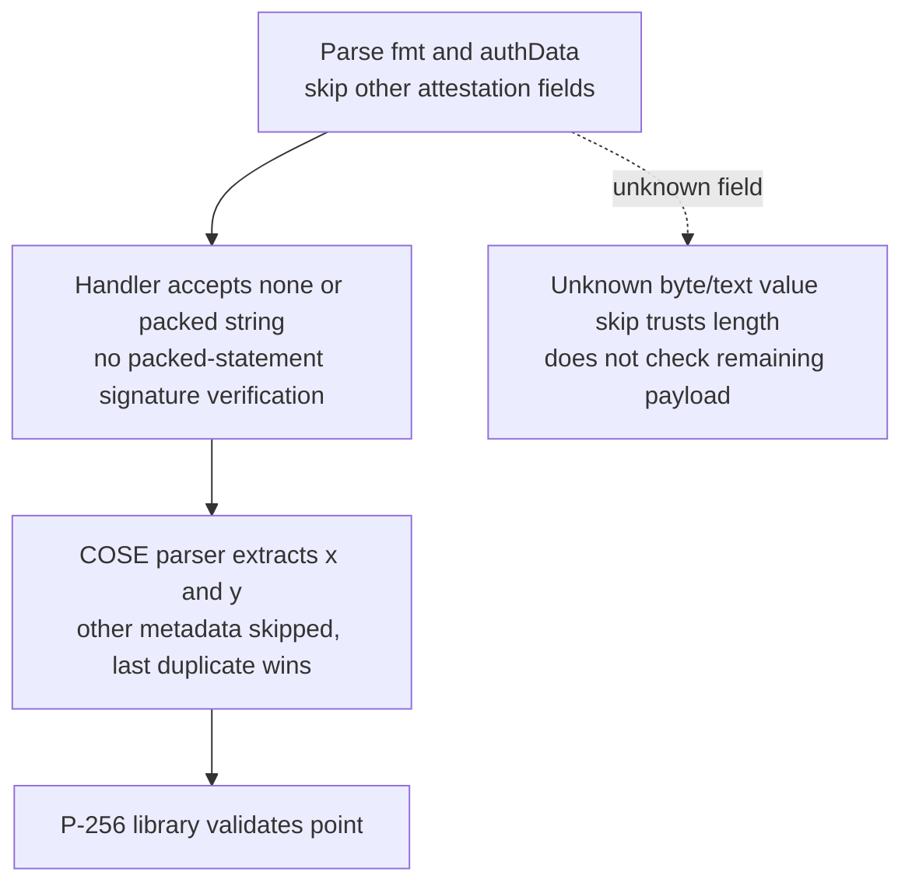
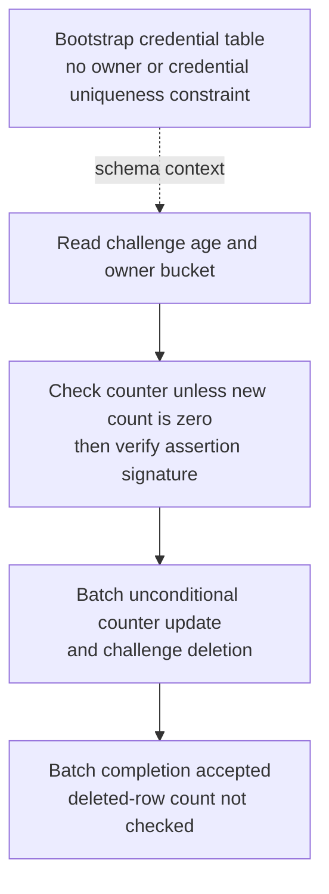
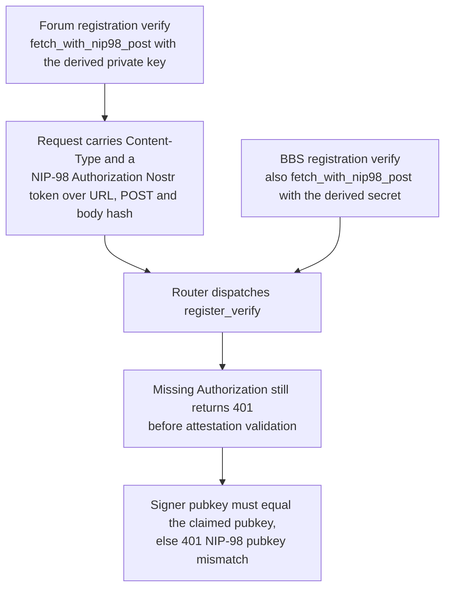
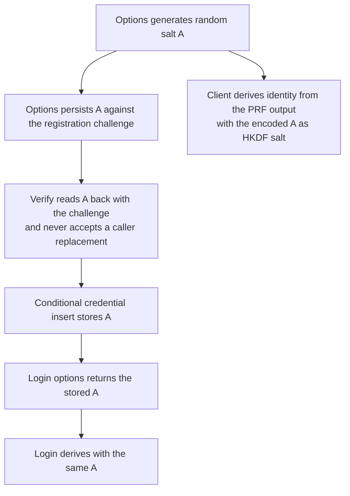

## For developers

NF-23.1 and NF-23.2 are frozen as the c39f41f audit record and superseded by NF-23.7 and NF-23.8, which describe the current registration behaviour at 4a06539. The scoped source-repair record is [NF-29](29-external-review-repairs.md#nf-291-registration-keeps-the-issued-salt-and-proves-the-derived-identity). Other discovery, recovery and authenticator boundaries below were not re-read for this change and are not closed.

[The passkey review](../../estate-review/2026-11-01-forum-passkey-contracts.md) adds 10 audit cases to the actual worker's 65 passing native WebAuthn tests, plus four isolated SQLite scenarios. No live Worker, browser ceremony or authenticator ran. Request/header findings are source composition; the salt probe holds PRF output constant to isolate downstream derivation drift.

## For the business

The acceptance journey is creation, logout, return to the same public identity and one authorised forum action. A functioning cryptographic primitive does not prove that the browser and server agree on the inputs needed to recover that identity.

## NF-23.1 Both registration clients omit the required authorisation header
> **Superseded** by NF-23.7 at 4a06539 (frozen at c39f41f).

This is the current caller/handler mismatch, not a live request trace. The worker's matching-author proof should be retained when the clients are repaired.

## NF-23.2 Issued and stored salts do not describe the same identity
> **Superseded** by NF-23.8 at 4a06539 (frozen at c39f41f).

The normal registration caller first encounters NF-23.1. Native controls separately prove different roots for A/B even with identical PRF output. No authenticator PRF was emulated and no salt was changed in production.

## NF-23.3 Empty credential lists do not close every discovery path

The common IP rate limiter still applies. The lookup finding concerns supplied credential IDs, not guessing arbitrary high-entropy IDs. The missing-secret condition was tested with synthetic values; deployed configuration is unknown.

## NF-23.4 Capability and transport heuristics are not identity checks

Creation-time PRF evaluation is optional in the specification. `getTransports` belongs to attestation responses, not standard assertion responses. These source/spec discrepancies require tested compatibility and identity checks; no hardware support claim follows from this diagram.

## NF-23.5 Point validation and attestation parsing have narrower guarantees

Native probes accept contradictory COSE metadata and a truncated final unknown field; an invalid point and truncated known authData are rejected. This is not a demonstrated bypass of NIP-98 ownership or login signature verification. Packed attestation needs an explicit verification policy or rejection.

## NF-23.6 Challenge reads and consumption are separate operations

SQLite permits duplicate owner rows under this bootstrap and two batches after a chosen two-reader schedule. Serial reuse correctly finds no challenge. D1 scheduling, deployed constraints and NIP-98 replay behaviour were not executed; both modelled requests assume independently valid tokens.

## NF-23.7 Both registration clients sign the verify request with the derived key

**What it shows.** At 4a06539 both registration clients send the verify POST through `fetch_with_nip98_post`, so the worker's authorisation requirement is met and the matching-author proof is retained. This describes source composition, not a live request trace.

**Why it is this way.** The worker refuses an unsigned register/verify so a caller cannot claim another identity's public key. NF-23.1 recorded the clients failing that contract at c39f41f. The scoped repair record is NF-29.1.

## NF-23.8 Registration stores the issued salt, so login derives the same identity

**What it shows.** The salt the client used to derive the identity is the salt the worker stores and later returns at login, so registration and login derive the same keypair. The native test `registration_and_login_use_the_same_server_issued_prf_input` asserts this for the stored value (`../nostr-rust-forum/crates/nostr-bbs-auth-worker/src/webauthn.rs:723`). No authenticator PRF was emulated.

**Why it is this way.** NF-23.2 recorded verify hashing a different salt B at c39f41f, which broke the same-identity guarantee. Credentials registered before the repair keep their old stored salt: the original PRF input cannot be reconstructed, so those need recovery or re-enrolment (NF-29.1).
