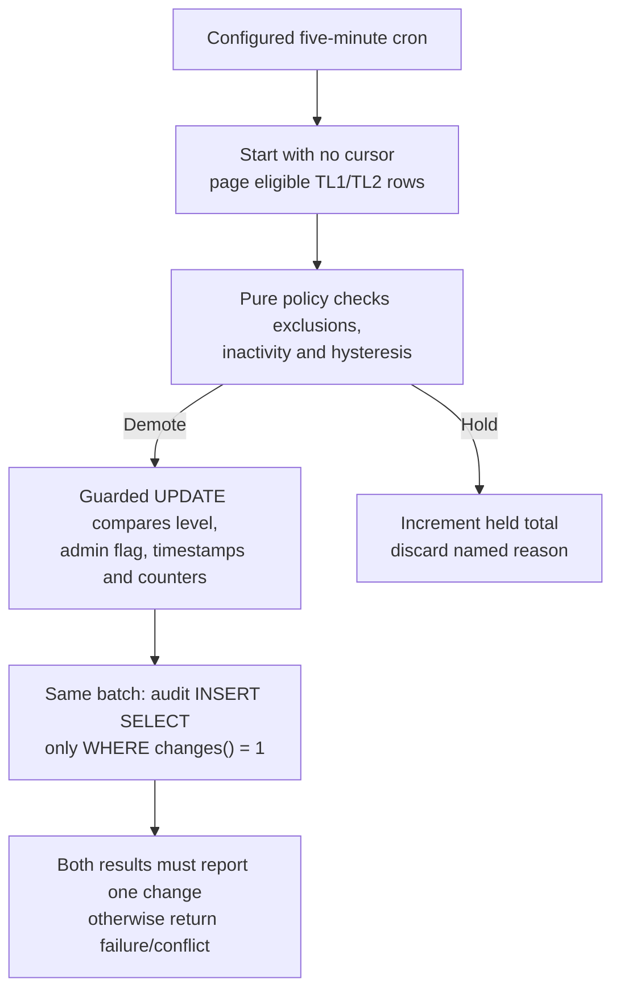
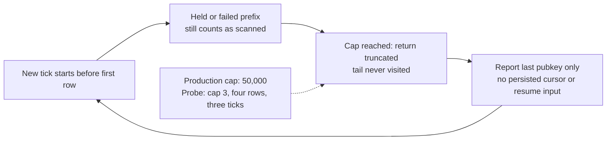
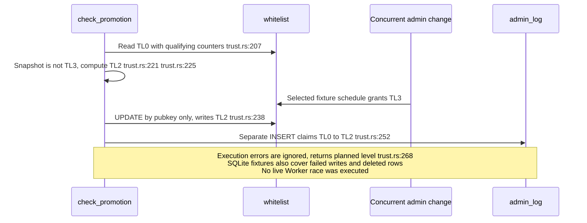
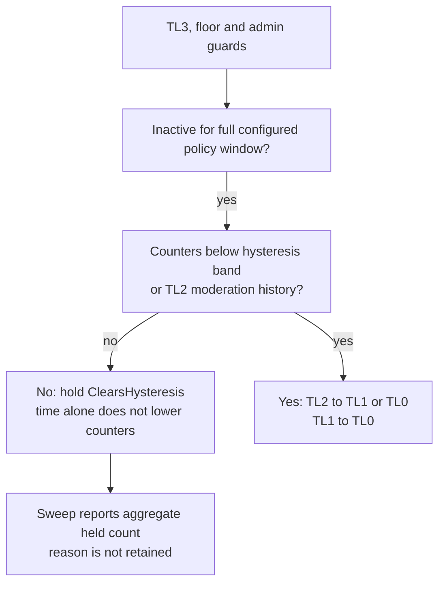

## For developers

[The trust-transition audit](../../estate-review/2026-11-01-forum-trust-transitions.md) records 32 native trust cases, five existing demotion SQL tests and six promotion SQL scenarios. Native cases call the actual policy/engine through its existing in-memory store. Promotion probes execute extracted SQL with chosen interleavings, not the async Worker handler or live D1.

## For the business

Members need stable rights and intelligible reasons for changes. Operators need an audit record that agrees with committed state and a sweep that eventually reaches every eligible member. A balanced counter alone establishes neither fairness nor an explanation.

## NF-24.1 Demotion commits only against the observed snapshot

## NF-24.2 Advancing within a sweep does not guarantee progress across ticks

The native fixture reproduces starvation at a smaller configurable cap. Production starvation requires a cap-sized eligible prefix that remains held or failed; no real membership population was inspected. Increasing the fixture budget reaches the tail, which is the positive control.

## NF-24.3 Promotion can overwrite a grant made after its read

## NF-24.4 Inactivity opens a gate; it does not age the counters

