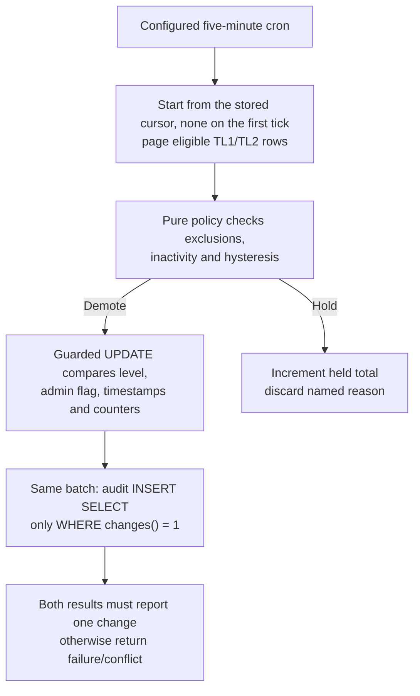
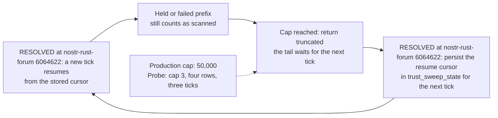
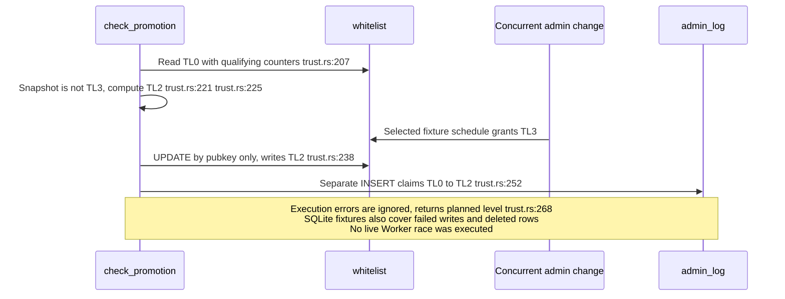
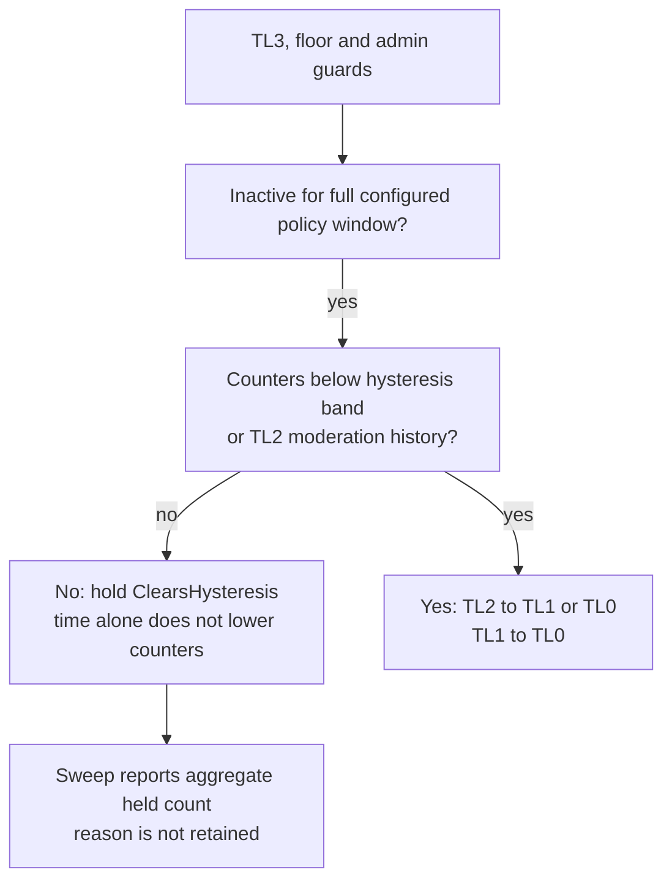

## For developers

The bounded-prefix starvation finding has a [scoped source-repair successor, NF-29](29-external-review-repairs.md#nf-293-notification-claims-and-bounded-sweeps-retain-concurrent-work). The starvation finding is marked resolved at the re-verified stamp 6064622; other trust consistency findings remain separate.

[The trust-transition audit](../../estate-review/2026-11-01-forum-trust-transitions.md) records 32 native trust cases, five existing demotion SQL tests and six promotion SQL scenarios. Native cases call the actual policy/engine through its existing in-memory store. Promotion probes execute extracted SQL with chosen interleavings, not the async Worker handler or live D1.

## For the business

Members need stable rights and intelligible reasons for changes. Operators need an audit record that agrees with committed state and a sweep that eventually reaches every eligible member. A balanced counter alone establishes neither fairness nor an explanation.

## NF-24.1 Demotion commits only against the observed snapshot

## NF-24.2 Advancing within a sweep does not guarantee progress across ticks

At the earlier stamp the native fixture reproduced starvation at a smaller configurable cap, because each tick restarted with no cursor. At 6064622 a truncated or aborted sweep stores its resume cursor and the next tick reads it back (`../nostr-rust-forum/crates/nostr-bbs-relay-worker/src/trust_sweep.rs:544-557`, `../nostr-rust-forum/crates/nostr-bbs-relay-worker/src/trust_sweep.rs:560-564`), so a held or failed prefix no longer hides the tail. No real membership population was inspected.

## NF-24.3 Promotion can overwrite a grant made after its read

## NF-24.4 Inactivity opens a gate; it does not age the counters

