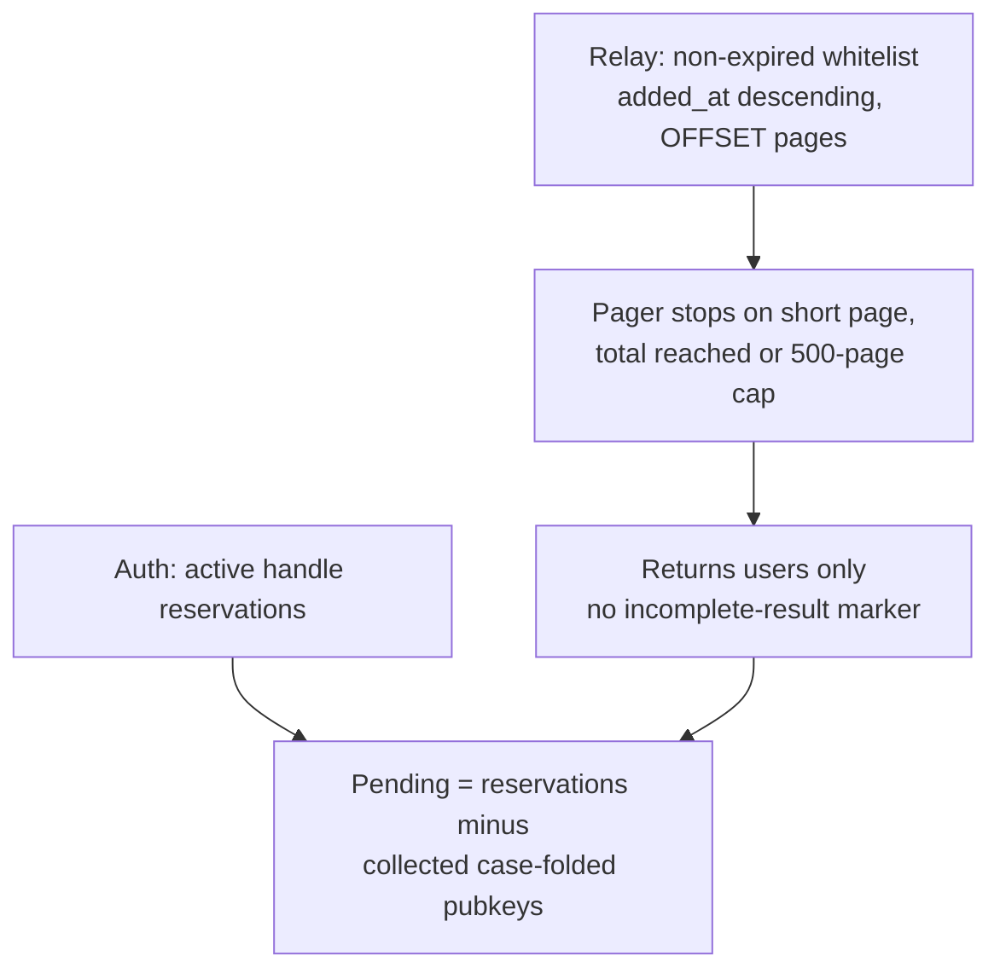
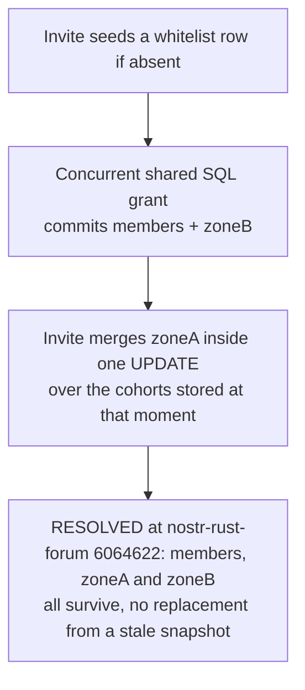
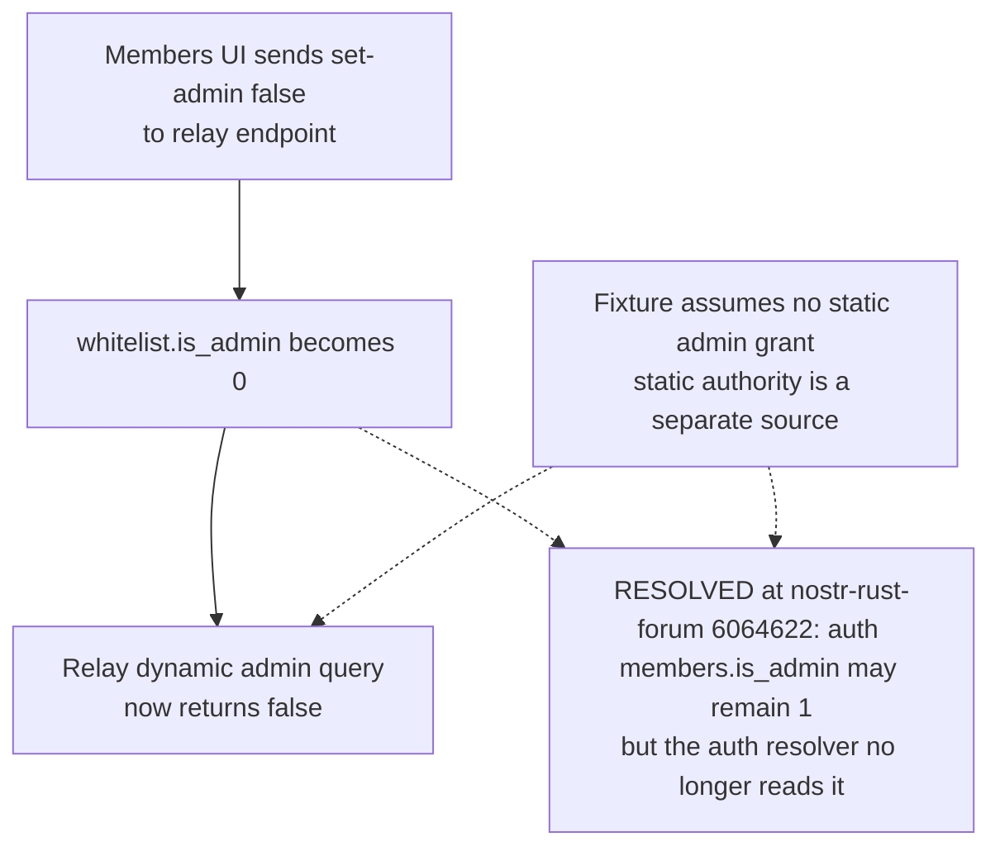
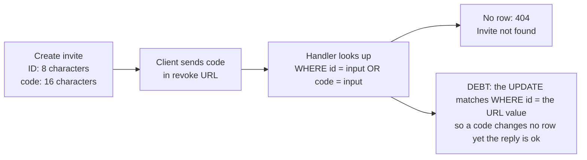
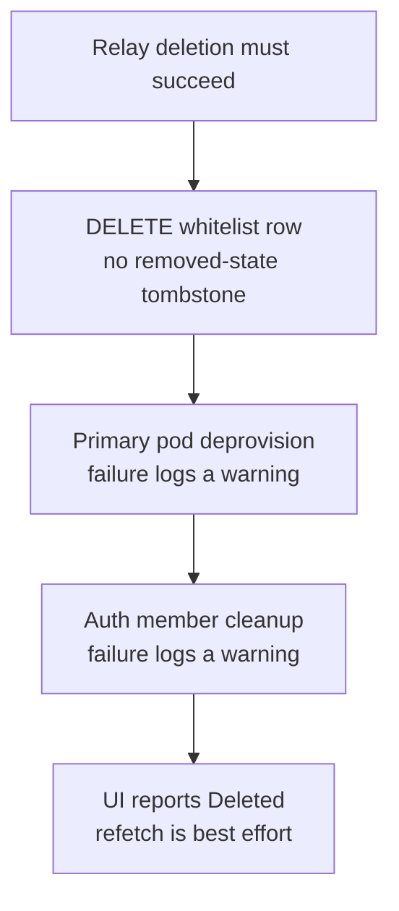
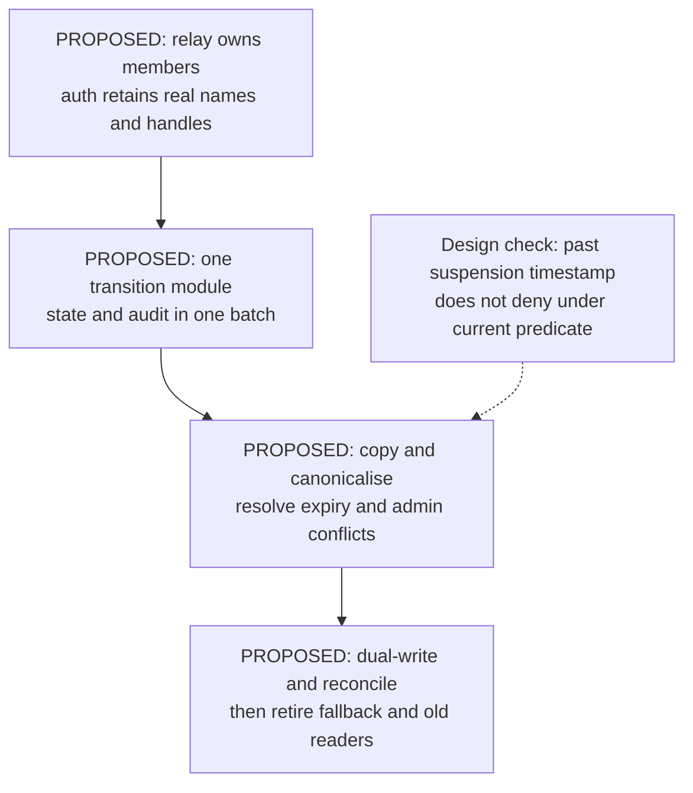

## For developers

The dynamic admin split and invite revoke/cohort findings have a [scoped source-repair successor, NF-29](29-external-review-repairs.md#nf-292-device-lifecycle-and-dynamic-administration-settle-at-their-owners). The dynamic admin split and invite cohort findings are marked resolved at the re-verified stamp 6064622; other membership findings remain separate.

[The membership audit](../../estate-review/2026-11-01-forum-membership-lifecycle.md) records 37 selected native cases and seven extracted-SQL scenarios. The pager uses the actual Rust implementation with synthetic pages. SQL cases exercise chosen schedules on SQLite, without running the async Worker handlers or live D1. Consolidation below is proposed, not deployed.

## For the business

Approving, demoting and removing a person should give an operator one intelligible result. Today the interface can derive Pending from an incomplete list and report deletion despite incomplete cleanup. A unified lifecycle needs receipts that explain those outcomes.

## NF-25.1 Pending depends on complete and consistent list reads

The native fixtures reproduce a missing 50,001st member and a live row skipped after deletion shifts the second OFFSET page. An expired row also stays invisible after a cohort grant because the shared statement preserves expiry. None of these cases used a production membership population.

## NF-25.2 Invite replacement can erase an intervening grant

At the earlier stamp this SQLite schedule lost zoneB. At 6064622 the invite merges inside one UPDATE and a native test asserts that members, zone-a and zone-b all survive (`../nostr-rust-forum/crates/nostr-bbs-auth-worker/src/invites.rs:267-278`). The shared grant SQL also tolerates a malformed legacy cohort value (`../nostr-rust-forum/crates/nostr-bbs-core/src/whitelist_sql.rs:66-72`).

## NF-25.3 A relay-only demotion leaves another source of authority

At the earlier stamp the auth resolver also consulted members. At 6064622 it reads only the static set and the relay whitelist (`../nostr-rust-forum/crates/nostr-bbs-auth-worker/src/admin.rs:62-83`), so a relay demotion is authoritative for both resolvers and a failed relay lookup returns false rather than falling through (`../nostr-rust-forum/crates/nostr-bbs-auth-worker/src/admin.rs:85`). The fixture executes the write and both store queries.

## NF-25.4 Invite creation and revocation use different identifiers

At the earlier stamp the lookup matched id only, so a revoke by code returned 404. At 6064622 the lookup also matches code, but the UPDATE still matches id only (`../nostr-rust-forum/crates/nostr-bbs-auth-worker/src/invites.rs:761-762`), so a revoke by code can report ok without changing a row; this is read from source, not executed.

## NF-25.5 Current deletion has separate cleanup outcomes

The storage fixture can grant a new row after deletion. It establishes missing tombstone enforcement, without demonstrating unauthorised re-admission or exercising pod deletion.

## NF-25.6 Consolidation remains a proposed migration

The bounded route/migration inventory finds no proposed relay membership module, table or unified endpoint. Phase 1's shared whitelist SQL and DDL exist. Copying a past expiry to a past suspension while declaring the member active needs a defined denial-preserving rule before migration equivalence can be claimed.
