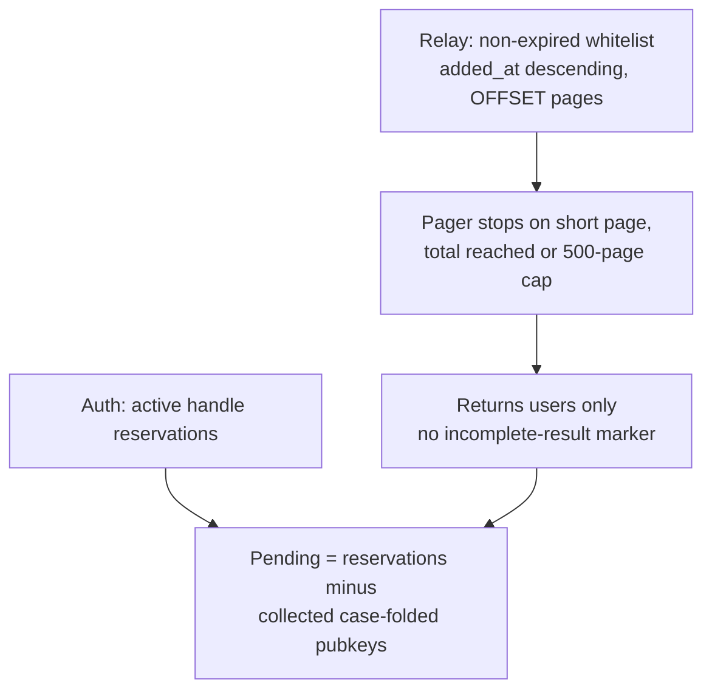
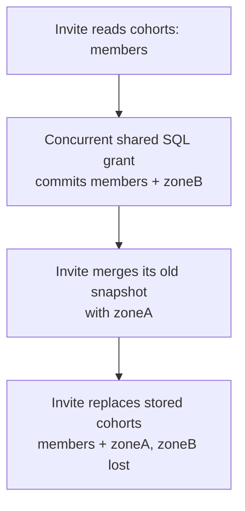
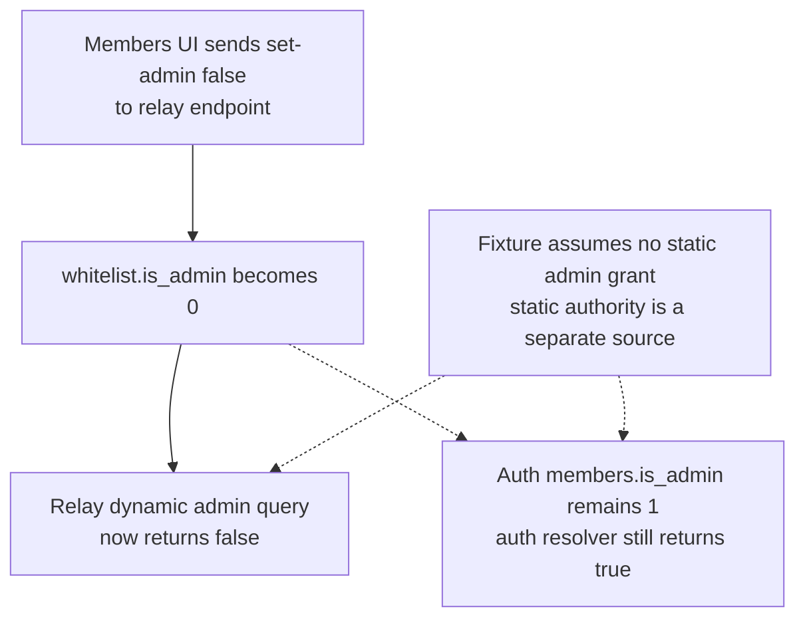
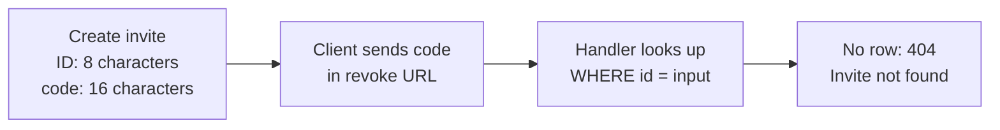
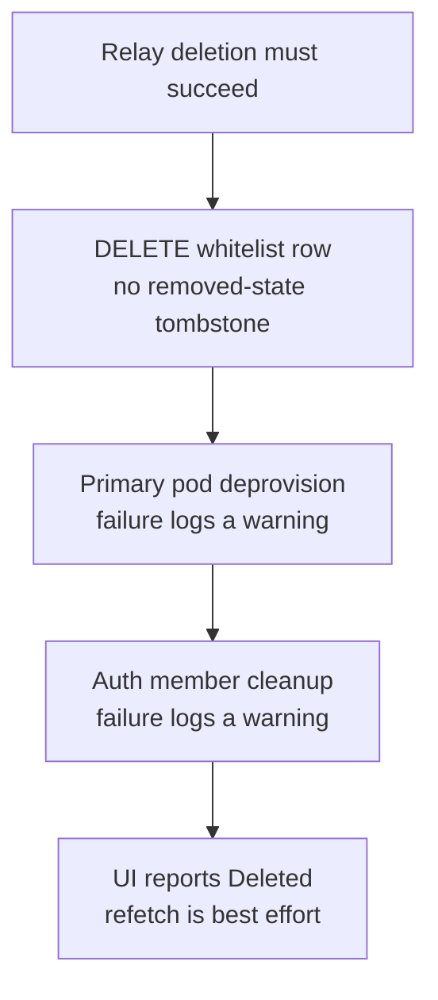
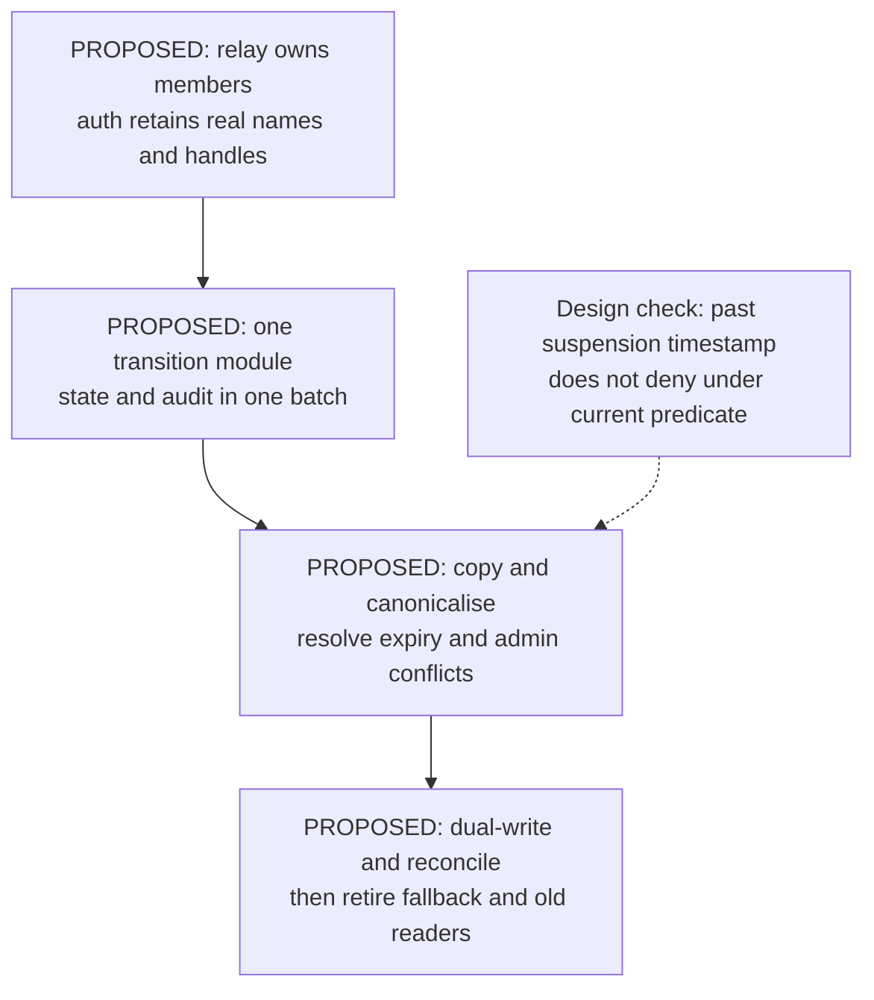

## For developers

[The membership audit](../../estate-review/2026-11-01-forum-membership-lifecycle.md) records 37 selected native cases and seven extracted-SQL scenarios. The pager uses the actual Rust implementation with synthetic pages. SQL cases exercise chosen schedules on SQLite, without running the async Worker handlers or live D1. Consolidation below is proposed, not deployed.

## For the business

Approving, demoting and removing a person should give an operator one intelligible result. Today the interface can derive Pending from an incomplete list, leave a second administrator grant intact, and report deletion despite incomplete cleanup. A unified lifecycle needs receipts that explain those outcomes.

## NF-25.1 Pending depends on complete and consistent list reads

The native fixtures reproduce a missing 50,001st member and a live row skipped after deletion shifts the second OFFSET page. An expired row also stays invisible after a cohort grant because the shared statement preserves expiry. None of these cases used a production membership population.

## NF-25.2 Invite replacement can erase an intervening grant

This is a selected SQLite schedule. The serial control keeps all three cohorts. Shared SQL itself preserves ordinary existing string grants, but added native cases show duplicate incoming values and a malformed legacy null array need stronger set validation.

## NF-25.3 A relay-only demotion leaves another source of authority

The fixture executes the write and both store queries. Resolver decisions are traced from source. The auth resolver may still grant after a failed relay lookup; an error in one source is not a denial from the union.

## NF-25.4 Invite creation and revocation use different identifiers

The SQL fixture misses by code and succeeds by ID. The client reports the error; this is a broken revocation contract, not a demonstrated silent success.

## NF-25.5 Current deletion has separate cleanup outcomes

The storage fixture can grant a new row after deletion. It establishes missing tombstone enforcement, without demonstrating unauthorised re-admission or exercising pod deletion.

## NF-25.6 Consolidation remains a proposed migration

The bounded route/migration inventory finds no proposed relay membership module, table or unified endpoint. Phase 1's shared whitelist SQL and DDL exist. Copying a past expiry to a past suspension while declaring the member active needs a defined denial-preserving rule before migration equivalence can be claimed.
