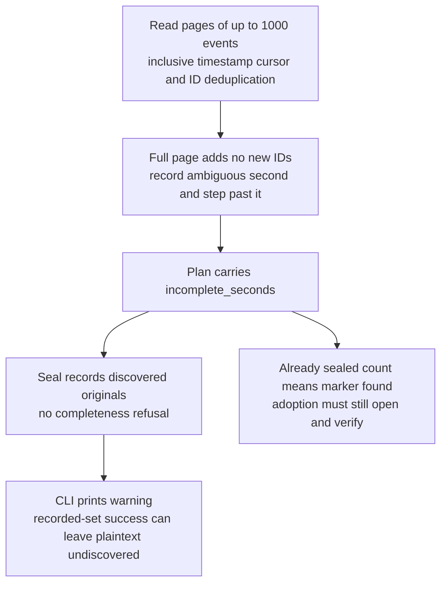
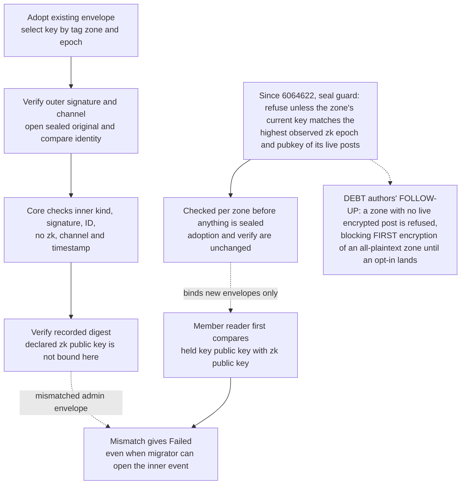
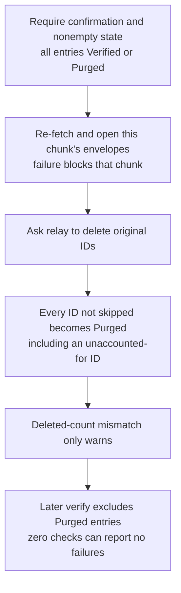
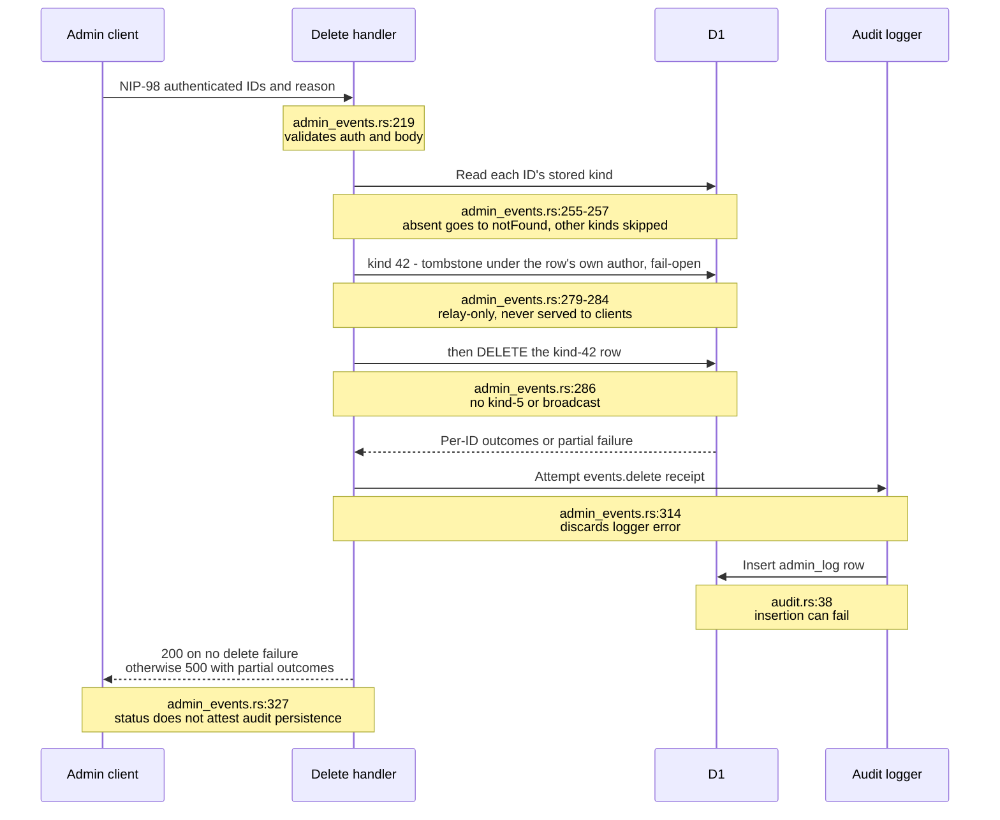
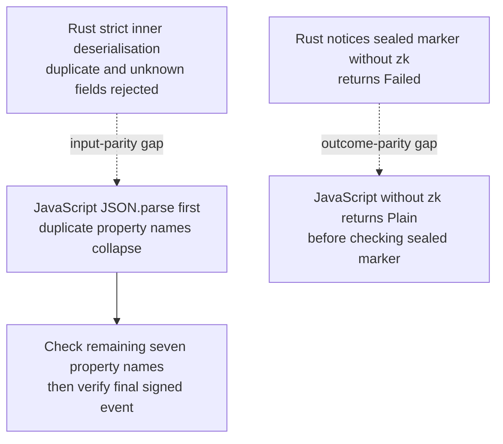
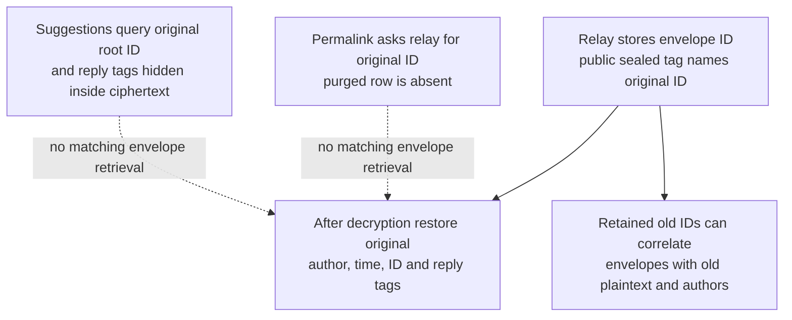
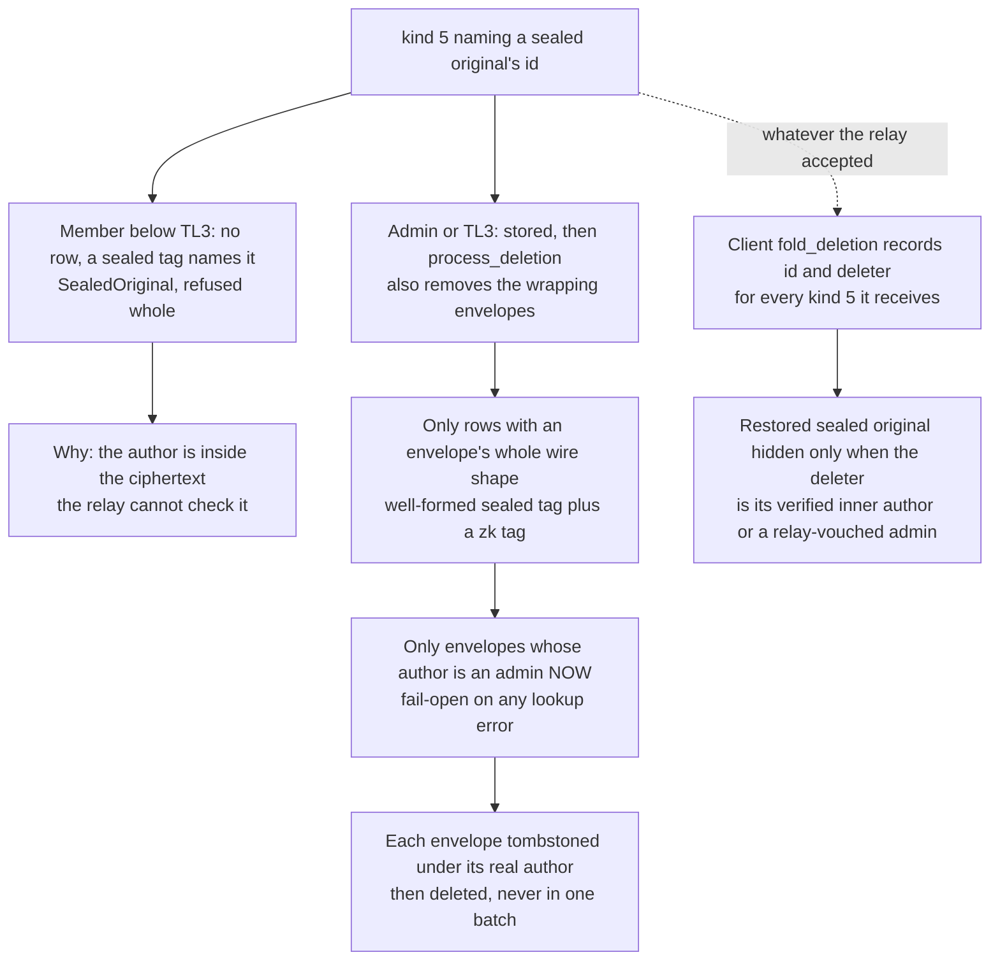
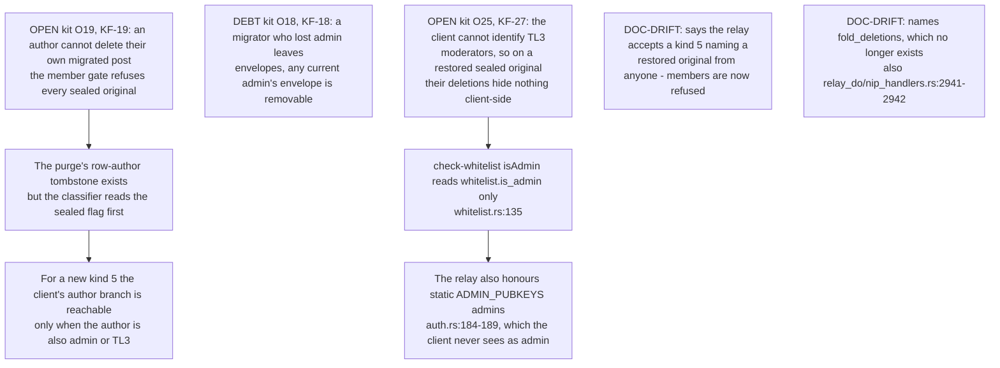

## For developers

[The sealed-history audit](../../estate-review/2026-11-01-forum-sealed-history.md) records source-backed ADR-2017 dispositions and synthetic fault cases. Core cryptography and migration code execute locally; no production relay, key or purge is involved. The fixture relay does not replace Worker/D1 integration evidence.

## For the business

History can remain signed by its original authors after encryption. An operator still needs separate evidence that every message was discovered, members can read the replacement, plaintext was removed and the audit receipt survived. A single success counter does not establish all four.

## NF-26.1 Discovery warnings survive only in the report

## NF-26.2 Migrator and member reader require different key checks

## NF-26.3 Purge state trusts an incomplete success response

## NF-26.4 Silent deletion, relay tombstone and audit receipt are separate operations

The tombstone stops the purged plaintext being published again, including after the zone's encryption is turned off; a D1 backup taken before the purge still restores it (`../nostr-rust-forum/crates/nostr-bbs-relay-worker/src/admin_events.rs:26-34`).

## NF-26.5 Malformed-input outcomes differ across readers

## NF-26.6 Preserved identity does not restore every lookup

## NF-26.7 Deleting a sealed original — relay gate, moderator envelope removal, client honour rule

`classify_member_target` reads the sealed flag before the tombstone flag (`../nostr-rust-forum/crates/nostr-bbs-relay-worker/src/relay_do/nip_handlers.rs:3054-3055`), and the member refusal says the purge does not yet record original authors (`../nostr-rust-forum/crates/nostr-bbs-relay-worker/src/relay_do/nip_handlers.rs:2960-2962`). A moderator's removal is fail-open (`../nostr-rust-forum/crates/nostr-bbs-relay-worker/src/relay_do/nip_handlers.rs:3401-3403`), and envelopes go one by one, tombstone then delete (`../nostr-rust-forum/crates/nostr-bbs-relay-worker/src/relay_do/nip_handlers.rs:3450-3461`).

## NF-26.8 Open items on sealed-original deletion

The two `fold_deletions` comments are recorded as left alone in ADR-2017's 2026-11-22 section (`../nostr-rust-forum/docs/adr/ADR-2017-sealed-original-history-migration.md:262`); `tombstones::fold_deletion` replaced the function (`../nostr-rust-forum/crates/nostr-bbs-forum-client/src/stores/tombstones.rs:164`).
