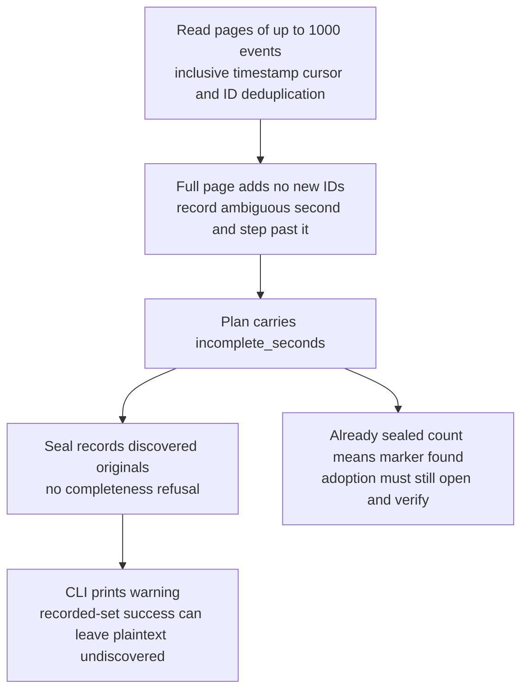
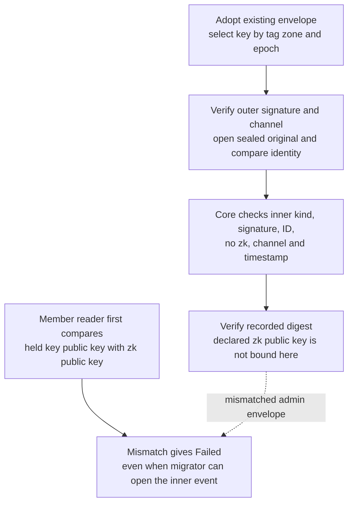
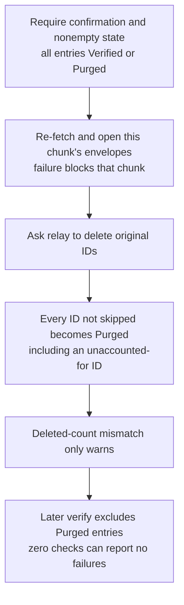
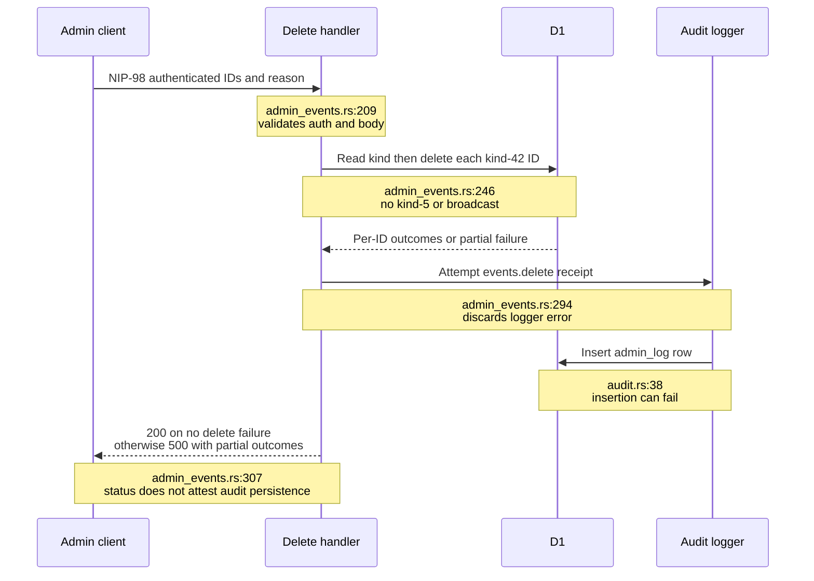
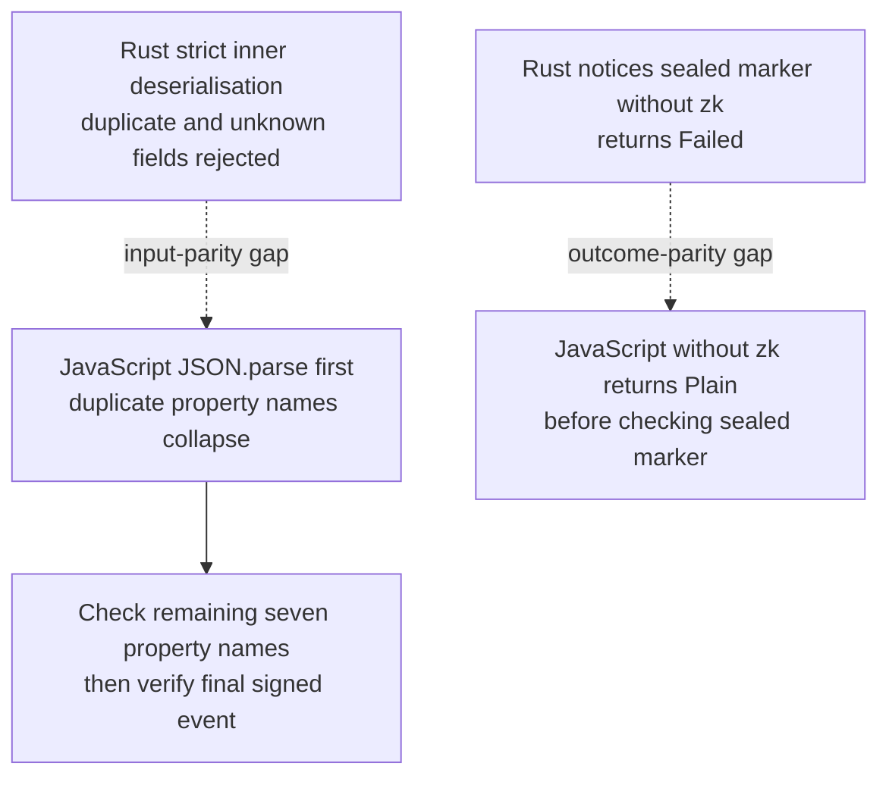
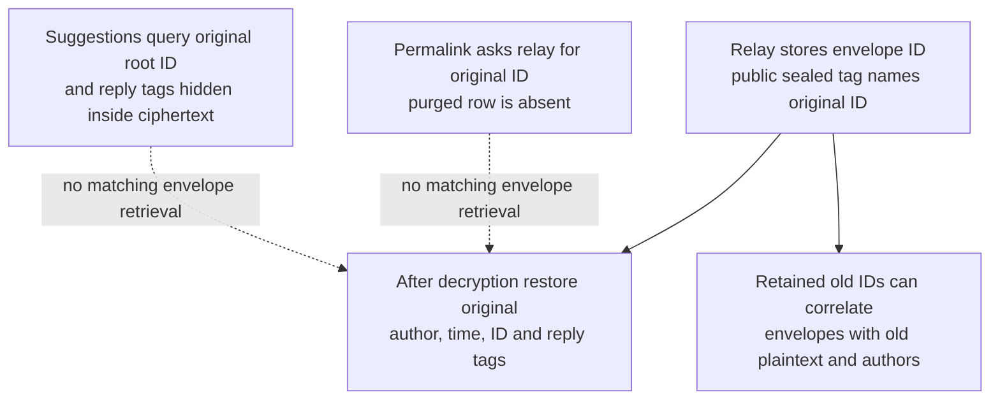

## For developers

[The sealed-history audit](../../estate-review/2026-11-01-forum-sealed-history.md) records source-backed ADR-2017 dispositions and synthetic fault cases. Core cryptography and migration code execute locally; no production relay, key or purge is involved. The fixture relay does not replace Worker/D1 integration evidence.

## For the business

History can remain signed by its original authors after encryption. An operator still needs separate evidence that every message was discovered, members can read the replacement, plaintext was removed and the audit receipt survived. A single success counter does not establish all four.

## NF-26.1 Discovery warnings survive only in the report

## NF-26.2 Migrator and member reader require different key checks

## NF-26.3 Purge state trusts an incomplete success response

## NF-26.4 Silent deletion and audit receipt are separate operations

## NF-26.5 Malformed-input outcomes differ across readers

## NF-26.6 Preserved identity does not restore every lookup

