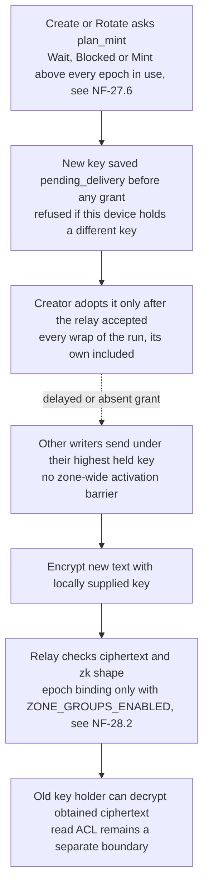
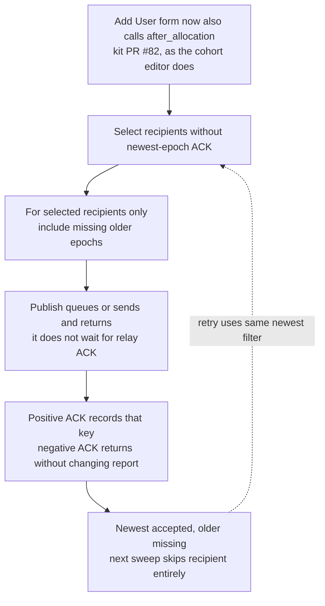
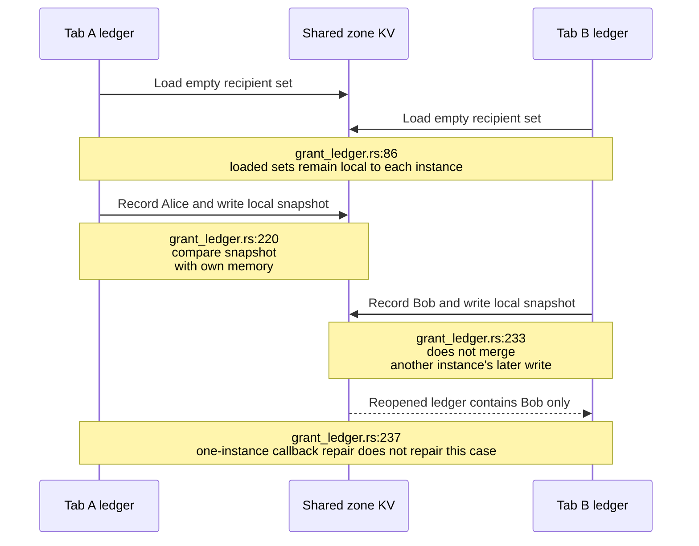
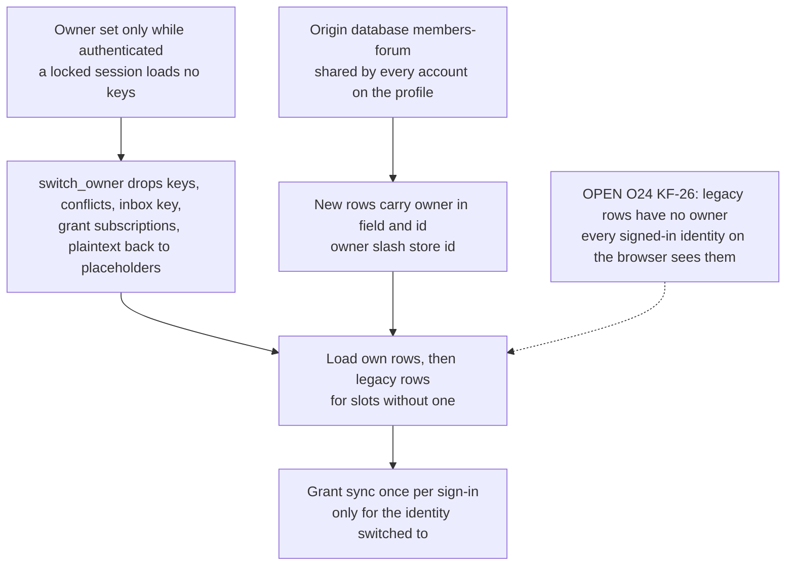
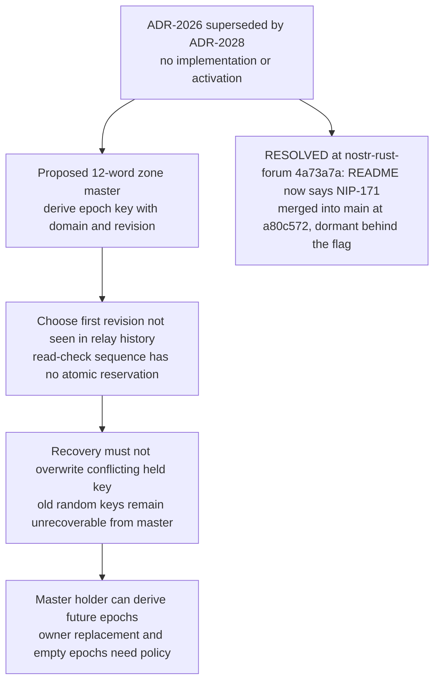
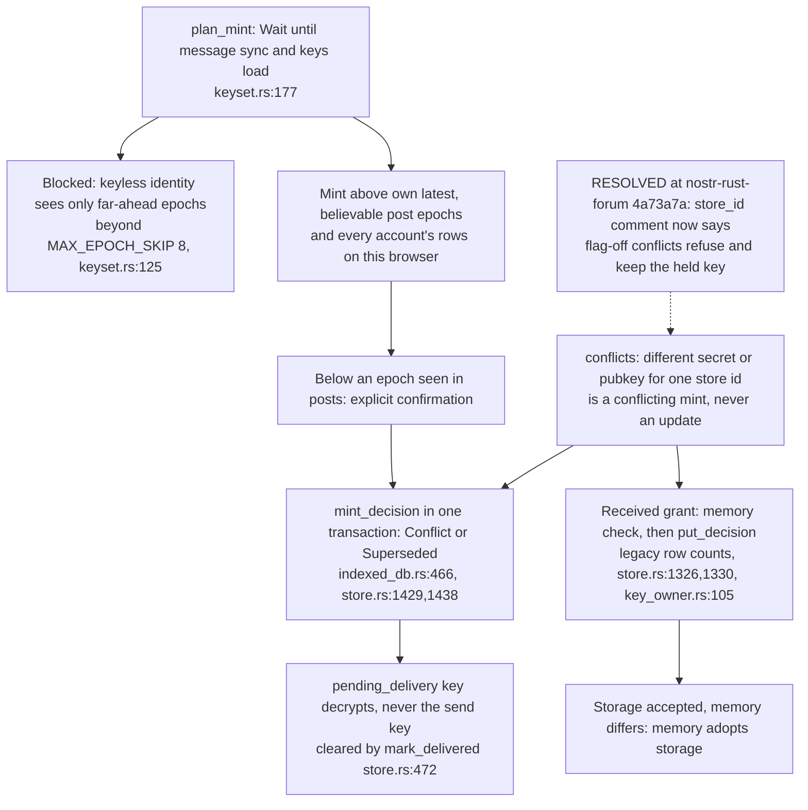
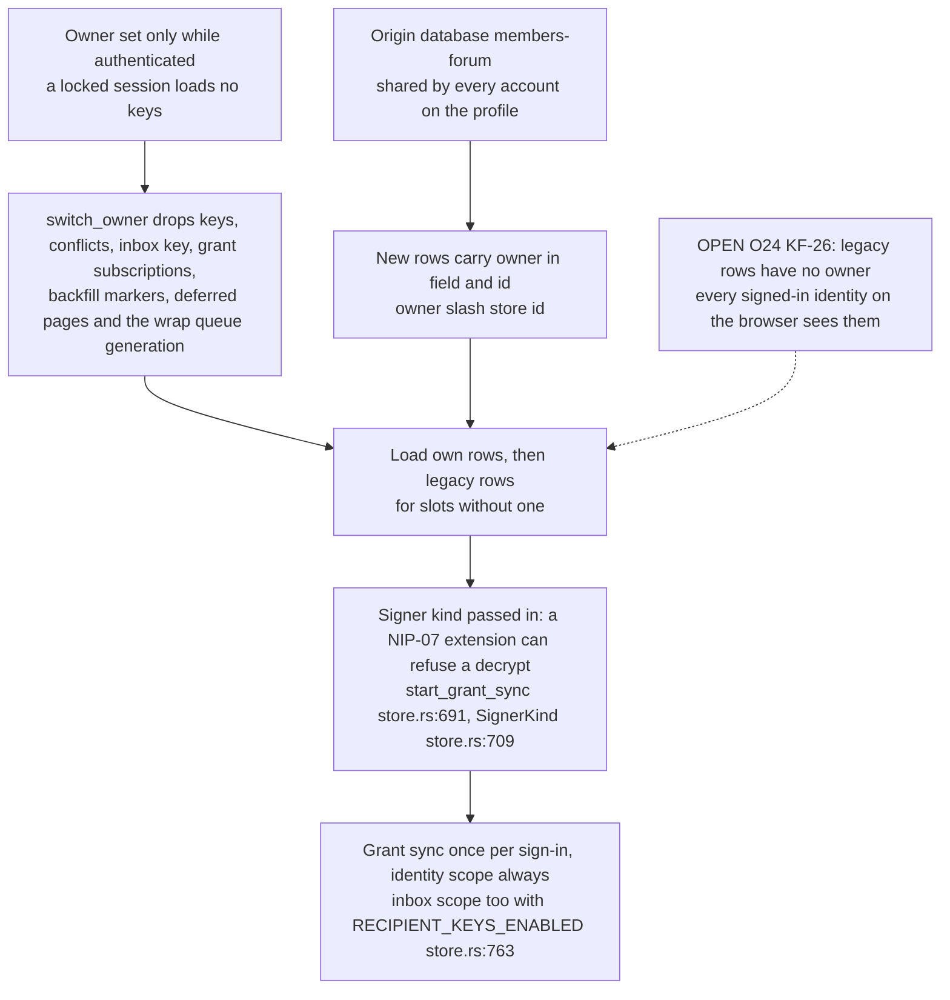
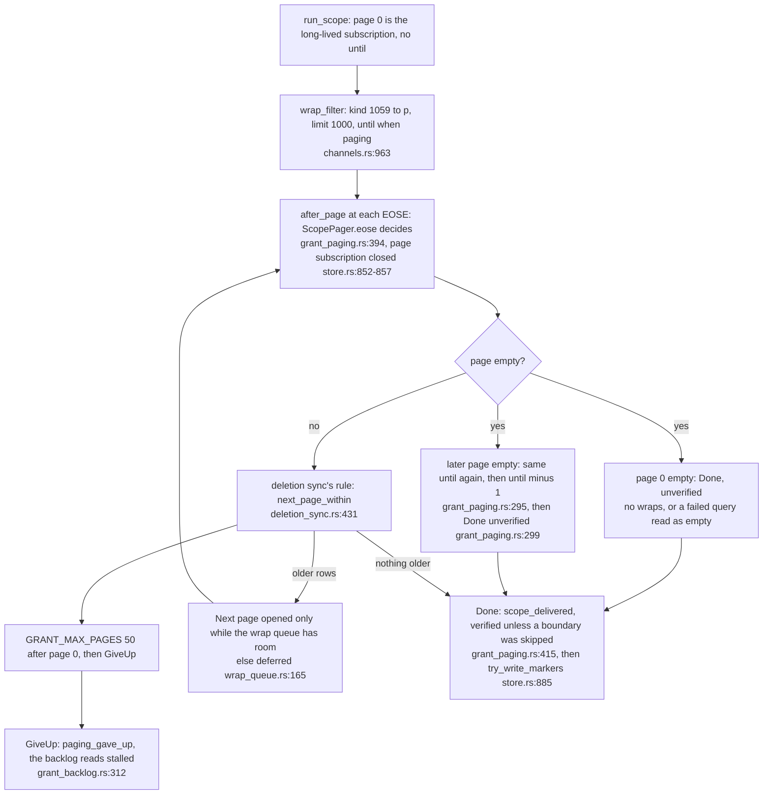
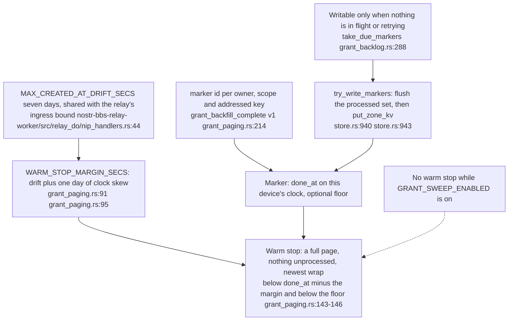
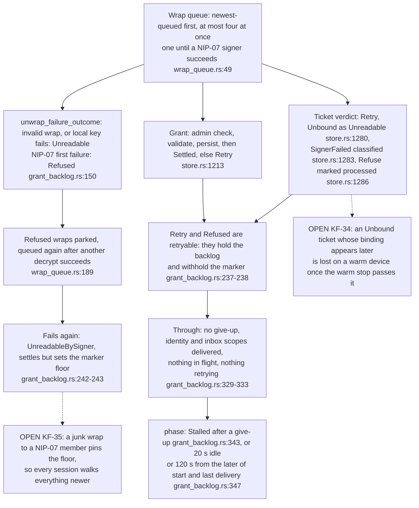

## For developers

[The audit report](../../estate-review/2026-11-01-forum-zone-key-distribution.md) assesses all sections of ADR-2016 and superseded ADR-2026. Native probes establish planning, ledger and crypto behaviour; full relay/browser acceptance remains untested. Re-verified at af4f0d5: the epoch guards (kit PRs #83, #84, #87) and per-identity key rows (#92) are drawn in NF-27.1, NF-27.4 and NF-27.6; the audit predates them and was not re-run. The NIP-171 key plane is on main since a80c572 but dormant (NF-28); the flag-off path is drawn here. Re-verified at de31aaa: kit PR #95 pages the grant backlog past the relay's 1,000-row cap and records per-identity, per-scope backfill markers (NF-27.7 to NF-27.10, superseding NF-27.4); its open limits are KF-31 to KF-35 in the known-findings table (`../nostr-rust-forum/docs/security/known-findings.md:108-112`), collected in NF-32.

## For the business

A generated key, an accepted grant and a member able to read are different outcomes. Administrators need a clear activation state, repairable history delivery and tested device recovery before they can rely on removal or recovery promises. Since kit PR #95 a member with many direct messages no longer silently misses their oldest zone keys on a new device: the forum keeps fetching older pages until it has seen everything, or says the keys are late. On 2026-11-24, after the website moved to this kit commit, the operator opened a Family topic link on a fresh device three times: "Fetching your keys" appeared at 4.5 to 5.4 seconds and the topic with decrypted posts at 11.7 to 13.0 seconds, never "Topic Not Found" (two days earlier the same test took 9.2 and 28.4 seconds). That is a live observation, not a code citation.

## NF-27.1 Rotation guards the creator, not every writer

**What it shows.** Since kit PR #83 a rotation whose grants fail no longer leaves new posts readable only on the creator's device. A member who has not yet received the new key still writes under the old one, and the relay does not refuse it.

## NF-27.2 Newest-key acknowledgement can hide missing history

## NF-27.3 Grant-ledger repair is scoped to one instance

## NF-27.4 Zone keys follow the signed-in identity, legacy rows stay shared
> **Superseded** by NF-27.7 at de31aaa (frozen at 4a73a7a).

**What it shows.** Logout itself still resets no key state (`../nostr-rust-forum/crates/nostr-bbs-forum-client/src/auth/mod.rs:676`); the store's auth effect does it (`../nostr-rust-forum/crates/nostr-bbs-forum-client/src/zone_crypto/store.rs:1226-1230`). Rows are never deleted, so isolation is per identity in the UI, not access control (`../nostr-rust-forum/crates/nostr-bbs-forum-client/src/zone_crypto/key_owner.rs:21-24`).

## NF-27.5 Recovery proposal is superseded and unimplemented on main

## NF-27.6 Four guards keep one key per zone and epoch

**What it shows.** Kit PRs #84 and #87: a held key is never replaced by a different one for its slot, and a refused grant is recorded and settled (`../nostr-rust-forum/crates/nostr-bbs-forum-client/src/zone_crypto/store.rs:1330-1340`). Kit PR #99 corrected the `store_id` comment that predated that guard (`../nostr-rust-forum/crates/nostr-bbs-forum-client/src/zone_crypto/mod.rs:214-218`).

## NF-27.7 Zone keys follow the signed-in identity, and so does the paged grant sync

**What it shows.** The auth effect still drives the switch (`../nostr-rust-forum/crates/nostr-bbs-forum-client/src/zone_crypto/store.rs:1747-1752`); each scope pages as NF-27.8 draws. Rows are never deleted, so isolation is per identity in the UI, not access control (`../nostr-rust-forum/crates/nostr-bbs-forum-client/src/zone_crypto/key_owner.rs:21-24`).

## NF-27.8 One grant scope pages past the relay's row cap

**What it shows.** Kit PR #95: a scope holds at most two subscriptions, page 0 and the current page (`../nostr-rust-forum/crates/nostr-bbs-forum-client/src/zone_crypto/store.rs:774-781`). **Debt (KF-31):** the relay answers a failed query as empty plus EOSE, so an empty page 0 is only unverified, never an error (`../nostr-rust-forum/docs/security/known-findings.md:108`). **Debt (KF-32, KF-33):** past 51,000 wraps, or a full page of one timestamp, the scope gives up every session (`../nostr-rust-forum/docs/security/known-findings.md:109-110`).

## NF-27.9 The backfill marker and the eight-day warm stop

**What it shows.** A wrap that reached the relay after the last backfill is dated at most seven days before it landed, so it sorts above any page eight days below the marker (`../nostr-rust-forum/crates/nostr-bbs-forum-client/src/zone_crypto/grant_paging.rs:48-71`). **Invariant:** the client's margin and the relay's ingress bound read one constant (`../nostr-rust-forum/crates/nostr-bbs-forum-client/src/zone_crypto/grant_paging.rs:91`, `../nostr-rust-forum/crates/nostr-bbs-relay-worker/src/relay_do/nip_handlers.rs:44`).

## NF-27.10 How each wrap ends, and when the backlog may settle

**What it shows.** A refused NIP-07 prompt is never taken as an unreadable wrap on its first attempt, so the backlog cannot settle over a grant that was only refused (`../nostr-rust-forum/crates/nostr-bbs-forum-client/src/zone_crypto/grant_backlog.rs:131-143`). **Open (KF-34):** a prerequisite for enabling `ZONE_GROUPS_ENABLED` (`../nostr-rust-forum/docs/security/known-findings.md:111`, `../nostr-rust-forum/docs/adr/ADR-2028-zones-adopt-nip171-key-plane.md:153-160`).
