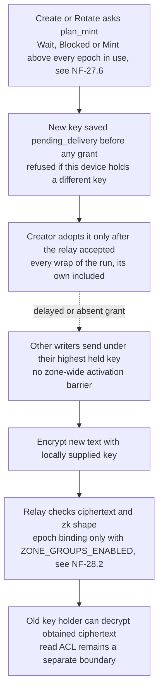
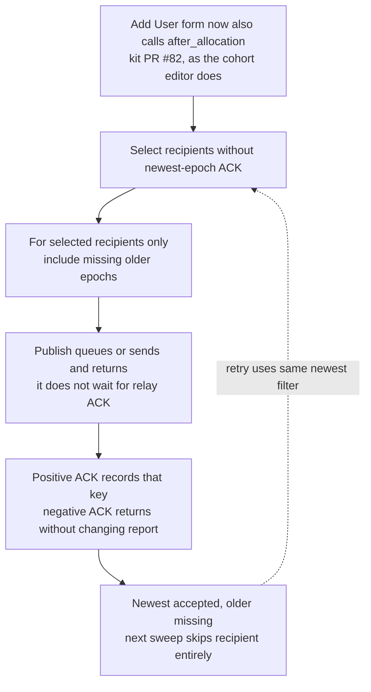
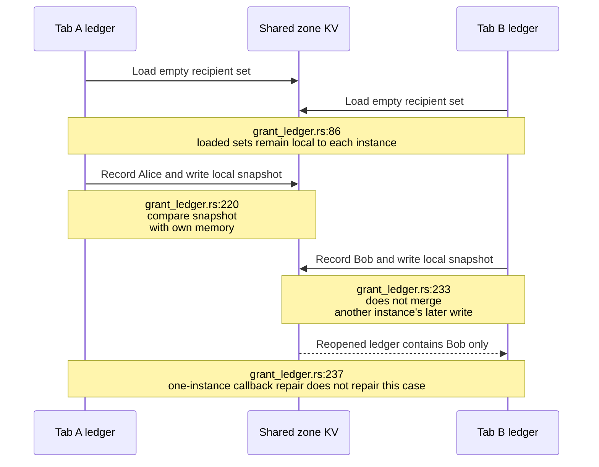
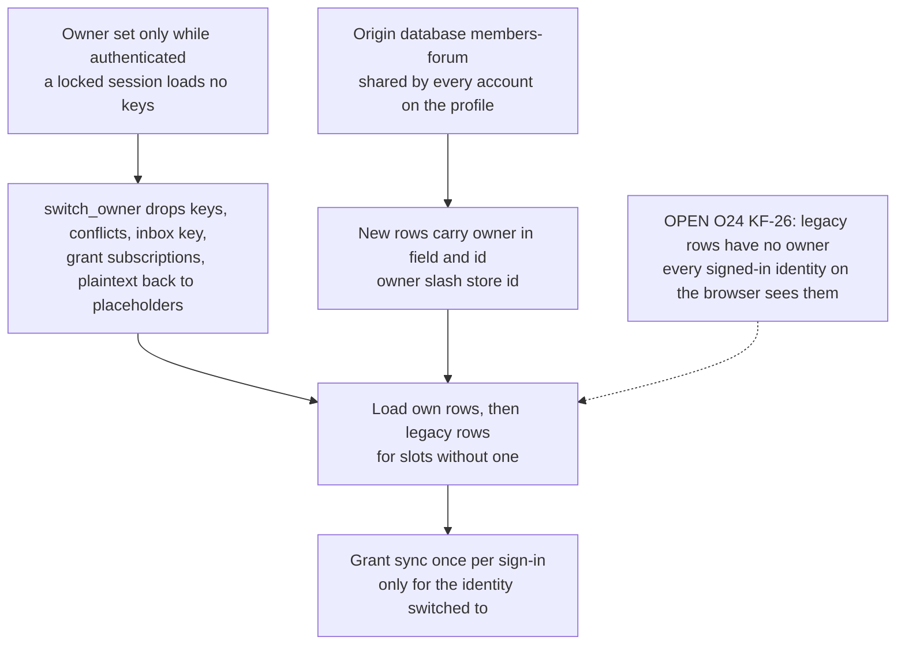
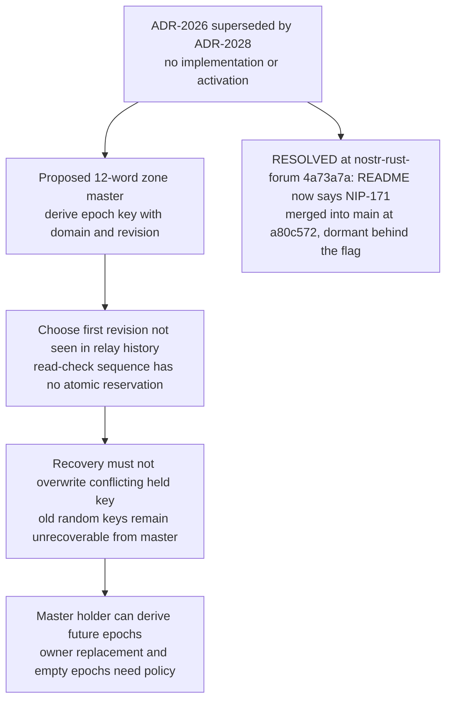

## For developers

[The audit report](../../estate-review/2026-11-01-forum-zone-key-distribution.md) assesses all sections of ADR-2016 and superseded ADR-2026. Native probes establish planning, ledger and crypto behaviour; full relay/browser acceptance remains untested. Re-verified at af4f0d5: the epoch guards (kit PRs #83, #84, #87) and per-identity key rows (#92) are drawn in NF-27.1, NF-27.4 and NF-27.6; the audit predates them and was not re-run. The NIP-171 key plane is on main since a80c572 but dormant (NF-28); the flag-off path is drawn here.

## For the business

A generated key, an accepted grant and a member able to read are different outcomes. Administrators need a clear activation state, repairable history delivery and tested device recovery before they can rely on removal or recovery promises.

## NF-27.1 Rotation guards the creator, not every writer

**What it shows.** Since kit PR #83 a rotation whose grants fail no longer leaves new posts readable only on the creator's device. A member who has not yet received the new key still writes under the old one, and the relay does not refuse it.

## NF-27.2 Newest-key acknowledgement can hide missing history

## NF-27.3 Grant-ledger repair is scoped to one instance

## NF-27.4 Zone keys follow the signed-in identity, legacy rows stay shared

**What it shows.** Logout itself still resets no key state (`../nostr-rust-forum/crates/nostr-bbs-forum-client/src/auth/mod.rs:676`); the store's auth effect does it (`../nostr-rust-forum/crates/nostr-bbs-forum-client/src/zone_crypto/store.rs:1226-1230`). Rows are never deleted, so isolation is per identity in the UI, not access control (`../nostr-rust-forum/crates/nostr-bbs-forum-client/src/zone_crypto/key_owner.rs:21-24`).

## NF-27.5 Recovery proposal is superseded and unimplemented on main

## NF-27.6 Four guards keep one key per zone and epoch

**What it shows.** Kit PRs #84 and #87: a held key is never replaced by a different one for its slot, and a refused grant is recorded and settled (`../nostr-rust-forum/crates/nostr-bbs-forum-client/src/zone_crypto/store.rs:869-879`). Kit PR #99 corrected the `store_id` comment that predated that guard (`../nostr-rust-forum/crates/nostr-bbs-forum-client/src/zone_crypto/mod.rs:208-212`).
