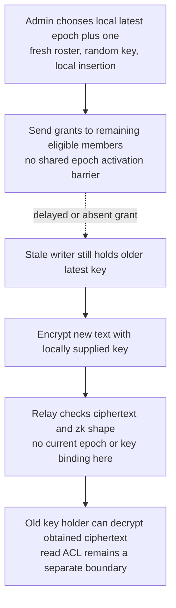
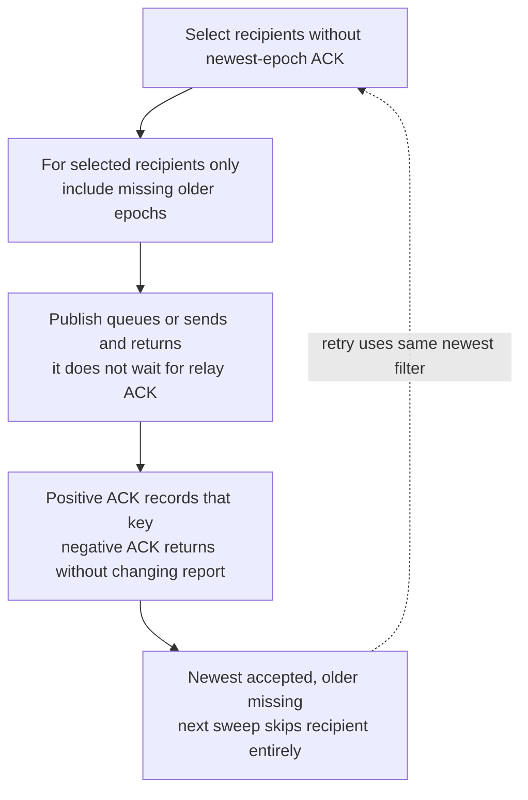
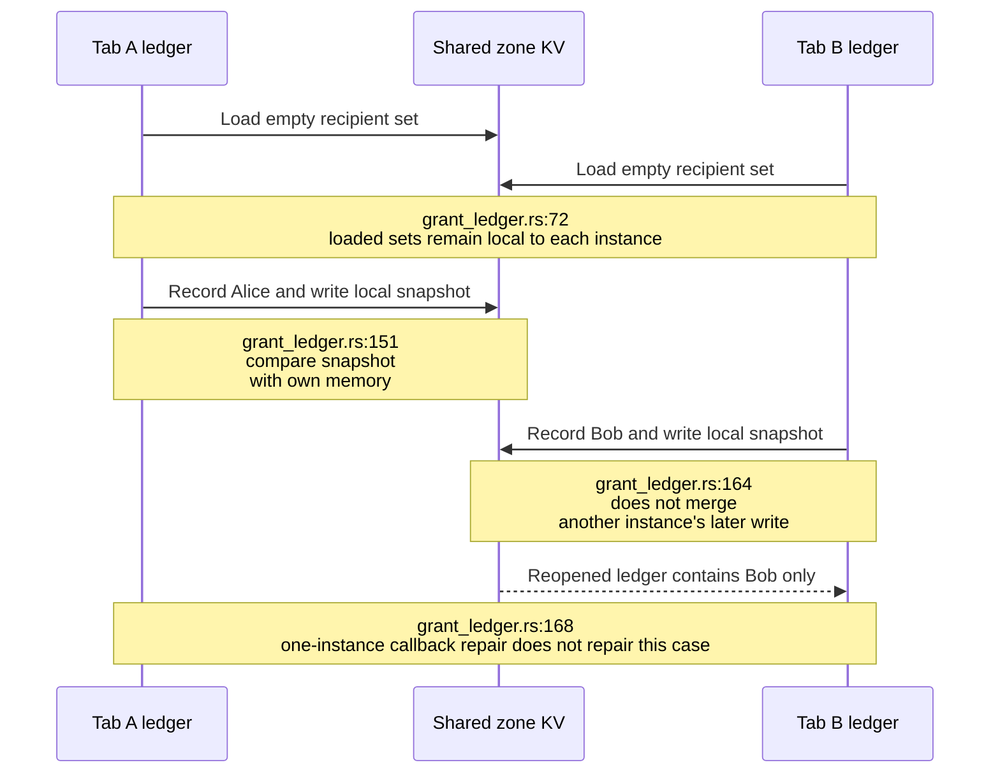
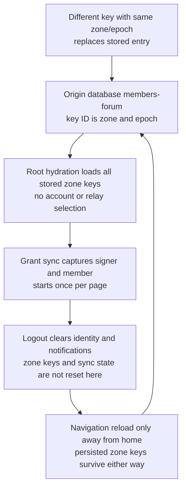
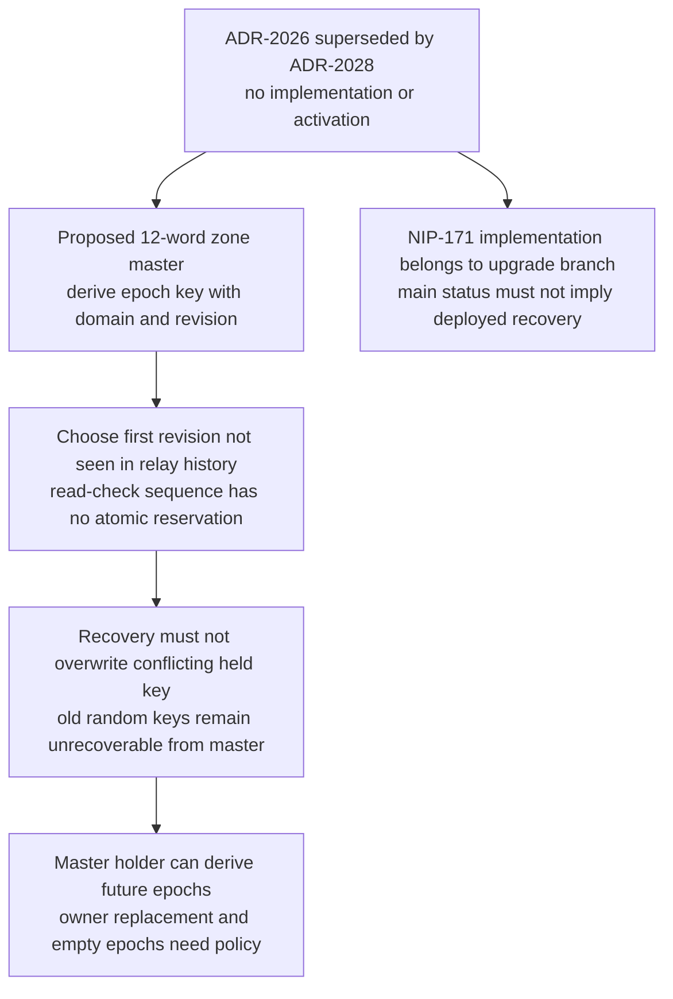

## For developers

[The audit report](../../estate-review/2026-11-01-forum-zone-key-distribution.md) assesses all sections of ADR-2016 and superseded ADR-2026. Native probes establish planning, ledger and crypto behaviour; account switching and full relay/browser acceptance remain untested. The NIP-171 upgrade branch is separate from the main implementation drawn here.

## For the business

A generated key, an accepted grant and a member able to read are different outcomes. Administrators need a clear activation state, repairable history delivery and tested device recovery before they can rely on removal or recovery promises.

## NF-27.1 Rotation does not force every writer onto the new epoch

## NF-27.2 Newest-key acknowledgement can hide missing history

## NF-27.3 Grant-ledger repair is scoped to one instance

## NF-27.4 Account identity and zone-key custody have different lifetimes

## NF-27.5 Recovery proposal is superseded and unimplemented on main

