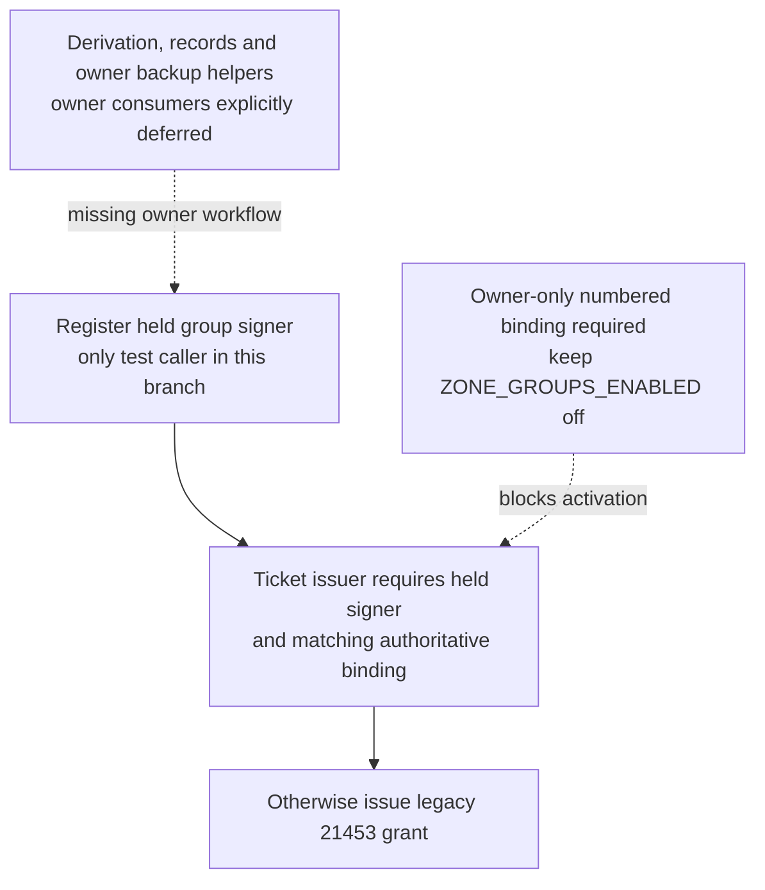
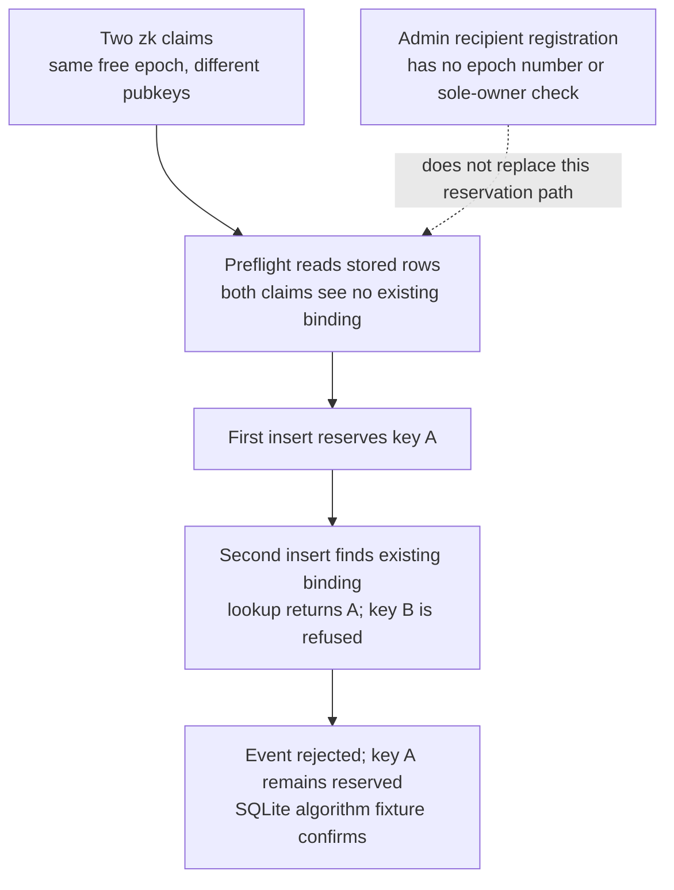
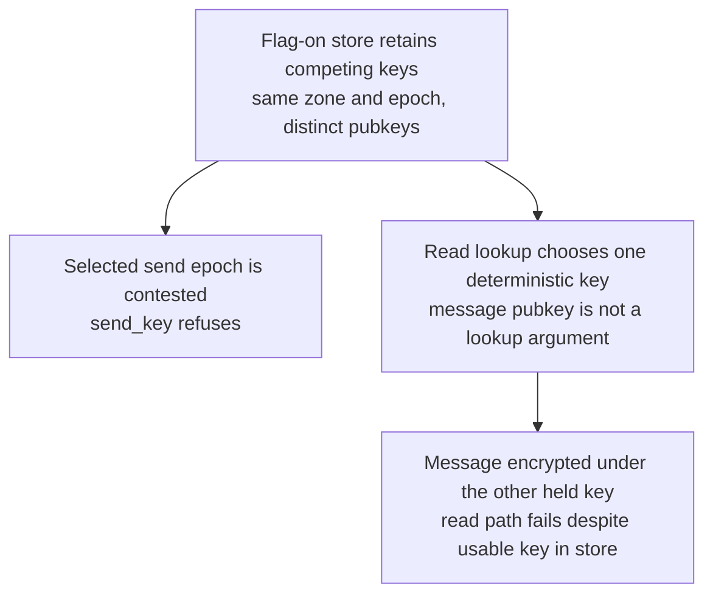
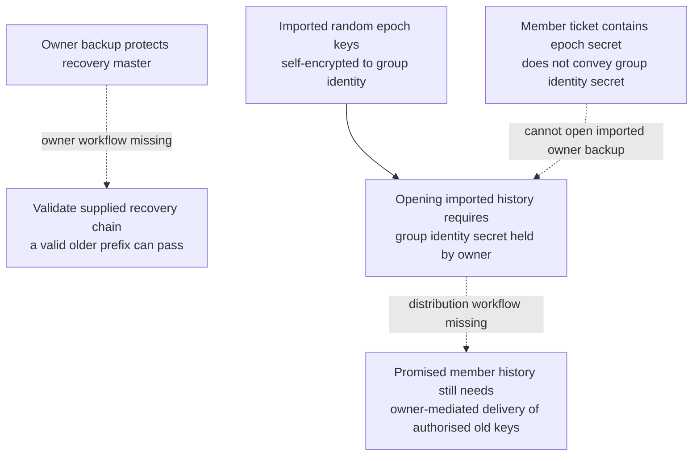
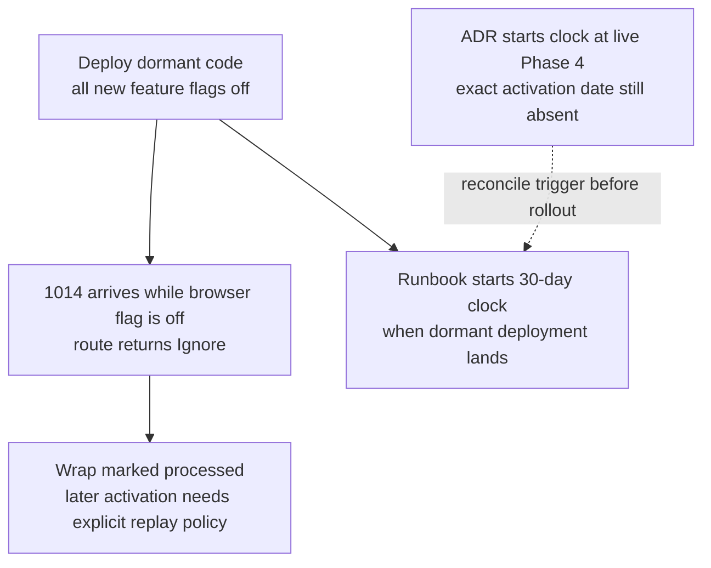
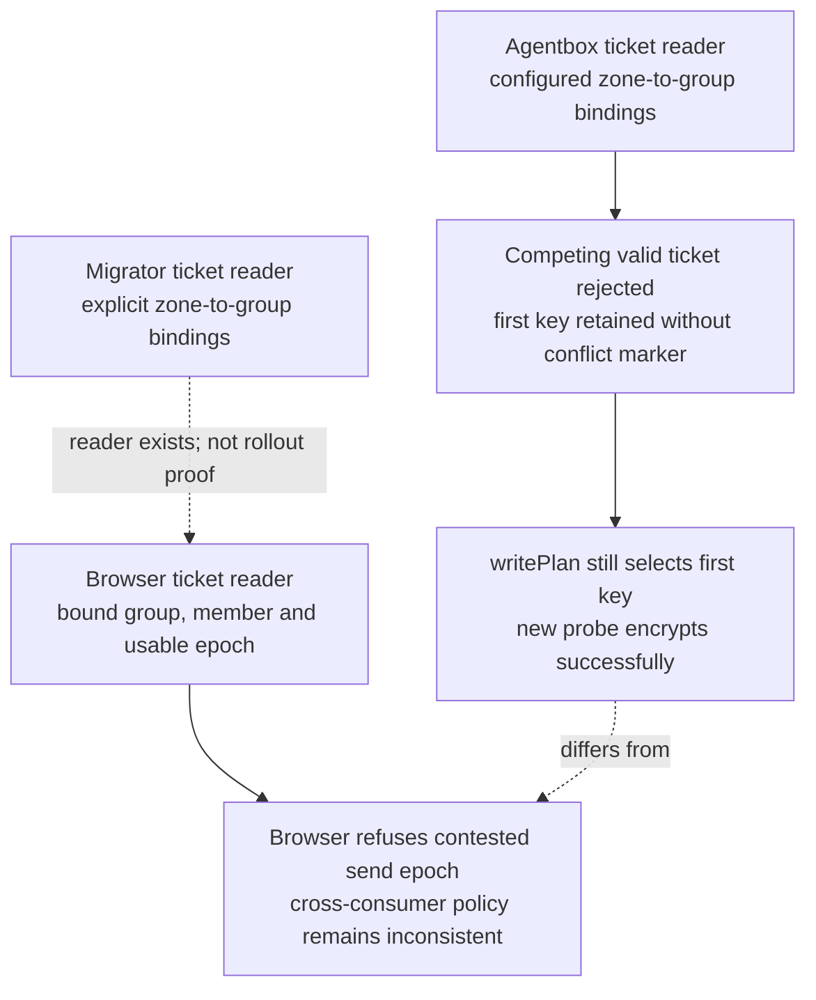

## For developers

These panels describe the **local upgrade branch**, not main or a live deployment. [The audit](../../estate-review/2026-11-01-forum-nip171-keyplane.md) assesses ADR-2028 section by section and records 220 bounded native/Node tests. Owner flows and scratch migration remain incomplete. NF-27 describes the separate main implementation.

## For the business

A recovery phrase and passing derivation tests do not yet constitute a recoverable zone. Owners need a verified restore workflow; ordinary members need the intended history without receiving owner authority. Conflicting keys must produce consistent behaviour across browsers and agents before activation.

## NF-28.1 Implemented primitives stop short of owner activation

## NF-28.2 A refused multi-claim event can leave a reservation

## NF-28.3 Browser conflict storage and historical lookup diverge

## NF-28.4 Owner restore and member history require different delivery paths

## NF-28.5 Dormant deployment does not prove reader readiness

## NF-28.6 Dual readers do not yet share one conflict contract

