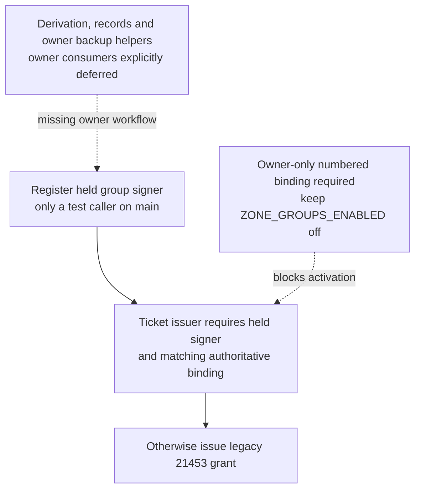
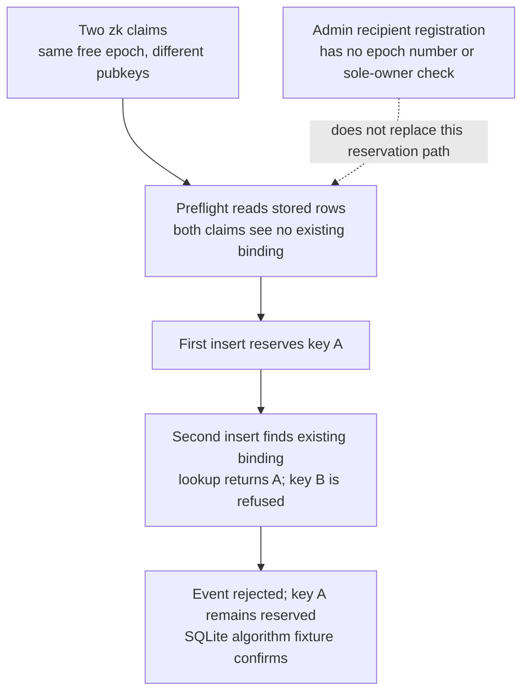
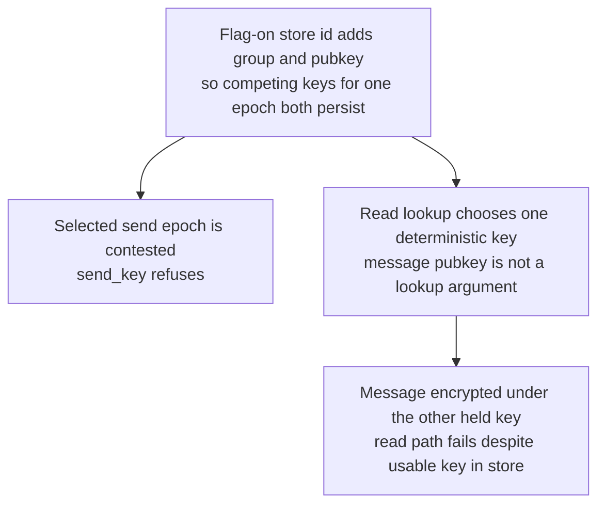
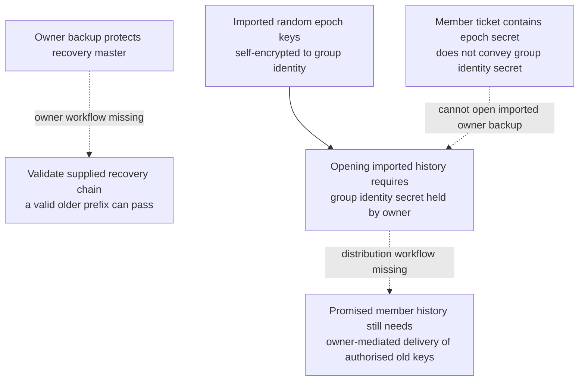
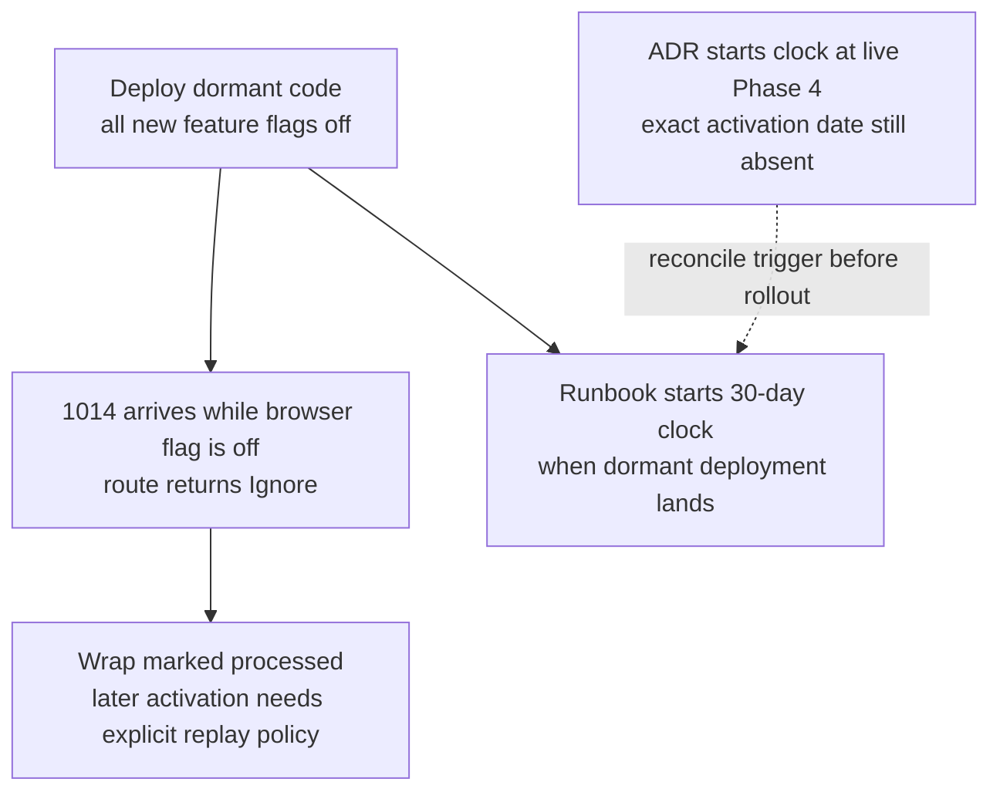
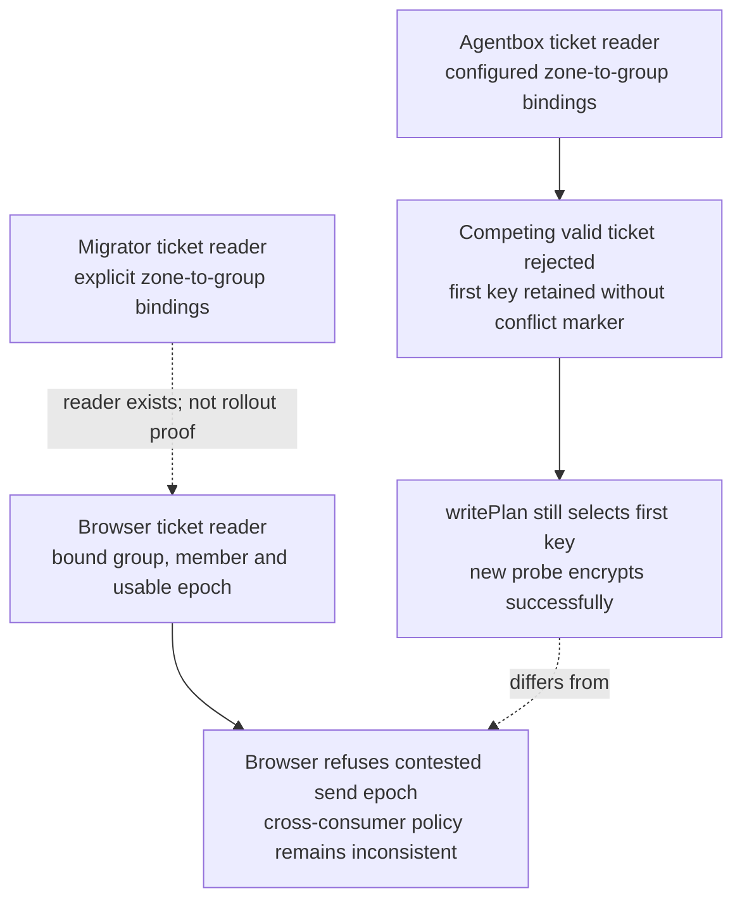

## For developers

These panels were drawn from the local upgrade branch and are re-derived here from **main**, which merged it at a80c572: the code ships dormant, since both sides read `ZONE_GROUPS_ENABLED` as on only for the exact string "true" (`../nostr-rust-forum/crates/nostr-bbs-relay-worker/src/zone_groups.rs:47-48`, `../nostr-rust-forum/crates/nostr-bbs-forum-client/src/zone_crypto/tickets.rs:51`, `../nostr-rust-forum/crates/nostr-bbs-forum-client/src/zone_crypto/mod.rs:107-108`), and the shipped relay template does not set it. [The audit](../../estate-review/2026-11-01-forum-nip171-keyplane.md) (220 bounded native/Node tests) was run on the branch, not re-run on main. Owner flows and scratch migration remain incomplete. NF-27 draws the flag-off path.

Resolved at nostr-rust-forum 4a73a7a: ADR-2028 now records `implementation_status: partial`, its key plane on main behind the flag (`../nostr-rust-forum/docs/adr/ADR-2028-zones-adopt-nip171-key-plane.md:6`).

## For the business

A recovery phrase and passing derivation tests do not yet constitute a recoverable zone. Owners need a verified restore workflow; ordinary members need the intended history without receiving owner authority. Conflicting keys must produce consistent behaviour across browsers and agents before activation.

## NF-28.1 Implemented primitives stop short of owner activation

## NF-28.2 A refused multi-claim event can leave a reservation

## NF-28.3 Browser conflict storage and historical lookup diverge

## NF-28.4 Owner restore and member history require different delivery paths

## NF-28.5 Dormant deployment does not prove reader readiness

## NF-28.6 Dual readers do not yet share one conflict contract

