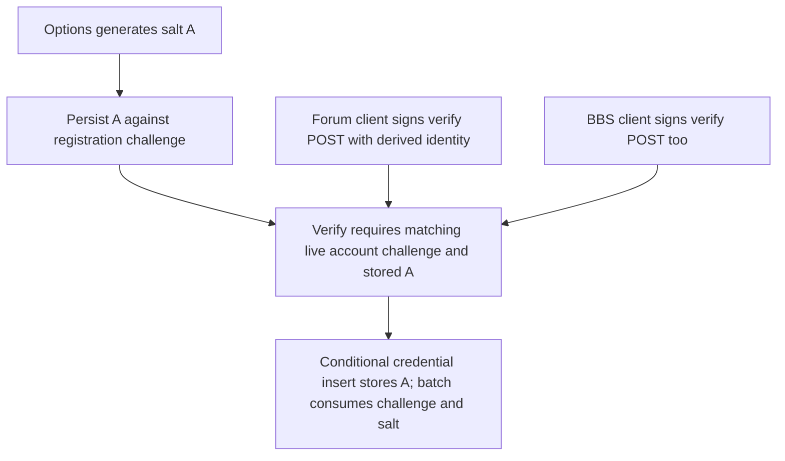
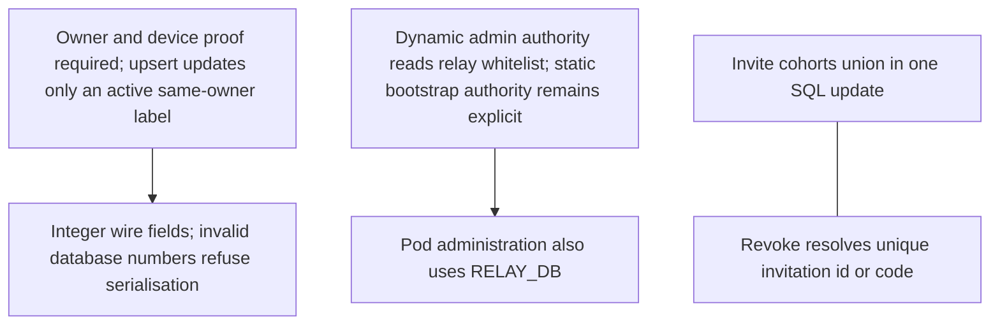
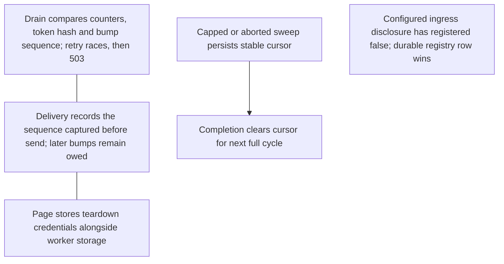
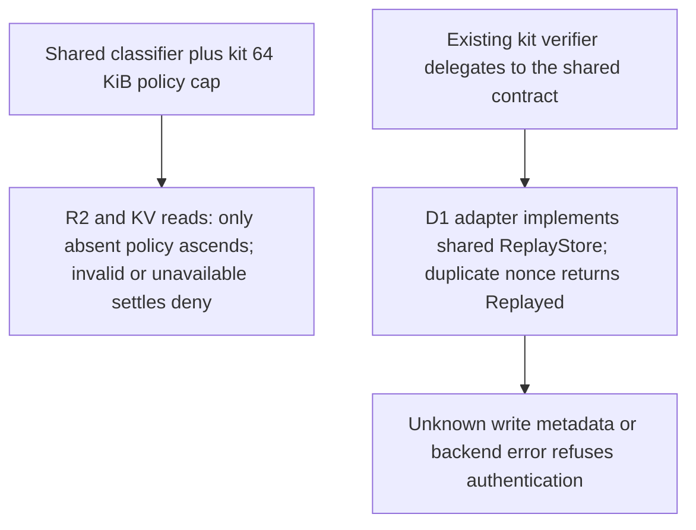

## For developers

This scoped successor records source repairs for selected findings in NF-18, NF-20, NF-23, NF-24 and NF-25. Historical panels retain their original evidence revisions. Neither this panel nor native/WASM gates establish a deployed Cloudflare Worker, real WebAuthn authenticator ceremony or browser logout journey. Other findings in those topics remain open unless explicitly named below.

## For the business

Registration now keeps the original identity input and proves the registering identity. Demotion uses one dynamic authority, revoked devices cannot silently re-enrol, and concurrent notifications retain work owed. Deployment still needs database bindings and schema reconciliation; old mismatched passkeys need authenticated recovery or re-enrolment.

## NF-29.1 Registration keeps the issued salt and proves the derived identity

NF-23.1 and NF-23.2 are repaired in source. SQL fixtures check challenge expiry/account binding and registration/login derivation equality. Old credential salt values are not rewritten: the original PRF input cannot be reconstructed safely. Native checks and successful client WASM compilation do not prove real hardware behaviour.

## NF-29.2 Device lifecycle and dynamic administration settle at their owners

NF-20.2/20.3 and the split-admin authority path in NF-25 are repaired in source. A revoked device requires a fresh derived device identity. The pod deployment must bind `RELAY_DB` to the instance relay database; the kit template contains an explicit placeholder. Payment cleanup also separates authority queries from payment data and has a regression fixture for stale auth-member grants after relay demotion. Device cache revocation latency remains a separate boundary.

## NF-29.3 Notification claims and bounded sweeps retain concurrent work

The push drain/bump/logout source findings and NF-24 bounded-prefix starvation are repaired. Disclosure is additive: consumers deciding whether provisioning is complete must require `registered === true`; a configured ingress row alone is insufficient. No registry identity was provisioned by this repair.

## Validation and remaining boundaries

At the first repair revision, 7852fe8, 1,120 native tests passed across auth, BBS, pod and relay; all three workers passed warning-denied native Clippy and rustdoc; all workers and both browser clients compiled to WASM. The two browser clients had four pre-existing WASM Clippy warnings, so no blanket client Clippy pass is claimed. The optional bounded Deepsec gate timed out without a verdict and is not counted as passing evidence.

## NF-29.4 Forum workers consume the shared Solid denial and nonce contracts

The a3812b8 delta adds shared Solid alpha.19 adoption. The first three panels' sources are byte-identical to their 7852fe8 evidence revision. Cargo resolves alpha.19 from the registry with a checksum; no workspace patch remains. Production SQL fixtures prove that a duplicate nonce cannot refresh its expiry and unknown write metadata is not first-seen success. Classifier fixtures prove invalid-child terminal denial and absent-child inheritance.

Final adoption gates pass 1,123 native library tests, existing integration/doc tests, four workers' native all-target Clippy and WASM library Clippy with warnings denied, plus both client WASM builds. The repaired nonce module and pod were retested after recovery from a local disk-space failure. NF-19 signer retention, sealed-history migration, NIP-171 owner ceremonies, remaining cache/transport findings and live rollout are not closed here.
