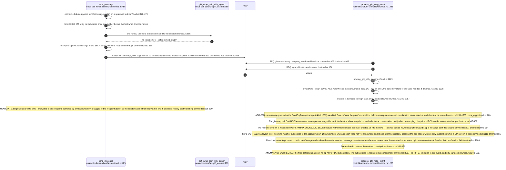
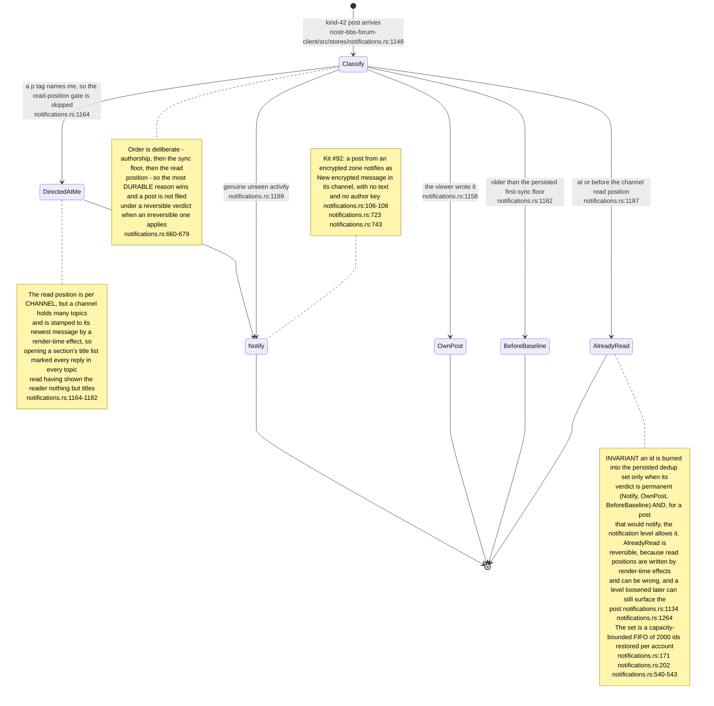
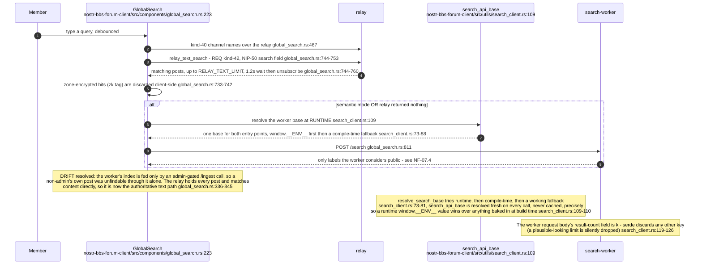
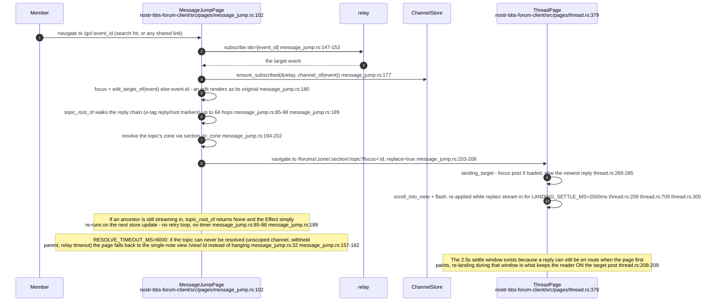
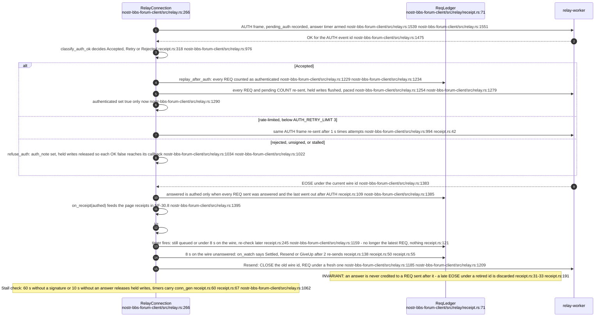
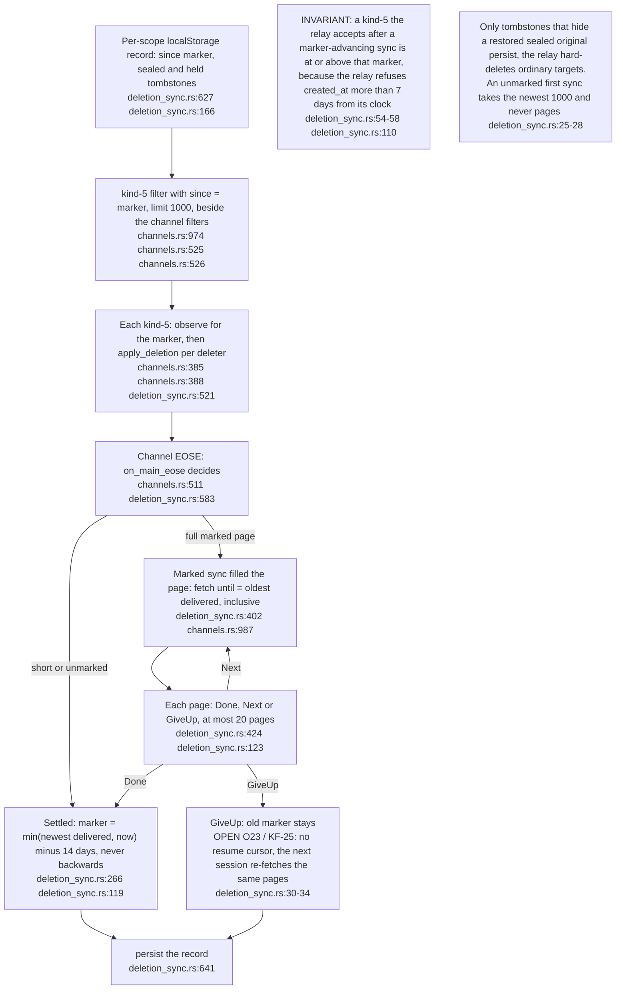
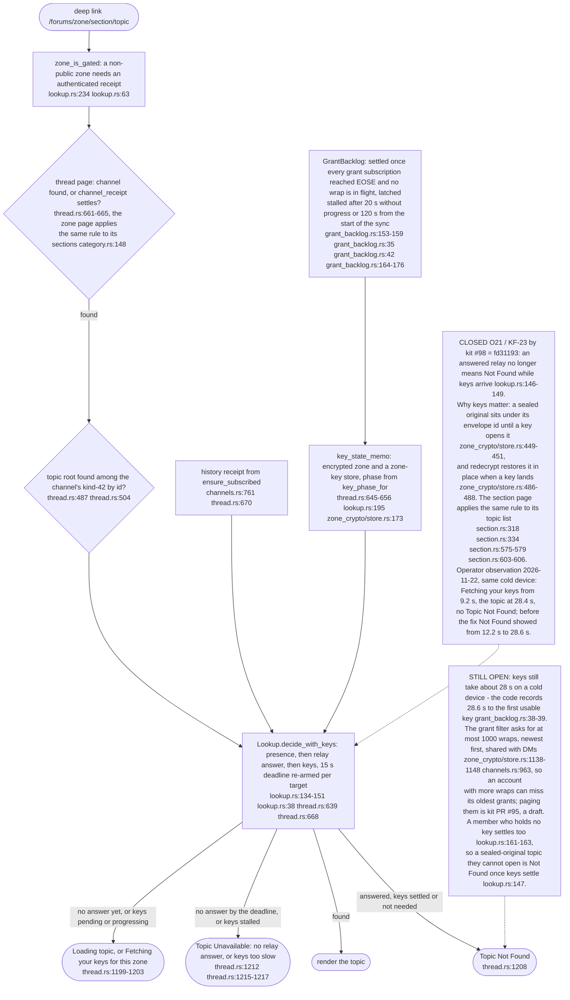
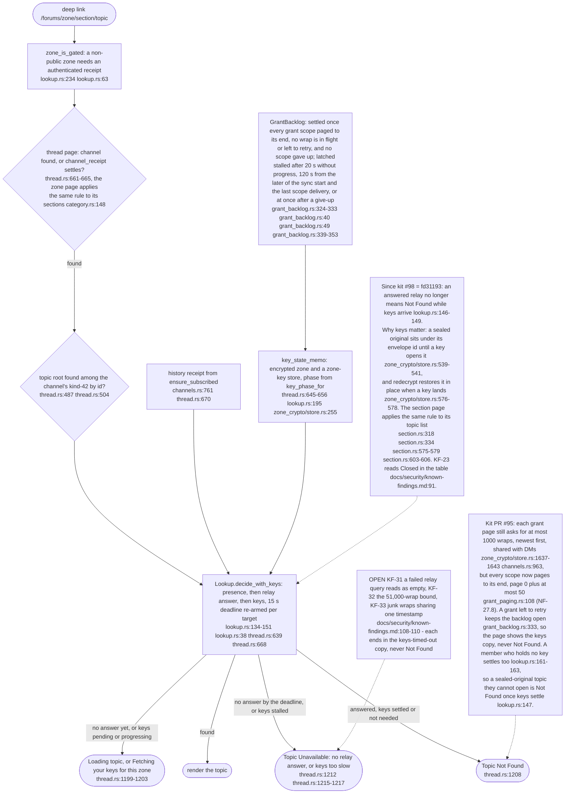

Split from NF-05 on 2026-11-23: the client's messaging and relay-facing behaviour (formerly NF-05.9, NF-05.10, NF-05.13 to NF-05.15 and NF-05.18 to NF-05.20). Boot, identity, transport, config and signup stay in NF-05. Old panel IDs resolve through the `aliases:` map above; the stamp is NF-05's, and the panels were not re-read.

## NF-30.1 Direct messages — two wraps per message, and why history exists

**Open:** ADR-2027 (NIP-17 overlay) is accepted, partly implemented and inactive, and ADR-2028 (NIP-171 key plane, superseding ADR-2026) is proposed and inactive (`../nostr-rust-forum/docs/adr/ADR-2027-nip17-overlay-for-nostr-chat-interop.md:6`, `../nostr-rust-forum/docs/adr/ADR-2028-zones-adopt-nip171-key-plane.md:5`, `:7`). Both implementations reached main with the upgrade-branch merge a80c572 and stay dormant: the extended DM path (reply and imeta rumors, multi-relay delivery) runs only with `RECIPIENT_KEYS_ENABLED` (`../nostr-rust-forum/crates/nostr-bbs-forum-client/src/dm/mod.rs:560`, `:1637-1638`), and the owner activation workflows are still missing ([NF-28](28-nip171-owner-recovery-and-ticket-contracts.md)), so neither is drawn as live here.

## NF-30.2 Feature surfaces the forum client calls out to

```mermaid
flowchart LR
    THREAD["thread reply - kind 42 e-tagging the topic root<br/>nostr-bbs-forum-client/src/pages/thread.rs:1043<br/>edit/delete via kind 5 thread.rs:1111"]
    CHAN["channel message - kind 42<br/>nostr-bbs-forum-client/src/pages/channel.rs:835"]
    EVENTS["calendar - kind 31923 events, 31925 RSVPs<br/>nostr-bbs-forum-client/src/pages/events.rs:137 events.rs:195"]
    SEARCH["global search - kind-40 channel names over the relay<br/>global_search.rs:467 plus NIP-50 text search over kind-42<br/>global_search.rs:725-760, worker as semantic layer/fallback<br/>global_search.rs:360. A hit links to /go/:event_id, not /chat/:channel - see NF-05.2 and NF-30.5"]
    BADGE["agent disclosure over public HTTP GET<br/>nostr-bbs-forum-client/src/components/agent_badge.rs:317"]
    GIT["pod git control panel - _git/status :213 stage :272 unstage :310<br/>discard :359 commit :385 diff :434 log :466<br/>nostr-bbs-forum-client/src/components/git_panel.rs:213"]
    POD["pod browser - {POD_API}/pods/{pubkey} and /HEAD<br/>nostr-bbs-forum-client/src/pages/pod_browser.rs:513 pod_browser.rs:582<br/>OPEN O26 / KF-28: mesh and pod cards print the raw probe error under Details<br/>pod_browser.rs:1045 pod_browser.rs:1058 pod_browser.rs:1181"]
    ADMINT["admin actions - POST /api/admin/suspend :269 and /api/admin/silence :701, NIP-98 signed<br/>nostr-bbs-forum-client/src/admin/user_table.rs:269"]

    N1["DOC-DRIFT consumer-surface-map: the map lists the git panel as calling /.well-known/apps, but the<br/>client fetches and PUTs /apps/manifest.json instead - git_panel.rs:893 and git_panel.rs:946; no<br/>.well-known path exists anywhere in the crate"]
    N2["Calendar: only 31923 (time-based) and 31925 (RSVP) are used client-side. Kind 31922 (date-based),<br/>which the relay ban-gates and zone-gates, has no client surface - see NF-03.6 and NF-03.12"]
    N3["DRIFT resolved: the worker's index was fed only by an admin-gated ingest call, so a member's own<br/>post was unfindable by non-admins. The relay now answers text search directly (NIP-50, matched<br/>case-insensitively against every post's content) and is authoritative; the worker is consulted only<br/>in semantic mode or when the relay returns nothing global_search.rs:336-360"]
    N4["A zone-encrypted post is never a search result either way: the relay match is on ciphertext, which<br/>relay_text_search discards client-side global_search.rs:735-742, and the semantic index is fed only<br/>public content - see NF-07.4"]
```

## NF-30.3 Notification ingress — why a reply addressed to you is not burned

## NF-30.4 Search from the client — relay text search first, the worker as semantic layer

## NF-30.5 Message deep-link — /go/:event_id resolves a bare id to a reader position

## NF-30.6 NIP-42 AUTH acceptance, held writes and the per-subscription REQ ledger (kit #91)

**What it shows.** Before kit #91 the `authenticated` signal meant only "AUTH frame sent", so a REQ answered anonymously could be taken for the member view. Now the relay's `OK true` is the trigger, and the ledger tells the page whether an EOSE is the authenticated answer.

## NF-30.7 Incremental kind-5 deletion sync (kit #93)

## NF-30.8 Page lookup states: loading, keys loading, found, not found, timed out (kit #91, kit #98)
> **Superseded** by NF-30.9 at de31aaa (frozen at 4a73a7a).

**What it shows.** Kit #91 made a deep-linked page wait for the subscription that would carry the topic; kit #98 (fd31193) adds the member's zone-key backlog as an input, so an encrypted zone shows "Fetching your keys" rather than "Topic Not Found" until the grant backlog settles or stalls.

## NF-30.9 Page lookup states after the grant backlog pages (kit #91, #98, #95)

**What it shows.** The decision is unchanged since kit #98 (`../nostr-rust-forum/crates/nostr-bbs-forum-client/src/utils/lookup.rs:134-151`); kit PR #95 changed what it waits on, so the backlog is complete past the row cap and a retryable wrap holds it (`../nostr-rust-forum/docs/adr/ADR-2034-absence-is-reported-only-after-an-authenticated-answer.md:75-80`). Live, 2026-11-24, after the website repinned to de31aaa: a fresh device on a direct Family topic link showed "Fetching your keys" at 4.5 to 5.4 s and the decrypted topic at 11.7 to 13.0 s over three runs, never "Topic Not Found" (9.2 s and 28.4 s on 2026-11-22); an operator observation, not a code citation.
