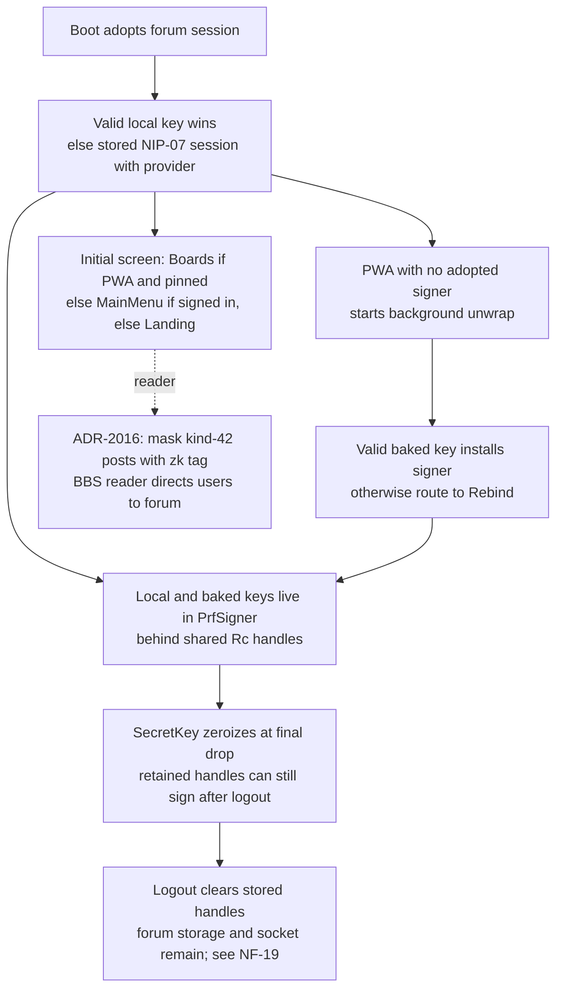
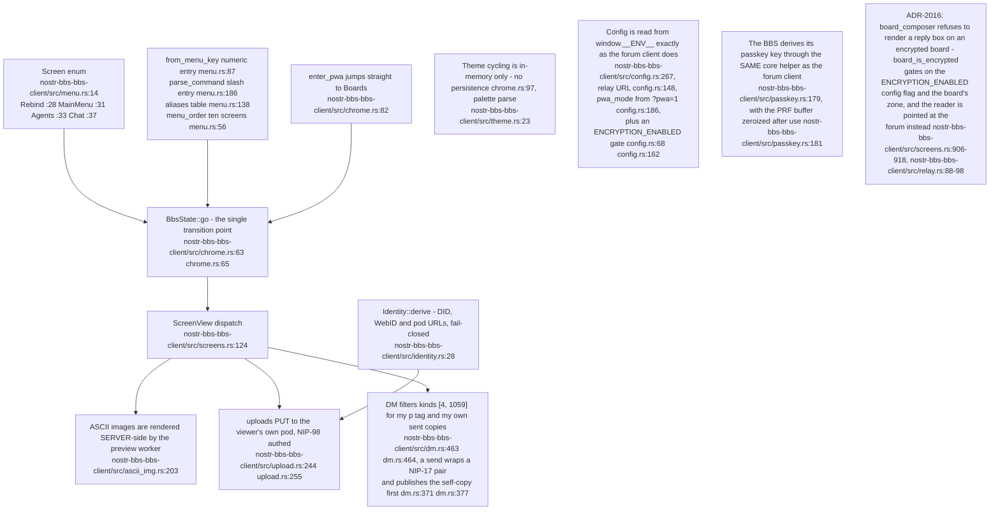
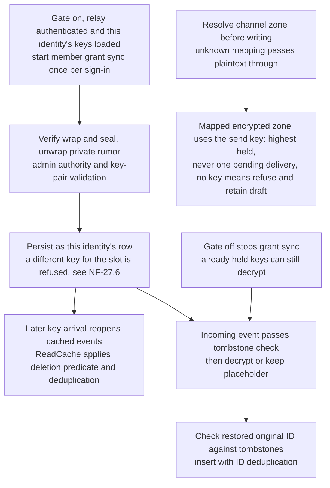
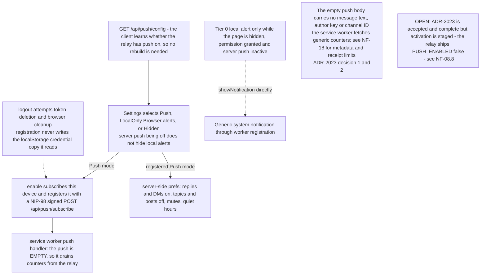

Split from NF-05 on 2026-11-23: the retro BBS client and the client-side key and push policy (formerly NF-05.11, NF-05.12, NF-05.16 and NF-05.17). Boot, identity, transport, config and signup stay in NF-05. Old panel IDs resolve through the `aliases:` map above; the split kept NF-05's stamp without a re-read; the panels were re-verified at de31aaa in pass C (2026-11-24).

## NF-31.1 Retro BBS client — session adoption and key custody

Custody and boot-routing correction: [current ADR-2008 review](../../estate-review/2026-11-01-forum-bbs-signer.md). That review was narrow; the whole topic was re-read and restamped at nostr-rust-forum c39f41f on 2026-11-02 ([audit](../../estate-review/2026-11-02-forum-clients-agents-search.md)).

## NF-31.2 BBS screen machine and its own surfaces

## NF-31.3 Zone encryption depends on resolved policy and locally held keys

[The zone-key audit](../../estate-review/2026-11-01-forum-zone-key-distribution.md) separates tested crypto/planning behaviour from browser-only lifecycle findings. NF-27 expands rotation, delivery and recovery.

## NF-31.4 Web Push in the client — default off, staged, content-free

**What it shows.** How the browser side of ADR-2023 works: the client asks the relay whether push is on, subscribes the device with a signed request, and from then on an empty push wakes the service worker, which drains content-free counters. Where server push is off, Tier 0 raises generic system notifications from the page. Logout cleanup is best effort, and its missing credential copy is documented in [the push audit](../../estate-review/2026-11-01-forum-web-push.md).

**Why it is this way.** Push payloads transit Google, Apple and Mozilla, and the service worker has no access to the page’s localStorage or sessionStorage, so ADR-2023 chose payload-less push with a bearer-token drain instead of RFC 8291 encryption (`../nostr-rust-forum/docs/adr/ADR-2023-content-free-web-push-for-pwa-alerts.md:34-35`, `../nostr-rust-forum/docs/adr/ADR-2023-content-free-web-push-for-pwa-alerts.md:38-39`).

**Open:** ADR-2023 records `activation_status: staged` (no live Cloudflare deploy, push-service round trip or iOS device run was verified), and the shipped relay template leaves `PUSH_ENABLED = "false"` (`../nostr-rust-forum/docs/adr/ADR-2023-content-free-web-push-for-pwa-alerts.md:7`, `../nostr-rust-forum/crates/nostr-bbs-relay-worker/wrangler.toml:88`).
