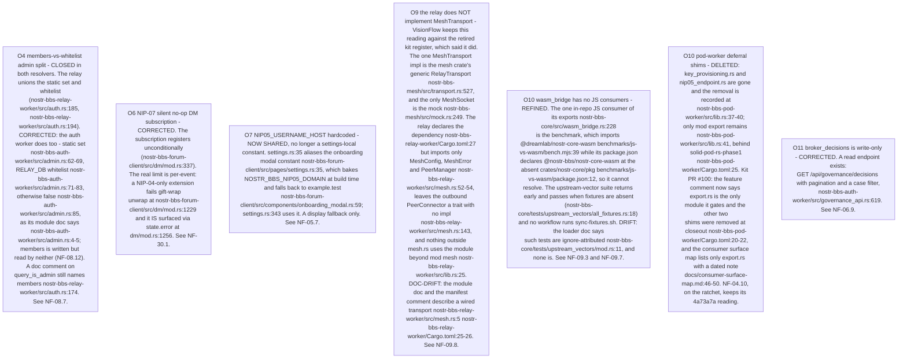
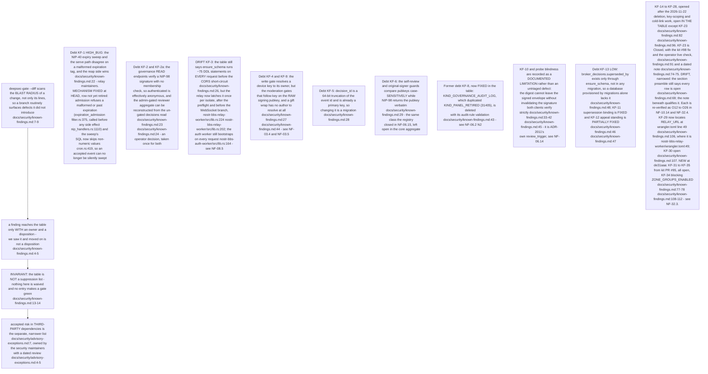
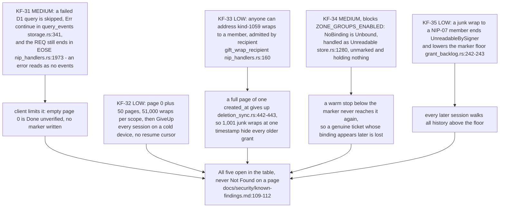
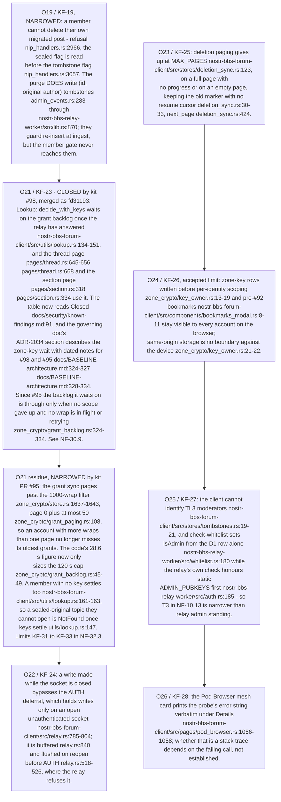
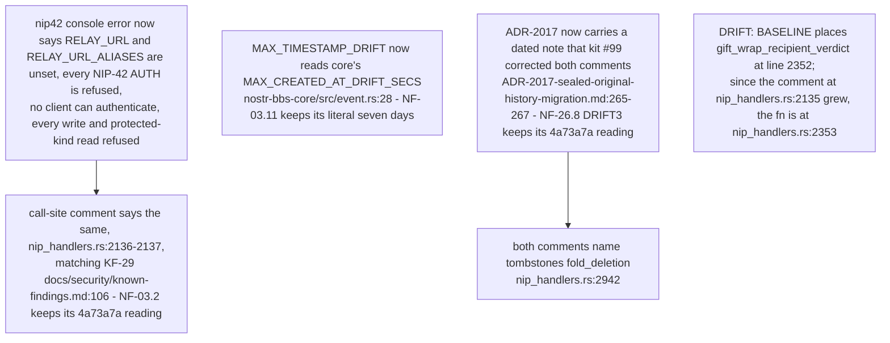
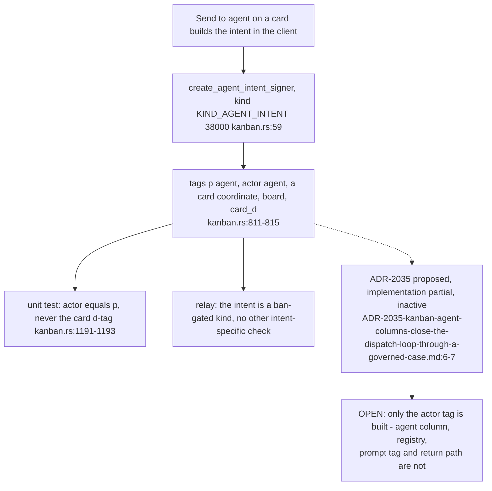

## For developers

Pass C over kit commits 4a06539 to de31aaa. NF-10 is the register, already at the fifteen-panel cap, so its superseded panels NF-10.4, NF-10.11, NF-10.15 and NF-10.16 get their successors here (NF-32.1, NF-32.2, NF-32.4, NF-32.5), and the new grant-paging findings KF-31 to KF-35 are drawn in NF-32.3 (`../nostr-rust-forum/docs/security/known-findings.md:77-78`). Five markers sit in panels on `resolved-ratchet.json`, which cannot be frozen, and no longer hold at de31aaa: NF-03.2 (the nip42 console message), NF-04.10 N5 (the pod-worker feature comment), NF-26.8 DRIFT3 (the ADR-2017 note), NF-10.6 DD9 (BASELINE's verdict anchor, now one line stale) and DW-01.5 (the website kit pin). Those topics keep their old stamps, NF-10 included (its four superseded panels are frozen at that stamp); NF-32.1 and NF-32.6 record the current text. NF-32.7 draws the kanban agent intent's new `actor` tag under the proposed ADR-2035.

## For the business

The forum's own records caught up with its code: the security table now shows the cold-link fix as closed and lists five new, open limits of the zone-key paging, one of which (KF-34) must be fixed before the group key plane can be switched on. A kanban card sent to an agent now names the agent explicitly, the first built piece of a proposed design in which boards hand work to agents and return it for human review.

## NF-32.1 Anomaly register refined - the pod-worker feature comment now matches the deleted shims

**Drift:** the upstream-vector loader says missing-fixture tests are ignore-attributed (`../nostr-rust-forum/crates/nostr-bbs-core/tests/upstream_vectors/mod.rs:11`); they return early and pass (O10).

## NF-32.2 The security-gate ledger at de31aaa

## NF-32.3 KF-31 to KF-35 - the open limits of grant paging (kit PR #95)

**Debt:** each limit ends in the keys-timed-out copy or an unverified walk, never a false absence, but KF-31 is a relay-wide blind spot shared by every REQ consumer (`../nostr-rust-forum/docs/security/known-findings.md:108`). **Open (KF-34 vs ADR-2028):** the proposed capped store for Unbound tickets is a prerequisite for `ZONE_GROUPS_ENABLED` (`../nostr-rust-forum/docs/adr/ADR-2028-zones-adopt-nip171-key-plane.md:153-160`).

## NF-32.4 Sealed originals, client and UX items after the grant backlog pages

## NF-32.5 Resolved history R1 to R9, re-checked at de31aaa

```mermaid
flowchart TB
    R1["R1 licence prose claimed MIT/Apache on AGPL code - fixed. HOLDS for the application: workspace licence nostr-rust-forum/Cargo.toml:64,<br/>CONTRIBUTING.md:105-106. SUPERSEDED for one crate by a deliberate relicence: nostr-bbs-core is MIT OR Apache-2.0 from beta.18<br/>nostr-bbs-core/Cargo.toml:6 nostr-bbs-core/README.md:10-13, as the README states nostr-rust-forum/README.md:164."]
    R2["R2 version drift README rc11, SECURITY rc tables, NIP-11 serving 3.0.0. HOLDS for NIP-11: version is env CARGO_PKG_VERSION nip11.rs:214.<br/>Kit PR #100: SECURITY.md now lists 1.0.0-beta.20 for core, config, mesh and rate-limit on crates.io, and main, as current SECURITY.md:19,<br/>explaining that the workspace carries no single version SECURITY.md:21-24; core is 1.0.0-beta.20 nostr-bbs-core/Cargo.toml:3. The v3.0.0-rc<br/>headings stay, under Past Security Fixes SECURITY.md:26-28."]
    R3["R3 NIP-17 over-advertised - HOLDS: NIP-11 lists 59, not 17 nip11.rs:16, saying why nip11.rs:205-208,<br/>and the architecture doc says there is no kind-14 inbox routing docs/architecture.md:227.<br/>DRIFT for the client: the NIP-17 overlay is on main, dormant behind RECIPIENT_KEYS_ENABLED nostr-rust-forum/README.md:124<br/>nostr-bbs-forum-client/src/dm/mod.rs:1632, and DM sends publish a kind-10050 DM-relay list once per pubkey per session,<br/>ungated, nostr-bbs-forum-client/src/dm/mod.rs:610-611<br/>nostr-bbs-forum-client/src/dm/mod.rs:611 nostr-bbs-forum-client/src/dm/mod.rs:2012, so that sentence holds only for the relay. See NF-01."]
    R4["R4 NIP-26 deleted as superseded by ADR-099 device keys - HOLDS for core and the auth worker; CHANGELOG.md:2257-2258 records NIP-26 rejected.<br/>NOT GONE from the workspace: nostr-bbs-mesh carries its own NIP-26 verifier for mesh delegation nostr-bbs-mesh/src/delegation.rs:1,<br/>noting core has no nip26 module nostr-bbs-mesh/src/delegation.rs:22-28; the upstream-vector suite still wires the fixture all_fixtures.rs:59-60."]
    R5["R5 NIP-90 DVM module deleted - HOLDS: removal recorded nip11.rs:209-211 and 90 not advertised nip11.rs:16.<br/>Kit PR #100: the architecture note now says NIP-90 is not implemented and no DVM kind is handled specially docs/architecture.md:215-224,<br/>and the NIP matrix no longer carries a 90 row docs/architecture.md:205-206."]
    R6["R6 template drift - HOLDS: SETUP lists ZONE_CONFIG and DEVICE_KEYS_ENABLED for the relay SETUP.md:150 and explains the flag SETUP.md:175-178;<br/>the auth template binds RELAY_DB nostr-bbs-auth-worker/wrangler.toml:18; the relay template declares both nostr-bbs-relay-worker/wrangler.toml:26<br/>nostr-bbs-relay-worker/wrangler.toml:29. ADMIN_PUBKEYS stays undeclared - S2 in NF-10.7."]
    R7["R7 ad-hoc did:nostr format - MOSTLY HOLDS: production sites call did_nostr_uri nostr-bbs-core/src/did.rs:141 and keep format! only as the<br/>parse-failure fallback webauthn.rs:1114-1116 nostr-bbs-pod-worker/src/lib.rs:903-905. RESIDUE: the mesh AS2 projection formats it<br/>directly nostr-bbs-mesh/src/envelope.rs:395-396."]
    R8["R8 dual auth cors_headers with an example.com fallback - HOLDS: one builder, fail-closed, no Allow-Origin when EXPECTED_ORIGIN is<br/>unset or blank nostr-bbs-auth-worker/src/http.rs:19-30, imported by the worker nostr-bbs-auth-worker/src/lib.rs:38. See NF-02.1."]
    R9["R9 architecture doc coverage - HOLDS: rate-limit crate row docs/architecture.md:184, NIP-56/59/65/90 note docs/architecture.md:215,<br/>ADR-098/099 section docs/architecture.md:487; ADR-099 status Accepted docs/archive/adr/ADR-099-revocable-device-keys.md:4.<br/>Its NIP-90 sentence, the old R5 drift, is corrected."]
    R1 --> R2 --> R3 --> R4 --> R5
    R6 --> R7 --> R8 --> R9
```

## NF-32.6 Drift kit #99 and #100 closed where the ratchet blocks a freeze

**Drift:** the governing doc's verdict anchor is one line stale at de31aaa (`../nostr-rust-forum/docs/BASELINE-architecture.md:163-165`); NF-10.6 DD9, on the ratchet, still reads it as matching, true at 4a73a7a.

## NF-32.7 The kind-38000 agent intent names its agent (ADR-2035, proposed)

**What it shows.** Kit PR #102 (`3e66d40`): before it, a consumer that fell back to the `a` coordinate read the card's own d-tag as the actor (`../nostr-rust-forum/docs/adr/ADR-2035-kanban-agent-columns-close-the-dispatch-loop-through-a-governed-case.md:23`). **Open:** the relay still holds no approval-column check, and ADR-2035 depends on the unmerged ADR-2024 (`../nostr-rust-forum/docs/adr/ADR-2035-kanban-agent-columns-close-the-dispatch-loop-through-a-governed-case.md:27`, `:47`).
