## For developers

Pass C over kit commits 4a06539 to de31aaa. NF-10 is the register, already at the fifteen-panel cap, so its superseded panels NF-10.4, NF-10.11, NF-10.15 and NF-10.16 get their successors here (NF-32.1, NF-32.2, NF-32.4, NF-32.5), and the new grant-paging findings KF-31 to KF-35 are drawn in NF-32.3 (`../nostr-rust-forum/docs/security/known-findings.md:77-78`). The panels that were held on `resolved-ratchet.json` are now frozen at their own stamps, with successors here re-derived at de31aaa: NF-03.2 and NF-03.11 (NF-32.8, NF-32.9), NF-04.10 (NF-32.10), NF-26.8 (NF-32.11), NF-10.6 (NF-32.12) and NF-06.18 (NF-32.13, which reads the website at 5dc4c64); DW-01.5's successor is DW-01.9. NF-32.6, which held their current text while they could not be frozen, is folded into those successors (alias to NF-32.8). Their topics keep their old stamps, NF-10 included. NF-32.7 draws the kanban agent intent's new `actor` tag under the proposed ADR-2035.

## For the business

The forum's own records caught up with its code: the security table now shows the cold-link fix as closed and lists five new, open limits of the zone-key paging, one of which (KF-34) must be fixed before the group key plane can be switched on. A kanban card sent to an agent now names the agent explicitly, the first built piece of a proposed design in which boards hand work to agents and return it for human review.

## NF-32.1 Anomaly register refined - the pod-worker feature comment now matches the deleted shims

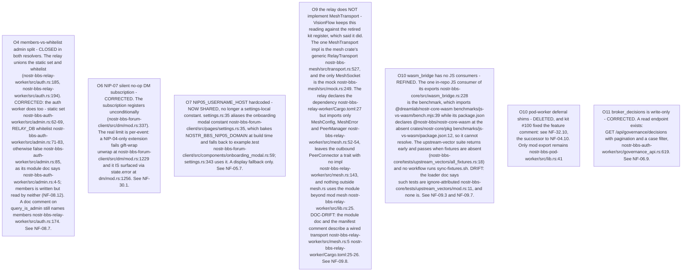

**Drift:** the upstream-vector loader says missing-fixture tests are ignore-attributed (`../nostr-rust-forum/crates/nostr-bbs-core/tests/upstream_vectors/mod.rs:11`); they return early and pass (O10).

## NF-32.2 The security-gate ledger at de31aaa

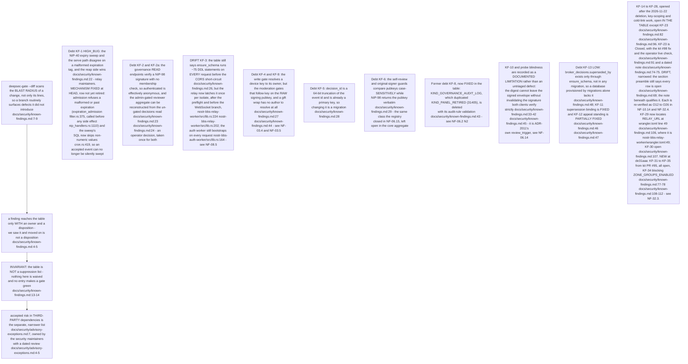

## NF-32.3 KF-31 to KF-35 - the open limits of grant paging (kit PR #95)

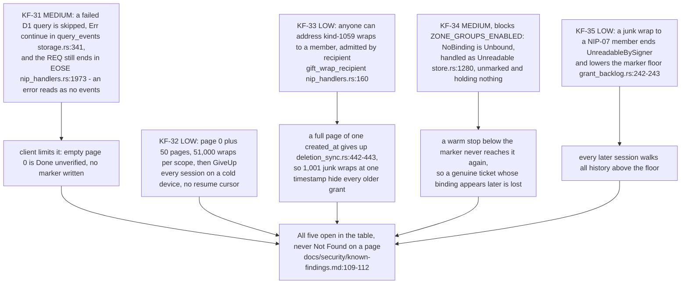

**Debt:** each limit ends in the keys-timed-out copy or an unverified walk, never a false absence, but KF-31 is a relay-wide blind spot shared by every REQ consumer (`../nostr-rust-forum/docs/security/known-findings.md:108`). **Open (KF-34 vs ADR-2028):** the proposed capped store for Unbound tickets is a prerequisite for `ZONE_GROUPS_ENABLED` (`../nostr-rust-forum/docs/adr/ADR-2028-zones-adopt-nip171-key-plane.md:153-160`).

## NF-32.4 Sealed originals, client and UX items after the grant backlog pages

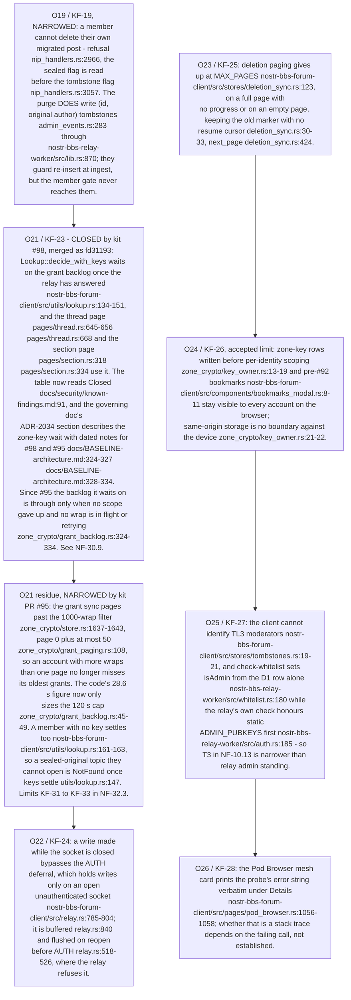

## NF-32.5 Resolved history R1 to R9, re-checked at de31aaa

```mermaid
flowchart TB
    R1["R1 licence prose claimed MIT/Apache on AGPL code - fixed. HOLDS for the application: workspace licence nostr-rust-forum/Cargo.toml:64,<br/>CONTRIBUTING.md:105-106. SUPERSEDED for one crate by a deliberate relicence: nostr-bbs-core is MIT OR Apache-2.0 from beta.18<br/>nostr-bbs-core/Cargo.toml:6 nostr-bbs-core/README.md:10-13, as the README states nostr-rust-forum/README.md:164."]
    R2["R2 version drift README rc11, SECURITY rc tables, NIP-11 serving 3.0.0. HOLDS for NIP-11: version is env CARGO_PKG_VERSION nip11.rs:214.<br/>Kit PR #100: SECURITY.md now lists 1.0.0-beta.20 for core, config, mesh and rate-limit on crates.io, and main, as current SECURITY.md:19,<br/>explaining that the workspace carries no single version SECURITY.md:21-24; core is 1.0.0-beta.20 nostr-bbs-core/Cargo.toml:3. The v3.0.0-rc<br/>headings stay, under Past Security Fixes SECURITY.md:26-28."]
    R3["R3 NIP-17 over-advertised - HOLDS: NIP-11 lists 59, not 17 nip11.rs:16, saying why nip11.rs:205-208,<br/>and the architecture doc says there is no kind-14 inbox routing docs/architecture.md:227.<br/>DRIFT for the client: the NIP-17 overlay is on main, dormant behind RECIPIENT_KEYS_ENABLED nostr-rust-forum/README.md:124<br/>nostr-bbs-forum-client/src/dm/mod.rs:1632, and DM sends publish a kind-10050 DM-relay list once per pubkey per session,<br/>ungated, nostr-bbs-forum-client/src/dm/mod.rs:610-611<br/>nostr-bbs-forum-client/src/dm/mod.rs:611 nostr-bbs-forum-client/src/dm/mod.rs:2012, so that sentence holds only for the relay. See NF-01."]
    R4["R4 NIP-26 deleted as superseded by ADR-099 device keys - HOLDS for core and the auth worker; CHANGELOG.md:2257-2258 records NIP-26 rejected.<br/>NOT GONE from the workspace: nostr-bbs-mesh carries its own NIP-26 verifier for mesh delegation nostr-bbs-mesh/src/delegation.rs:1,<br/>noting core has no nip26 module nostr-bbs-mesh/src/delegation.rs:22-28; the upstream-vector suite still wires the fixture all_fixtures.rs:59-60."]
    R5["R5 NIP-90 DVM module deleted - HOLDS: removal recorded nip11.rs:209-211 and 90 not advertised nip11.rs:16.<br/>Kit PR #100: the architecture note now says NIP-90 is not implemented and no DVM kind is handled specially docs/architecture.md:215-224,<br/>and the NIP matrix no longer carries a 90 row docs/architecture.md:205-206."]
    R6["R6 template drift - HOLDS: SETUP lists ZONE_CONFIG and DEVICE_KEYS_ENABLED for the relay SETUP.md:150 and explains the flag SETUP.md:175-178;<br/>the auth template binds RELAY_DB nostr-bbs-auth-worker/wrangler.toml:18; the relay template declares both nostr-bbs-relay-worker/wrangler.toml:26<br/>nostr-bbs-relay-worker/wrangler.toml:29. ADMIN_PUBKEYS stays undeclared - S2 in NF-10.7."]
    R7["R7 ad-hoc did:nostr format - MOSTLY HOLDS: production sites call did_nostr_uri nostr-bbs-core/src/did.rs:141 and keep format! only as the<br/>parse-failure fallback webauthn.rs:1114-1116 nostr-bbs-pod-worker/src/lib.rs:903-905. RESIDUE: the mesh AS2 projection formats it<br/>directly nostr-bbs-mesh/src/envelope.rs:395-396."]
    R8["R8 dual auth cors_headers with an example.com fallback - HOLDS: one builder, fail-closed, no Allow-Origin when EXPECTED_ORIGIN is<br/>unset or blank nostr-bbs-auth-worker/src/http.rs:19-30, imported by the worker nostr-bbs-auth-worker/src/lib.rs:38. See NF-02.1."]
    R9["R9 architecture doc coverage - HOLDS: rate-limit crate row docs/architecture.md:184, NIP-56/59/65/90 note docs/architecture.md:215,<br/>ADR-098/099 section docs/architecture.md:487; ADR-099 status Accepted docs/archive/adr/ADR-099-revocable-device-keys.md:4.<br/>Its NIP-90 sentence, the old R5 drift, is corrected."]
    R1 --> R2 --> R3 --> R4 --> R5
    R6 --> R7 --> R8 --> R9
```

## NF-32.7 The kind-38000 agent intent names its agent (ADR-2035, proposed)

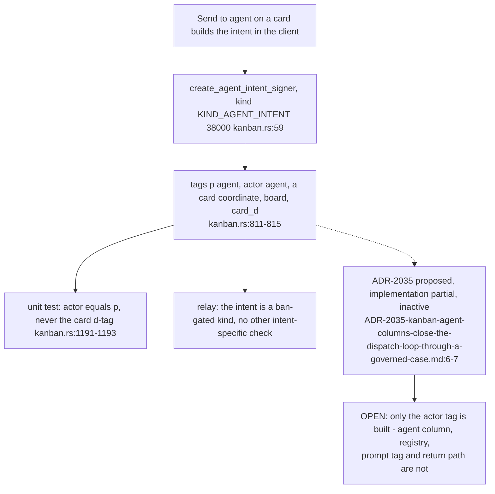

**What it shows.** Kit PR #102 (`3e66d40`): before it, a consumer that fell back to the `a` coordinate read the card's own d-tag as the actor (`../nostr-rust-forum/docs/adr/ADR-2035-kanban-agent-columns-close-the-dispatch-loop-through-a-governed-case.md:23`). **Open:** the relay still holds no approval-column check, and ADR-2035 depends on the unmerged ADR-2024 (`../nostr-rust-forum/docs/adr/ADR-2035-kanban-agent-columns-close-the-dispatch-loop-through-a-governed-case.md:27`, `:47`).

## NF-32.8 NIP-42 AUTH verdict table at de31aaa - the console error now says every AUTH is refused
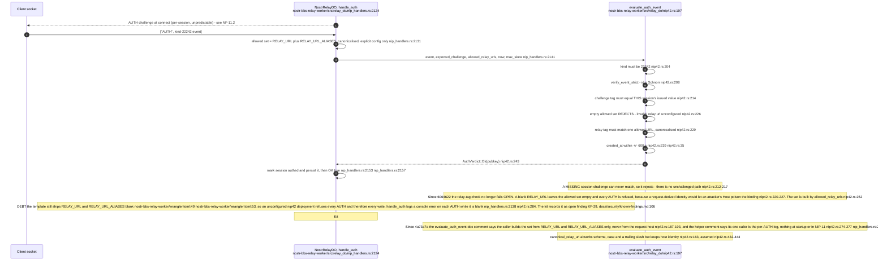

**What it shows.** Successor to the frozen NF-03.2. Kit #100 rewrote the console error and its call-site comment, so the DOC-DRIFT is closed (`../nostr-rust-forum/crates/nostr-bbs-relay-worker/src/relay_do/nip42.rs:288`); the call grew one line, so the handler anchors after it sit one lower. KF-29, the blank template, stays open.

## NF-32.9 Structural validation limits at de31aaa - the drift cap comes from core
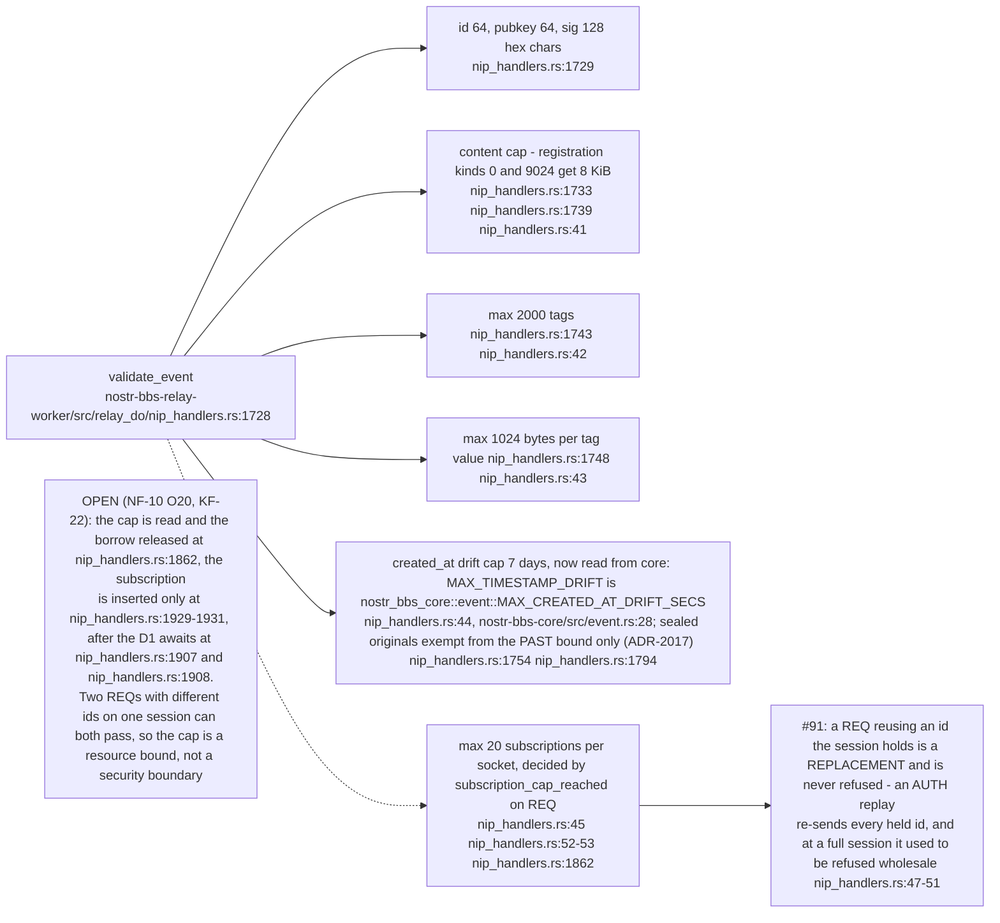

**What it shows.** Successor to the frozen NF-03.11: the seven-day drift limit is no longer a relay-local literal but core's constant (`../nostr-rust-forum/crates/nostr-bbs-relay-worker/src/relay_do/nip_handlers.rs:44`, `../nostr-rust-forum/crates/nostr-bbs-core/src/event.rs:28`), the value unchanged. The subscription-cap race (O20, KF-22) is unchanged.

## NF-32.10 The three wasm32-unreachable Phase-1 surfaces at de31aaa - the feature comment now matches the deleted shims
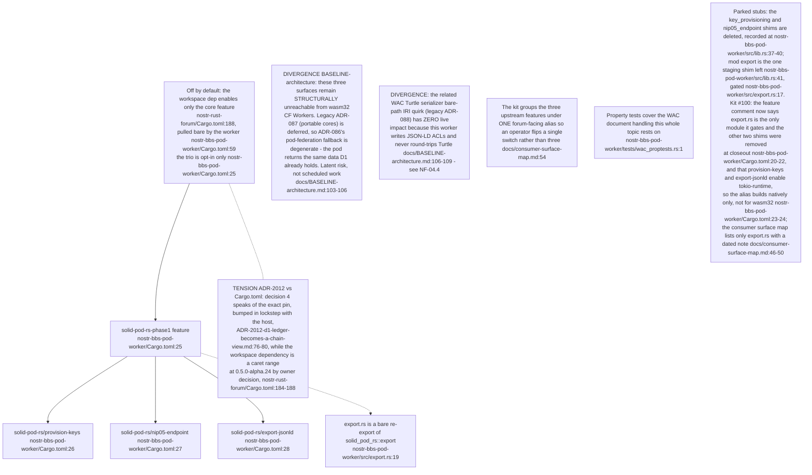

**What it shows.** Successor to the frozen NF-04.10: kit #100 closed the N5 drift; the feature comment names `export.rs` as the only gated module and says the alias builds natively only (`../nostr-rust-forum/crates/nostr-bbs-pod-worker/Cargo.toml:20-24`). The comment grew three lines, so the feature anchors sit three lower.

## NF-32.11 Open items on sealed-original deletion at de31aaa - ADR-2017 carries the dated note
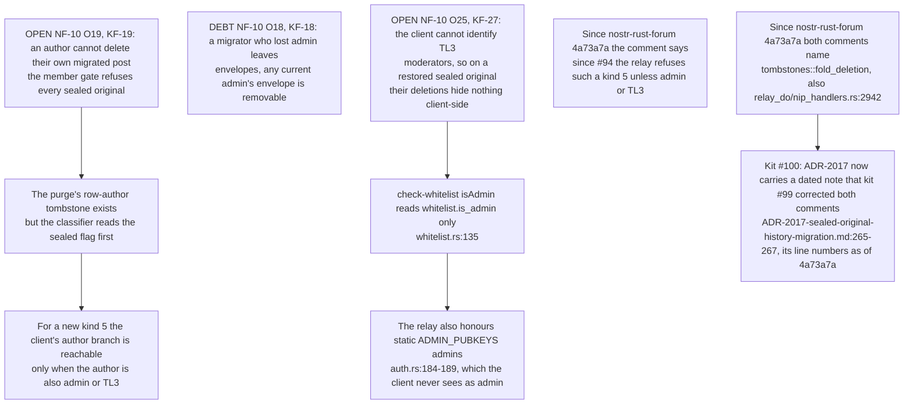

**What it shows.** Successor to the frozen NF-26.8: DRIFT3 is closed by ADR-2017's dated note (`../nostr-rust-forum/docs/adr/ADR-2017-sealed-original-history-migration.md:265-267`). The note cites `nip_handlers.rs:2941` as checked at 4a73a7a; at de31aaa the comment sits at `nip_handlers.rs:2942`, which is the note's own stated revision boundary, not a fresh drift.

## NF-32.12 Doc-drift register DD1 to DD10 at de31aaa - BASELINE's verdict anchor is one line stale
```mermaid
flowchart TB
    DD1["CLOSED by the README rewrite: the Known-gaps row calling NIP-42 AUTH scaffolded with auth_required false is gone<br/>(the README at this stamp carries no scaffolded or planned rows nostr-rust-forum/README.md:60). The code is unchanged: nip42 is the DEFAULT nip42.rs:134,<br/>the template ships AUTH_MODE nip42 nostr-bbs-relay-worker/wrangler.toml:39, and every EVENT passes the gate first nip_handlers.rs:1142.<br/>See NF-03.3."]
    DD2["CLOSED by the README rewrite: the row saying nostr-bbs-mesh is NOT a dependency of the relay-worker is gone and the README<br/>now draws mesh as a dotted configured-routing edge nostr-rust-forum/README.md:60. nostr-bbs-relay-worker/Cargo.toml:27 declares the dependency. See NF-09.8."]
    DD3["nostr-bbs-relay-worker/wrangler.toml:18 asserts there is no ADMIN_PUBKEYS reader in src/.<br/>nostr-bbs-relay-worker/src/auth.rs:185 reads it, and so does nostr-bbs-auth-worker/src/admin.rs:63.<br/>Only nostr-bbs-search-worker/wrangler.toml:41 declares the var. See NF-08.7."]
    DD4["nostr-rust-forum/Cargo.toml:72 workspace.metadata.ci.wasm-check-packages names three crates (config, preview-worker, jev) and is read by NOTHING -<br/>the wasm job checks the whole workspace .github/workflows/ci.yml:188. Inert metadata. See NF-01.2."]
    DD5["nostr-bbs-upstream-canary/src/lib.rs:10 names a five-NIP build matrix but only three smokes exist<br/>nostr-bbs-upstream-canary/src/lib.rs:35 nostr-bbs-upstream-canary/src/lib.rs:56 nostr-bbs-upstream-canary/src/lib.rs:89 - nip04, nip59 and nip98 are unexercised. The same doc calls the crate<br/>nostr-upstream-canary nostr-bbs-upstream-canary/src/lib.rs:14 while the package is nostr-bbs-upstream-canary. See NF-01.5."]
    DD6["The search-worker cron runs every five minutes and reindexes NOTHING - the handler body is a<br/>load_store warm touch nostr-bbs-search-worker/src/lib.rs:1008. See NF-07.1."]
    DD7["CLOSED in part: KIND_GOVERNANCE_AUDIT_LOG, which was numerically the SAME kind as KIND_PANEL_RETIRED, is deleted and a regression test<br/>keeps the six kinds pairwise distinct nostr-bbs-core/src/governance.rs:2222, KIND_PANEL_RETIRED stays nostr-bbs-core/src/governance.rs:32.<br/>Still open: only three of the six documented ACS types have Rust structs nostr-bbs-core/src/governance.rs:102 nostr-bbs-core/src/governance.rs:1227 nostr-bbs-core/src/governance.rs:1257.<br/>See NF-06.1 and NF-06.2."]
    DD8["docs/consumer-surface-map.md:21 lists the git panel as calling /.well-known/apps; the client fetches<br/>/apps/manifest.json nostr-bbs-forum-client/src/components/git_panel.rs:893 and no .well-known path exists in that crate. See NF-30.2."]
    DD9["DOC-DRIFT, one line: the governing doc's gift-wrap paragraph cites the recipient gate at nip_handlers.rs lines 1175 to 1185,<br/>gift_wrap_recipient at line 160 and the verdict at line 2352 docs/BASELINE-architecture.md:163-165. The first two still hold<br/>nip_handlers.rs:160 nip_handlers.rs:1175-1185, but the call-site comment at nip_handlers.rs:2135-2137 grew a line,<br/>so gift_wrap_recipient_verdict is at nip_handlers.rs:2353. See NF-10.1 I5."]
    DD10["Since 4a73a7a the client tombstone doc says that since the member gate the relay refuses a kind-5 naming a<br/>restored sealed original unless the signer is an admin or TL3+, and that kind-5s stored before the gate can still name one<br/>nostr-bbs-forum-client/src/stores/tombstones.rs:11-15, matching nip_handlers.rs:2966 nip_handlers.rs:3057. See NF-10.15."]
```

**What it shows.** Successor to the frozen NF-10.6. DD9 no longer holds as matching: BASELINE still places `gift_wrap_recipient_verdict` at line 2352 (`../nostr-rust-forum/docs/BASELINE-architecture.md:163-165`), the function is at `../nostr-rust-forum/crates/nostr-bbs-relay-worker/src/relay_do/nip_handlers.rs:2353`. The other entries are unchanged at de31aaa.

## NF-32.13 The M4 probe suite at de31aaa, with the website kit pin at 5dc4c64
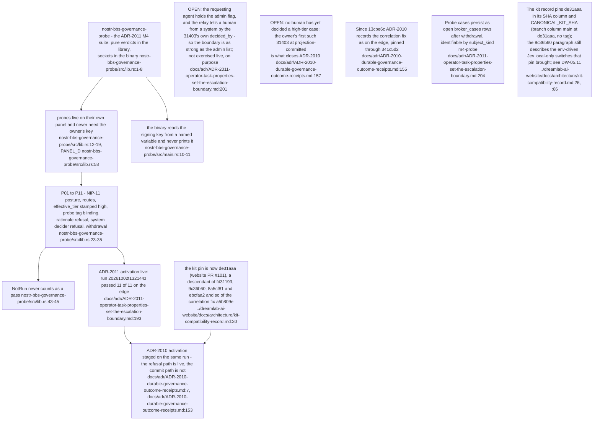

**What it shows.** Successor to the frozen NF-06.18: the website pins kit de31aaa (`../dreamlab-ai-website/docs/architecture/kit-compatibility-record.md:26`, `kit-compatibility-record.md:30`), still a descendant of the correlation fix a5b809e. NF-06 keeps its website key at e255b2b because the frozen NF-06.18 is its only website citation and a frozen panel pins only the forum repository.
