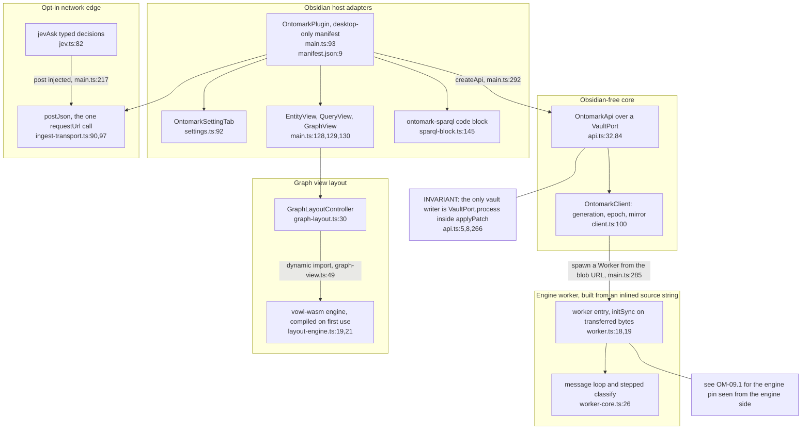
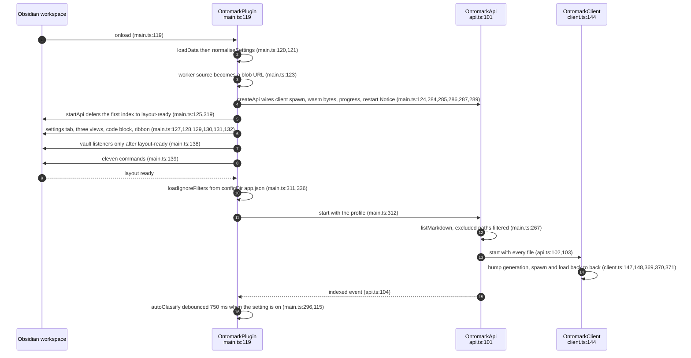
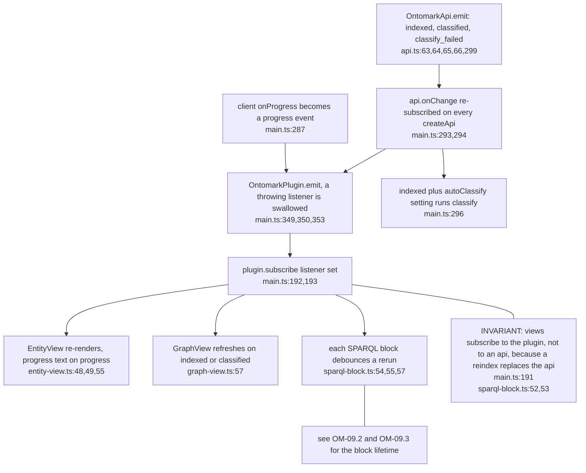
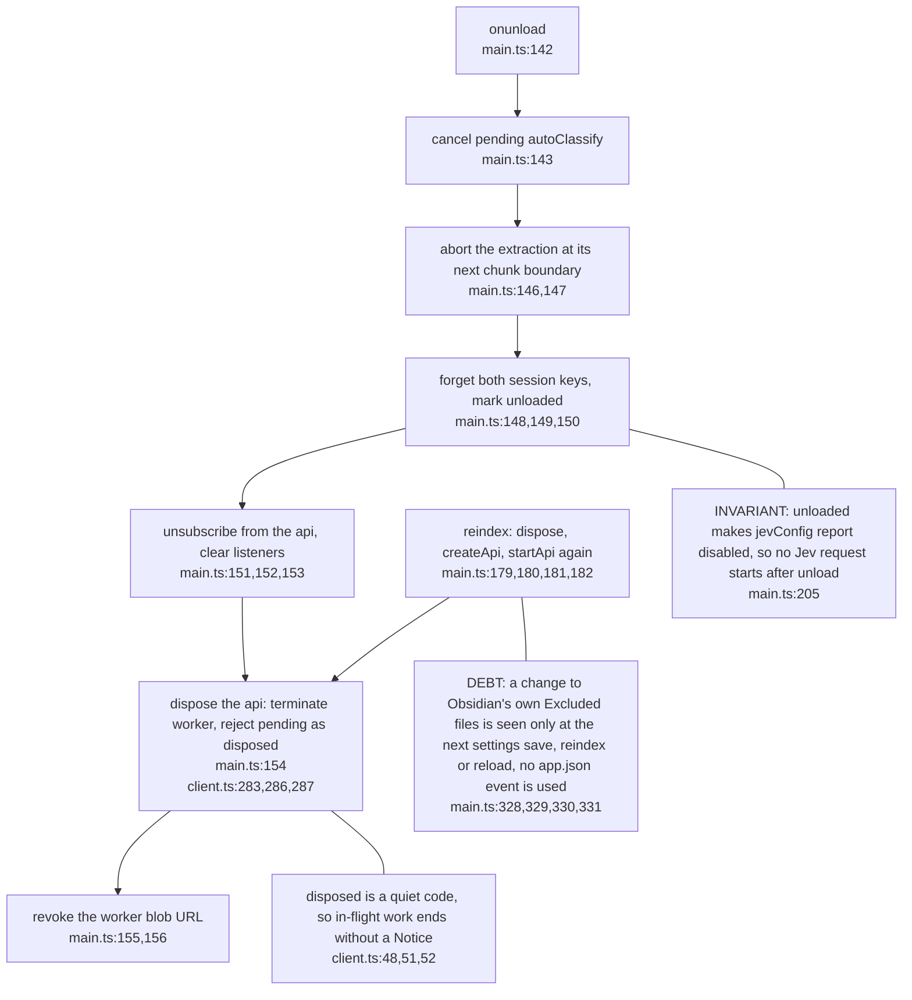

## OO-01.1 Module map: one host class, one API, one worker, two embedded WebAssembly modules

**What it shows.** Everything Obsidian-specific sits in `main.ts`, the settings tab, views and modals; the API, client and worker loop take injected ports and run under Node tests. Engine wire detail is OO-04, the network edge OO-05.

## OO-01.2 onload: synchronous wiring, deferred first index

**What it shows.** Load returns before any note is read: the index and the vault listeners both wait for layout-ready, so the startup `create` storm is never indexed twice (`main.ts:136,137`). `ready` is the promise every later step awaits.

## OO-01.3 The change relay that outlives a reindex

**What it shows.** One listener set lives on the plugin and survives `reindex`; each new API is wired into it in `createApi`. The query view is not a subscriber: it runs only when the user presses Run.

## OO-01.4 onunload and reindex teardown

**What it shows.** Unload and reindex share the dispose step; only unload clears keys and listeners. Work still holding the old API rejects quietly with `disposed` rather than touching the new engine (`main.ts:480,481`).
