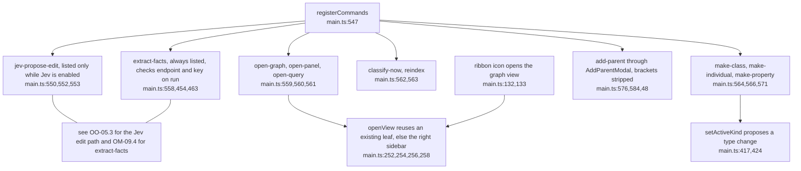
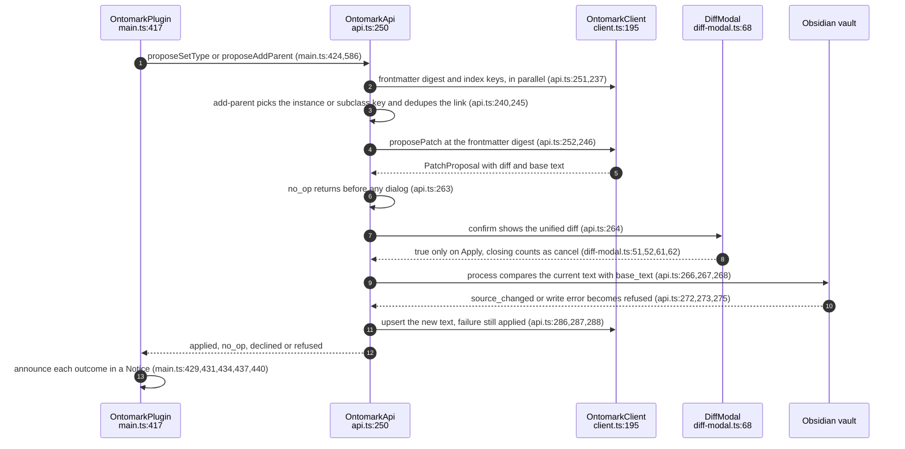
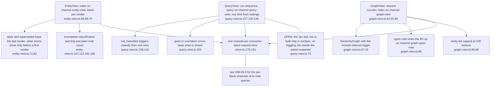
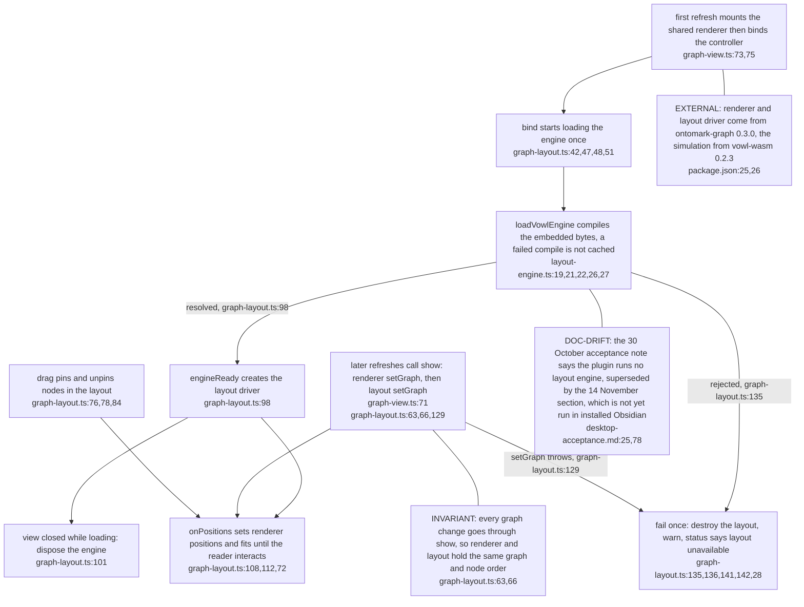

## OO-02.1 Command palette and ribbon: eleven commands, one gated

**What it shows.** Every command but one is registered unconditionally; the Jev command uses `checkCallback`, so with Jev off the palette is unchanged. The three edit commands and add-parent all end in the same guarded write (OO-02.2).

## OO-02.2 A guarded frontmatter edit, from proposal to announcement

**What it shows.** The engine plans the patch; the host alone writes, and only if the file still holds the planned text. A persisted write is `applied` even if the engine update after it fails (`api.ts:277,278,279`).

## OO-02.3 Views, their guard channels and how each keeps stale data off screen

**What it shows.** Each view names its own channel and adds a local counter, so neither a superseded engine reply nor an older local run can repaint it. The query view does not subscribe to index events; the other two do (OO-01.3).

## OO-02.4 The graph layout controller: renderer first, layout optional

**What it shows.** The graph always draws; the force layout is an optional layer whose failure only changes the status line. ADR-OBS-001's ledger still reads implementation `none` (`ADR-OBS-001-shared-graph.md:6`) although this view consumes the shared graph package (`graph-view.ts:3`).
