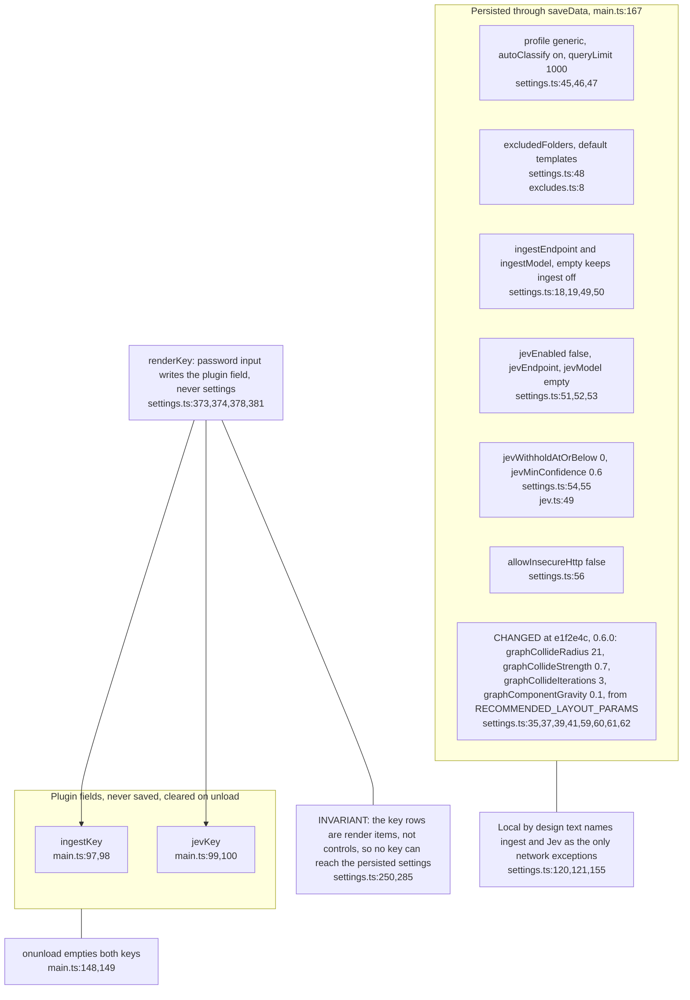
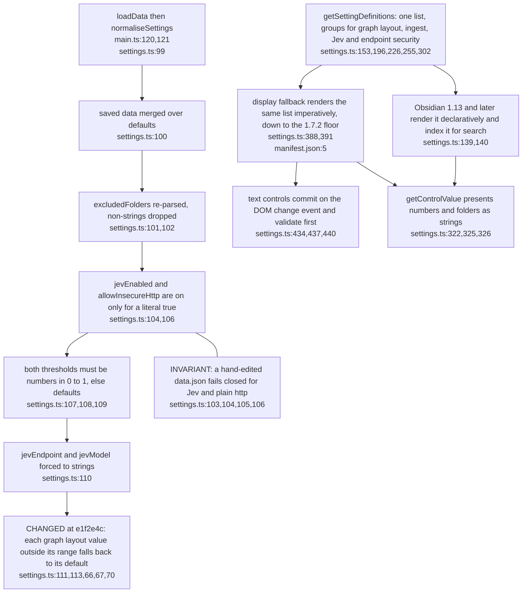
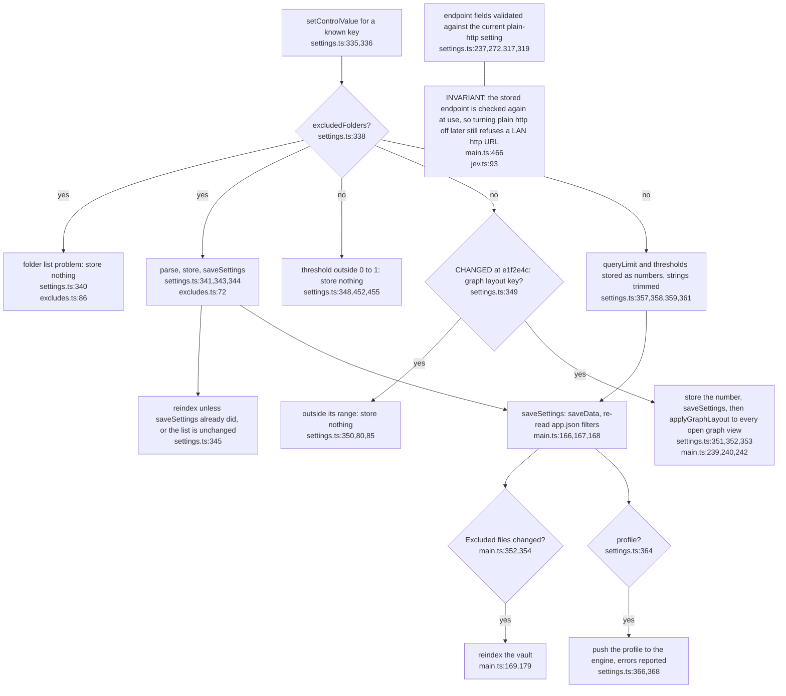

## OO-03.1 What is stored in data.json and what lives only in memory

**What it shows.** Endpoints and thresholds persist; API keys are typed per session and die with the plugin. An empty endpoint is the off switch for ingest, and Jev additionally needs its own toggle.

## OO-03.2 Load-time repair and the two renderers of one definition list

**What it shows.** Malformed or hostile saved values are repaired before use rather than rejected. Both renderers read and write through the same `getControlValue` and `setControlValue` pair (`settings.ts:142,143`).

## OO-03.3 setControlValue: what a single change sets in motion

**What it shows.** Any save can reindex, because a save is one of the two moments Obsidian's own Excluded files are re-read; a profile change instead mutates the live engine. Validation of an endpoint is advisory at entry and enforced at use.
