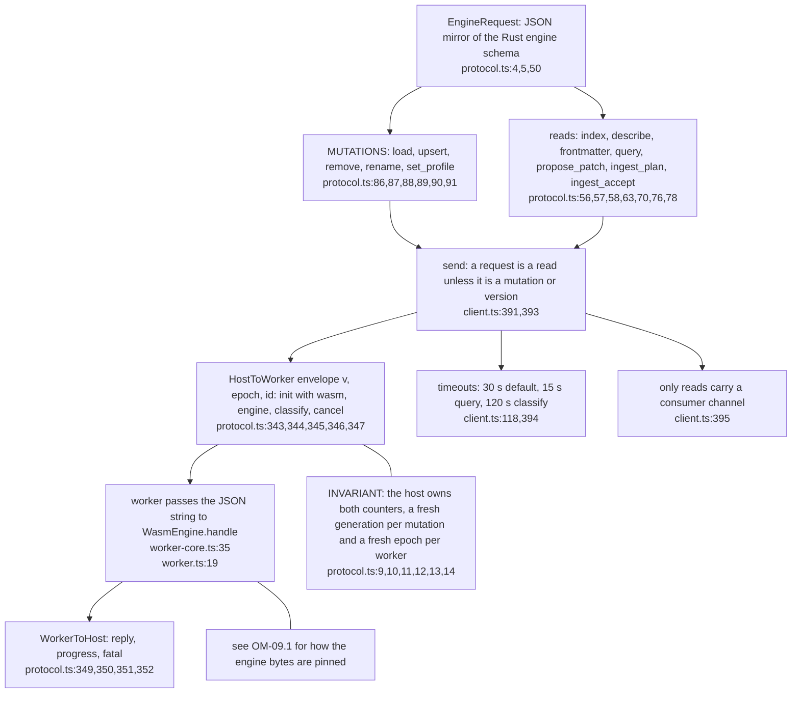
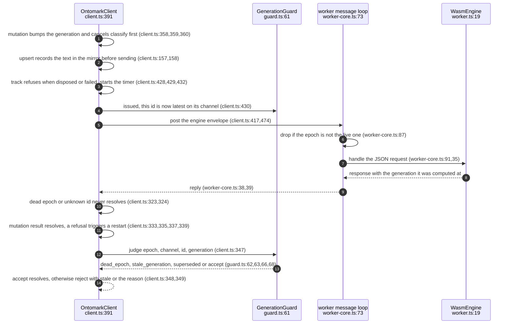
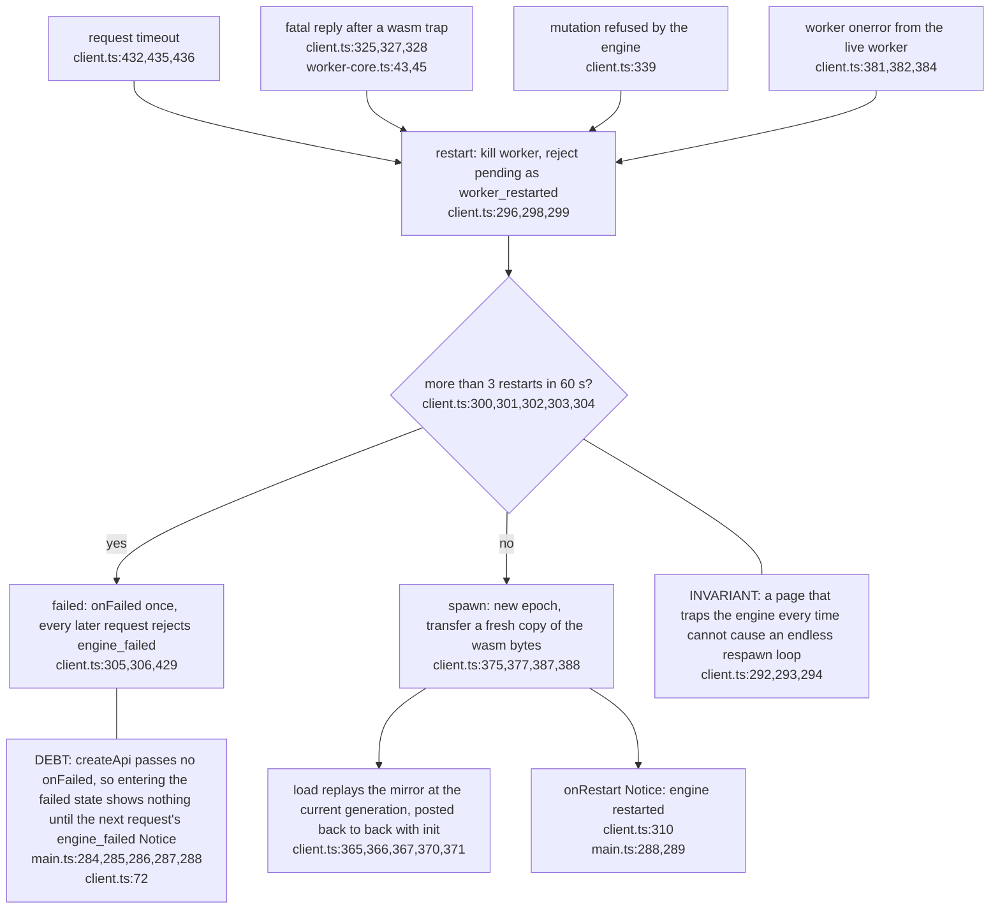
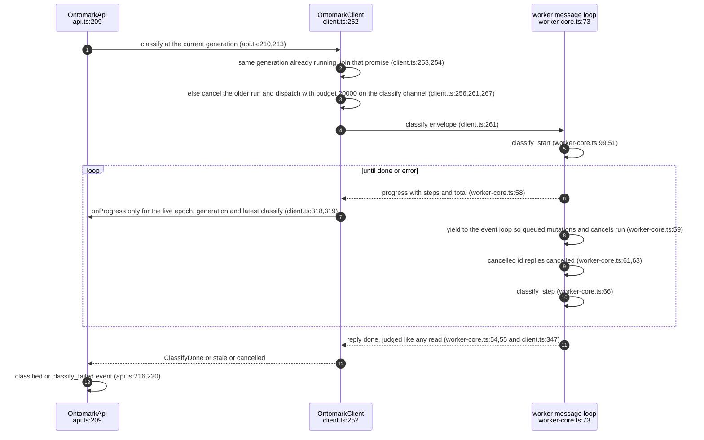

## OO-04.1 Two protocol layers and what counts as a mutation

**What it shows.** Rust is the schema's source of truth and these types only mirror it; `version` is neither read nor mutation, so it carries no channel and is never judged. The worker adds only `init`, `classify` and `cancel` around engine traffic.

## OO-04.2 One request, start to verdict

**What it shows.** A read only reaches its caller if it came from the live worker, was computed at the current generation and is still its channel's latest request. A refused mutation means the engine and the mirror disagree, so the worker is rebuilt from the mirror (`client.ts:338`).

## OO-04.3 Restart, replay and the failed state

**What it shows.** Four triggers share one restart path, and every restart replays the host's mirror rather than re-reading the vault. Requests swept up by a restart or dispose reject quietly (`client.ts:48`); the request that timed out or trapped, and every request after the cap, is reported (`client.ts:435,327,429`).

## OO-04.4 Stepped classify, joining and cancellation

**What it shows.** Classification never blocks the worker for its whole run: each step yields, so an edit queued behind it advances the generation and the next step answers stale. No SharedArrayBuffer is needed (`worker-core.ts:3,4,5,6,7`).
