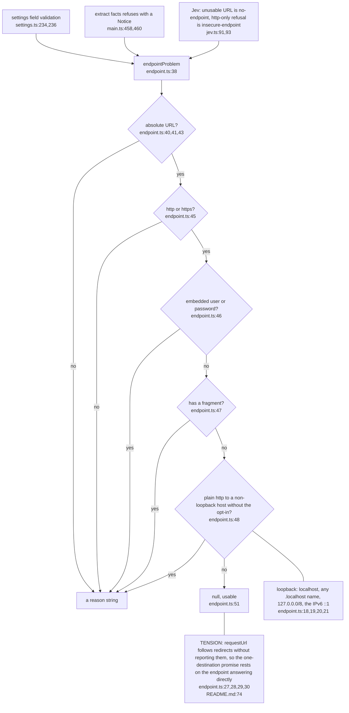
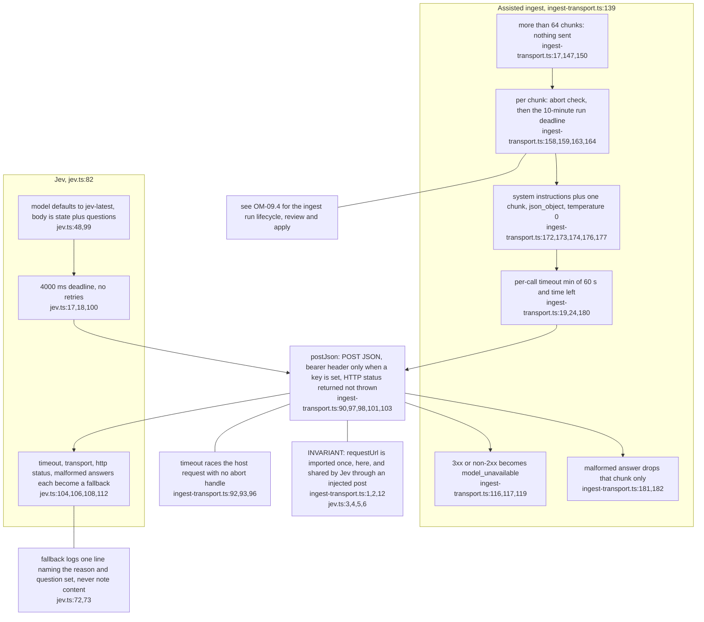
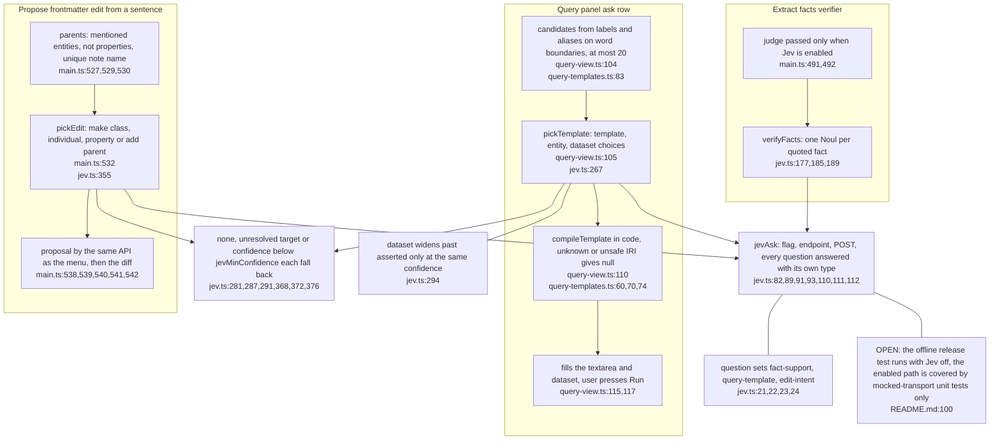
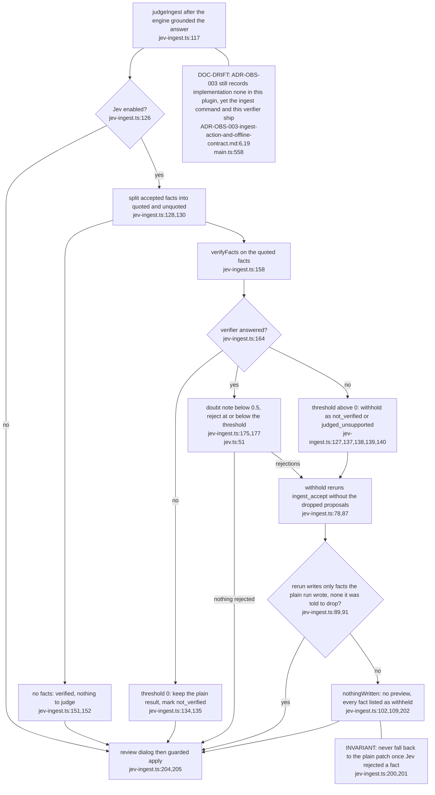

## OO-05.1 endpointProblem: one policy, checked at entry and at use

**What it shows.** The same pure function guards both optional features. A 3xx that does reach the plugin is refused (OO-05.2), but a redirect the host layer already followed is invisible to it.

## OO-05.2 postJson: the one place a request leaves the plugin

**What it shows.** Ingest and Jev share a transport but not a failure model: an ingest failure aborts the run with an error, a Jev failure returns a fallback and the caller keeps its pre-Jev behaviour. Timeouts stop waiting; they do not recall a request already sent.

## OO-05.3 Three Jev call sites, one ask, nothing written by Jev

**What it shows.** Jev only selects among options the code generated, and its output is either an annotation, a filled-but-unrun query, or the input to an existing reviewed edit. The model never sees IRIs for template choices: entities are offered as `e0`, `e1` with labels (`jev.ts:226`).

## OO-05.4 judgeIngest: advisory by default, fail-closed above a threshold

**What it shows.** The patch is always the engine's own output, re-run on fewer proposals, so grounding, conflict checks and the digest guard still apply after a withhold. OM-09.4 states the same threshold rule as one invariant; this panel draws its branches.
