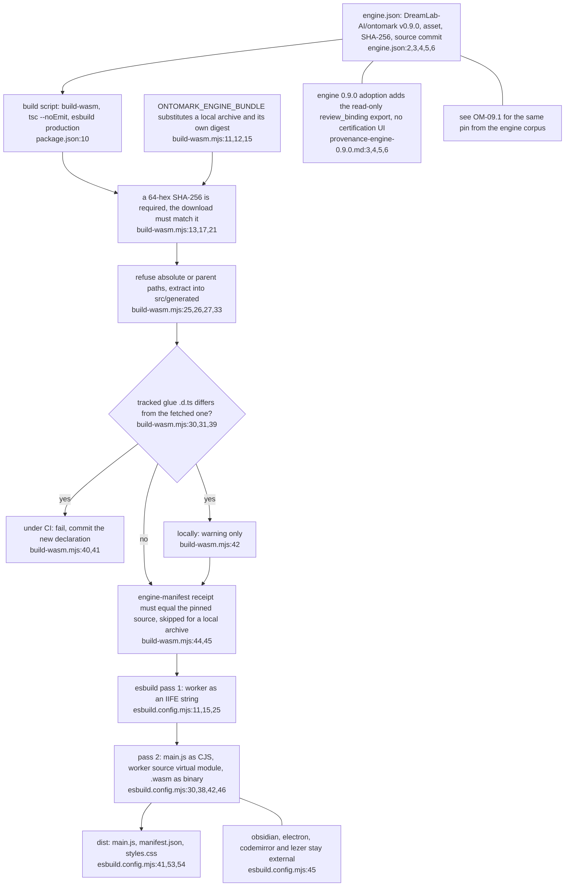
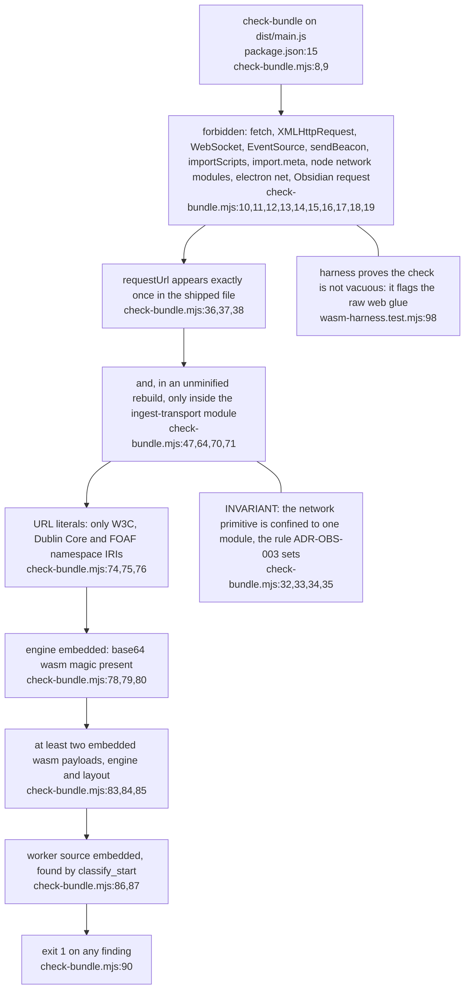
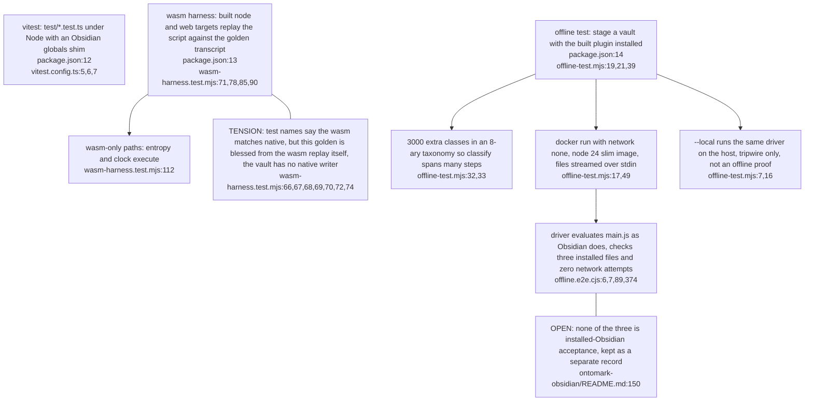
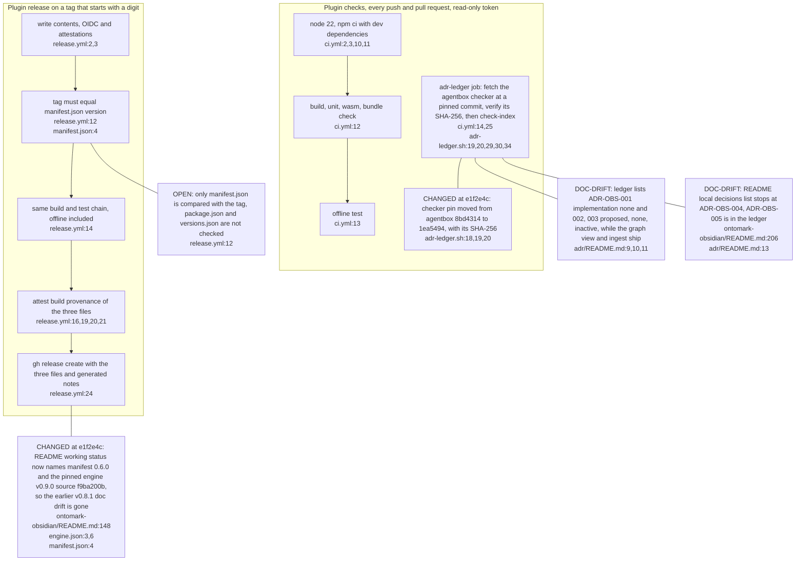

## OO-06.1 npm run build: pinned engine in, three runtime files out

**What it shows.** No Rust toolchain is needed: the engine arrives as a digest-checked release archive, and the only tracked generated file is the glue's type declaration. The installed plugin is the three files in `dist/`, with the worker and both WebAssembly modules inlined (`esbuild.config.mjs:1,2,3,4`).

## OO-06.2 check-bundle: the static offline proof on the shipped main.js

**What it shows.** The check runs on the minified artefact users install, then on an unminified rebuild of the same sources to prove module locality. A single literal `requestUrl` is the whole permitted network surface.

## OO-06.3 Three test layers and what each one proves

**What it shows.** Unit tests cover the pure modules, the harness pins engine output byte for byte, and the offline test exercises the built plugin with networking removed. Native parity rests on Ontomark's own CI for its fixtures (`wasm-harness.test.mjs:68,69`).

## OO-06.4 CI, tag release and the ADR ledger gate

**What it shows.** CI and release run the same gates; only the release adds the tag check, attestation and publication. The ledger gate checks record syntax and index freshness, not whether a record's implementation status matches the code.
