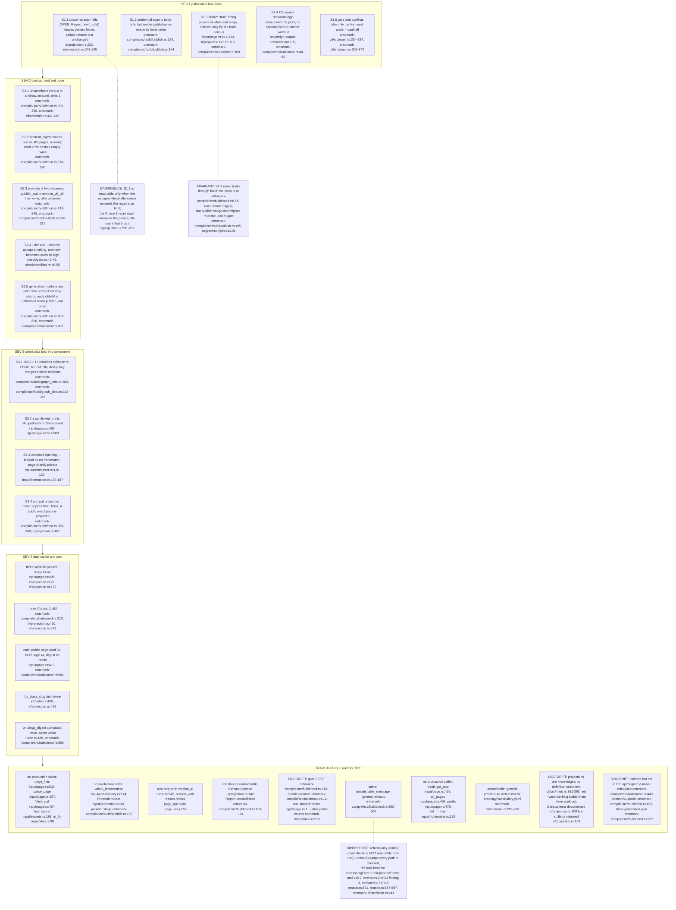
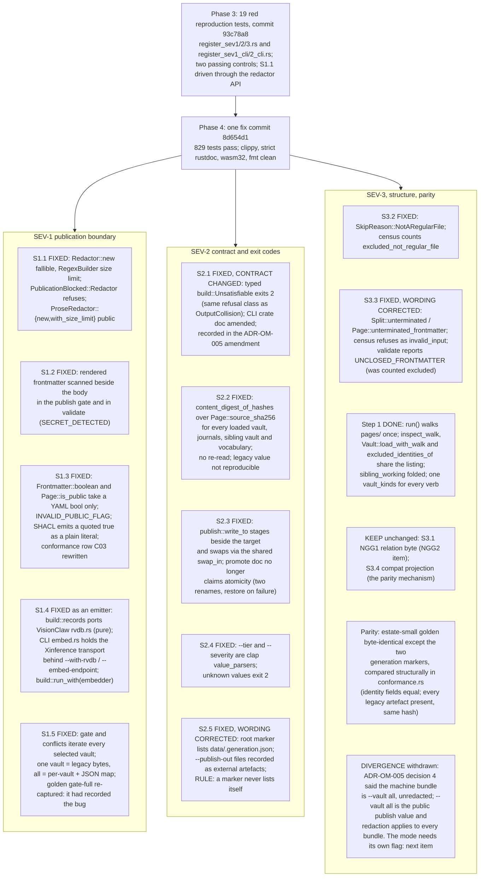
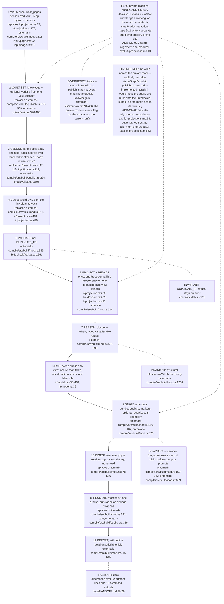

## OM-00.1 Duplicated rules — every copy, whether it diverges, and the one home each should collapse into

```mermaid
flowchart LR
    subgraph PUB["public gate x4"]
        P1["lenient: strings true/false accepted<br/>input/page.rs:211-213 via input/frontmatter.rs:233-236"]
        P2["strict: only a YAML bool, anything else refuses the build<br/>ir/projection.rs:112-116"]
        P3["profile-configurable lenient_booleans<br/>ontomark-model/src/profile.rs:604-611"]
        P4["strict, gate key optional<br/>ontomark-wasm/src/profile.rs:316-321"]
    end
    PUBC["CANONICAL: one is_public on the model Profile,<br/>estate profile with lenient_booleans false<br/>ontomark-model/src/profile.rs:607"]
    P1 -->|DIVERGENCE| PUBC
    P2 -->|same rule| PUBC
    P3 --> PUBC
    P4 -->|same rule| PUBC

    subgraph WALK["directory walk x3"]
        W1["walk_pages: errors surface, skips reported, dot rule<br/>input/page.rs:492-515"]
        W2["inspect_inputs census: own dot + unpublished filter<br/>ir/projection.rs:77, ir/projection.rs:93"]
        W3["excluded_identities: filter_map ok swallows walk errors, no dot rule<br/>ir/projection.rs:172-175"]
    end
    WALKC["CANONICAL: walk_pages once, PageWalk feeds census and holds<br/>input/page.rs:492"]
    W2 -->|DIVERGENCE| WALKC
    W3 -->|DIVERGENCE| WALKC
    W1 --> WALKC

    subgraph LINK["wikilink resolve x4"]
        L1["Corpus::build resolve, fragment and .md kept<br/>ir/model.rs:336-342"]
        L2["PrivateLinks::resolve strips fragment and .md<br/>build/redact.rs:209-226"]
        L3["shacl Resolver::page, no slug key, case-sensitive<br/>shacl.rs:1197-1199"]
        L4["curated links slug verbatim via target_slug<br/>ir/model.rs:424"]
    end
    LINKC["CANONICAL: one Resolver in ir/, rules of build/redact.rs:209"]
    L1 -->|DIVERGENCE| LINKC
    L2 --> LINKC
    L3 -->|DIVERGENCE| LINKC
    L4 -->|DIVERGENCE| LINKC

    subgraph HOLD["held-back list x4"]
        H1["UNPUBLISHED_DIRS _misc, first component only<br/>input/page.rs:38, input/page.rs:543-547"]
        H2["HELD_BACK_DIRS _misc + misc at any depth<br/>ontomark-compile/src/build/publish.rs:130-142"]
        H3["copy of the excluded_identities loop<br/>migrate/compile.rs:90-99"]
        H4["held_back applied only on the redacted projection path<br/>ir/projection.rs:467"]
    end
    HOLDC["CANONICAL: one held_back(rel) in input/, one list<br/>ontomark-compile/src/build/publish.rs:134"]
    H1 -->|DIVERGENCE| HOLDC
    H2 --> HOLDC
    H3 -->|dup only| HOLDC
    H4 -->|DIVERGENCE| HOLDC

    subgraph SLUG["slugify x3"]
        S1["regex non-alnum to dash, trimmed<br/>input/slug.rs:15-32"]
        S2["hand-rolled, same output, parity-tallied<br/>ontomark-model/src/mint.rs:73-88, adr2015.rs:727"]
        S3["target_slug: kebab target taken verbatim, keeps leading/doubled dashes<br/>input/slug.rs:66-75"]
    end
    SLUGC["CANONICAL: the model minter<br/>ontomark-model/src/mint.rs:73"]
    S1 -->|dup only| SLUGC
    S2 --> SLUGC
    S3 -->|DIVERGENCE| SLUGC

    subgraph REL["relation-order table x4 + stub list"]
        R1["RELATION_KEYS<br/>ir/model.rs:36"]
        R2["SCAFFOLD_REL_ORDER<br/>indexes.rs:30"]
        R3["PAGE_API_REL_ORDER<br/>page_api.rs:18"]
        R4["REL_MAP related-to to skos:related<br/>webvowl.rs:30"]
        R5["hard-coded 13 stub names, misses vocabulary-added relations<br/>turtle.rs:446-460"]
    end
    RELC["CANONICAL: RELATION_KEYS + vocabulary<br/>ir/model.rs:36"]
    R2 -->|dup only| RELC
    R3 -->|dup only| RELC
    R4 -->|DIVERGENCE| RELC
    R5 -->|DIVERGENCE| RELC
    R1 --> RELC

    subgraph LBL["label fallback x3"]
        B1["label else title<br/>indexes.rs:129-133"]
        B2["label else title else slug<br/>ir/closure.rs:109-113"]
        B3["label else slug, title skipped<br/>ontomark-compile/src/build/graph_tiers.rs:254-256"]
    end
    LBLC["CANONICAL: one display_label on the record, closure rule"]
    B1 -->|DIVERGENCE| LBLC
    B2 --> LBLC
    B3 -->|DIVERGENCE| LBLC

    subgraph DOM["domain normalisation x5"]
        D1["verbatim<br/>turtle.rs:302-304"]
        D2["alias fold via profile<br/>ontomark-compile/src/build/graph_tiers.rs:81-90"]
        D3["raw slug match<br/>webvowl.rs:91"]
        D4["empty to unclassified<br/>page_api.rs:147-148"]
        D5["title-case for display<br/>indexes.rs:328"]
    end
    DOMC["CANONICAL: profile resolver, then per-surface formatting<br/>ontomark-compile/src/build/graph_tiers.rs:81"]
    D1 -->|DIVERGENCE| DOMC
    D3 -->|DIVERGENCE| DOMC
    D4 -->|DIVERGENCE| DOMC
    D5 -->|presentation| DOMC
    D2 --> DOMC

    subgraph VK["vault_kinds x3"]
        K1["unknown to knowledge, clap-guarded<br/>ontomark-cli/src/main.rs:141-147"]
        K2["unknown to BOTH vaults<br/>migrate_cmd.rs:59-65"]
        K3["VisionClaw legacy copy<br/>vault/src/main.rs:165"]
    end
    VKC["CANONICAL: one VaultSelector beside VAULT_VALUES<br/>ontomark-cli/src/main.rs:131"]
    K1 --> VKC
    K2 -->|DIVERGENCE| VKC
    K3 -->|"EXTERNAL: dup until VC-60 retires"| VKC

    subgraph RED["body redaction x3, Corpus::build x3, sibling loaders x2, secret scan x2"]
        Y1["links.body on cleaned vault<br/>ir/projection.rs:497"]
        Y2["links.body in render<br/>ontomark-compile/src/build/publish.rs:168"]
        Y3["links.body + prose redactor for the mirror tally<br/>ontomark-compile/src/build/mod.rs:516"]
        C1["Corpus::build raw<br/>ontomark-compile/src/build/mod.rs:313"]
        C2["Corpus::build collision probe, result discarded<br/>ir/projection.rs:460"]
        C3["Corpus::build cleaned<br/>ir/projection.rs:499"]
        G1["sibling_working ignores vault.kind<br/>ontomark-compile/src/build/publish.rs:336-346"]
        G2["sibling_vault(kind)<br/>ontomark-compile/src/build/publish.rs:353"]
        X1["validate scans page.body only<br/>check/validate.rs:305"]
        X2["staging scans page.body only<br/>ontomark-compile/src/build/publish.rs:224"]
    end
    REDC["CANONICAL: one redacted page view, one Corpus::build,<br/>sibling_vault only, one census scan of rendered bytes"]
    Y1 -->|dup only| REDC
    Y2 -->|dup only| REDC
    Y3 -->|dup only| REDC
    C1 -->|dup only| REDC
    C2 -->|dup only| REDC
    C3 -->|dup only| REDC
    G1 -->|DIVERGENCE| REDC
    G2 --> REDC
    X1 -->|dup only| REDC
    X2 -->|dup only| REDC
```

- DIVERGENCE: an edge labelled DIVERGENCE joins a copy whose output differs from the canonical rule for some input; `dup only` copies agree today and differ only in cost.
- DIVERGENCE: slug.rs vs mint.rs are equivalent (`[^a-z0-9]+` at `input/slug.rs:17` vs ASCII-alnum at `ontomark-model/src/mint.rs:77`), overruling OM-01's "two slugify" as a divergence; the real fork is `target_slug` at `input/slug.rs:66-75`.

## OM-00.2 Ranked anomalies, grouped by severity

- DIVERGENCE: S2.1 conforms to the crate doc, which lists only credential, collision and reasoner-cap refusals as exit 2 (`ontomark-cli/src/main.rs:6-9`); making it 2 is a contract decision recorded in an ADR, not a bug fix.

## OM-00.3 Revert, reconcile or keep — origin of each SEV-1..3 divergence

```mermaid
flowchart LR
    VC["VisionClaw crates/vault, the legacy producer,<br/>relocated by 2bb20ec WIP relocate legacy pipeline into ontomark-compile<br/>and d7863ff Relocate the vault pipeline: byte parity"]
    S11["S1.1 fail-open redactor<br/>INHERITED vault/src/projection.rs:229"]
    S12["S1.2 body-only scan, frontmatter published<br/>INHERITED vault/src/build/publish.rs:159-160, vault/src/build/publish.rs:200;<br/>d5c1188 EXP-04 wrapped link redaction round render, not the scan<br/>ontomark-compile/src/build/publish.rs:162-168"]
    S13["S1.3 lenient vs strict public<br/>INHERITED vault-core/src/page.rs:211-213, vault/src/projection.rs:112<br/>lenient pinned as expected by standards.md:179"]
    S14["S1.4 records.jsonl absent<br/>VisionClaw has --with-rvdb vault/src/main.rs:389-392; git log --all -S with_rvdb finds no ontomark commit, never ported;<br/>deferral DEPRECATION.md:145; C3 line added by VisionFlow 6443781 sovereign-corpus-contracts.md:115"]
    S15["S1.5 gate/conflicts first vault only<br/>INHERITED vault/src/main.rs:855-858 via d7863ff"]
    S21["S2.1 unsatisfiable exit 1<br/>INHERITED vault/src/build/mod.rs:348 via 2bb20ec"]
    S22["S2.2 narrow digest<br/>INHERITED vault/src/build/mod.rs:514 via 2bb20ec"]
    S23["S2.3 non-atomic publish_out<br/>INHERITED vault/src/build/publish.rs:288"]
    S24["S2.4 free-text --tier/--severity<br/>INHERITED vault/src/gate.rs:42, vault/src/conflicts.rs:48 via 2bb20ec"]
    S31["S3.1 NGG1 relation collapse<br/>INHERITED vault/src/build/graph_tiers.rs:426-428;<br/>format published as ontomark-ngg1 0.1.0, 6c71ebc"]
    S32["S3.2 silent symlink skip<br/>INHERITED vault-core/src/page.rs:501-503 via 2bb20ec"]
    S33["S3.3 unclosed fence<br/>INHERITED vault-core/src/frontmatter.rs:153-157 via 2bb20ec"]
    S34["S3.4 compat path without held_back<br/>d5c1188 EXP-04 added the compat branch to keep legacy bytes; e96f726 merge put held_back on the redacted path only<br/>ontomark-compile/src/build/mod.rs:368-369, ir/projection.rs:467"]
    VC --> S11 & S12 & S13 & S14 & S15 & S21 & S22 & S23 & S24 & S31 & S32 & S33
    S11 --> RC1["RECONCILE: ProseRedactor::new returns Result, build refuses on failure (fail closed)<br/>ir/projection.rs:232"]
    S12 --> RC2["RECONCILE: scan the rendered page bytes, frontmatter + body, once in the census<br/>ontomark-compile/src/build/publish.rs:164, check/validate.rs:305"]
    S13 --> RC3["RECONCILE: strict rule canonical per its own comment ir/projection.rs:110-111;<br/>validate reports the string flag; rewrite standards.md:179 C03 row"]
    S14 --> RC4["RECONCILE contract first: C3 marks records.jsonl VisionClaw-only until the optional<br/>capability of DEPRECATION.md:145 lands; never fake an empty file"]
    S15 --> RC5["RECONCILE: loop every selected vault as validate does<br/>ontomark-cli/src/main.rs:304"]
    S21 --> RC6["RECONCILE by ADR: typed Unsatisfiable error, exit 2 beside ReasoningError,<br/>then amend ontomark-cli/src/main.rs:6-9"]
    S22 --> RC7["RECONCILE: digest the bytes parsed at input/page.rs:413 for every vault + vocabulary; read error refuses"]
    S23 --> RC8["RECONCILE: stage publish_out as a sibling and swap; promote doc says two renames<br/>ontomark-compile/src/build/publish.rs:316"]
    S24 --> RC9["RECONCILE: clap value_parser as VAULT_VALUES does<br/>ontomark-cli/src/main.rs:131"]
    S31 --> KP1["KEEP in NGG1 v1, DIVERGENCE recorded: EDGE_RELATION ontomark-ngg1/src/lib.rs:144 is a published<br/>wire value; per-relation edge types need an NGG2 format bump; TTL keeps them turtle.rs:337-341"]
    S32 --> RC10["RECONCILE: SkipReason for symlinks, honouring input/page.rs:79-81"]
    S33 --> RC11["RECONCILE: unclosed fence is an invalid_input census count, not a private page"]
    S34 --> KP2["KEEP: the compat flag is the parity comparison mechanism, docs/HANDOFF.md:28-29;<br/>default build takes the redacted path ontomark-compile/src/build/mod.rs:366"]
    NOREV["DIVERGENCE: no SEV-1..3 item is a regression of an earlier ontomark copy, so REVERT applies to none;<br/>reverting 2bb20ec or d7863ff would remove the whole port"]
    RC1 -.- NOREV
    EXT["EXTERNAL: VisionClaw's vault build job ships S1.1, S1.2, S1.5, S2.3 and S3.1 unchanged<br/>until VC-60 retires under its four gates<br/>ADR-OM-005-estate-alignment-one-producer-explicit-projections.md:11"]
    VC -.- EXT
```

- INVARIANT: the closure-vs-Whelk split is KEEP, pinned by `the_closure_and_the_reasoner_agree_on_the_taxonomy` (`ontomark-compile/src/build/mod.rs:1254`); the NGG1 category ancestry walk at `ontomark-compile/src/build/graph_tiers.rs:154` has no such test.
- DIVERGENCE: `reason.rs:79` gained `refusals.is_empty()` in 6c040a5 together with `checked` (`reason.rs:590-597`); reverting it would let refusals pass, so it stays.

## OM-00.5 Resolution at ontomark 8d654d1 (2026-10-12)

- Every citation in OM-00.1 to OM-00.4 is at `ffe06e4` and describes the state the fixes removed; this section carries commit shas only.
- Dead code removed with the fixes: `page_files`, `iri_for`, `has_secret`, `unsatisfiable_message`; docs corrected for `parse_page`, `excluded_identities` and `Census.rejected`.

## OM-00.4 Canonical run() after reconciliation

- INVARIANT: the parity receipt is over the complete committed corpus through the compat flag (`docs/HANDOFF.md:27-29`), so S3.4 stays byte-identical; a strict validate cannot move it, because the census at `ontomark-compile/src/build/mod.rs:309` already runs on every build, compat included, so a corpus with a passing receipt holds only real booleans.
- INVARIANT: the census refusal must keep exit 2 and stage nothing (`ontomark-compile/src/build/publish.rs:246-248`, `ontomark-cli/src/main.rs:429-431`).
