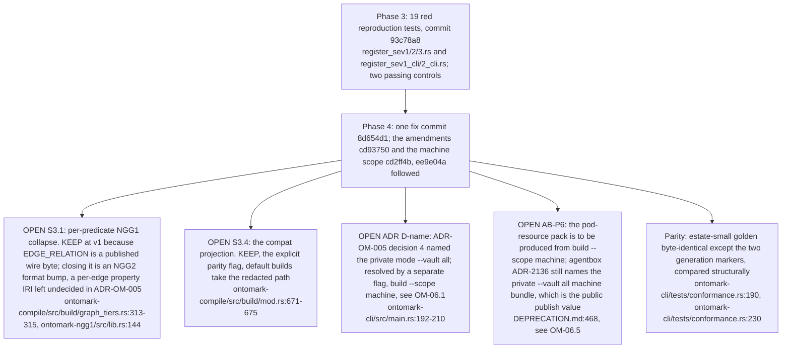

## OM-00.1 Duplicated rules — every copy at 07f4c1c, whether it still diverges, and the one home each collapses into

```mermaid
flowchart LR
    subgraph PUB["public gate x4"]
        P1["Page::is_public: only Value::Bool(true) publishes — RESOLVED 8d654d1 (S1.3)<br/>input/page.rs:268-273"]
        P2["build census: bool true or false or absent; any other value is invalid_publication_flag<br/>ir/projection.rs:139-143"]
        P3["model Profile: strings accepted only when the profile sets lenient_booleans<br/>ontomark-model/src/profile.rs:604-612"]
        P4["wasm profile: strict bool, gate key optional<br/>ontomark-wasm/src/profile.rs:316-321"]
    end
    PUBC["CANONICAL: the model Profile is_public, estate profile with lenient_booleans false<br/>ontomark-model/src/profile.rs:604"]
    P1 -->|same rule since 8d654d1| PUBC
    P2 -->|same rule| PUBC
    P3 --> PUBC
    P4 -->|same rule| PUBC

    subgraph WALK["directory walk — one listing since 8d654d1"]
        W1["walk_pages root, excluded: errors surface, skips reported, dot rule and excluded-folder rule<br/>input/page.rs:581"]
        W2["census inspect_walk over the SAME PageWalk — RESOLVED<br/>ir/projection.rs:96"]
        W3["excluded_identities_of reads held pages out of the loaded Vault, no second walk — RESOLVED<br/>ir/projection.rs:228"]
        W4["excluded_identities by path still walks on its own and has no production caller<br/>ir/projection.rs:202-205"]
    end
    WALKC["CANONICAL: walk_pages once, PageWalk feeds census, load and holds<br/>ontomark-compile/src/build/mod.rs:569-575"]
    W1 --> WALKC
    W2 --> WALKC
    W3 --> WALKC
    W4 -->|dup only| WALKC

    subgraph LINK["wikilink resolve x4"]
        L1["Corpus::build resolve, fragment and .md kept<br/>ir/model.rs:336-342"]
        L2["PrivateLinks::resolve strips fragment and .md; also the machine scope resolver<br/>ontomark-compile/src/build/redact.rs:210-229"]
        L3["shacl Resolver::page, no slug key, case-sensitive id then lower-cased title and alias<br/>shacl.rs:1201-1207"]
        L4["curated links slug verbatim via target_slug<br/>ir/model.rs:424"]
    end
    LINKC["CANONICAL: one Resolver in ir/, rules of redact.rs resolve_public<br/>ontomark-compile/src/build/redact.rs:239"]
    L1 -->|DIVERGENCE| LINKC
    L2 --> LINKC
    L3 -->|DIVERGENCE| LINKC
    L4 -->|DIVERGENCE| LINKC

    subgraph HOLD["held-back list x4"]
        H1["UNPUBLISHED_DIRS _misc, first component only<br/>input/page.rs:47, input/page.rs:641-646"]
        H2["HELD_BACK_DIRS is now only the site-only misc; held_back adds UNPUBLISHED_DIRS at any depth (ER-18, 95208e8)<br/>ontomark-compile/src/build/publish.rs:134, ontomark-compile/src/build/publish.rs:138-148"]
        H3["migrate delegates to is_unpublished but keeps its own excluded-identity loop<br/>migrate/compile.rs:38-39, migrate/compile.rs:105-114"]
        H4["held_back applied on the redacted path; the compat path skips it — KEEP (S3.4)<br/>ir/projection.rs:616, ir/projection.rs:657, ontomark-compile/src/build/mod.rs:671-675"]
    end
    HOLDC["CANONICAL: one held_back(rel) in input/<br/>ontomark-compile/src/build/publish.rs:138"]
    H1 -->|DIVERGENCE| HOLDC
    H2 --> HOLDC
    H3 -->|dup only| HOLDC
    H4 -->|DIVERGENCE kept| HOLDC

    subgraph SLUG["slugify x3"]
        S1["regex non-alnum to dash, trimmed<br/>input/slug.rs:14-16, input/slug.rs:28"]
        S2["hand-rolled, same output, parity-tallied<br/>ontomark-model/src/mint.rs:73-88, ontomark-model/tests/adr2015.rs:727"]
        S3["target_slug: kebab target taken verbatim, keeps leading and doubled dashes<br/>input/slug.rs:65-75"]
    end
    SLUGC["CANONICAL: the model minter<br/>ontomark-model/src/mint.rs:73"]
    S1 -->|dup only| SLUGC
    S2 --> SLUGC
    S3 -->|DIVERGENCE| SLUGC

    subgraph REL["relation-order table x4 + stub list"]
        R1["RELATION_KEYS<br/>ir/model.rs:36"]
        R2["SCAFFOLD_REL_ORDER<br/>indexes.rs:30"]
        R3["PAGE_API_REL_ORDER<br/>page_api.rs:18"]
        R4["REL_MAP related-to to skos:related<br/>webvowl.rs:30"]
        R5["hard-coded 13 stub names, misses vocabulary-added relations<br/>turtle.rs:446-460"]
    end
    RELC["CANONICAL: RELATION_KEYS + vocabulary<br/>ir/model.rs:36"]
    R2 -->|dup only| RELC
    R3 -->|dup only| RELC
    R4 -->|DIVERGENCE| RELC
    R5 -->|DIVERGENCE| RELC
    R1 --> RELC

    subgraph LBL["label fallback x3"]
        B1["label else title<br/>indexes.rs:129-133"]
        B2["label else title else slug<br/>ir/closure.rs:109-113"]
        B3["label else slug, title skipped<br/>ontomark-compile/src/build/graph_tiers.rs:254-256"]
    end
    LBLC["CANONICAL: one display_label on the record, closure rule"]
    B1 -->|DIVERGENCE| LBLC
    B2 --> LBLC
    B3 -->|DIVERGENCE| LBLC

    subgraph DOM["domain normalisation x5"]
        D1["verbatim<br/>turtle.rs:302-304"]
        D2["alias fold via profile<br/>ontomark-compile/src/build/graph_tiers.rs:81-89"]
        D3["raw slug match<br/>webvowl.rs:91"]
        D4["empty to unclassified<br/>page_api.rs:147-148"]
        D5["title-case for display<br/>indexes.rs:328"]
    end
    DOMC["CANONICAL: profile resolver, then per-surface formatting<br/>ontomark-compile/src/build/graph_tiers.rs:81"]
    D1 -->|DIVERGENCE| DOMC
    D3 -->|DIVERGENCE| DOMC
    D4 -->|DIVERGENCE| DOMC
    D5 -->|presentation| DOMC
    D2 --> DOMC

    subgraph VK["vault_kinds — one since 8d654d1"]
        K1["vault_kinds, VAULT_VALUES as clap value_parser, used by every verb<br/>ontomark-cli/src/migrate_cmd.rs:72-76, ontomark-cli/src/main.rs:75"]
        K3["VisionClaw legacy copy<br/>vault/src/main.rs:181"]
    end
    VKC["CANONICAL: the one selector in migrate_cmd<br/>ontomark-cli/src/migrate_cmd.rs:72"]
    K1 --> VKC
    K3 -->|"EXTERNAL: dup until VC-60 retires"| VKC

    subgraph RED["redaction, Corpus::build, sibling loaders, secret scan"]
        Y1["link-cleaned vault built once per projection<br/>ir/projection.rs:613"]
        Y2["markdown mirror redacts the prose again for the mirror tally<br/>ontomark-compile/src/build/mod.rs:886-891"]
        C1["Corpus::build raw<br/>ontomark-compile/src/build/mod.rs:577"]
        C2["Corpus::build over the cleaned vault<br/>ir/projection.rs:606"]
        G1["one sibling_vault(kind) loader — RESOLVED, sibling_working folded<br/>ontomark-compile/src/build/publish.rs:365"]
        X1["validate scans body AND rendered frontmatter — RESOLVED (S1.2)<br/>check/validate.rs:305, check/validate.rs:323"]
        X2["staging scans body AND rendered frontmatter — RESOLVED (S1.2)<br/>ontomark-compile/src/build/publish.rs:228, ontomark-compile/src/build/publish.rs:240"]
    end
    REDC["CANONICAL: one redacted page view, one Corpus::build, one census scan of rendered bytes (SEV-4, open)"]
    Y1 -->|dup only| REDC
    Y2 -->|dup only| REDC
    C1 -->|dup only| REDC
    C2 -->|dup only| REDC
    G1 --> REDC
    X1 --> REDC
    X2 --> REDC
```

- INVARIANT: after 8d654d1 the in-tree copies of the public gate, the walk, `vault_kinds`, the sibling loader and the credential scan agree; an edge labelled DIVERGENCE is a copy whose output still differs from the canonical rule for some input.
- DIVERGENCE: `slug.rs` and `mint.rs` are equivalent (`[^a-z0-9]+` at `input/slug.rs:14-16` vs ASCII-alnum at `ontomark-model/src/mint.rs:77`); the real fork is `target_slug` at `input/slug.rs:65-75`.
- **Debt:** the list of furniture folders that are not pages is written twice across the producers: `EXCLUDED_DIRS = [templates, bases, assets, journals]` (`ontomark-compile/src/input/page.rs:58`) and VisionClaw's `FURNITURE_DIRS` with the same four names (`../project/crates/vault-core/src/page.rs:50`), both introduced when the `pages/` folder was retired (ADR-OM-007).
- **Open:** is the held-back `misc` rule meant to stay in `HELD_BACK_DIRS` beside the `UNPUBLISHED_DIRS` it no longer restates? The two lists are disjoint since 95208e8 and applied together by `held_back` (`ontomark-compile/src/build/publish.rs:134`, `ontomark-compile/src/build/publish.rs:138-148`).

## OM-00.2 Ranked anomalies and their outcome at 07f4c1c

```mermaid
flowchart TB
    subgraph SEV1["SEV-1 publication boundary"]
        A1["S1.1 prose redactor failed OPEN on a regex compile error — RESOLVED 8d654d1<br/>fix: ir/projection.rs:303-319, ir/projection.rs:460, ir/projection.rs:583; test s1_1_redactor_refuses_rather_than_fails_open register_sev1.rs:118"]
        A2["S1.2 credential scan was body-only but render publishes frontmatter — RESOLVED 8d654d1<br/>fix: check/validate.rs:323, ontomark-compile/src/build/publish.rs:240; tests s1_2_build_refuses_a_credential_in_published_frontmatter register_sev1.rs:144, s1_2_validate_reports_a_credential_in_frontmatter register_sev1.rs:175"]
        A3["S1.3 public string passed validate and stage, refused only by the census — RESOLVED 8d654d1<br/>fix: input/page.rs:268-273, input/frontmatter.rs:247-252, check/validate.rs:354-367; test s1_3_validate_and_build_agree_on_a_string_public_flag register_sev1.rs:207; row C03 conformance/evidence/standards.md:179"]
        A4["S1.4 C3 names data/ontology-corpus.records.jsonl, no emitter wrote it — RESOLVED 8d654d1, contract first then emitter<br/>fix: build/records.rs, ontomark-cli/src/embed.rs:14, ontomark-compile/src/build/mod.rs:949-953; test s1_4_c3_records_jsonl_has_an_emitter register_sev1.rs:239; see OM-06.3"]
        A5["S1.5 gate and conflicts took only the first vault under --vault all — RESOLVED 8d654d1<br/>fix: ontomark-cli/src/main.rs:686, ontomark-cli/src/main.rs:745; tests s1_5_gate_all_reports_a_working_only_page register_sev1_cli.rs:83, s1_5_conflicts_all_reports_a_working_only_conflict register_sev1_cli.rs:101"]
    end
    subgraph SEV2["SEV-2 contract and exit code"]
        B1["S2.1 unsatisfiable corpus was anyhow ensure, exit 1 — RESOLVED 8d654d1, typed Unsatisfiable exits 2<br/>fix: ontomark-compile/src/build/mod.rs:235-241, ontomark-compile/src/build/mod.rs:743-749, ontomark-cli/src/main.rs:861-863; test s2_1_unsatisfiable_corpus_is_a_typed_error_not_a_bare_string register_sev2.rs:87"]
        B2["S2.2 content_digest covered one vault, re-read, a read error hashed empty bytes — RESOLVED 8d654d1<br/>fix: input/page.rs:223, ontomark-compile/src/build/generation.rs:234, ontomark-compile/src/build/mod.rs:983; tests s2_2a_content_digest_covers_published_working_pages register_sev2.rs:147, s2_2b_content_digest_covers_the_vocabulary register_sev2.rs:170"]
        B3["S2.3 promote and publish_out were remove-then-write — RESOLVED 8d654d1<br/>fix: ontomark-compile/src/build/mod.rs:304, ontomark-compile/src/build/mod.rs:411, ontomark-compile/src/build/publish.rs:338-356; test s2_3_failed_publish_out_replacement_keeps_the_previous_publication register_sev2.rs:218"]
        B4["S2.4 --tier and --severity accepted anything — RESOLVED 8d654d1, clap value_parser, unknown exits 2<br/>fix: ontomark-cli/src/main.rs:212-215, ontomark-cli/src/main.rs:357, ontomark-cli/src/main.rs:367; tests s2_4a_gate_refuses_an_unknown_tier register_sev2_cli.rs:46, s2_4b_conflicts_refuses_an_unknown_severity register_sev2_cli.rs:70"]
        B5["S2.5 markers were not in the artefact list they stamp, publish/ unhashed under publish_out — RESOLVED 8d654d1<br/>fix: ontomark-compile/src/build/mod.rs:361, ontomark-compile/src/build/mod.rs:1008-1016; tests s2_5a_generation_markers_are_listed_among_the_artifacts register_sev2.rs:259, s2_5b_publish_files_are_hashed_when_publish_out_is_set register_sev2.rs:286"]
    end
    subgraph SEV3["SEV-3 silent data loss into consumers"]
        C1["S3.1 NGG1: 12 relations collapse to EDGE_RELATION, the dedup key merges distinct relations — KEEP, needs an NGG2 format bump<br/>ontomark-compile/src/build/graph_tiers.rs:283, ontomark-compile/src/build/graph_tiers.rs:313-315; EDGE_RELATION is a published wire value ontomark-ngg1/src/lib.rs:144; pinned by build_is_byte_identical_to_the_legacy_golden conformance.rs:230"]
        C2["S3.2 a symlinked .md was skipped with no Skip record — RESOLVED 8d654d1<br/>fix: input/page.rs:83-96, input/page.rs:597-607; test s3_2_symlinked_page_is_reported_not_dropped register_sev3.rs:12"]
        C3["S3.3 unclosed opening fence read as no frontmatter, page silently private — RESOLVED 8d654d1<br/>fix: input/frontmatter.rs:164-169, ir/projection.rs:123-126, check/validate.rs:342-348; test s3_3_unclosed_frontmatter_is_invalid_input_not_private register_sev3.rs:64"]
        C4["S3.4 compat projection never applies held_back — KEEP, the compat flag is the byte-parity mechanism<br/>ontomark-compile/src/build/mod.rs:671-675; pinned by build_is_byte_identical_to_the_legacy_golden conformance.rs:230, which passes --no-redact-private-links conformance.rs:245"]
    end
    subgraph SEV4["SEV-4 duplication and cost"]
        E1["three WalkDir passes — RESOLVED, one walk_pages<br/>ontomark-compile/src/build/mod.rs:569-575"]
        E2["Corpus::build runs for the raw corpus, the collision probe and the cleaned vault<br/>ontomark-compile/src/build/mod.rs:577, ir/projection.rs:606"]
        E3["each public page is parsed once; the digest no longer re-reads — RESOLVED<br/>input/page.rs:493, input/page.rs:223"]
        E4["by_class_slug built twice<br/>ir/model.rs:436"]
        E5["ontology_digest computed twice, same value<br/>turtle.rs:488, ontomark-compile/src/build/mod.rs:985-987"]
    end
    subgraph SEV5["SEV-5 dead code and doc drift"]
        F1["removed in 8d654d1: page_files, iri_for, has_secret, unsatisfiable_message. Still no production caller: parse_page input/page.rs:657, Vault::get input/page.rs:541. all_pages now has one, the digest loop ontomark-compile/src/build/mod.rs:968"]
        F2["no production caller: whelk_inconsistent input/consistency.rs:144, PromotionState input/promotion.rs:30, publish::stage ontomark-compile/src/build/publish.rs:191"]
        F3["test-only pub: version_iri turtle.rs:645, reason_with reason.rs:604, page_api::build page_api.rs:55"]
        F4["constant by design: Census.rejected is always 0 and kept for the published census shape ir/projection.rs:61-62; Report.unsatisfiable is always empty ontomark-compile/src/build/mod.rs:157-161"]
        F5["DOC-DRIFT: the promote doc now describes the staged swap ontomark-compile/src/build/mod.rs:409-410, but the module doc still says promote atomically ontomark-compile/src/build/mod.rs:12; the CLI print path takes --stats from ontomark-cli/src/main.rs:394"]
        F8["RESOLVED by ADR-OM-008: the generic-profile fallback is reachable, a repository without ontology/vocabulary.yaml is a plain Obsidian vault with the flat layout<br/>ontomark-cli/src/main.rs:492-502, ontomark-cli/src/main.rs:527-535"]
        F10["RESOLVED in the C3 text: api/pages/_domain-index.json, context/v1.jsonld and data/.generation.json are now all listed, ontomark-compile/src/build/mod.rs:811, ontomark-compile/src/build/mod.rs:824, ontomark-compile/src/build/mod.rs:1015, sovereign-corpus-contracts.md:123, sovereign-corpus-contracts.md:126, sovereign-corpus-contracts.md:153"]
    end
    SEV1 --> SEV2 --> SEV3 --> SEV4 --> SEV5
    N1["INVARIANT: refusals reach exit 2 through ReasoningError::UnsupportedProfile; the unsatisfiable gate is the typed build::Unsatisfiable, so both exit 2<br/>reason.rs:571, reason.rs:587-597, ontomark-cli/src/main.rs:861"]
    N2["INVARIANT: S1.1 is closed by refusing, not by repairing: a marker alternation past the size limit stops the build<br/>ir/projection.rs:285, ir/projection.rs:313-315"]
    N3["INVARIANT: S1.3 is one rule now: census, validate, publish and redact all read a YAML bool only<br/>ir/projection.rs:139-143, check/validate.rs:354-367, ontomark-compile/src/build/redact.rs:168"]
    F4 -.- N1
    A1 -.- N2
    A3 -.- N3
```

- INVARIANT: S2.1 changed the contract, not only the code: exit 2 now covers the unsatisfiable corpus beside credentials, collisions and reasoner-cap refusals, recorded in the crate doc (`ontomark-cli/src/main.rs:28-35`) and the ADR-OM-005 amendment.
- The test files' header comments now say they were written red against ffe06e4 and green since 8d654d1 (`ontomark-compile/tests/register_sev2.rs:6-8`), so the earlier divergence between header and outcome is closed at 07f4c1c.

## OM-00.3 Revert, reconcile or keep — origin of each SEV-1..3 item and what shipped

```mermaid
flowchart LR
    VC["VisionClaw crates/vault, the legacy producer,<br/>relocated by 2bb20ec WIP relocate legacy pipeline into ontomark-compile<br/>and d7863ff Relocate the vault pipeline: byte parity"]
    S11["S1.1 fail-open redactor<br/>INHERITED vault/src/projection.rs:230"]
    S12["S1.2 body-only scan, frontmatter published<br/>INHERITED vault/src/build/publish.rs:159-160, vault/src/build/publish.rs:196;<br/>d5c1188 EXP-04 wrapped link redaction round render, not the scan"]
    S13["S1.3 lenient vs strict public<br/>INHERITED vault-core/src/page.rs:237-239, vault/src/projection.rs:113<br/>lenient had been pinned by the conformance row C03"]
    S14["S1.4 records.jsonl absent<br/>VisionClaw has --with-rvdb vault/src/main.rs:298-301; never ported until 8d654d1;<br/>deferral DEPRECATION.md:151; C3 line added by VisionFlow 6443781 sovereign-corpus-contracts.md:115"]
    S15["S1.5 gate/conflicts first vault only<br/>INHERITED vault/src/main.rs:595-598 via d7863ff"]
    S21["S2.1 unsatisfiable exit 1<br/>INHERITED vault/src/build/mod.rs:354 via 2bb20ec"]
    S22["S2.2 narrow digest<br/>INHERITED vault/src/build/mod.rs:521 via 2bb20ec"]
    S23["S2.3 non-atomic publish_out<br/>INHERITED vault/src/build/publish.rs:284"]
    S24["S2.4 free-text --tier/--severity<br/>INHERITED vault/src/gate.rs:42, vault/src/conflicts.rs:48 via 2bb20ec"]
    S31["S3.1 NGG1 relation collapse<br/>INHERITED vault/src/build/graph_tiers.rs:450-452;<br/>format published as ontomark-ngg1 0.1.0, 6c71ebc"]
    S32["S3.2 silent symlink skip<br/>INHERITED vault-core/src/page.rs:540-542 via 2bb20ec"]
    S33["S3.3 unclosed fence<br/>INHERITED vault-core/src/frontmatter.rs:153-157 via 2bb20ec"]
    S34["S3.4 compat path without held_back<br/>d5c1188 EXP-04 added the compat branch to keep legacy bytes; e96f726 merge put held_back on the redacted path only"]
    VC --> S11 & S12 & S13 & S14 & S15 & S21 & S22 & S23 & S24 & S31 & S32 & S33
    S11 --> RC1["RESOLVED 8d654d1: ProseRedactor::new returns Result, the build refuses on failure (fail closed)<br/>ir/projection.rs:460, ir/projection.rs:583"]
    S12 --> RC2["RESOLVED 8d654d1: the rendered frontmatter is scanned beside the body in validate and in staging<br/>check/validate.rs:323, ontomark-compile/src/build/publish.rs:240"]
    S13 --> RC3["RESOLVED 8d654d1: the strict rule is canonical; validate reports INVALID_PUBLIC_FLAG; row C03 rewritten<br/>input/page.rs:268, check/validate.rs:354, conformance/evidence/standards.md:179"]
    S14 --> RC4["RESOLVED 8d654d1: contract first (C3 marks the file VisionClaw-only), then the optional emitter behind --with-rvdb; never an empty file<br/>ontomark-compile/src/build/mod.rs:949-953, ontomark-cli/src/main.rs:416"]
    S15 --> RC5["RESOLVED 8d654d1: gate and conflicts loop every selected vault as validate does<br/>ontomark-cli/src/main.rs:650, ontomark-cli/src/main.rs:686, ontomark-cli/src/main.rs:745"]
    S21 --> RC6["RESOLVED 8d654d1 by ADR: typed Unsatisfiable, exit 2 beside ReasoningError, crate doc amended<br/>ontomark-compile/src/build/mod.rs:235, ontomark-cli/src/main.rs:861"]
    S22 --> RC7["RESOLVED 8d654d1: digest of the hashes taken as each page was parsed, every loaded vault plus the vocabulary, a read error refuses<br/>ontomark-compile/src/build/mod.rs:964-983"]
    S23 --> RC8["RESOLVED 8d654d1: publish_out staged beside the target and swapped; promote doc says two renames<br/>ontomark-compile/src/build/publish.rs:338-356, ontomark-compile/src/build/mod.rs:304"]
    S24 --> RC9["RESOLVED 8d654d1: clap value_parser as VAULT_VALUES does<br/>ontomark-cli/src/main.rs:212-215"]
    S31 --> KP1["KEEP in NGG1 v1, DIVERGENCE recorded: EDGE_RELATION ontomark-ngg1/src/lib.rs:144 is a published wire value; per-relation edge types need an NGG2 format bump; TTL keeps them turtle.rs:337-341"]
    S32 --> RC10["RESOLVED 8d654d1: SkipReason::NotARegularFile, honouring input/page.rs:110-112<br/>input/page.rs:597-607"]
    S33 --> RC11["RESOLVED 8d654d1: an unclosed fence is an invalid_input census count, not a private page<br/>input/frontmatter.rs:164-169, ir/projection.rs:123-126"]
    S34 --> KP2["KEEP: the compat flag is the parity comparison mechanism, docs/HANDOFF.md:28-29;<br/>default build takes the redacted path ontomark-compile/src/build/mod.rs:671"]
    NOREV["DIVERGENCE: no SEV-1..3 item was a regression of an earlier ontomark copy, so REVERT applied to none;<br/>reverting 2bb20ec or d7863ff would have removed the whole port"]
    RC1 -.- NOREV
    EXT["EXTERNAL: VisionClaw's vault build job still ships S1.1, S1.2, S1.5, S2.3 and S3.1 unchanged<br/>until VC-60 retires under its four gates<br/>ADR-OM-005-estate-alignment-one-producer-explicit-projections.md:11"]
    VC -.- EXT
```

- INVARIANT: the closure-vs-Whelk split is KEEP, pinned by `the_closure_and_the_reasoner_agree_on_the_taxonomy` (`ontomark-compile/src/build/mod.rs:1653`); the NGG1 category ancestry walk at `ontomark-compile/src/build/graph_tiers.rs:154` has no such test.
- DIVERGENCE: `reason.rs:79` gained `refusals.is_empty()` in 6c040a5 together with `checked` (`reason.rs:590-597`); reverting it would let refusals pass, so it stays.

## OM-00.4 Canonical run() — as built at 07f4c1c

```mermaid
flowchart TD
    W["1 WALK once: walk_pages per vault, the PageWalk feeds census and load<br/>ontomark-compile/src/build/mod.rs:569-575, input/page.rs:481"]
    V["2 VAULT SET: knowledge, plus working for --scope machine or --vault all, from one selector<br/>ontomark-compile/src/build/mod.rs:596-608, ontomark-cli/src/main.rs:795"]
    CEN["3 CENSUS: strict public gate, one held_back, credential scan over rendered frontmatter and body; refusal exits 2<br/>ir/projection.rs:96, ontomark-compile/src/build/publish.rs:228-247"]
    CB["4 Corpus::build on the raw vault<br/>ontomark-compile/src/build/mod.rs:577"]
    VAL["5 VALIDATE incl. DUPLICATE_IRI; working validated too under machine scope<br/>ontomark-compile/src/build/mod.rs:635-641, ontomark-compile/src/build/mod.rs:591-603"]
    PR["6 PROJECT + REDACT: fallible ProseRedactor, Split::checked; machine scope forks to project_machine<br/>ontomark-compile/src/build/mod.rs:659-676, ir/projection.rs:740"]
    RS["7 REASON: closure + Whelk, typed Unsatisfiable refusal<br/>ontomark-compile/src/build/mod.rs:689-703"]
    EM["8 EMIT over the public-only view: Turtle, indexes, page API, graph tiers, OKF; optional records.jsonl<br/>ontomark-compile/src/build/mod.rs:760-761, ontomark-compile/src/build/mod.rs:791, ontomark-compile/src/build/mod.rs:949-953"]
    ST["9 STAGE write-once: bundle, publish/ unless machine, markers; ensure_single_claims<br/>ontomark-compile/src/build/mod.rs:763-771, ontomark-compile/src/build/mod.rs:957"]
    DG["10 DIGEST over every hash taken in step 1 + vocabulary, no re-read<br/>ontomark-compile/src/build/mod.rs:964-983"]
    PM["11 PROMOTE by swap: out and publish_out staged as siblings and swapped, restore on failure<br/>ontomark-compile/src/build/mod.rs:304, ontomark-compile/src/build/mod.rs:411, ontomark-compile/src/build/mod.rs:1018-1021"]
    RP["12 REPORT, with the machine summary when scoped<br/>ontomark-compile/src/build/mod.rs:1023-1065"]
    W --> V --> CEN --> CB --> VAL --> PR --> RS --> EM --> ST --> DG --> PM --> RP
    PRIV["RESOLVED: the private machine bundle of ADR-OM-005 decision 4 is --scope machine, not --vault all;<br/>steps 2, 5, 6, 9 and 12 fork on it, redaction is not skipped, publish/ is never written, see OM-06.1<br/>ontomark-compile/src/build/mod.rs:554-557, ontomark-compile/src/build/mod.rs:476-516"]
    PRIV -.-> V
    PRIV -.-> PR
    PRIV -.-> ST
    I1["INVARIANT: zero differences over 32 artefact lines and 12 command outputs; since 8d654d1 the two markers compare structurally<br/>docs/HANDOFF.md:27-29"]
    I2["INVARIANT: write-once Staged refuses a second claim before stamp or promote<br/>ontomark-compile/src/build/mod.rs:957, ontomark-compile/src/build/mod.rs:1017"]
    I3["INVARIANT: DUPLICATE_IRI refusal stays an error<br/>check/validate.rs:634"]
    I4["INVARIANT: structural closure == Whelk taxonomy<br/>ontomark-compile/src/build/mod.rs:1653"]
    ST -.- I2
    VAL -.- I3
    RS -.- I4
    RP -.- I1
```

- INVARIANT: the parity receipt is over the complete committed corpus through the compat flag (`docs/HANDOFF.md:27-29`), so S3.4 stays byte-identical; the census at `ir/projection.rs:96` runs on every build, compat included, so a passing corpus holds only real booleans.
- INVARIANT: the census refusal keeps exit 2 and stages nothing (`ontomark-compile/src/build/publish.rs:264-266`, `ontomark-cli/src/main.rs:839-845`).
## OM-00.5 Open items carried out of the register

- INVARIANT: every register row is closed or carries a KEEP with its pinning test; the three STILL-OPEN rows of the ADR are S3.1, S3.4 and the AB-P6 wording.
