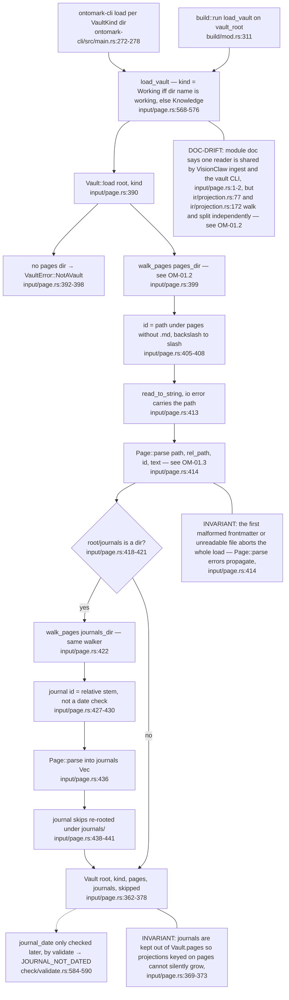
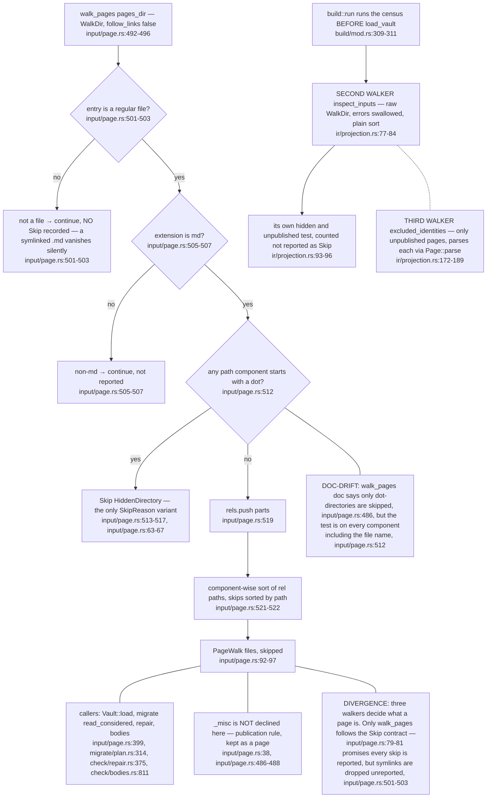
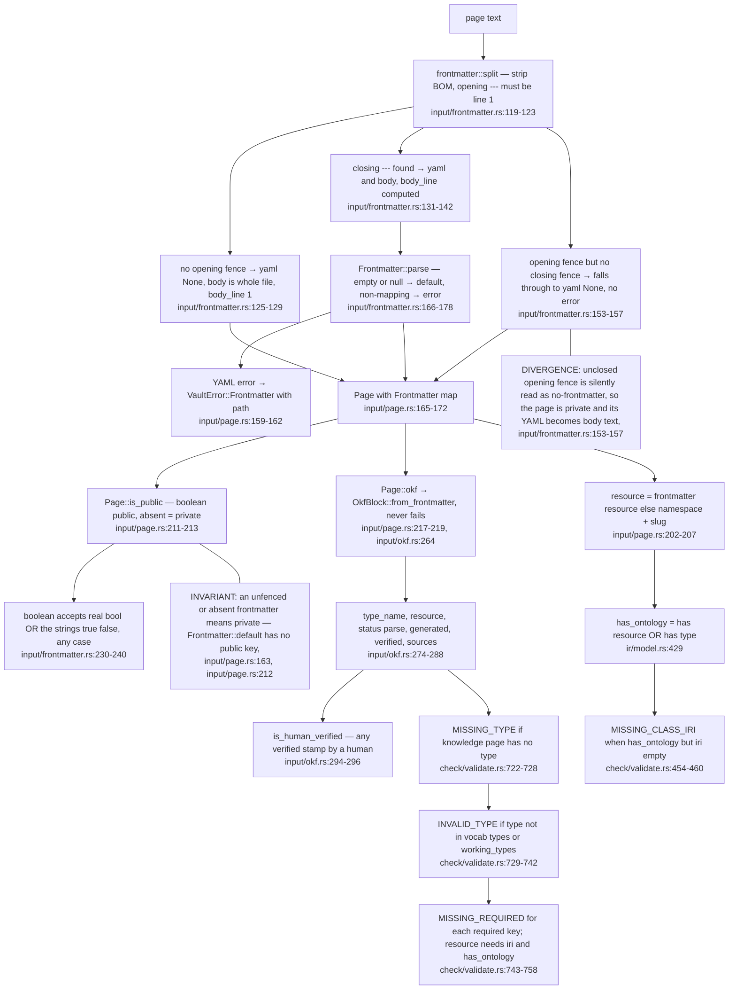
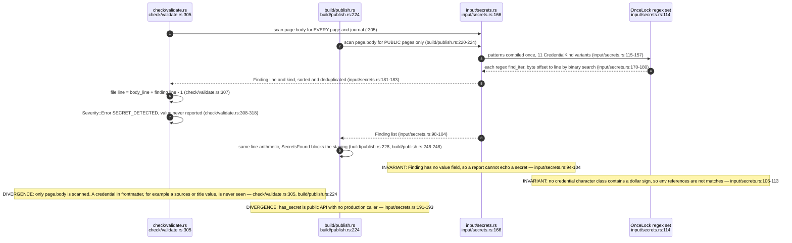
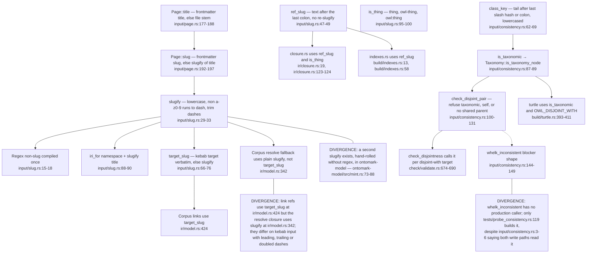
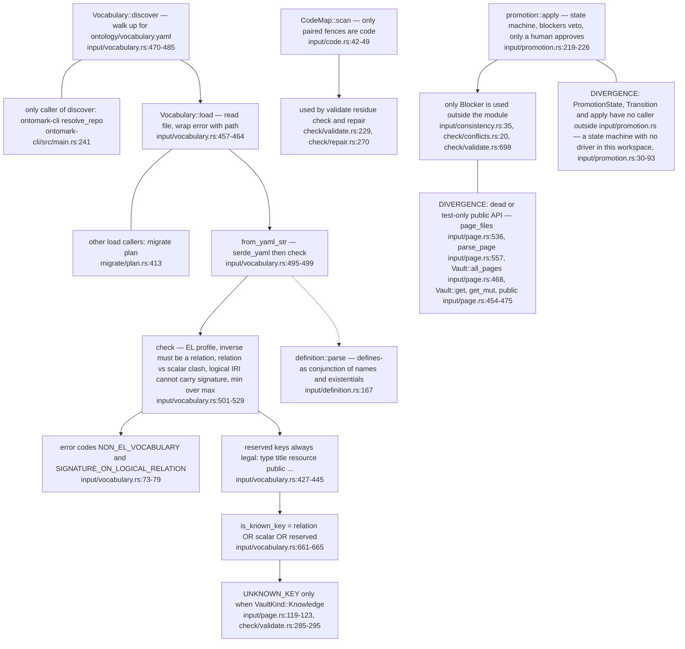

## OM-01.1 Vault root to Vault — pages, journals, skips

- **EXTERNAL:** the whole `input/` tree is a temporary stand-in relocated from VisionClaw `vault-core`, to be deleted once the input adapter reads `ontomark-model` (`input/mod.rs:3-8`); ADR-OM-001 owns that replacement.
- **DIVERGENCE:** `ontomark-parse` carries its own frontmatter reader (`ontomark-parse/src/frontmatter.rs:1-9`) beside the one used here (`input/frontmatter.rs:119`); the two are not shared in production.

## OM-01.2 walk_pages — what is declined, and the three other walkers

- **DIVERGENCE:** `UNPUBLISHED_DIRS = ["_misc"]` (`input/page.rs:38`) is not the only held-back rule: `build/publish.rs` adds `misc` at any depth (`build/publish.rs:130-142`), so the publish scope has two lists.
- **INVARIANT:** hidden-directory pages are reported on `Vault.skipped` (`input/page.rs:374-377`) and surface in the validation report (`check/validate.rs:329`).

## OM-01.3 Frontmatter parse and the public, type and resource gates

- **DIVERGENCE:** there are four "is public" decisions: `Page::is_public` lenient to the strings `true`/`false` (`input/frontmatter.rs:233-236`), the build census strict to a real bool and refusing anything else (`ir/projection.rs:112-116`), `ontomark-model` lenient only if the profile says so (`ontomark-model/src/profile.rs:604-611`), and the wasm profile strict (`ontomark-wasm/src/profile.rs:316-321`).
- **DOC-DRIFT:** the census promises `"true"` the string never becomes publication permission (`ir/projection.rs:8-9`), yet validate, publish and redact all call the lenient `Page::is_public` (`check/validate.rs:384`, `build/publish.rs:220`, `build/redact.rs:166`); the census alone guards the string case, and only on the build path (`build/mod.rs:309`).

## OM-01.4 Secrets scanner — body only, kind and line never value

- **INVARIANT:** the build runs the credential gate first, before validation, so a key on a public page gets its own exit code rather than being swallowed by the generic validation failure (`build/mod.rs:315-324`).
- **INVARIANT:** `journals/` pages are secret-scanned by validate (`check/validate.rs:580-581`) but are never staged for publication (`build/publish.rs:207-209`).

## OM-01.5 Slug derivation and the consistency vocabulary

- **DIVERGENCE:** `iri_for` is exported (`input/slug.rs:88`) but nothing in the workspace calls it; Corpus builds the IRI inline instead (`ir/model.rs:342`, `input/page.rs:206`).
- **EXTERNAL:** the module doc says the sibling-only rule is shared with VisionClaw's elevation actor (`input/consistency.rs:3-6`); that consumer is not in this repo.

## OM-01.6 Vocabulary loading, and the input modules with no production caller

- **DOC-DRIFT:** `parse_page` is documented as the entry point `VisionClaw`'s `CorpusSource::LocalDirectory` calls (`input/page.rs:550-553`), but no caller exists in this workspace.
- **INVARIANT:** an unparseable or inconsistent vocabulary is a load error naming the file, never a partial vocabulary (`input/vocabulary.rs:460-463`, `input/vocabulary.rs:495-499`).
