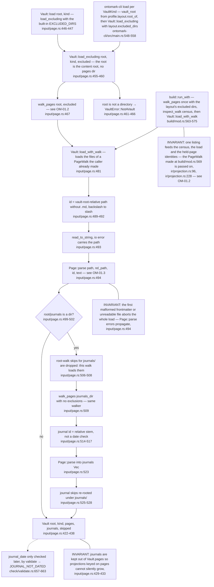
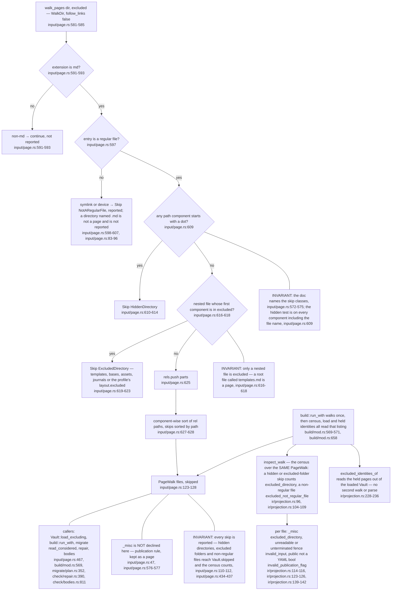
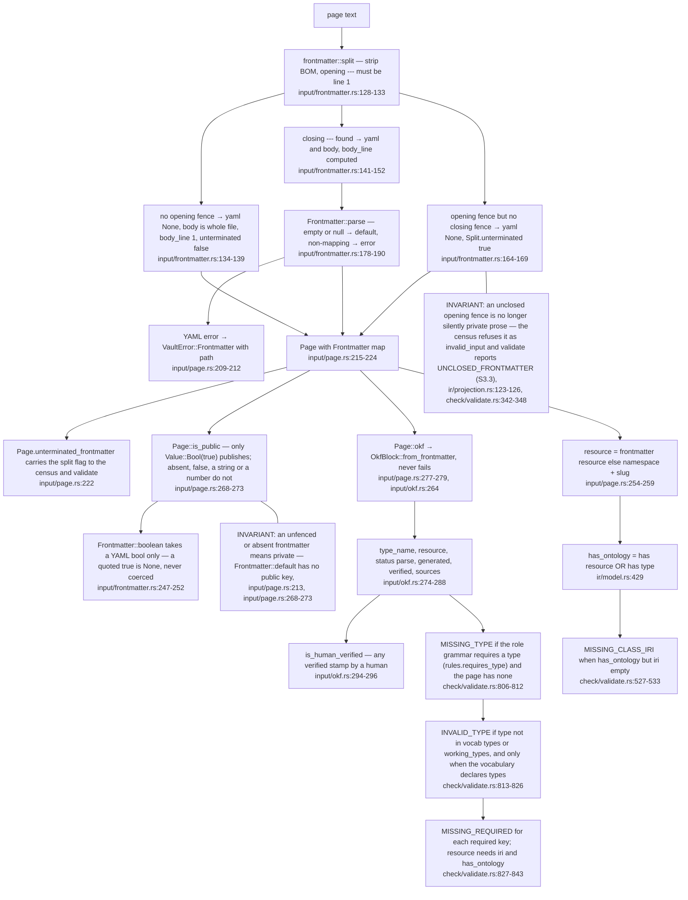
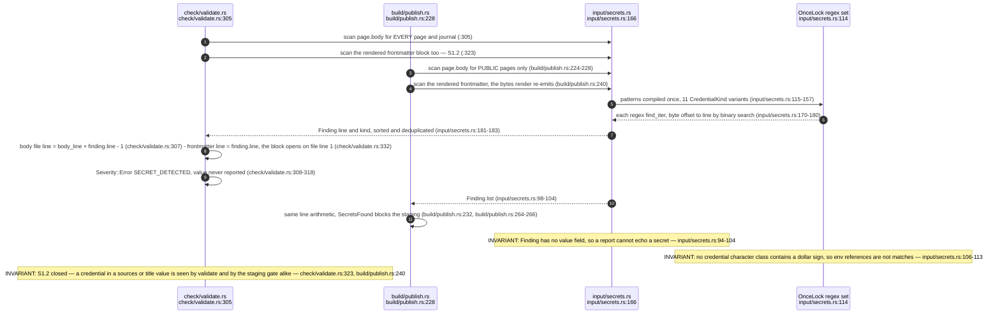
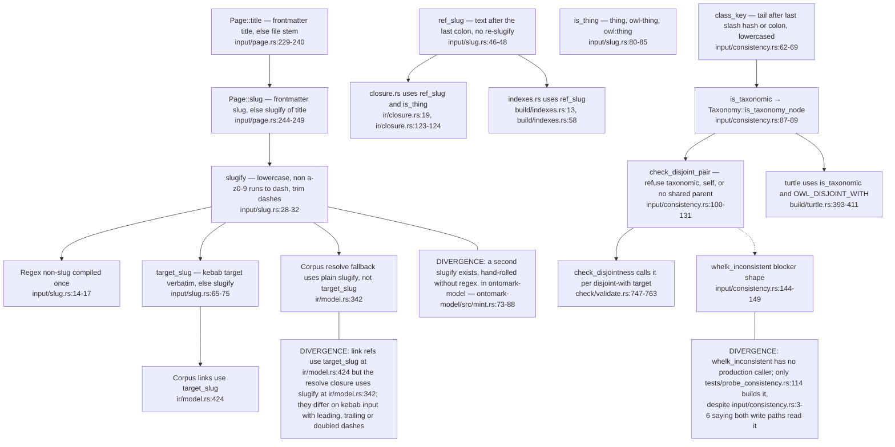
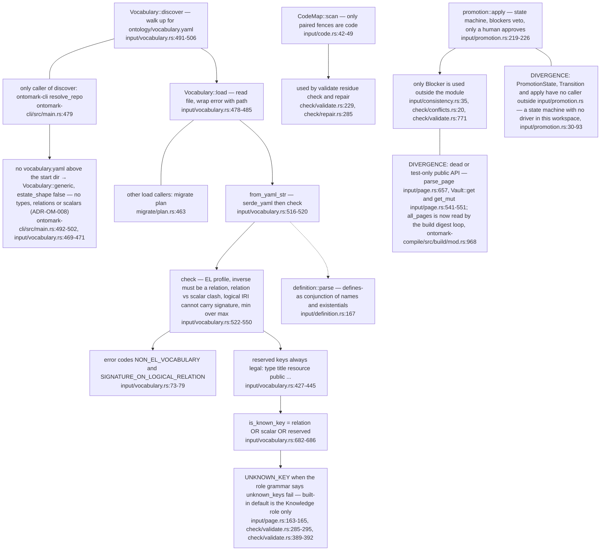

## OM-01.1 Vault root to Vault — pages, journals, skips

- **EXTERNAL:** the whole `input/` tree is a temporary stand-in relocated from VisionClaw `vault-core`, to be deleted once the input adapter reads `ontomark-model` (`input/mod.rs:3-8`); ADR-OM-001 owns that replacement.
- **DIVERGENCE:** `ontomark-parse` carries its own frontmatter reader (`ontomark-parse/src/frontmatter.rs:1-9`) beside the one used here (`input/frontmatter.rs:128`); the two are not shared in production.
- **Changed at 07f4c1c:** the Logseq-era `pages/` folder is gone. A vault is an ordinary Obsidian vault whose pages sit at the vault root (`input/page.rs:7-14`, ADR-OM-007); where that root sits under the repository is the profile's layout (`ontomark-cli/src/main.rs:544-546`), and a page id is its root-relative path (`input/page.rs:489-492`). The old `load_vault` entry that guessed the role from a folder name no longer exists; the role is the layout's, named by `VaultKind::role_name` (`input/page.rs:154`).

## OM-01.2 walk_pages — what is declined, reported, and the one listing every consumer shares

- **INVARIANT:** `UNPUBLISHED_DIRS = ["_misc"]` (`input/page.rs:47`) is applied twice: `is_unpublished` at the top level (`input/page.rs:641-646`) and, since this stamp, at any depth by `held_back`, which also holds back `misc` (`build/publish.rs:134`, `build/publish.rs:138-148`). `HELD_BACK_DIRS` lists only the site-only `misc`, so the two lists no longer restate each other (`build/publish.rs:131-133`).
- **INVARIANT:** hidden-directory, excluded-folder and non-regular-file skips are reported on `Vault.skipped` (`input/page.rs:434-437`) and travel into the validation report (`check/validate.rs:378`).

## OM-01.3 Frontmatter parse and the public, type and resource gates

- **INVARIANT:** every in-tree "is public" decision now reads the same rule: `Page::is_public` (`input/page.rs:268-273`), `Frontmatter::boolean` (`input/frontmatter.rs:247-252`) and the build census (`ir/projection.rs:139-143`) accept only a real YAML bool; `validate` reports anything else as `INVALID_PUBLIC_FLAG` (`check/validate.rs:354-367`).
- **DIVERGENCE:** `ontomark-model` is still lenient when the profile sets `lenient_booleans` (`ontomark-model/src/profile.rs:604-611`) and the wasm profile has its own strict copy (`ontomark-wasm/src/profile.rs:316-321`); both sit outside the build path.

## OM-01.4 Secrets scanner — body and rendered frontmatter, kind and line never value

- **INVARIANT:** the build runs the credential gate first, before validation, so a key on a public page gets its own exit code rather than being swallowed by the generic validation failure (`build/mod.rs:579-592`, `build/mod.rs:633`).
- **INVARIANT:** `journals/` pages are secret-scanned by validate (`check/validate.rs:653-654`) but are never staged for publication (`build/publish.rs:215-217`).

## OM-01.5 Slug derivation and the consistency vocabulary

- **DIVERGENCE:** `iri_for` had no caller and was removed in 8d654d1; the class IRI is built inline from `Page::resource` (`input/page.rs:254-259`) and the resolve fallback (`ir/model.rs:342`).
- **EXTERNAL:** the module doc says the sibling-only rule is shared with VisionClaw's elevation actor (`input/consistency.rs:3-6`); that consumer is not in this repo.

## OM-01.6 Vocabulary loading, and the input modules with no production caller

- **Changed at 07f4c1c:** a repository with no `ontology/vocabulary.yaml` is no longer refused: `resolve_repo` falls back to the built-in generic vocabulary (`ontomark-cli/src/main.rs:492-502`), and the validator takes `type` and `status` requirements and the unknown-key policy from the profile's role grammar, not from the vault's name (`check/validate.rs:389-402`, `check/validate.rs:806-812`).
- **DOC-DRIFT:** `parse_page` is documented as the entry point `VisionClaw`'s `CorpusSource::LocalDirectory` calls (`input/page.rs:650-655`), but no caller exists in this workspace.
- **INVARIANT:** an unparseable or inconsistent vocabulary is a load error naming the file, never a partial vocabulary (`input/vocabulary.rs:481-484`, `input/vocabulary.rs:516-520`).
