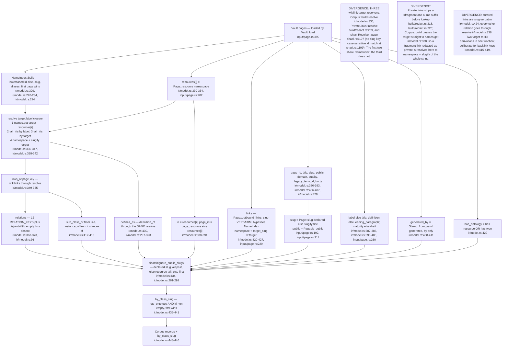
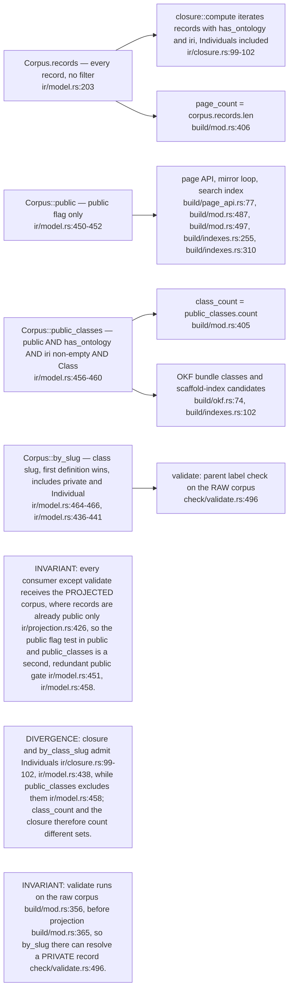
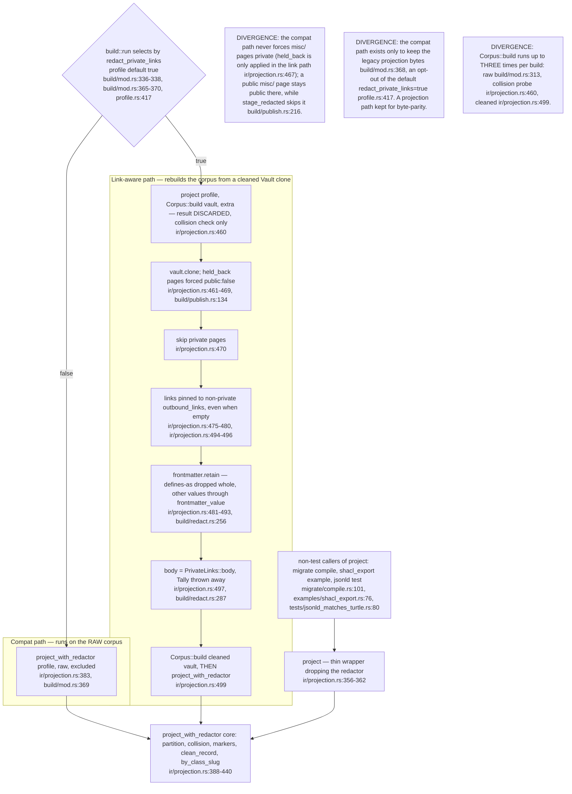
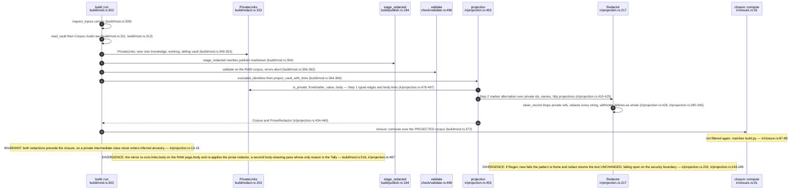
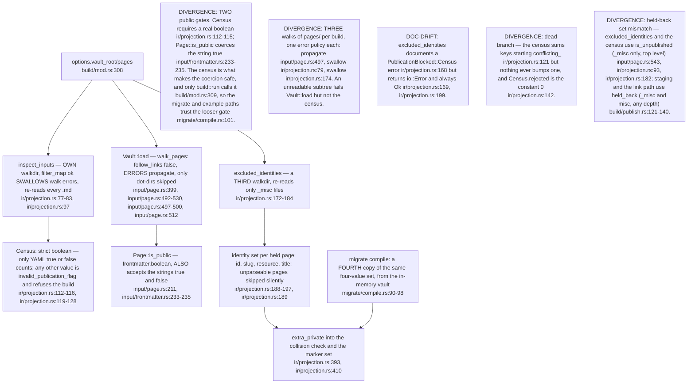
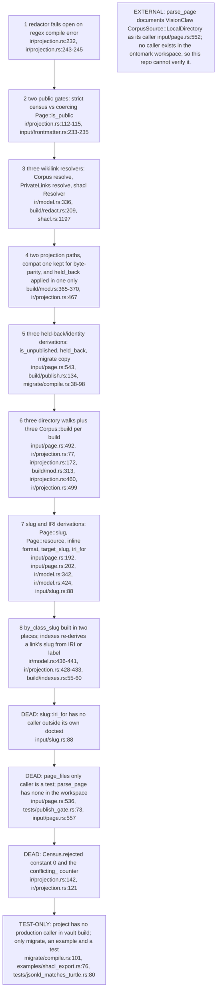

## OM-02.1 Corpus::build — Vault to ClassRecord, every field's source and every resolver

- `Corpus::build` is the only constructor of `ClassRecord` outside tests; every artefact is a pure function of it (`ir/model.rs:4-7`).
- `slug` is the page publish slug, `class_slug()` is the IRI tail; they differ on 96 pages (`ir/model.rs:185-190`), and `disambiguate_public_slugs` rewrites `slug` from the IRI tail on a clash (`ir/model.rs:285-287`).
- Private records are never renamed; a public/private clash is left to the projection (`ir/model.rs:257-260`).

## OM-02.2 The record selectors — which accessor is right for what

- Use `public_classes` for anything that is an OWL class count or class listing; `public` for per-page surfaces; `records` only before projection or for the closure.
- No selector is dead: `public` (5 non-test callers), `public_classes` (3), `by_slug` (1, `check/validate.rs:496`).

## OM-02.3 The two projection paths — project_with_redactor vs project_vault_with_links

- Both paths end in the same `project_with_redactor`; the link path only differs in WHAT corpus it is handed (links and frontmatter pre-redacted at the `Vault` level).
- `project_vault_with_links` is called once, `build/mod.rs:366`; `project_with_redactor` is called directly once, `build/mod.rs:369`.
- The `ProseRedactor` is the same `Redactor` that cleaned the records (`ir/projection.rs:439`), reused for the markdown mirror (`build/mod.rs:516`).

## OM-02.4 Redaction order — private-link rewrite, marker redaction, closure

- Step 1 (`PrivateLinks`) is structural: it rewrites wikilinks and frontmatter before `Corpus::build`; Step 2 (`Redactor`) is lexical: it masks identity strings after `Corpus::build`.
- `PrivateLinks` resolves its own vault first, then the other (`build/redact.rs:192-194`); a journal is always non-public (`build/redact.rs:170`).
- A definition naming a private class is withheld whole (`ir/projection.rs:323-328`), at both layers (`ir/projection.rs:482-484`).

## OM-02.5 The second and third reads of pages/ — inspect_inputs and excluded_identities beside Vault::load

- The census exists so the parser cannot silently drop a file and so a non-boolean flag is a refusal (`ir/projection.rs:6-9`); its counts are written to `api/census.json` (`build/mod.rs:441`).
- `excluded_identities` is what stops a link from publishing a held page: its values join `private_ids` (`ir/projection.rs:393`).
- A dot-directory is deliberately NOT a held page (`ir/projection.rs:158-166`), so it is absent from `excluded_identities` but counted as `excluded_directory` by the census (`ir/projection.rs:93-94`).

## OM-02.6 Register — parallel implementations and dead code, ranked

- Ranking is by blast radius on the publication boundary, not by code size; R1 and R2 can leak, R3 to R5 can mis-redact or mis-hold, R6 to R8 cost only duplication.
- Grep scope was the whole ontomark workspace (`crates/*`); the wasm, ingest, parse and model crates call none of these functions.
