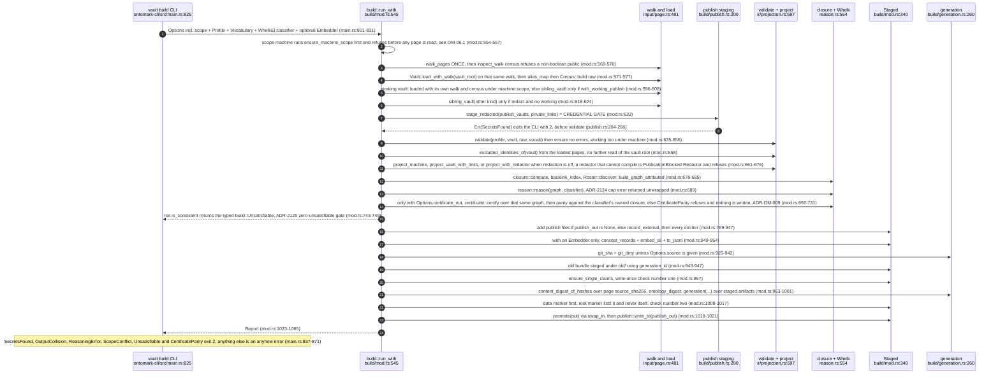
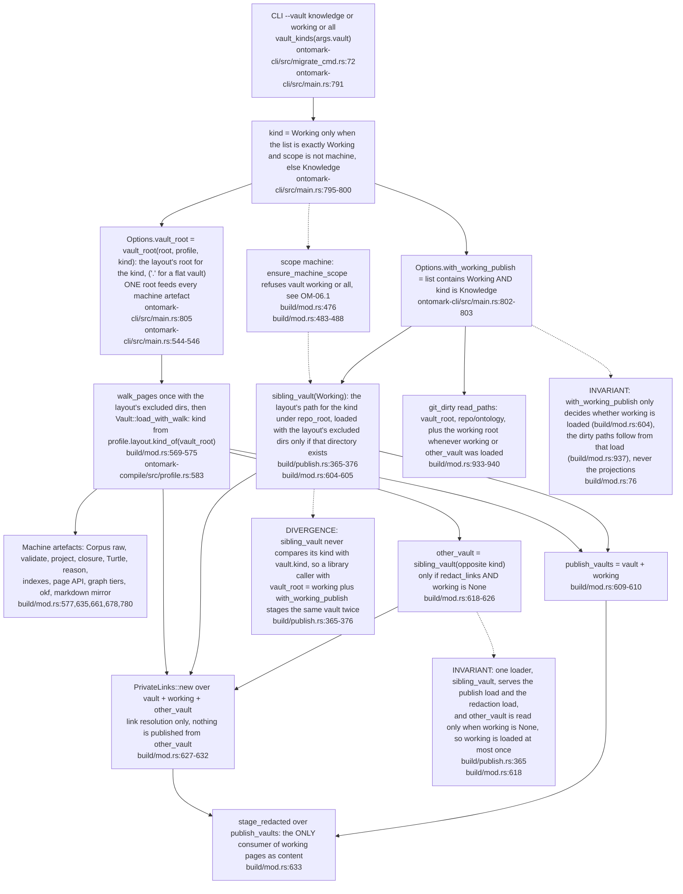
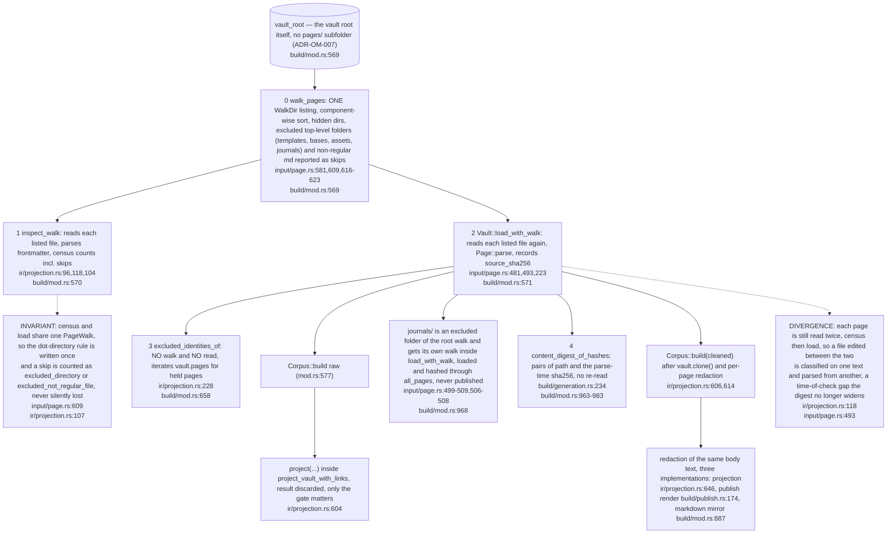
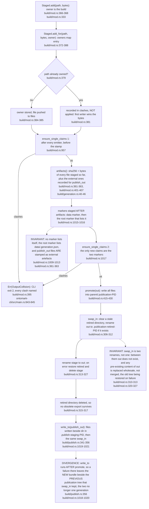
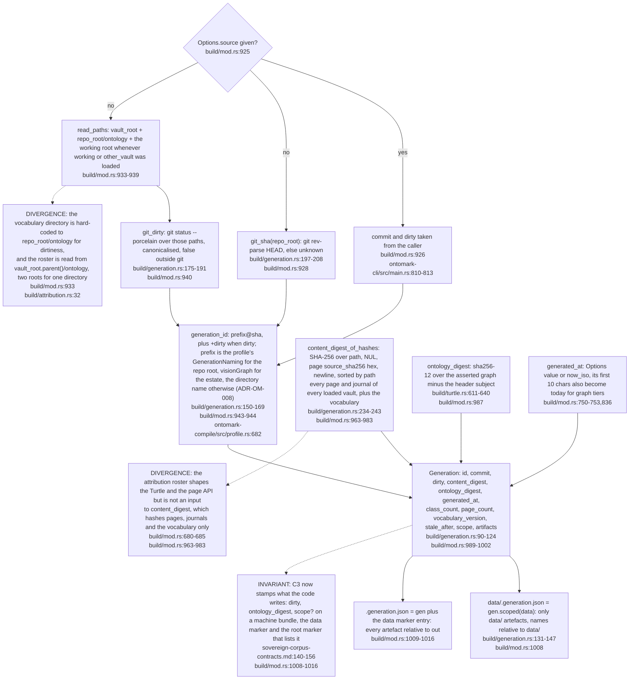
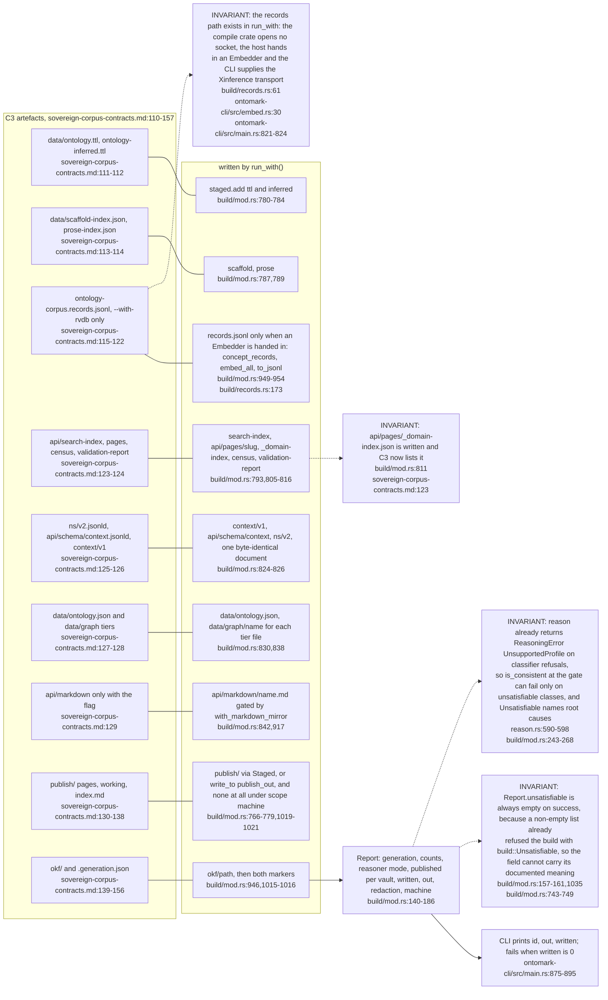
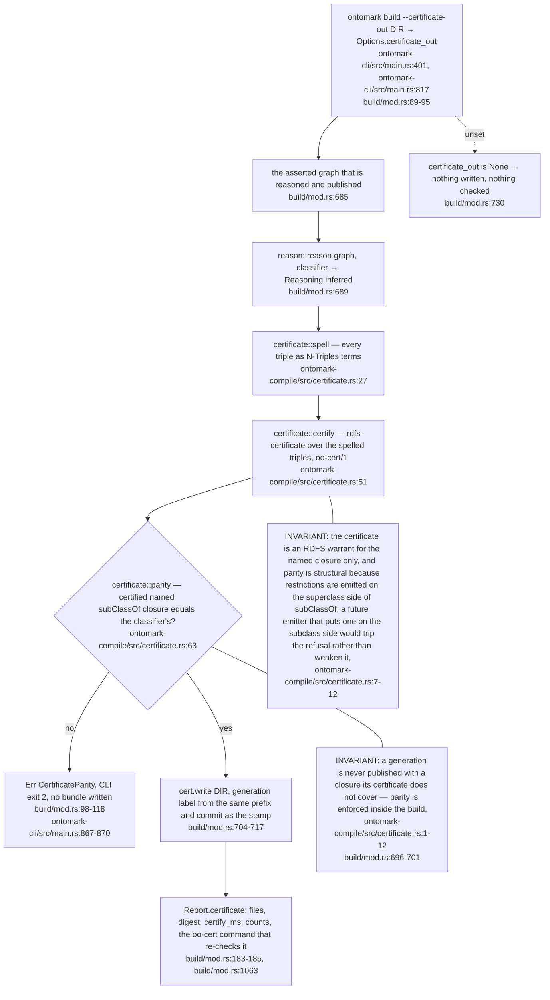

## OM-03.1 build::run_with — Options to promoted bundle, in the order the code runs

- INVARIANT: nothing touches `out` until `promote` at `build/mod.rs:1018`; every earlier refusal (`mod.rs:633`, `:577`, `:642`) leaves the previous bundle intact.
- INVARIANT: the credential gate runs after the census, the load and up to two extra vault loads, and before validation (`build/mod.rs:569-633`); its comment now says the census runs earlier still (`mod.rs:588-589`).
- INVARIANT: an unsatisfiable corpus is the typed `build::Unsatisfiable` (`mod.rs:235`) and exits 2 (`main.rs:861-864`), the same refusal class as the ADR-2124 cap error (`main.rs:849-852`); it was an untyped error at exit 1 before the OM-00 reconcile.

## OM-03.2 What `--vault` means, and every place a vault is loaded

- INVARIANT: in the public scope `working/` never enters `corpus`, so OWL membership stays `knowledge/`-only (`ontomark-cli/src/main.rs:786-790`, `build/mod.rs:76-77`); `--vault working` alone makes the WHOLE projection come from `working/` (`main.rs:796-800`).
- INVARIANT: `Options.repo_root` serves git, the vocabulary directory for dirtiness and, since the layout landed, the placement of every sibling vault (`build/mod.rs:928,933,940`, `build/mod.rs:468-472`, `build/publish.rs:370`), so the old `vault_root.parent()` derivations of the repository are gone from vault loading.
- **Debt:** the attribution roster is still read from `vault_root.parent()` (`build/mod.rs:680-684`), and a flat layout puts the vault root at `repo_root` itself (`ontomark-compile/src/profile.rs:514-518`, `ontomark-compile/src/profile.rs:549-550`), so for a flat vault the roster is looked up one directory above the repository while the dirtiness check reads `repo_root/ontology` (`build/mod.rs:933`).

## OM-03.3 Reads of the vault root — one walk, two file reads per page

- INVARIANT: `excluded_identities(root)` with its own walk survives as public API (`ir/projection.rs:202`) but `run` calls only `excluded_identities_of` (`build/mod.rs:658`), which filters by `is_unpublished` alone (`projection.rs:114`).
- DIVERGENCE: the hold-back rule is still written in two shapes: `is_unpublished` covers `_misc` at top level only (`input/page.rs:47,641`), while `held_back` (`build/publish.rs:138`) applies `UNPUBLISHED_DIRS` at any depth and adds the site-only `misc` through `HELD_BACK_DIRS` (`publish.rs:134,144-146`); `clean_vault` and `hold_back` use the wider one (`projection.rs:616,657`). ontomark `95208e8` (2026-10-18, estate register ER-18) made the two lists disjoint, so they no longer overlap; the census and `excluded_identities_of` still use the top-level-only `is_unpublished` (`projection.rs:114,231`), which is the divergence that remains.

## OM-03.4 Credential gate and publish staging

- INVARIANT: the refusal is a typed error so the CLI exits 2 (`build/publish.rs:66`, `ontomark-cli/src/main.rs:837-840`); `stage` without links is only a wrapper (`publish.rs:191-193`) and `run_with` never calls it.
- DOC-DRIFT: `publish.rs` says `<out>/publish/` is the markdown that is published (`publish.rs:1`) but with `publish_out` it is not in `<out>` at all (`mod.rs:773-778`, `:1019-1021`).
- Under `--scope machine` the gate still scans `working/`'s public pages though nothing is staged into the bundle (`build/mod.rs:591-603`, `build/mod.rs:766-768`), see OM-06.

## OM-03.5 Staged write-once and the promote

- INVARIANT: `Staged` is the only writer path for the bundle and holds bytes in memory (`build/mod.rs:340-347`); no emitter can overwrite another silently, a clash names both claimants (`mod.rs:198-209`).
- DOC-DRIFT: the module doc calls step 6 an atomic promotion (`build/mod.rs:12`); the two-rename swap in `mod.rs:310-313` is rolled back on failure but is not a single atomic operation, and the `promote` doc no longer claims it (`mod.rs:409-410`).

## OM-03.6 Generation identity — what the stamp is made of

- INVARIANT: `commit` stays the bare sha even when dirty (`build/generation.rs:94-96`); the sha says which commit, the digest what was read, and the ontology digest what was emitted, so pages alone do not fix the Turtle (`build/mod.rs:984-986`).
- INVARIANT: `Roster::discover` is the only reader of `attribution.yaml`, an absent file is an empty roster (`build/attribution.rs:29-37`), and it is called with `vault_root.parent()` (`build/mod.rs:680-683`), not `repo_root`.

## OM-03.7 Report, and C3 artefact map — what run() writes versus what C3 lists

- INVARIANT: `Report.written` counts both destinations (`build/mod.rs:1042-1049`) and the CLI refuses a zero (`ontomark-cli/src/main.rs:889-895`); `mod.rs:1044` sums `staged.files` plus the separate publish staging.
- INVARIANT: C3 now says `content_digest` is over sorted `(path, sha256(bytes))` pairs of every byte the build read, pages and journals of every loaded vault plus the vocabulary, not comparable with vault's one-vault digest (`sovereign-corpus-contracts.md:159-163`), which is what `run_with` hashes (`build/mod.rs:963-983`, `build/generation.rs:234`); the OM-03 divergence recorded against the earlier C3 text is closed at this stamp.
- **Drift:** C3 still illustrates page identity as `knowledge/pages/Knowledge Graph` (`sovereign-corpus-contracts.md:106`) while the loader derives the id from the vault-root-relative path with no `pages/` folder (`ontomark-compile/src/input/page.rs:489-492`).

## OM-03.8 Derivation certificate — the optional warrant for the published closure (ADR-OM-009)

**What it shows.** The one new gate between reasoning and the unsatisfiable check: with `--certificate-out`, the build spells the graph it is about to publish, certifies it under the RDFS rule table, compares the certified named subsumptions with the classifier's, and refuses on any difference before writing anything.

**Why it is this way.** ADR-OM-009 (Accepted, owner request of 20 October 2026, active from v0.6.0) makes ontomark, the sole producer of published bundles (ADR-OM-005), also the writer of the warrant a Lean 4 checker can re-verify, instead of leaving that to the `vault` path (`docs/adr/ADR-OM-009-every-published-closure-carries-a-derivation-certificate.md:3-5`).

**Open:** is a bundle published without `--certificate-out` meant to carry no warrant at all? `certificate_out` defaults to absent and the build writes and checks nothing then (`ontomark-compile/src/build/mod.rs:730`, `ontomark-cli/src/main.rs:401`).
