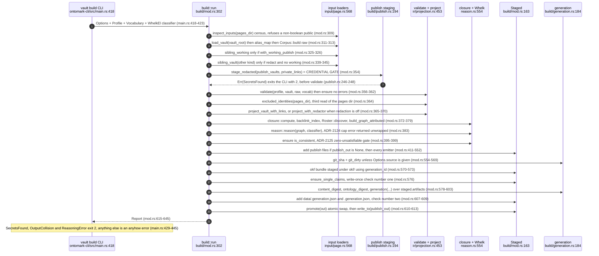
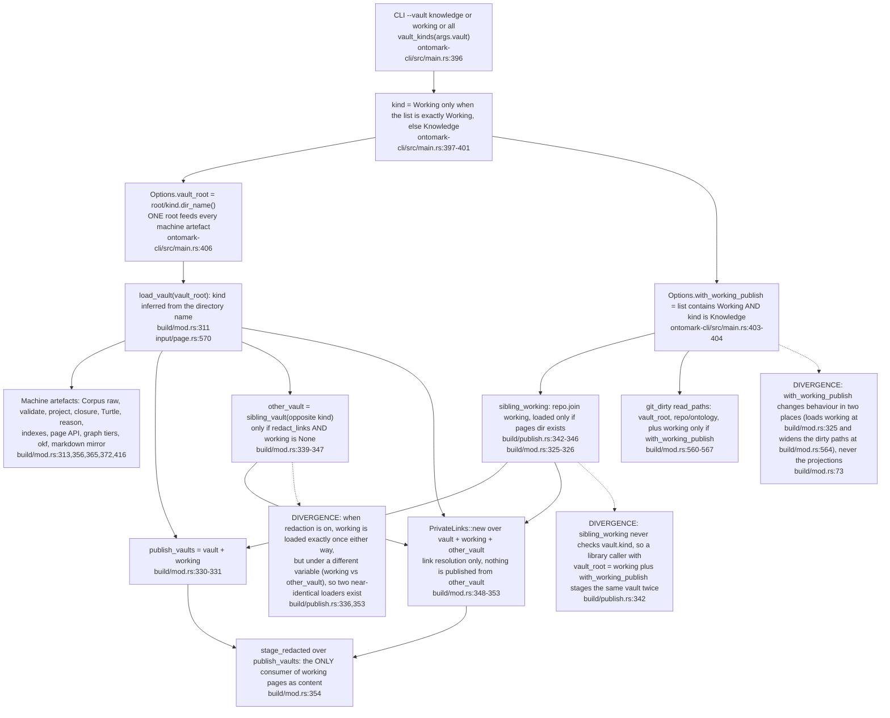
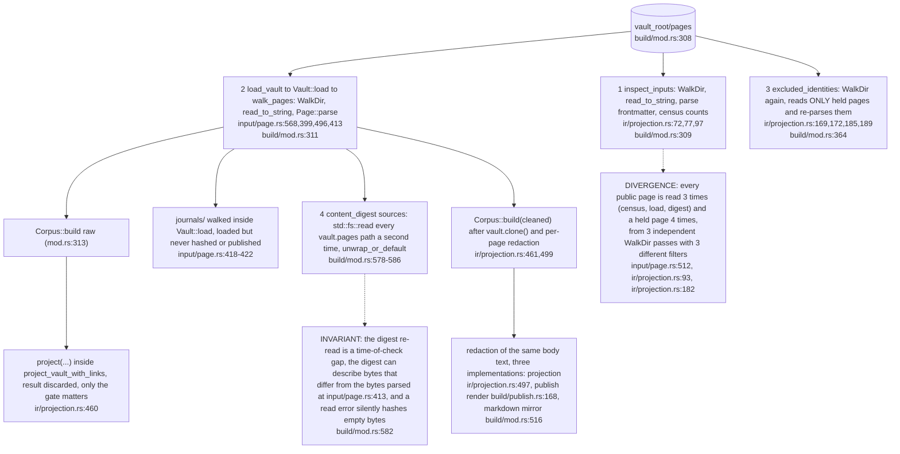
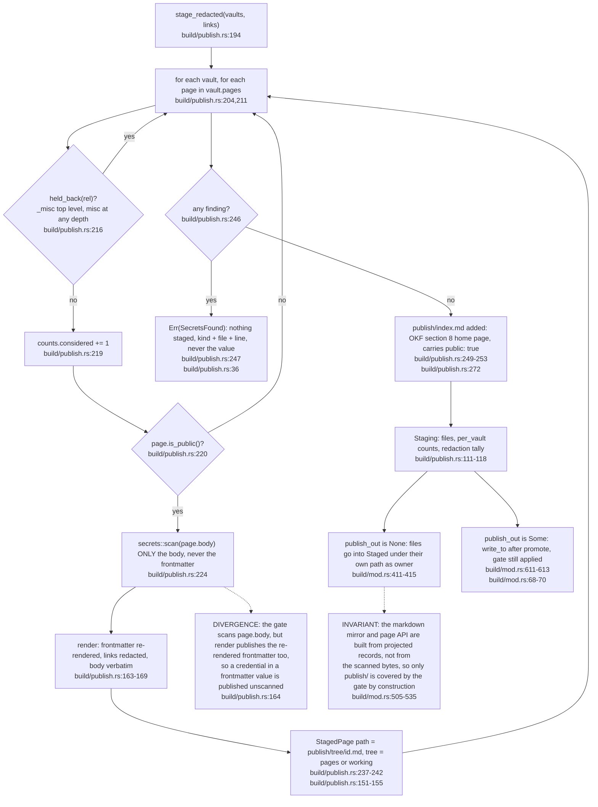
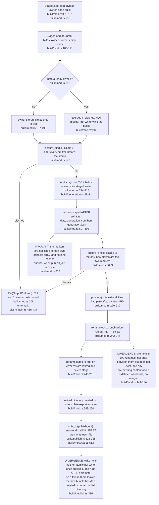
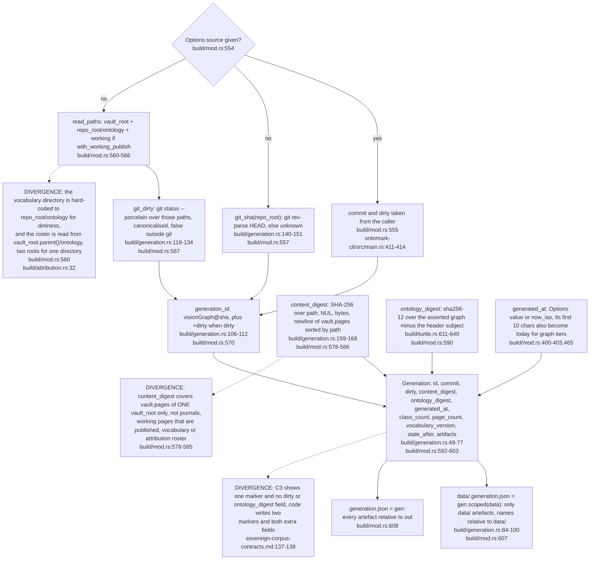
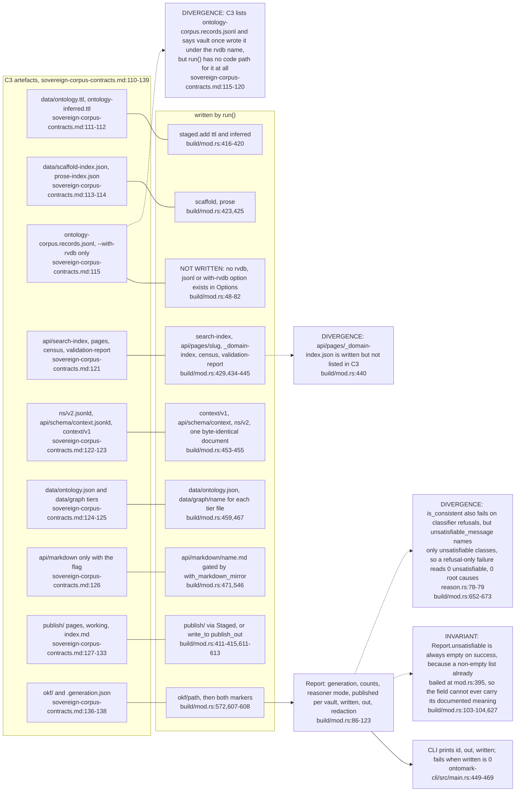

## OM-03.1 build::run — Options to promoted bundle, in the order the code runs

- INVARIANT: nothing touches `out` until `promote` at `build/mod.rs:610`; every earlier refusal (`mod.rs:357`, `:395`, `:576`) leaves the previous bundle intact.
- DOC-DRIFT: the gate comment says it runs FIRST (`build/mod.rs:315`), yet census, vault load and `Corpus::build` precede it (`mod.rs:309-313`) and `stage_redacted` runs after up to two extra vault loads (`mod.rs:325-347`).
- DIVERGENCE: an unsatisfiable corpus is a plain `anyhow::ensure!` (`mod.rs:395`), so it exits 1 not 2 (`main.rs:445`); only the ADR-2124 cap error is downcast to exit 2 (`main.rs:441`).

## OM-03.2 What `--vault` means, and every place a vault is loaded

- INVARIANT: `working/` never enters `corpus`, so OWL membership stays `knowledge/`-only (`ontomark-cli/src/main.rs:391-395`, `build/mod.rs:73`); `--vault working` alone makes the WHOLE machine corpus come from `working/` (`main.rs:397-399`).
- INVARIANT: `Options.repo_root` is used only for git (`build/mod.rs:557,560,567`); every other "repo" is `vault_root.parent()` (`mod.rs:326,344,374,561`), two derivations of one directory.

## OM-03.3 Repeated reads — three independent walkers over the pages dir

- DIVERGENCE: the dot-directory rule is written twice, in `walk_pages` (`input/page.rs:512`) and in `inspect_inputs` (`ir/projection.rs:93`), while `excluded_identities` has no dot rule at all and filters by `is_unpublished` only (`projection.rs:182`).
- DIVERGENCE: `held_back` (`build/publish.rs:134`) is a fourth copy of the hold-back rule: `is_unpublished` covers `_misc` at top level only (`input/page.rs:38,543`), `HELD_BACK_DIRS` adds `misc` at any depth (`publish.rs:130`).

## OM-03.4 Credential gate and publish staging

- INVARIANT: the refusal is a typed error so the CLI exits 2 (`build/publish.rs:66`, `ontomark-cli/src/main.rs:429-431`); `stage` without links is only a wrapper (`publish.rs:185-187`) and `run` never calls it.
- DOC-DRIFT: `publish.rs` says `<out>/publish/` is the markdown that is published (`publish.rs:1`) but with `publish_out` it is not in `<out>` at all (`mod.rs:411`, `:611`).

## OM-03.5 Staged write-once and the promote

- INVARIANT: `Staged` is the only writer path for the bundle and holds bytes in memory (`build/mod.rs:158-167`); no emitter can overwrite another silently, a clash names both claimants (`mod.rs:125-136`).
- DOC-DRIFT: the module doc calls step 6 an atomic promotion (`build/mod.rs:12`); the two-rename swap in `mod.rs:244-246` is rolled back on failure but is not a single atomic operation.

## OM-03.6 Generation identity — what the stamp is made of

- INVARIANT: `commit` stays the bare sha even when dirty (`build/generation.rs:52-54`); the sha says which commit, the digest what was read, and the ontology digest what was emitted, so pages alone do not fix the Turtle (`build/mod.rs:587-589`).
- INVARIANT: `Roster::discover` is the only reader of `attribution.yaml`, an absent file is an empty roster (`build/attribution.rs:29-37`), and it is called with `vault_root.parent()` (`build/mod.rs:374-378`), not `repo_root`.

## OM-03.7 Report, and C3 artefact map — what run() writes versus what C3 lists

- INVARIANT: `Report.written` counts both destinations (`build/mod.rs:629-636`) and the CLI refuses a zero (`ontomark-cli/src/main.rs:465-469`); `mod.rs:631` sums `staged.files` plus the separate publish staging.
- DOC-DRIFT: C3 says `content_digest` is over pairs "the build read" (`sovereign-corpus-contracts.md:141`), but `run()` hashes only the one vault's pages, see OM-03.6.
