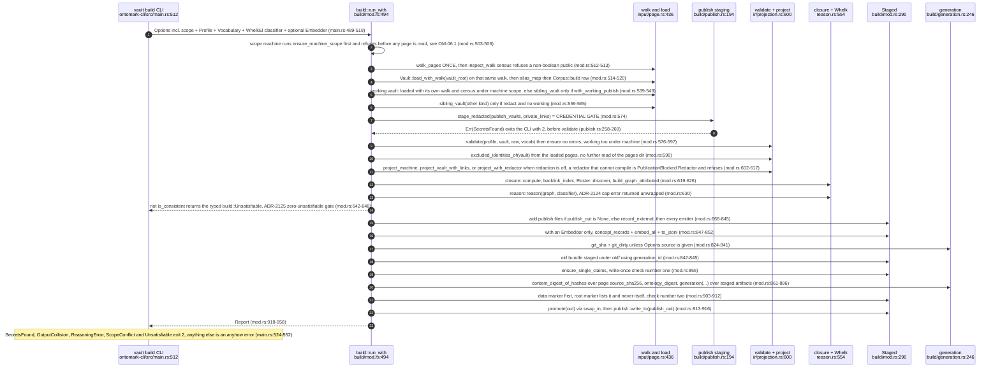
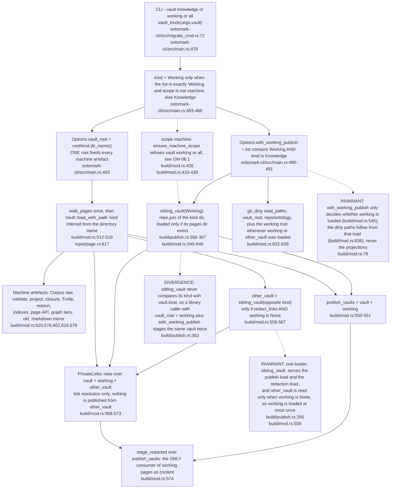
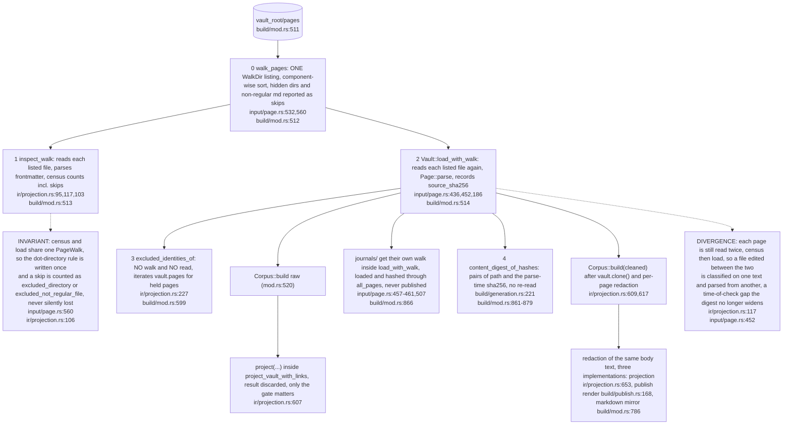
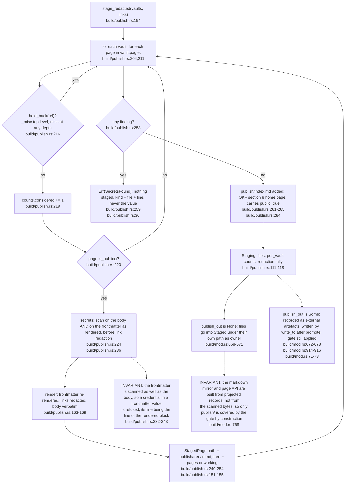
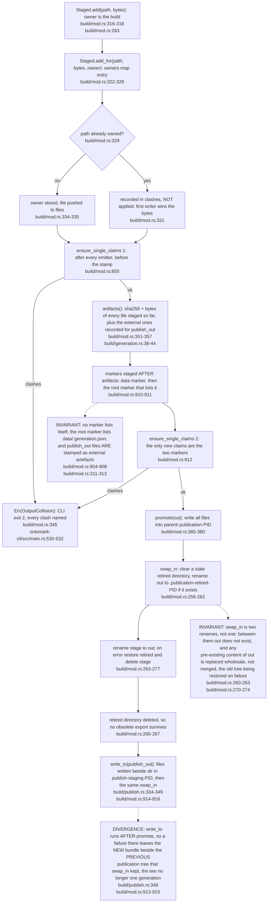
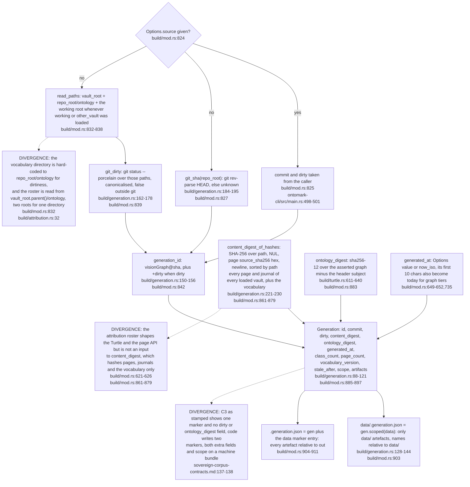
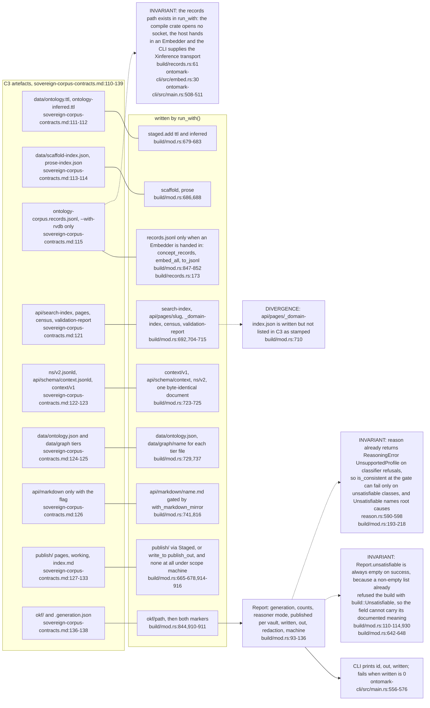

## OM-03.1 build::run_with — Options to promoted bundle, in the order the code runs

- INVARIANT: nothing touches `out` until `promote` at `build/mod.rs:913`; every earlier refusal (`mod.rs:574`, `:577`, `:642`) leaves the previous bundle intact.
- INVARIANT: the credential gate runs after the census, the load and up to two extra vault loads, and before validation (`build/mod.rs:512-576`); its comment now says the census runs earlier still (`mod.rs:531-532`).
- INVARIANT: an unsatisfiable corpus is the typed `build::Unsatisfiable` (`mod.rs:185`) and exits 2 (`main.rs:548-551`), the same refusal class as the ADR-2124 cap error (`main.rs:536-539`); it was an untyped error at exit 1 before the OM-00 reconcile.

## OM-03.2 What `--vault` means, and every place a vault is loaded

- INVARIANT: in the public scope `working/` never enters `corpus`, so OWL membership stays `knowledge/`-only (`ontomark-cli/src/main.rs:474-478`, `build/mod.rs:76-77`); `--vault working` alone makes the WHOLE projection come from `working/` (`main.rs:484-488`).
- INVARIANT: `Options.repo_root` serves git and the vocabulary directory for dirtiness (`build/mod.rs:827,832,839`); every other "repo" is `vault_root.parent()` (`mod.rs:419,623,833`, `publish.rs:360`), two derivations of one directory.

## OM-03.3 Reads of the pages dir — one walk, two file reads per page

- INVARIANT: `excluded_identities(pages_dir)` with its own walk survives as public API (`ir/projection.rs:201`) but `run` calls only `excluded_identities_of` (`build/mod.rs:599`), which filters by `is_unpublished` alone (`projection.rs:234`).
- DIVERGENCE: the hold-back rule is still written twice: `is_unpublished` covers `_misc` at top level only (`input/page.rs:38,583`), `held_back` (`build/publish.rs:134`) adds `misc` at any depth through `HELD_BACK_DIRS` (`publish.rs:130`), and `clean_vault` and `hold_back` use the wider one (`projection.rs:623,668`).

## OM-03.4 Credential gate and publish staging

- INVARIANT: the refusal is a typed error so the CLI exits 2 (`build/publish.rs:66`, `ontomark-cli/src/main.rs:524-527`); `stage` without links is only a wrapper (`publish.rs:185-187`) and `run_with` never calls it.
- DOC-DRIFT: `publish.rs` says `<out>/publish/` is the markdown that is published (`publish.rs:1`) but with `publish_out` it is not in `<out>` at all (`mod.rs:672-678`, `:914`).
- Under `--scope machine` the gate still scans `working/`'s public pages though nothing is staged into the bundle (`build/mod.rs:665-667`), see OM-06.

## OM-03.5 Staged write-once and the promote

- INVARIANT: `Staged` is the only writer path for the bundle and holds bytes in memory (`build/mod.rs:290-297`); no emitter can overwrite another silently, a clash names both claimants (`mod.rs:148-159`).
- DOC-DRIFT: the module doc calls step 6 an atomic promotion (`build/mod.rs:12`); the two-rename swap in `mod.rs:260-263` is rolled back on failure but is not a single atomic operation, and the `promote` doc no longer claims it (`mod.rs:359-360`).

## OM-03.6 Generation identity — what the stamp is made of

- INVARIANT: `commit` stays the bare sha even when dirty (`build/generation.rs:91-93`); the sha says which commit, the digest what was read, and the ontology digest what was emitted, so pages alone do not fix the Turtle (`build/mod.rs:880-882`).
- INVARIANT: `Roster::discover` is the only reader of `attribution.yaml`, an absent file is an empty roster (`build/attribution.rs:29-37`), and it is called with `vault_root.parent()` (`build/mod.rs:621-624`), not `repo_root`.

## OM-03.7 Report, and C3 artefact map — what run() writes versus what C3 lists

- INVARIANT: `Report.written` counts both destinations (`build/mod.rs:937-944`) and the CLI refuses a zero (`ontomark-cli/src/main.rs:570-576`); `mod.rs:939` sums `staged.files` plus the separate publish staging.
- INVARIANT: C3 as stamped says `content_digest` is over pairs "the build read" (`sovereign-corpus-contracts.md:141`) and `run_with` now hashes every page and journal it loaded plus the vocabulary, see OM-03.6.
