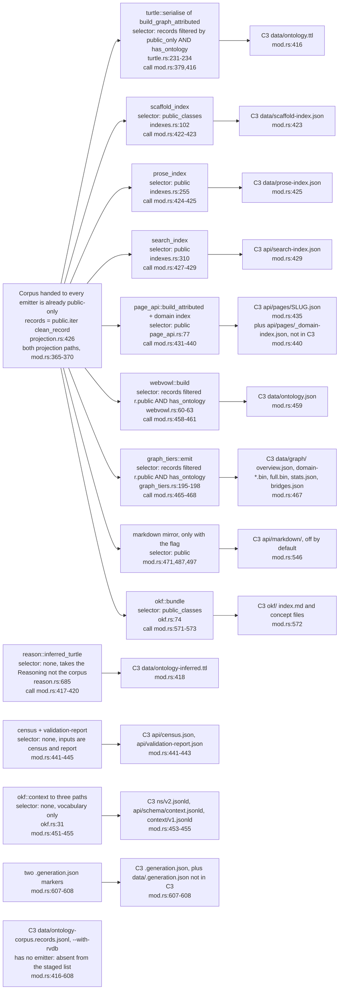
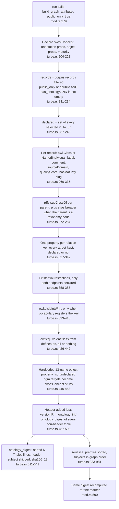
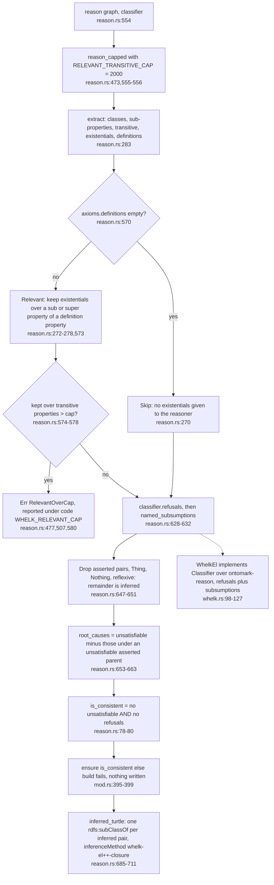
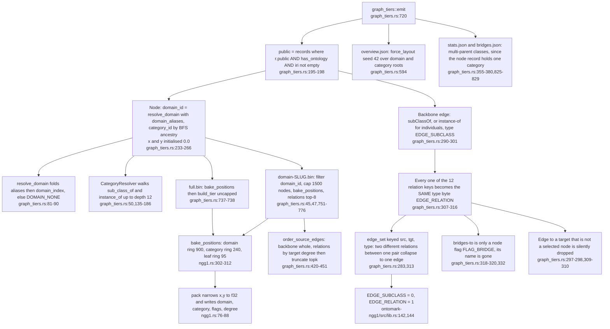
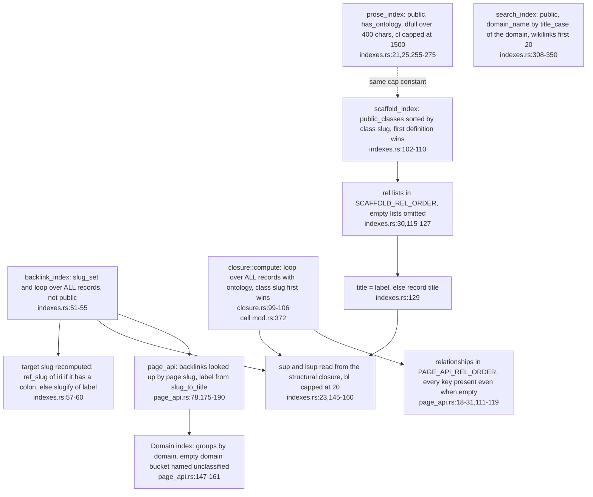
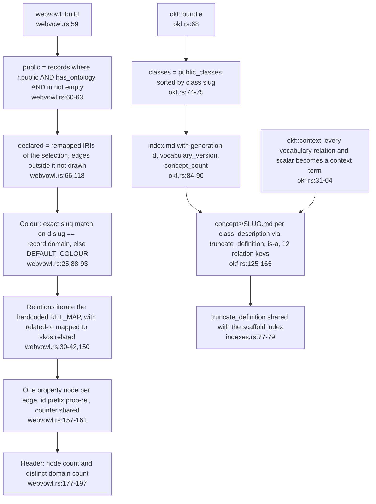
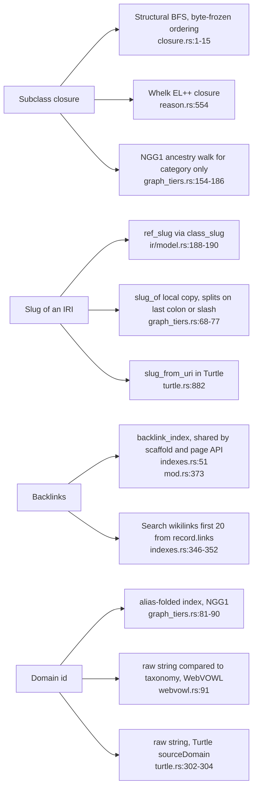

## OM-04.1 Emitter by emitter — corpus selector, output, C3 artefact

- **DIVERGENCE:** C3 lists `ontology-corpus.records.jsonl` (only `--with-rvdb`); `run` stages no such file and no `rvdb` option exists in `build/mod.rs:302-613`. Emitted but not in C3: `api/pages/_domain-index.json` (`mod.rs:440`), `context/v1.jsonld` (`mod.rs:453`), `data/.generation.json` (`mod.rs:607`).
- **INVARIANT:** the selector split is `public()` for per-page artefacts and `public_classes()`, which also requires `EntityType::Class` (`ir/model.rs:456-460`), for scaffold, OKF and `class_count`; Turtle, WebVOWL and NGG1 use the inline `public AND has_ontology AND iri` filter (`turtle.rs:234`, `webvowl.rs:63`, `graph_tiers.rs:198`), so they include individuals and the others do not. The corpus is already public-only, so each `r.public` test is a second filter (`turtle.rs:168-172`).
- **DIVERGENCE:** `class_count` counts `public_classes()` un-deduplicated (`mod.rs:405`), `page_count` is `records.len()` (`mod.rs:406`), scaffold `counts.classes` keeps the first record per class slug (`indexes.rs:110-111`) and `stats.json` `pages` counts distinct page ids (`graph_tiers.rs:201-210`); they can differ only if two records share a slug, which `DUPLICATE_IRI` refuses (`check/validate.rs:561`) and `Staged` write-once refuses for OKF paths (`mod.rs:164-167`), so the gap is theoretical.

## OM-04.2 Turtle graph build — one function, header last, digest feeds the version IRI

- **INVARIANT:** the header is built last so `owl:versionIRI` addresses everything above it and none of it addresses itself (`turtle.rs:485-488`); `run` recomputes `ontology_digest` on the finished graph (`mod.rs:590`), the same value because the header subject is skipped (`turtle.rs:614-616`), a duplicated computation rather than a shared one.
- **DIVERGENCE:** the stub list is a hardcoded array of 13 property names (`turtle.rs:446-460`), a third copy of the relation set beside the vocabulary-driven `declare_object_properties` list (`turtle.rs:678-691`); a relation the vocabulary adds is declared but never stubbed.
- **DIVERGENCE:** `build_graph` with `public_only=false` is called by the CLI `gate` command on the raw, unprojected corpus (`ontomark-cli/src/main.rs:341`), so that graph holds private classes; it is a gate-only graph and is never serialised.

## OM-04.3 Reasoner — mode decision, transitive cap, consistency gate

- **INVARIANT:** the mode is derived from the graph (`Relevant` iff a class has a definition, else `Skip`), never configured; `Include` is a test-only mode that does not finish on the full corpus (`reason.rs:143-145,546`).
- **INVARIANT:** `WHELK_RELEVANT_CAP` is an error-code string only (`reason.rs:477`); the cap is the constant 2000 and `vault.toml` has no reasoner section (`reason.rs:473`).
- **DIVERGENCE:** `reason_with` (`reason.rs:604`) and `Restrictions::Include` (`reason.rs:145`) have no caller outside `reason.rs` tests; `reason` is called by `run` (`mod.rs:383`) and by the migrate compile path.

## OM-04.4 NGG1 tiers — where relation names collapse and where ids and positions are baked

- **DIVERGENCE:** the force-projection gap (ADR-OM-005): NGG1 keeps one bit of relation information (backbone vs relation, `graph_tiers.rs:299,313`) where `ontology.ttl` keeps a named property per relation (`turtle.rs:337-341`), existential restrictions (`turtle.rs:358-383`), `owl:disjointWith` (`turtle.rs:409-413`), `owl:equivalentClass` (`turtle.rs:436-440`), `skos:broader` (`turtle.rs:278-282`), maturity and quality (`turtle.rs:312-334`) and `skos:Concept` stubs for targets outside the graph (`turtle.rs:475-483`).
- **DIVERGENCE:** `declared_backbone` and `declared_relations` count edges the tiers then discard when the target is not a selected node (`graph_tiers.rs:285-286,297,309`), so `stats.json` reports declared against shipped.
- **DIVERGENCE:** the module note explains the single `u16` category limit (`graph_tiers.rs:22-25`); relation identity is lost by a separate, deliberate collapse that no comment explains (`graph_tiers.rs:313-315`).

## OM-04.5 Scaffold, prose and search indexes, backlinks and the domain index

- **DIVERGENCE:** `backlink_index` (`indexes.rs:53-55`) and `closure::compute` (`closure.rs:99`) iterate `records`, while the artefacts consuming them iterate `public()` or `public_classes()`; safe today only because the corpus is pre-filtered (`projection.rs:426`), unenforced here.
- **DIVERGENCE:** three emitters compute the same domain and label differently: scaffold label falls back to title (`indexes.rs:129`), closure to title then slug (`closure.rs:109-113`), NGG1 to the slug (`graph_tiers.rs:254-256`); the domain is a title-cased name in search (`indexes.rs:328`), `unclassified` in the page API (`page_api.rs:148`), alias-folded in NGG1 (`graph_tiers.rs:81-90`) and exact-match in WebVOWL (`webvowl.rs:91`).
- **DIVERGENCE:** `SCAFFOLD_REL_ORDER` (`indexes.rs:30`), `PAGE_API_REL_ORDER` (`page_api.rs:18`), `RELATION_KEYS` (`ir/model.rs:36`) and WebVOWL `REL_MAP` (`webvowl.rs:30`) are four hand-kept orderings of the same twelve relations; `page_api::build` has no caller outside tests, `build_attributed` is the live one (`page_api.rs:55,71`).

## OM-04.6 WebVOWL graph and OKF bundle — second and third projections of the same records

- **DIVERGENCE:** WebVOWL labels `related-to` as `skos:related` and `part-of` as `vc:isPartOf` from a hardcoded table (`webvowl.rs:30-42`), while Turtle takes each relation IRI from the vocabulary (`turtle.rs:656-673`); the two agree only while the vocabulary does.
- **INVARIANT:** `iri_to_uri` is deliberately not reused by WebVOWL, which has its own `remap_iri` that passes foreign IRIs through (`webvowl.rs:44-53`); NGG1 imports that function so tiers and WebVOWL share node ids (`graph_tiers.rs:39`).
- **DIVERGENCE:** the OKF concept file carries only `is-a` and relation IRIs plus scalars (`okf.rs:152-165`); it drops provenance, restrictions and disjointness, and `okf::bundle` has the single `public_classes` selector in this file set, the same as scaffold (`indexes.rs:102`).

## OM-04.7 Duplicated computation — what each emitter recomputes instead of sharing

- **DIVERGENCE:** the structural closure and the Whelk closure are intentionally two engines; a build test pins that they agree on the taxonomy (`build/mod.rs:1254-1265`), so only the third, NGG1's ancestry walk, is untested for agreement.
- **DIVERGENCE:** Turtle emits the domain verbatim while NGG1 folds aliases (`turtle.rs:302-304` against `graph_tiers.rs:81-90`): a class in an aliased domain lands in the canonical domain tier but carries the unfolded string in `ontology.ttl`.
- **DIVERGENCE:** callable only from tests (no non-test caller): `turtle::version_iri` (`turtle.rs:645`), `reason::reason_with` (`reason.rs:604`), `page_api::build` (`page_api.rs:55`).
