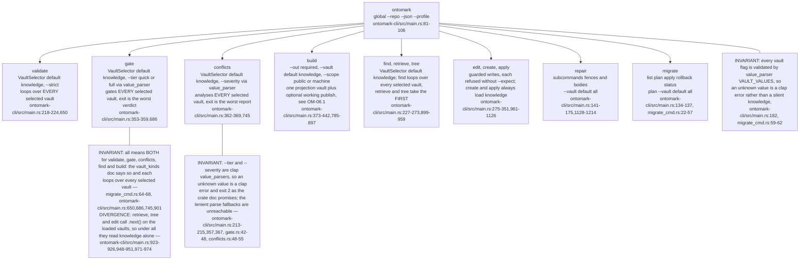
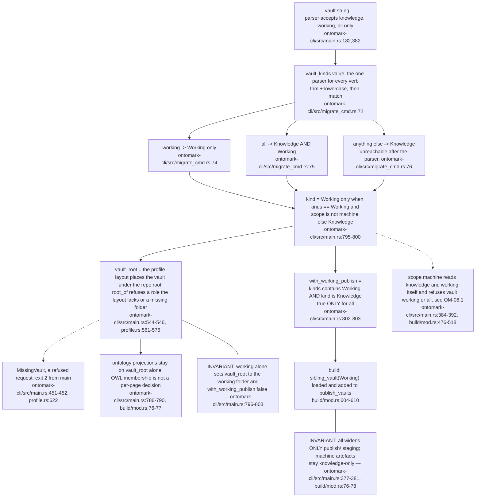
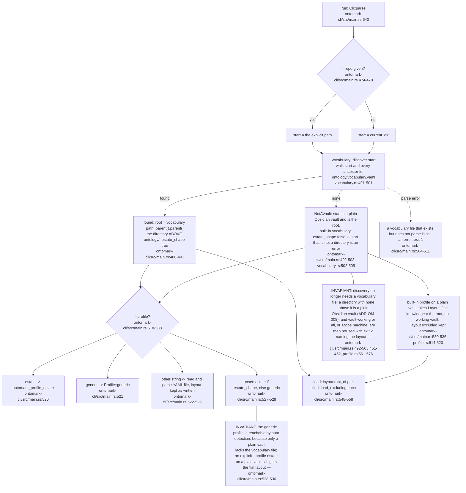
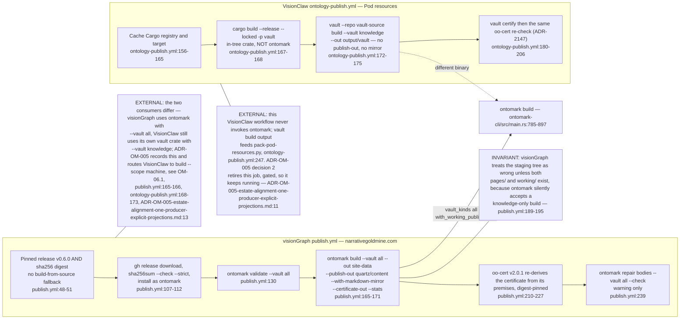
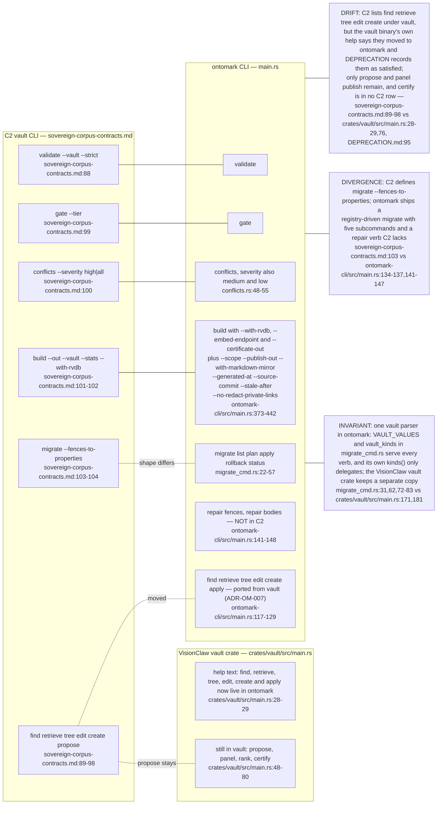

## OM-05.1 Command tree — ten verbs, repair and migrate, three global flags, and which vault each one reads

- `repair` defaults to `all` while `validate`, `gate`, `conflicts`, `build` and the query verbs default to `knowledge`, so the same word means a different scope per verb (`ontomark-cli/src/main.rs:152,169,182,382`).
- DIVERGENCE: `--stats` is documented as "print the counts" but only forces the JSON report, a build-only alias for `--json` (`ontomark-cli/src/main.rs:394,875`).
- INVARIANT: `--profile` reaches every verb through the loaded vaults' layout (`ontomark-cli/src/main.rs:548-558,561-575`), but the conflict analysis itself takes no profile (`ontomark-cli/src/main.rs:749`).

## OM-05.2 `--vault knowledge|working|all` — resolution into vault_root and with_working_publish

- Every verb, `migrate` included, reads `--vault` through the one `vault_kinds` (`migrate_cmd.rs:72-83`): `validate`, `gate`, `conflicts` and `find` loop over every kind via `load` (`ontomark-cli/src/main.rs:548-558,650,686,745,901`), `repair` maps them to layout-placed roots for `scopes_for` (`main.rs:561-575,1129,1170`, `repair.rs:444`).
- DOC-DRIFT: comments say the projections are `knowledge/`'s by definition (`ontomark-cli/src/main.rs:786-787`, `build/mod.rs:76-77`), yet `--vault working` roots the build at the working vault (`ontomark-cli/src/main.rs:796-800`).

## OM-05.3 Exit codes — which error type maps to 0, 1 or 2

```mermaid
flowchart LR
    MAIN["main: run Ok(code) returns code;<br/>Err prints ontomark: and exits 1, except MissingVault which exits 2<br/>ontomark-cli/src/main.rs:444-456"]
    ZERO["0 — success<br/>ontomark-cli/src/main.rs:896,918,1064,1125"]
    ONE["1 — failed check or execution error"]
    TWO["2 — refused operation or invalid argument<br/>ontomark-cli/src/main.rs:5-13,32-36"]
    V1["validate: any error, or warning with --strict<br/>ontomark-cli/src/main.rs:653-654,675"]
    G1["gate: worst verdict.exit_code 0 or 1 over the selected vaults<br/>gate.rs:110-112, ontomark-cli/src/main.rs:701-705,738"]
    C1["conflicts: worst report.exit_code 0 or 1 over the selected vaults<br/>conflicts.rs:119-121, ontomark-cli/src/main.rs:752-756,782"]
    B1["build: written == 0 is an anyhow<br/>error<br/>ontomark-cli/src/main.rs:891-895"]
    R1["repair bodies --check with residue<br/>ExitCode::FAILURE,<br/>ontomark-cli/src/main.rs:1163-1165"]
    ANY["any other Err from<br/>build::run_with, load,<br/>resolve_repo<br/>ontomark-cli/src/main.rs:871,<br/>641-642"]
    S2["SecretsFound — credential on a<br/>published page<br/>build/publish.rs:66,<br/>ontomark-cli/src/main.rs:837-840"]
    O2["OutputCollision — two artefacts<br/>claim one path build/mod.rs:206,<br/>ontomark-cli/src/main.rs:843-846"]
    R2["ReasoningError — definition<br/>reasoner would not finish<br/>reason.rs:481,<br/>ontomark-cli/src/main.rs:849-852"]
    SC2["ScopeConflict or Unsatisfiable —<br/>machine scope misuse, or an<br/>unsatisfiable class<br/>build/mod.rs:282,235<br/>ontomark-cli/src/main.rs:855-864"]
    CP2["CertificateParity — the derivation<br/>certificate does not cover the<br/>classifier's closure (ADR-OM-009)<br/>build/mod.rs:101,<br/>ontomark-cli/src/main.rs:867-870"]
    MV2["MissingVault — a vault role the<br/>layout does not place, for example<br/>vault working on a plain vault<br/>profile.rs:622,<br/>ontomark-cli/src/main.rs:451-452"]
    GW2["create or apply refused by its<br/>guards, nothing written<br/>ontomark-cli/src/main.rs:1010-1021,1070-1081"]
    CL["clap parse failure: bad flag, or a<br/>vault, tier, severity or scope<br/>value outside its list clap<br/>default exit 2,<br/>ontomark-cli/src/main.rs:182,357,367,213"]
    M2["migrate plan not Ready -> 2<br/>migrate_cmd.rs:152-157"]
    M1["migrate apply incomplete, rollback<br/>with conflicts -> 1<br/>migrate_cmd.rs:186,212"]
    MAIN --> ZERO
    MAIN --> ONE
    MAIN --> TWO
    V1 --> ONE
    G1 --> ONE
    C1 --> ONE
    B1 --> ONE
    R1 --> ONE
    ANY --> ONE
    M1 --> ONE
    S2 --> TWO
    O2 --> TWO
    R2 --> TWO
    SC2 --> TWO
    CP2 --> TWO
    MV2 --> TWO
    GW2 --> TWO
    CL --> TWO
    M2 --> TWO
    n1["INVARIANT: build maps six typed errors to 2 by downcast_ref<br/>on the anyhow error, and create, apply, migrate plan and<br/>MissingVault refuse with 2 too,<br/>ontomark-cli/src/main.rs:837-870,1010-1021,1070-1081,451-452"]
    n2["DIVERGENCE: validate, gate and conflicts never return 2 from their<br/>own code (only clap and MissingVault do), so a refusal is<br/>distinguishable only on the writing verbs —<br/>ontomark-cli/src/main.rs:675,738,782"]
    TWO --- n1
    ONE --- n2
```

- `SecretsFound` is checked before validation on purpose so a credential is a code-2 refusal and never swallowed by the generic code-1 validation message (`build/mod.rs:579-589`).
- The `0/1/2` contract is declared in the crate doc, with `1` also covering execution errors, and the doc lists the unsatisfiable class, the machine-scope refusals, the layout refusals and the `create`/`apply` guards under 2 (`ontomark-cli/src/main.rs:5-13,32-36`).
- An unsatisfiable corpus exits 2 through the typed `build::Unsatisfiable`; before the OM-00 reconcile it was an untyped error at exit 1 (`build/mod.rs:743-749`, `ontomark-cli/src/main.rs:861-864`).

## OM-05.4 Repo-root discovery and profile resolution — before any verb runs

- The `--repo` argument is the START of an upward search, not necessarily the root, so `--repo a/b/c` can resolve to an ancestor holding `ontology/vocabulary.yaml` (`ontomark-cli/src/main.rs:474-503`).

## OM-05.5 Two consumers — visionGraph publishes both vaults from a pinned release, VisionClaw builds knowledge in-tree

- Redaction is not a flag in either workflow: visionGraph gets it from the estate profile (`estate/profile.yaml:226`, `build/mod.rs:615-617`) and never passes `--no-redact-private-links`; the legacy `vault` build kept private links (`ontomark-cli/src/main.rs:434-441`).
- The consumer does not pass `--generated-at`, `--source-commit` or `--stale-after`, so `.generation.json` takes the clock and git (`build/mod.rs:63-67`, `publish.yml:165-171`).

## OM-05.6 C2 contract versus the shipped CLI — what C2 lists that ontomark and vault now split between them

- The verbs ontomark leaves out are the forum transport only: `propose` and `panel publish` stay in VisionClaw (`ontomark-cli/src/main.rs:49-50`, `DEPRECATION.md:95`).
- No `BuildArgs` option is parsed and left unused: all fourteen reach `build::Options`, the embedder or the report (`ontomark-cli/src/main.rs:373-442,801-824,875`).
- DIVERGENCE: `--no-redact-private-links` overlays the profile setting `publication.redact_private_links` as a `Some(false)` override rather than a separate behaviour (`ontomark-cli/src/main.rs:815`, `build/mod.rs:84`, `profile.rs:422`).
