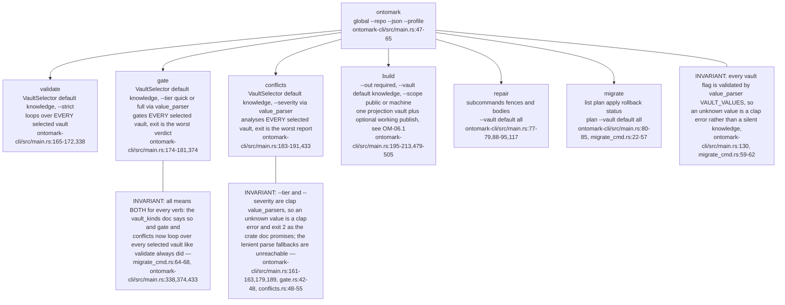
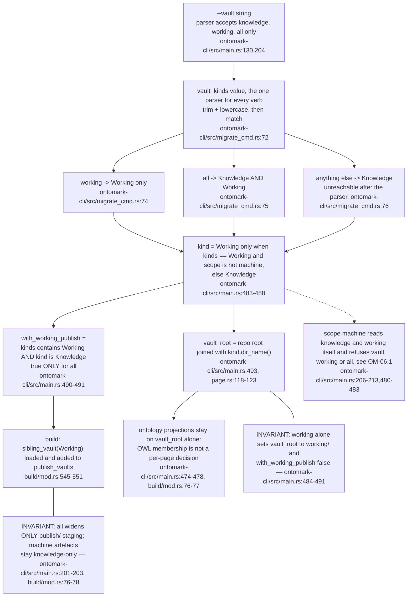
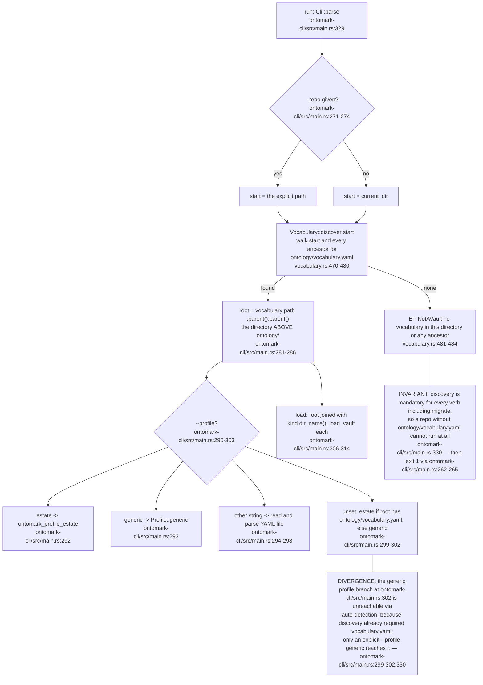
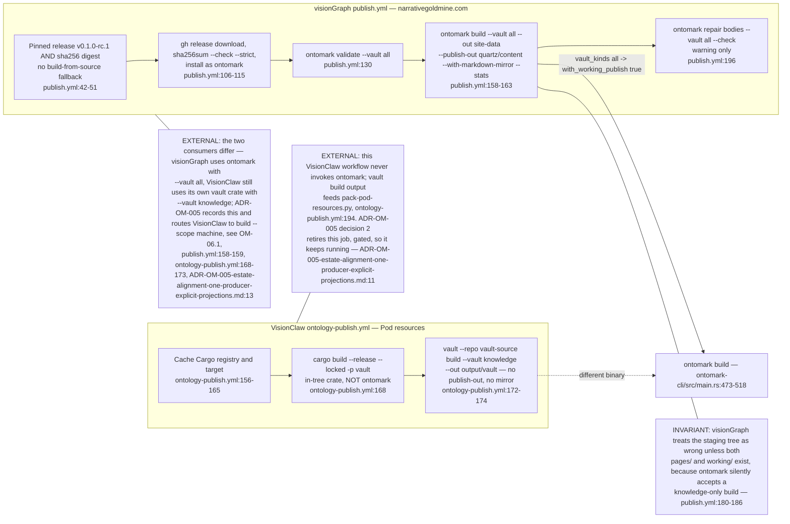
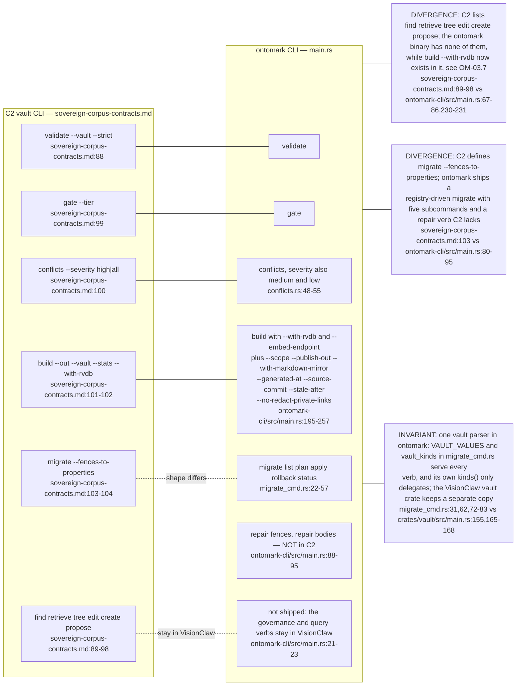

## OM-05.1 Command tree — six verbs, three global flags, and which vault each one reads

- `repair` defaults to `all` while `validate`, `gate`, `conflicts` and `build` default to `knowledge`, so the same word means a different scope per verb (`ontomark-cli/src/main.rs:100,117,130,204`).
- DIVERGENCE: `--stats` is documented as "print the counts" but only forces the JSON report, a build-only alias for `--json` (`ontomark-cli/src/main.rs:214-216,556`).
- DIVERGENCE: global `--profile` is resolved for every verb (`ontomark-cli/src/main.rs:331`) but `conflicts`, `repair bodies` and `repair fences` never consume it (`ontomark-cli/src/main.rs:437,585,629`).

## OM-05.2 `--vault knowledge|working|all` — resolution into vault_root and with_working_publish

- Every verb, `migrate` included, reads `--vault` through the one `vault_kinds` (`migrate_cmd.rs:72-83`): `validate`, `gate` and `conflicts` loop over every kind via `load` (`ontomark-cli/src/main.rs:306-314,338,374,433`), `repair` maps them to directory names for `scopes_for` (`main.rs:581-586,625-630`, `repair.rs:424-435`).
- DOC-DRIFT: comments say the projections are `knowledge/`'s by definition (`ontomark-cli/src/main.rs:474-475`, `build/mod.rs:76-77`), yet `--vault working` roots the build at `working/` (`ontomark-cli/src/main.rs:484-488`).

## OM-05.3 Exit codes — which error type maps to 0, 1 or 2

```mermaid
flowchart TD
    MAIN["main: run Ok(code) returns code;<br/>Err prints ontomark: and exits 1<br/>ontomark-cli/src/main.rs:259-267"]
    ZERO["0 — success<br/>ontomark-cli/src/main.rs:577,621,671"]
    ONE["1 — failed check or execution error"]
    TWO["2 — refused operation or invalid argument<br/>ontomark-cli/src/main.rs:5-13"]
    V1["validate: any error, or warning with --strict<br/>ontomark-cli/src/main.rs:341-342,363"]
    G1["gate: worst verdict.exit_code 0 or 1 over the selected vaults<br/>gate.rs:110-112, ontomark-cli/src/main.rs:389-393,426"]
    C1["conflicts: worst report.exit_code 0 or 1 over the selected vaults<br/>conflicts.rs:119-121, ontomark-cli/src/main.rs:440-444,470"]
    B1["build: written == 0 is an anyhow error<br/>ontomark-cli/src/main.rs:572-576"]
    R1["repair bodies --check with residue<br/>ExitCode::FAILURE, ontomark-cli/src/main.rs:618-620"]
    ANY["any other Err from build::run_with, load, resolve_repo<br/>ontomark-cli/src/main.rs:552, 330-331"]
    S2["SecretsFound — credential on a published page<br/>build/publish.rs:66, ontomark-cli/src/main.rs:524-527"]
    O2["OutputCollision — two artefacts claim one path<br/>build/mod.rs:156, ontomark-cli/src/main.rs:530-533"]
    R2["ReasoningError — definition reasoner would not finish<br/>reason.rs:481, ontomark-cli/src/main.rs:536-539"]
    SC2["ScopeConflict or Unsatisfiable — machine scope misuse, or an unsatisfiable class<br/>build/mod.rs:232,185<br/>ontomark-cli/src/main.rs:542-551"]
    CL["clap parse failure: bad flag, or a vault, tier,<br/>severity or scope value outside its list<br/>clap default exit 2, ontomark-cli/src/main.rs:130,179,189,212"]
    M2["migrate plan not Ready -> 2<br/>migrate_cmd.rs:152-157"]
    M1["migrate apply incomplete, rollback with conflicts -> 1<br/>migrate_cmd.rs:186,212"]
    MAIN --> ZERO
    MAIN --> ONE
    MAIN --> TWO
    V1 --> ONE
    G1 --> ONE
    C1 --> ONE
    B1 --> ONE
    R1 --> ONE
    ANY --> ONE
    M1 --> ONE
    S2 --> TWO
    O2 --> TWO
    R2 --> TWO
    SC2 --> TWO
    CL --> TWO
    M2 --> TWO
    n1["INVARIANT: only build and migrate plan return 2 from code; the five build<br/>refusals are downcast_ref matches on the anyhow error, ontomark-cli/src/main.rs:524-551"]
    n2["DIVERGENCE: validate, gate and conflicts never return 2 from their own<br/>code (only clap does), so refusal is distinguishable only on build —<br/>ontomark-cli/src/main.rs:363,426,470"]
    TWO --- n1
    ONE --- n2
```

- `SecretsFound` is checked before validation on purpose so a credential is a code-2 refusal and never swallowed by the generic code-1 validation message (`build/mod.rs:522-532`).
- The `0/1/2` contract is declared in the crate doc, with `1` also covering execution errors, and the doc lists the unsatisfiable class and the machine-scope refusals under 2 (`ontomark-cli/src/main.rs:5-13`).
- An unsatisfiable corpus exits 2 through the typed `build::Unsatisfiable`; before the OM-00 reconcile it was an untyped error at exit 1 (`build/mod.rs:642-648`, `ontomark-cli/src/main.rs:548-551`).

## OM-05.4 Repo-root discovery and profile resolution — before any verb runs

- The `--repo` argument is the START of an upward search, not necessarily the root, so `--repo a/b/c` can resolve to an ancestor (`ontomark-cli/src/main.rs:271-275`).

## OM-05.5 Two consumers — visionGraph publishes both vaults from a pinned release, VisionClaw builds knowledge in-tree

- Redaction is not a flag in either workflow: visionGraph gets it from the estate profile (`estate/profile.yaml:198`, `build/mod.rs:556-558`) and never passes `--no-redact-private-links`; the legacy `vault` build kept private links (`ontomark-cli/src/main.rs:249-254`).
- The consumer does not pass `--generated-at`, `--source-commit` or `--stale-after`, so `.generation.json` takes the clock and git (`build/mod.rs:63-67`, `publish.yml:158-163`).

## OM-05.6 C2 contract versus the shipped CLI — what C2 lists that ontomark lacks and the reverse

- The missing C2 verbs are a deliberate subset: governance and graph queries stay in VisionClaw (`ontomark-cli/src/main.rs:21-23`).
- No `BuildArgs` option is parsed and left unused: all thirteen reach `build::Options`, the embedder or the report (`ontomark-cli/src/main.rs:195-257,489-512,556`).
- DIVERGENCE: `--no-redact-private-links` overlays the profile setting `publication.redact_private_links` as a `Some(false)` override rather than a separate behaviour (`ontomark-cli/src/main.rs:503`, `build/mod.rs:84`, `profile.rs:411`).
